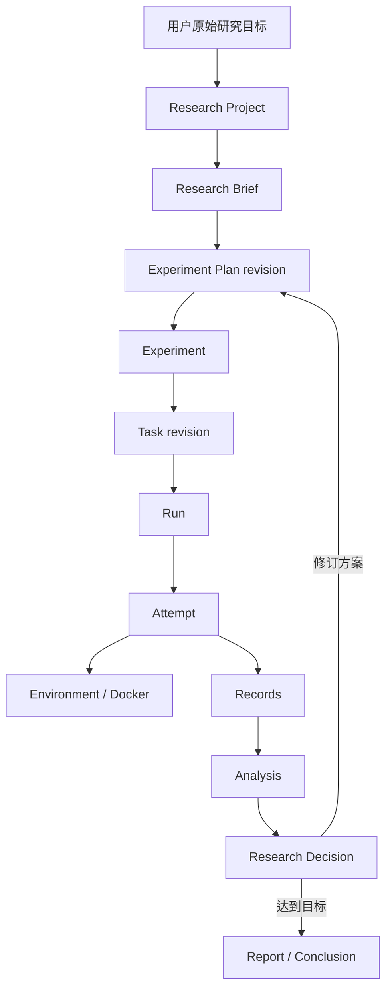
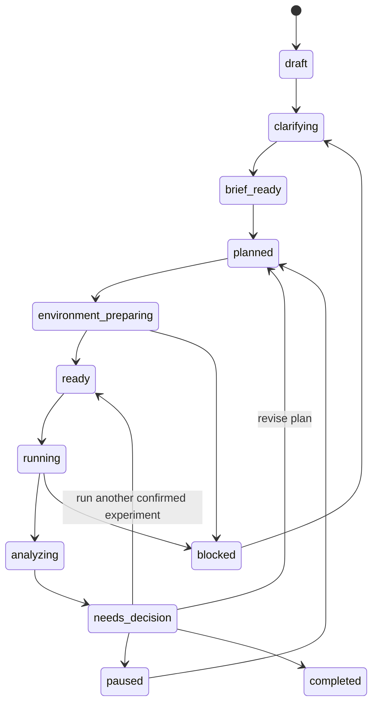
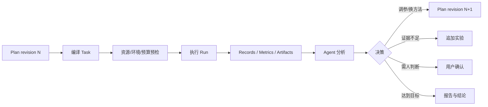
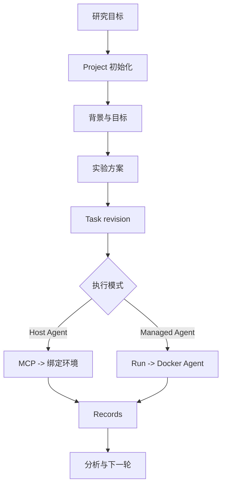
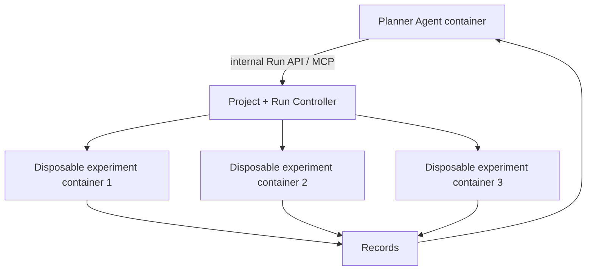

# 0917 设计微调：从研究目标到自动实验迭代

状态：**架构提案，尚未实现**。

本文基于 `main@f8f47f3` 对产品主线进行微调。项目最重要的用户体验不是
“用户先写好 Task，平台再执行”，而是：

> 用户给出一个研究目标，Agent 与用户通过多轮交互补全背景、目标、约束和实验方案，
> 创建可持续的研究项目，然后自动准备环境、执行实验、归档证据、分析结果，
> 再与用户决定下一轮方案。

这个过程同时服务两种模式：宿主机 Agent 通过 MCP 控制容器内科研任务，
以及平台托管的 Agent 在 Docker 中执行任务。两种模式共用 Project 初始化、
研究规划、Task 生成、Records 和实验迭代契约。

## 1. 当前设计缺失什么

当前已有两个相关但不完整的概念：

1. Web 中的 Project catalog 可以保存名称、目标、状态、里程碑以及 Task/Run 关联；
2. Tasks 模块的 `create_research_draft()` 可以从已经存在的 instruction 和可选 data
   创建 Task 草稿，并指出输出、资源、评测等未解决字段。

它们尚不能完成：

- 从一句自然语言目标创建研究工作区；
- 建立稳定的 `docs/`、`code/`、`data/`、`runs/` 等目录；
- 保留用户原始目标，同时区分资料事实、Agent 推断、假设和待确认项；
- 使 Agent 通过多轮对话形成可追溯的 Research Brief 和实验方案；
- 将实验方案编译为可执行 Task、资源请求和环境提案；
- 管理“执行—分析—决策—下一轮”的研究循环；
- 在 Agent 会话、平台进程或容器中断后恢复整个项目上下文。

因此，项目初始化不应继续被当成 Web 表单或 Task 的一个字段，而应成为
独立、可版本化、可恢复的研究项目能力。

## 2. 调整后的产品主线



这条主线中的各层含义如下：

| 对象 | 生命周期 | 职责 | 是否可变 |
| --- | --- | --- | --- |
| Project | 整个研究周期 | 承载原始目标、背景、方案、实验、结果和决策 | 可变，使用 revision |
| Research Brief | 立项和重大方向修订 | 问题、假设、范围、约束和成功标准 | 保留历史 revision |
| Experiment Plan | 一轮或多轮实验 | 基线、变量、方法、指标、资源、停止条件 | 不覆盖，新建 revision |
| Experiment | 一个可比较实验 | 一组明确的控制变量、参数和预期证据 | 确认后冻结 |
| Task revision | 一个可执行快照 | Agent 可见材料、输入输出、工具、环境和执行规则 | 不可变 |
| Run | 一次调度请求 | 关联 Task、Agent、资源请求和策略 | 状态可变，请求冻结 |
| Attempt | 一次真实执行 | 容器、进程、失败、提交、评测和清理 | 只追加执行证据 |
| Analysis | 一轮结果解读 | 引用 Run、指标和 Artifact 得出观察 | 保留修订和来源 |
| Decision | 一次研究选择 | 继续、修订、暂停、回退或结束 | 不可变决策记录 |

关键边界是：**Project 表达长期研究过程，Task 表达一个可执行快照，Run
表达一次执行请求。** 一个 Project 可以产生多个 Plan、Experiment、Task 和 Run。

## 3. Projects 应成为正式业务模块

当 Project 只有名称、目标和里程碑时，将它放在小型 catalog 中是可以的。
当它还要负责工作区初始化、Brief、Plan、Experiment、分析和恢复时，它已经
成为独立业务领域。建议增加：

```text
src/agent_infra/projects/
├── __init__.py
├── api.py                 # 项目公共契约
├── models.py              # Brief、Plan、Experiment、Analysis、Decision
├── initializer.py         # 安全、幂等的目录初始化
├── service.py             # 项目生命周期和 revision
├── planning.py            # 研究规划工作流
├── compiler.py            # Experiment -> Task draft/revision
├── templates/             # 目录与文档模板
├── prompts/               # provider 无关的研究提示源文件
└── local.py                # 本地 Project 存储实现
```

模块职责：

- Projects 创建和管理研究项目，产生 Experiment 与 Task 草稿；
- Tasks 校验和冻结可执行任务，不管理整个研究生命周期；
- Runs 执行已确认的 Task，不自己决定研究方向；
- Environment 准备工作区和运行环境，不编写科研方案；
- Records 保存执行证据和产物，不把 Agent 生成的文字自动当成用户结论；
- Bootstrap 组装 Projects、Tasks、Runs 和 Records 的具体实现。

建议的公共用例如下。名称是提案，尚不是已实现 API：

```text
preview_project_init(goal, destination)
create_project(spec, expected_empty_destination)
get_project(project_id)
update_research_brief(project_id, expected_revision, patch)
create_plan_revision(project_id, brief_revision, plan)
add_experiment(project_id, plan_revision, experiment)
compile_experiment_task(project_id, experiment_id)
link_run(project_id, experiment_id, run_id)
record_analysis(project_id, analysis)
record_decision(project_id, decision)
archive_project(project_id)
```

`runs` 不应反向依赖 `projects`。Run 只在请求和事件中携带 `project_id`、
`experiment_id` 等关联标识；Projects 通过 Runs/Records 公共查询接口建立视图。

## 4. 项目工作区协议

初始化器应由代码按稳定模板创建工作区，而不是让 Agent 每次即兴设计目录。
建议首版结构：

```text
research-project/
├── project.yaml
├── README.md
├── .gitignore
├── docs/
│   ├── background.md
│   ├── research-goal.md
│   ├── research-plan.md
│   ├── decisions/
│   ├── analyses/
│   └── reports/
├── code/
│   ├── README.md
│   ├── src/
│   └── tests/
├── configs/
│   ├── experiments/
│   ├── resources/
│   └── environments/
├── data/
│   ├── README.md
│   ├── manifests/
│   ├── raw/
│   └── processed/
├── runs/
│   ├── README.md
│   └── index.jsonl
├── artifacts/
│   └── README.md
└── .agent-infra/
    ├── state.json
    └── locks/
```

### 4.1 `project.yaml`

`project.yaml` 是可审查、可版本化的项目入口，保存稳定身份和对其他对象的引用。
用户最初输入必须原样保留，Agent 精炼后的目标使用独立字段：

```yaml
schema_version: 1
project_id: long-context-position-encoding
title: Long-context position encoding study
status: clarifying

goal:
  original: >
    研究长上下文训练中，不同位置编码方法对性能和显存的影响。
  refined: null

constraints:
  time_budget: null
  compute_budget: null
  data_policy: local_only

current_brief_revision: null
current_plan_revision: null
experiments: []
tasks: []
runs: []
```

不建议把完整运行事件、日志和 Artifact 列表写进 `project.yaml`，否则文件会持续膨胀并
容易产生并发冲突。它只保存当前 revision 和稳定引用，详细证据仍在 Records。

### 4.2 `docs/`

`docs/` 保存人和 Agent 都能阅读的研究上下文：

- `background.md`：背景、已知方法、引用和待验证信息；
- `research-goal.md`：问题、假设、范围、非目标和成功标准；
- `research-plan.md`：当前生效方案的可读投影；
- `decisions/`：为什么改方法、参数、数据或资源；
- `analyses/`：基于特定 Run 和 Artifact 的分析；
- `reports/`：阶段总结和最终报告。

每个研究陈述都应能区分以下来源：

| 来源 | 含义 | 能否直接当成事实 |
| --- | --- | --- |
| `user_confirmed` | 用户明确提供或确认 | 可作为项目约束 |
| `sourced` | 有可追溯资料或数据支持 | 在来源适用范围内可以 |
| `agent_inference` | Agent 根据上下文推断 | 不可，需标明推断 |
| `assumption` | 为了继续规划而暂定 | 不可，需验证或用户确认 |
| `unknown` | 目前不知道 | 不可自动填造 |

### 4.3 `data/`

大型数据不应默认进入 Git。`data/` 主要保存数据说明、manifest、版本、摘要、
外部路径/对象存储引用和小型样例。`raw/` 与 `processed/` 默认在 `.gitignore`中，除非用户明确将小数据纳入版本管理。

### 4.4 `runs/` 和 `artifacts/`

Records 是完整执行证据的权威来源。项目目录中的 `runs/` 只保存人可读索引或导出摘要：

- Run ID 与 Records 引用；
- Task/Plan/Experiment revision；
- 核心配置摘要；
- 用户标记的基线、候选最佳或失败样例；
- 对应 Analysis/Decision 文档。

完整日志、模型权重和大型输出不复制到 Git 工作区。`artifacts/` 用于可选的
受控导出或人工选定结果，默认忽略大文件。

### 4.5 `.agent-infra/`

该目录保存平台的本地可写状态、锁和恢复信息，默认不进入 Git。人类可审查且
需要协作的内容放在 `project.yaml`、`docs/` 和 `configs/`；平台临时状态不混入研究文档。

## 5. 初始化和规划交互

初始化不应要求用户一次填完长表单。它应是一个可暂停、可恢复的对话工作流。

### 5.1 捕获原始目标

例如用户输入：

> 我想研究长上下文训练中，不同位置编码方法对性能和显存的影响。

平台先创建 Project 草稿，原样保存输入，分配 `project_id` 和 revision。
此时不声称研究方案已完成。

### 5.2 产生初步理解和缺口

Agent 产生结构化草案：

- 可能的研究背景；
- 核心问题与子问题；
- 初步假设；
- 可选基线和比较方法；
- 可能的评价指标；
- 所需数据、代码和资源；
- 当前未知项、假设和风险。

每项都携带 provenance，不把模型常识自动升格为已确认项目事实。

### 5.3 询问高价值问题

Agent 不应把 schema 中每个空字段都变成问题。它应优先询问会明显改变实验
方案、成本或结论的信息，例如：

- 目标是探索性结果、内部基线还是可发表实验？
- 已有哪些数据、代码、预训练模型和先前结果？
- 更关心精度、速度、显存、稳定性还是成本？
- 时间、GPU、显存、费用和网络访问有什么限制？
- 哪些外部数据或服务允许使用？
- 什么证据才算达到目标？

对低风险、可逆的选项，Agent 可以给出默认建议并允许用户修改：

> 建议先用一个较小模型和两张 GPU 运行缩小实验，验证指标链路后再扩大。

建议不要为了“尽可能自动”而隐藏成本很高或会改变研究结论的默认值。

### 5.4 形成 Research Brief

用户确认后，Brief 至少包含：

- 原始研究目标和精炼后的问题定义；
- 背景与已知证据；
- 研究假设；
- 研究范围和明确的非目标；
- 数据、算力、时间、费用和合规约束；
- 成功标准、最低可接受结果和停止条件；
- 未解决问题与风险。

### 5.5 生成实验方案

一个 Experiment 建议包含：

```yaml
experiment_id: baseline-rope
title: RoPE baseline
hypothesis: RoPE provides the baseline quality and memory profile

method:
  summary: Train the baseline configuration with RoPE
  code_revision: null

variables:
  positional_encoding: rope

controls:
  model_size: 1b
  dataset_revision: null
  seed: 42

metrics:
  - validation_loss
  - tokens_per_second
  - peak_gpu_memory

resources:
  gpu_count: 2
  gpu_memory_min_gib: 20
  cpu_cores: 8
  memory_gib: 64

environment:
  template: pytorch-cuda
  status: unresolved

stop_conditions:
  max_steps: 10000
  max_runtime_hours: 8
  abort_on_nan: true

outputs:
  - metrics.json
  - training.log
  - checkpoints/
```

实验方案应先成为 Plan revision，然后编译成 Task，不应直接在一次对话中
边说边执行，从而丢失实验边界和可复现信息。

## 6. 代码工作流与 Skill 的分工

建议采用**代码保证工作流，Skill 驱动研究推理**的混合方案。

### 6.1 必须由代码保证的内容

- Project/Brief/Plan/Experiment schema 和 revision；
- 固定的项目目录模板；
- 安全路径、目标根目录和符号链接校验；
- 幂等初始化和“不覆盖已有文件”规则；
- 状态迁移、恢复和并发 revision 冲突；
- Task/Run/Records 的稳定关联；
- 用户原始输入、Agent 推断和外部资料的 provenance；
- 资源、费用、网络、凭据和破坏性操作的策略门；
- Docker 构建、执行、超时、取消、清理和记录；
- 数据、凭据、日志、产物和 Git 的边界。

这些不能仅靠 prompt，否则更换 Agent、对话压缩或进程重启后就无法保证一致。

### 6.2 适合由 Skill 驱动的内容

- 理解自然语言研究目标；
- 识别影响方案的缺失信息；
- 提出少量高价值问题；
- 起草研究背景和子问题；
- 检索和整理相关工作；
- 提出假设、基线、变量、指标和对照实验；
- 根据规模估算初步资源；
- 阅读日志、图表、指标和产物；
- 起草结果分析和下一轮建议；
- 生成阶段总结和最终报告。

Skill 不是数据库、状态机或权限层。Skill 只指导 Agent 如何使用 Projects、
Tasks、Runs、Environment 和 Records 的受控工具。

### 6.3 不应将权威流程绑定到 Codex Skill

可以先实现 Codex Skill 验证真实交互，但研究工作流的源定义应跟随产品代码，例如：

```text
src/agent_infra/projects/prompts/research-planner.md
src/agent_infra/projects/workflows/research-lifecycle.yaml
```

之后由 Agent adapter 或插件层适配为：

- Codex Skill；
- Claude Code Skill/command；
- DSH profile；
- 自研 Agent system prompt/workflow；
- Web 对话工作流。

这样可以替换 Agent，而 Project 语义、状态和证据不变。

## 7. 研究生命周期和状态机

建议项目工作流使用可恢复状态，而不是依赖一次长对话：



状态只表达工作流位置，不用它掩盖执行结果。例如一次 Run 失败不代表
Project 失败；Project 可以进入 `needs_decision` 分析失败原因。

每个状态迁移应记录：

- 原状态和目标状态；
- 发起者（用户、Agent 或平台）；
- 触发原因；
- 所用 Brief/Plan/Task revision；
- 关联 Run、Artifact、Analysis 和 Decision；
- 用户审批或 autonomy policy 依据。

## 8. 从 Experiment 到 Task

Project 层不绕过现有 Tasks 契约。Experiment 经用户或策略确认后，由 compiler
转换为 Task 草稿：

| Experiment 内容 | Task 字段 |
| --- | --- |
| 方法、执行步骤和实验问题 | instructions |
| 数据、代码、参考资料 | materials |
| 所需外部服务或工具 | tools |
| CPU/GPU/内存范围 | resource intent |
| 依赖、镜像、网络和可写路径 | environment |
| 指标、checkpoint、日志和报告 | outputs |
| 科研人工查看或可自动校验的规则 | evaluation |
| 超时、重试、预算和中止条件 | execution policy |

编译后先运行当前 Tasks 校验。尚未解决的资源、环境、工具或输出保持
`unknown`/`unspecified`，不由 compiler 编造。只有 Task 达到对应运行模式的就绪条件后才能冻结并提交 Run。

## 9. 自动环境准备

当前 Docker 执行内核需要调用者事先提供已存在的 `solver_image`，还不能根据项目
自动构建镜像。因此“Agent 和任务都在 Docker”的运行内核已有一部分，
但“从研究方案自动得到可信镜像”仍是明确缺口。

建议将环境准备建模为：

```text
EnvironmentIntent
  -> EnvironmentProposal
  -> user/policy review
  -> EnvironmentLock
  -> image build
  -> smoke verification
  -> limited repair
  -> immutable image digest
```

### 9.1 优先级

1. 优先使用用户指定的已有镜像；
2. 其次匹配平台内置模板，例如 Python CPU、PyTorch CUDA、JAX CUDA；
3. 再保留 benchmark 原生 Dockerfile/构建流程；
4. 只在前三者不适用时，由 Agent 生成可审查的 Dockerfile 提案。

### 9.2 构建与验证边界

- Dockerfile、依赖锁文件、基础镜像 digest 和构建参数需要归档；
- 凭据通过专用 secret 机制使用，不写入 Dockerfile、镜像层或普通日志；
- 构建前执行路径、引用、权限和已知危险配置检查；
- 构建后用小型 smoke test 检查进口、依赖、GPU 可见性和输出目录；
- 自动修复必须限制次数、时间和构建网络预算；
- 成功后 Run 只使用不可变 image digest，不仅记录 tag；
- 无法验证时状态是 `blocked`，不将“Docker build 成功”等同“实验环境正确”。

## 10. 实验执行、分析和迭代

一次完整循环建议如下：



Analysis 不应只包含 Agent 的自然语言判断。它需要引用可追溯证据：

```markdown
## Observation

学习率 3e-4 的运行在 step 4200 后不稳定。

## Evidence

- Run: run-20260917-003
- Task revision: sha256:...
- validation_loss: 2.31 -> 4.87
- gradient_norm 连续 160 step 超过阈值
- Artifact: metrics.json@sha256:...

## Interpretation

当前证据支持“该配置不稳定”，但尚不能区分是学习率还是数值精度造成。

## Proposed next experiment

保持其他变量不变，对比 1e-4 和 2e-4，并增加 overflow 指标。
```

结论的强度不能超过证据。失败 Run 也是研究证据，不应被平台静默删除或
仅标记为“重试成功”。

## 11. 人机协作与自治策略

用户希望只做少量控制，但不宜把所有事情都改为每步确认。建议为每个 Project
保存 `AutonomyPolicy`：

```yaml
autonomy:
  planning: propose_then_continue
  filesystem: project_root_only
  max_parallel_runs: 2
  max_gpu_count_without_confirmation: 1
  max_runtime_hours_without_confirmation: 2
  max_cost_without_confirmation: null
  network_download: ask
  new_credentials: ask
  destructive_changes: ask
  final_conclusion: user_confirmed
```

默认建议在以下节点停下来请用户决策：

- 首次 Research Brief 和首版实验方案；
- 超出项目 GPU、时间、费用或并发预算；
- 使用新的网络目标、数据源或凭据；
- 创建首个新环境或无法通过 smoke test；
- 删除数据、覆盖代码、丢弃未归档产物；
- 宣布研究完成或对外发布结论。

在已确认计划和预算内的普通命令、日志查询、小文件修改和可逆重试可以自动进行。

## 12. 两种运行模式

Project 初始化和研究规划是两种模式共用的前半段：



### 12.1 模式 A：宿主机 Agent

宿主机上的 Codex/Claude/DSH 维护用户对话和 Project 上下文，通过 MCP：

- 读取和修订 Brief/Plan；
- 创建 Experiment 和 Task；
- 请求资源和环境；
- 启动容器内长作业；
- 读取增量日志、指标和 Artifact；
- 停止作业；
- 生成 Analysis 和下一轮方案。

这是日常科研的主要模式。当前缺少 MCP Gateway、环境绑定、后台 Job、增量日志、
重连和宿主机 Agent 轨迹归档。

### 12.2 模式 B：Agent 与任务在 Docker 中

当前 `LocalRunService` 能够在一次 Run 中启动容器 Agent，收集结果并可选评测，
但这是“一次 Task 的执行循环”，还不是“一个 Project 的多轮研究循环”。

不建议让一个临时求解容器永久控制后续容器，也不应把 Docker socket 给它。
即使希望“所有 Agent 都在 Docker”，也建议使用一个持久的 Planner/Controller Agent：



Planner 容器通过内部 Run API 或 MCP 请求新实验，Environment 仍由受信控制面创建
一次性实验容器。Planner 重启后从 Project、Plan 和 Records 恢复，而不依赖容器内未持久的对话记忆。

## 13. 恢复、并发和失败边界

### 13.1 幂等初始化

`create_project` 应使用唯一操作 ID 和预览结果。重试同一请求不得创建第二个项目；
如果目标目录非空，默认拒绝，不覆盖用户文件。

### 13.2 revision 和并发修改

Brief、Plan 和项目元数据修改携带 `expected_revision`。如果另一个 Agent 或用户已修改，
平台返回冲突，调用者重新读取并语义合并，不执行 last-write-wins。

### 13.3 Agent 和控制服务重启

可恢复上下文来自 Project manifest、最新 Brief/Plan revision、未决项、活跃 Run 和 Records，
不将聊天窗口作为唯一状态来源。会话历史可以是辅助证据，但不能替代结构化项目状态。

### 13.4 执行失败

- 环境构建失败：保留 build 证据，限制自动修复，然后进入 `blocked`；
- 资源不足：保留原请求，给出调整建议或进入等待队列；
- Run 失败：保留 Attempt，先分析失败类型，不无限自动重试；
- 分析失败：不影响原始 Records，可用另一个 Agent 重新分析；
- 清理失败：不将 Run 标记为完全结束，资源不提前释放。

## 14. 建议实施顺序

### P0：Project 契约和初始化器

实现：

- `ProjectDefinition`、`ResearchBrief`、`ExperimentPlan` 和 `ExperimentSpec`；
- 工作区模板和 `.gitignore`；
- preview/create/get/update 契约；
- 安全路径、幂等、不覆盖和 revision 检查；
- 现有 Web Project catalog 到新 Project ID 的迁移或适配边界。

验收：在一个空目标目录中生成完整骨架，重试不重复创建，非空目录不被覆盖，
新会话可以从 manifest 恢复项目。这一阶段不需要 Docker 或真实模型。

### P1：Research Planning workflow 和首个 Codex Skill

实现：

- provider 无关的规划 prompt/workflow；
- Project 状态读取与结构化写入工具；
- 高价值问题、provenance 和用户确认规则；
- Codex Skill 或等价接入；
- Brief 和 Plan revision 的可读 Markdown 投影。

验收：从一句目标开始，经有限轮交互产生用户确认的 Brief 和至少一个实验方案；
所有未知和 Agent 推断清楚标记。

### P2：Experiment -> Task compiler

实现 Experiment 到当前 Task schema 的转换、缺口检查和冻结。

验收：一个已确认 Experiment 产生可由 Tasks loader 读取的 manifest；未解决字段保留
原状态，不伪造评测、工具或资源要求。

### P3：自动环境提案和构建

先实现已有镜像和少量可信模板，再增加 Agent 生成 Dockerfile、审查、smoke test 和有限修复。

验收：从一个小型 Experiment 生成可审查提案，构建后记录 image digest，通过
真实 Docker smoke test；失败时保留证据并有界地停止。

### P4：研究循环控制器

在当前 Run 内核之上实现持久后台控制、Analysis/Decision 关联、预算和 autonomy policy。

验收：从 Plan 启动实验，执行后产生引用真实 Records 的 Analysis，再在用户确认后
创建新 Plan revision 和下一个 Task。

### P5：两种 Agent 接入

- 宿主机模式：MCP、环境绑定、后台 Job、增量日志、停止和重连；
- 托管模式：持久 Planner Agent 通过内部 API 创建一次性实验 Run；
- 两者使用同一 Projects/Tasks/Runs/Records 契约。

验收：对同一小型研究 Project，宿主机 Agent 和托管 Planner 都能恢复状态、启动实验、
读取证据并提出下一轮，且不直接获得 Docker socket。

## 15. 首版端到端验收场景

建议选择一个不需要大模型训练的小型科研任务，验证产品链路：

1. 用户输入一句研究目标；
2. 系统创建项目目录和 `project.yaml`；
3. Agent 提出不超过 3–5 个关键问题；
4. 用户确认 Brief 和第一版方案；
5. 系统生成两个可对比 Experiment 和 Task；
6. 系统使用已有 CPU 镜像或安全模板准备环境；
7. 两个 Run 产生指标和 Artifact；
8. Agent 产生引用实际 Run/Artifact 的对比分析；
9. 用户接受、修改或拒绝下一轮建议；
10. 新会话可以从文件和 Records 恢复到相同研究状态。

验收时需要分开证明：

- 目录和状态初始化是幂等的；
- Agent 的研究内容与结构化状态一致；
- 环境是真实构建/使用并通过 smoke test 的；
- Run 真实执行且资源、取消、清理可观察；
- Analysis 引用实际证据，不是 fixture 或虚构结果；
- 过程在 Agent 断开后可恢复。

## 16. 与当前设计的兼容性

这次微调不推翻已有 Agent、Tasks、Resources、Environment、Run 和 Records 边界。
它在这些模块之上补充一个面向用户的长期研究层：

```text
Projects
  -> Tasks
  -> Runs
  -> Resources + Agent + Environment
  -> Records
  -> Projects analysis/decision
```

需要后续调整的地方包括：

- 将现有 Web Project catalog 从纯 JSON 记录升级为稳定 Project 契约；
- Project 关联 Task 使用 `task_id + revision + digest`，不继续依赖绝对路径哈希；
- Run 请求和 Records 事件增加稳定 Project/Experiment 关联；
- Web 项目页增加 Brief、Plan、Experiment、Analysis 和 Decision；
- 开发顺序将 Project 初始化和研究规划提到用户入口的前置位置；
- 后续通过 ADR 确认 Projects 作为新一级模块及依赖图变更。

实施前仍需在 ADR 中决定三个关键问题：

1. `project.yaml` 和 Project store 谁是权威状态，以及双向同步规则；
2. 项目工作区是否由平台统一管理，还是允许关联用户已有仓库；
3. Planner Agent 的长期会话、重启恢复和预算结算边界。

在这三项确认前，可以先实现不依赖其最终答案的 Project schema、目录预览、
安全初始化和研究规划原型。
