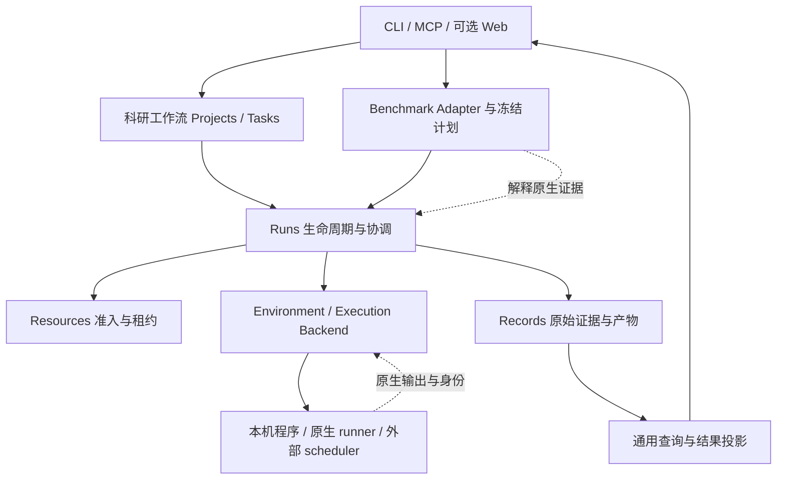

# 0926-1717：任意 Benchmark 的接入与监测，以及 infra 的抽象、模块化和精简建议

日期：2026-09-26，Asia/Shanghai。文件名前缀按本次讨论要求保留。

状态：**架构审阅与建议，未批准为实施计划；本次不修改接口或运行行为。**

主基线：本地已集成 `main` 的 `b7079f4c3226460639104186bddb38131dd6b216`。另读 `feat/tb-science-codex` 的 `99c8450` 作为未合并工作的补充证据；不会把它写成 main 已交付能力。

承接上一轮需求调研 `da59eb4` 中的 `docs/product/scientific-agent-needs-2026-09.md`；该文仍在独立文档分支。本文专门回答架构边界，不重复社区需求索引。

阅读依据：[项目状态](../project-status.md)、[现有 Benchmark 架构](benchmark-integration-layer.md)、[已采纳的协议/执行分离 ADR](../adr/20260922-benchmark-protocol-execution.md)、[0926 当前调用链](../implementation/0926-framework-and-benchmark-scheduling.md)。源码链接均指本文所在仓库版本；后续版本需要重新核对。

本次范围与检查见[任务记录](../changes/20260926-framework-abstraction-6d91f4.md)。

## 1. 我对这个想法的理解与判断

你希望 infra 成为一个稳定底座：每来一个新 benchmark，只需告诉 Codex 上游仓库、固定版本和接入接口，让它实现一个适配包，就能复用已有的提交、资源管理、监测、取消、日志、产物和展示，而不用修改整个框架。

**这个方向是对的，而且当前 infra 已经有相当一部分基础。下一步应把已有扩展点收敛成真正稳定、易实现、能验收的契约。**

更准确的产品承诺应当是：

> 在已支持的执行环境内，新 benchmark 通过独立适配包接入；遇到新执行环境，再增加可复用的 backend。平台统一管理运行事实，benchmark 保留自己的任务与评分规则。

这里有三个不同问题：

| 问题 | 主要由谁解决 | 是否每个新 bench 都要重新实现 |
| --- | --- | --- |
| 这个 benchmark 怎样选题、运行、评分、汇总？ | Benchmark adapter，优先委托原生 runner/scorer | 要做特定映射，但尽量不重写原生逻辑 |
| 怎样可靠启动、找到、监测、停止这类工作？ | Execution backend，例如本机进程、原生容器、外部 scheduler | 相同执行形态应复用；遇到新形态才补 |
| 怎样排队、记账、归档、展示和继续查询？ | infra 的 Runs / Resources / Records 与通用读模型 | 不应该因新增 bench 而重写 |

“任意”意味着**可扩展**，不意味着只给一个网址就自动具备全部能力。闭源远程评测、GUI 模拟器、物理实验设备和不暴露日志的服务，都有自己的接入上限。系统必须能够明确说“能看到进程状态，但拿不到内部步骤”，而不是制造统一的假进度。

对整个框架的判断：**模块划分总体合理，实用基础已经存在；用户入口与扩展契约还不够简洁一致。最需要的是补齐边界、复用执行事实和减少接入步骤，不是重新规划一套目录或再造通用 Agent 框架。**

## 2. 当前已经实现了什么，离设想还有多远

### 2.1 用户设想与现有代码的对应关系

| 设想 | 已有实现 | 当前边界 |
| --- | --- | --- |
| 留一套接口给不同 bench 实现 | [BenchmarkAdapter](../../src/agent_infra/benchmarks/api.py)：`discover / plan / validate` | 这是无执行副作用的规划接口 |
| 独立安装，不改核心注册表 | [AdapterRegistry](../../src/agent_infra/benchmarks/registry.py)：固定包/version/entry point、显式启用 | 包是可信 Python 代码；启用配置不是代码沙箱 |
| 将原生命令交给 infra | [BenchmarkExecutionAdapter](../../src/agent_infra/benchmarks/execution_api.py)：`invocation` | 返回命令、输出位置和边界；不在规划时启动工作 |
| 不同执行方式有共同生命周期 | [ExecutionBackend](../../src/agent_infra/environments/execution_api.py)：六个生命周期方法 | 进程、容器子任务和 scheduler 的覆盖范围各有不同 |
| 原生结果转成可读结果 | 同一执行扩展中的 `interpret` | 返回 `dict[str, Any]`；强类型 SDK 结果尚未贯通实际运行 |
| 通用排队、对账、取消和归档 | [BenchmarkExecutionService](../../src/agent_infra/runs/benchmark_execution.py)、Resources、Records | 已有持久队列和恢复；不能等同所有科研入口都有同样能力 |
| Codex 照着规范写新适配包 | [开发指南](../development/benchmark-adapters.md)、[规划模板](../../examples/benchmark-adapter/)、[执行模板](../../examples/benchmark-execution/) | 已能起步；通用验收 helper 主要覆盖规划，监测/结果契约仍需补强 |
| 多个 benchmark 共享一个运行时 | [TB-Science 包](../../adapters/tb-science/) 使用独立 [Harbor runtime 包](../../adapters/harbor-runtime/) | 这是正确的现成例子，应优先沿用 |

因此，不应再新建一个同义的 `UniversalBenchmarkManager` 或另一套 plugin registry。应在现有 SDK 和执行扩展上继续工作。

### 2.2 当前真正执行的原子单位

[prepare_execution](../../src/agent_infra/benchmarks/execution.py) 目前只接受 **一个 WorkUnit、一个 native-owned Phase**。SDK 可以表达多个阶段，不表示平台已经有通用 DAG 执行器。

这不一定是缺陷。一个 native Phase 可以包含原生求解、评测、多个有序 episode，或者一个完整 scheduler job。只要内部协议由原生 runner 正确执行，外层没有必要再调度一次。

四个现有适配器很好地说明了为什么不能统一成“每道题启动一次 Docker”：

| 现有适配器 | 原子单位/执行方式 | 必须留给原生协议的部分 |
| --- | --- | --- |
| [ASI-Bench](../../adapters/asi-bench/) | 公开单实例，原生 CLI 与 Docker 子容器 | 提示级别、产出位置、公开评分、正式提交边界 |
| [TB-Science](../../adapters/tb-science/) | Harbor 原生 trial，独立 verifier | solver/verifier 材料和网络边界、任务时钟、原生 rewards |
| [PAST-Bench](../../adapters/past-bench/) | 完整 family 的 persistence on/off 配对序列 | episode 顺序、fresh session、状态传播和配对聚合 |
| [PostTrainBench](../../adapters/posttrain-bench/) | 一个完整训练 trial / HTCondor job | 训练过程、目标模型、judges、原生预算与模型交接 |

这里比较的是源码表达与职责，不是四者都已经完成真实模型、全套或官方验收。特别是 PAST 和 PostTrain 的工程验证不能代替真实运行。

## 3. “监测任意 bench”到底能统一到哪一层

### 3.1 需要把五种监测分开

| 监测层 | 可以统一提供的内容 | 必需证据/接入点 | 不能自动推断的内容 |
| --- | --- | --- | --- |
| 执行生命周期 | 是否提交、排队、运行、结束；退出码；取消和清理 | 持久 operation ID、原生 job/container/process 身份、backend 对账 | 启动脚本退出不一定代表远端训练结束 |
| 资源 | 申请量、授权量、实际限额、采样使用量 | 租约、scheduler allocation、Docker inspect/stats 或进程采样 | 父进程 CPU 不等于子容器 CPU；采样值不等于绝对峰值 |
| 任务进展 | 当前 native stage、已完成单位、训练 step | 原生事件/API/结果文件；或版本固定的日志解析 | 没有总量就没有可靠百分比；无新日志不等于卡死 |
| Agent 行为 | 已公开的消息、工具调用、原生会话和用量 | Agent 原生 JSONL/ATIF/其他可获得轨迹 | 不能还原未暴露的内部状态、未记录的调用或完整计费 |
| 评测结果 | 原始分数、方向/单位、失败、覆盖、聚合依据 | 原生 scorer/result 文件及来源位置 | 进程成功不等于答对；单项分数不等于官方 suite 分数 |

当前 `ExecutionObservation` 已有生命周期、增量字节、cursor/EOF、清理、usage/allocation；它**没有通用的任务阶段、进度或多来源观测覆盖模型**。部分深层信息在适配器自己的产物中，归档后才能被读取。

建议默认保证执行级观测，再按能力提供进度、资源、轨迹和评分。每个页面显示数据来自哪里、何时更新、是否完整。不可得的字段显示未知；“不支持采集”和“支持但采集失败”也应分开。

### 3.2 三种接入深度，不新增第二套兼容等级

以下是选择接入成本的方式，不是替换已有 `indexed / runnable / scored / protocol_validated` 兼容矩阵：

1. **受管外壳**：包装一个可拥有和清理的本机命令，获得退出、日志、产物。不能把会启动未知 Docker/远端子作业的命令直接当作完整受管任务。
2. **原生语义适配**：在外壳上解析原生状态、结果和证据，使运行可解释。大多数成熟 benchmark 应做到这一层。
3. **可选细粒度观测**：原生 API、事件或可验证 sidecar 提供实时阶段、资源、轨迹。只为真实需要增加；不是所有 bench 的接入门槛。

已经由用户在平台外启动的任务，属于“外部运行导入/只读观察”的另一种场景。**本次审阅的 SDK 没有通用 attach-to-any-PID 能力。** 将来若增加，默认只读，先确认身份与所有权，再决定是否允许取消；不能见到一个 PID 就认为它归 infra 管理。

### 3.3 采集方式的优先顺序

优先使用原生结构化事件或 API，其次是原生产物/日志的确定性解析；实在没有，再只展示执行层事实。可以用 LLM 帮人解释日志，但它的摘要不能成为调度、正式评分或释放资源的权威依据。

采集应由程序执行，增量读取、固定频率或按事件推进，不让 Codex 反复调用工具询问“还在跑吗”。事件推送是可选优化，本地轮询只要开销小、持久游标可靠，就足够实用。没有必要为此默认部署消息队列或全套遥测服务。

## 4. 建议保留的整体架构：模块化单体，稳定的公共边界

下面是**目标职责图**，沿用当前目录；不是新建三个服务，也不是改变现有 import-linter 规则。



### 4.1 哪些模块值得保留

| 模块 | 清楚的一句话责任 | 需要守住的边界 |
| --- | --- | --- |
| Projects | 研究目标、工作区、方案、决定与 Run 的关联 | 单纯运行一个 bench 不应先完成整套科研规划 |
| Tasks | 平台科研任务的冻结材料与执行/评测要求 | 不强迫所有 native bench 转成平台 Task 格式 |
| Benchmarks / adapters | 描述并保留原生 benchmark 协议 | 不拥有平台队列、Records 数据库或全局资源分配 |
| Agents | 平台直接管理的 Agent 启动与轨迹适配 | 原生 runner 已管理 Agent 时，不再包一层替换其行为 |
| Runs | 协调提交、恢复、取消、证据归档及完成状态 | 不解释某个 bench 的 task ID、评分公式或目录结构 |
| Environments / backend | 环境与工作的实际生命周期 | 按授权资源执行，给出实际观测和清理证明 |
| Resources | 对同一资源域做唯一准入和租约对账 | 声明/租约不是物理限额；外部 scheduler 保留自己的分配权 |
| Records | 保存原始证据和可追溯引用 | 不决定实验是否值得继续，不替代原生 scorer |
| Gateways / Web | 参数、协议和展示 | 不因新增 bench 再写一套业务判断 |
| Bootstrap | 选择实现和组装 | 可做入口调度，但领域政策逐步下沉到所属模块 |

目录已经基本体现这些职责。**无需统一改成 domain/application/infrastructure 三层目录，也不需要微服务化。** 实际简洁性要看“新增一类功能会改几个已有模块”，而不是模块名称有多少。

### 4.2 科研与 benchmark 应共享到什么程度

应复用：任务身份、幂等提交、后台执行、日志排空、取消、清理证明、产物归档、资源准入和基本查询。

应保留差异：科研可以渐进修改方案；benchmark 的样本、提示、私有评测、重试、时钟和聚合受固定协议约束。长期 Environment 内可以先后运行多个 Job，它们也不必每条 shell 命令都变成独立实验 Run。

因此先抽取小而明确的共同机制，再逐个接入调用方。不要立刻把 `Environment`、`ResearchEnvironment` 和 `ExecutionBackend` 合成一个几十个可选方法的大接口，也不要强行把三种工作流装入同一个巨大状态机。

## 5. 接口应怎样收敛，才能让 Codex 容易写适配器

### 5.1 保留现有接口，以可选能力扩展

以下是三组**已有公共接口的签名概要**，不是要求每个包全部实现：

```text
BenchmarkAdapter
  discover(source) -> Catalog
  plan(catalog, request) -> ExecutionPlan
  validate(plan) -> Issues

BenchmarkExecutionAdapter
  invocation(plan) -> NativeInvocation

ExecutionBackend
  submit(operation_id, spec) -> ExecutionHandle
  reconcile(operation_id) -> Reconciliation
  observe(handle, cursor) -> ExecutionObservation
  cancel(handle) -> CleanupResult
  cleanup(handle) -> CleanupResult
  collect(handle) -> Submission
```

再把扩展分为三种可选能力：

| 能力 | 现状 | 建议 |
| --- | --- | --- |
| 原生结果解释 | `NativeRuntimeAdapter.interpret(root) -> dict`，与 backend 工厂绑定 | 独立于“是否自定义 backend”提供强类型结果解释；简单进程也能有结果解析 |
| 原生运行时 | `execution_backend / validate_execution / interpret` 一组方法 | 无需每个 bench 复制 runtime；包内可以组合共享 backend，保留专属协议校验 |
| 实时进度/证据索引 | 各原生包自行归档部分信息 | 为现有 observation/Records 增加小型可选扩展；不再建一个独立 MonitorManager |

当前 [bootstrap](../../src/agent_infra/bootstrap/benchmark_execution.py) 的普通 `ManagedProcessBackend` 分支没有挂 `interpret`；只有 native runtime 分支传入解释器。这是一个具体可改进的耦合点：**仅仅为了读取 `results.json`，不应要求新适配器提供自己的执行后端。**

简单包只需规划、命令映射和可选结果解析。没有轨迹、没有外部提交的包，不应被迫实现空方法或生成虚假的完整标记。

### 5.2 首先补“类型已有，运行链没用起来”的结果契约

[BenchmarkOutcome / Metric](../../src/agent_infra/benchmarks/api.py) 已定义 execution、evaluation、protocol、cleanup、capture、submission 等独立维度，Metric 也要求方向、单位、scope 与证据引用。但实际 `interpret` 返回自由字典，[批次汇总](../../src/agent_infra/benchmarks/batch.py)、[Campaign](../../src/agent_infra/projects/benchmark_campaign.py) 和页面分别读取其键。

建议在现有 SDK 中确定一个版本化的**原生解释结果子契约**，再由 Runs 绑定 run/attempt/artifact ID，组装已有的 `BenchmarkOutcome`。解释器不拥有 Run ID，也不能替执行后端声明“清理成功”。不要另造一套独立的 `Result` 系统。

| 字段责任 | 谁提供 | 必须验证什么 |
| --- | --- | --- |
| execution、exit、cleanup | backend / Runs | 执行与实际清理证据，不从 score 推导 |
| evaluation、protocol 判断和原生理由 | adapter | 原始文件存在、来源匹配；valid 的检查范围明确 |
| metrics | adapter 解析，Runs 验证和绑定引用 | 有限数值、单位、方向、split/scope、原生来源位置；不能缺失变 0 |
| artifacts / evidence coverage | Records + adapter 索引 | 本 Run 的产物 ID、受控相对路径、缺失与截断 |
| 官方提交状态 | 原生提交扩展 | 本地产生结果、请求已发出、官方接受、官方评分分别处理 |
| 原生专属详情 | 带 schema/version 的命名空间 | 保存原文/原结构；通用 UI 不依赖其任意内部键 |

当前 `BenchmarkOutcome.execution` 的枚举与实际运行结果也不完全相同，例如后端可能报告 `timed_out`。迁移时应明确定义映射和失败原因，保留原始状态，不只是给现有 dict 套上类型后忽略不匹配项。

SDK 中 `protocol=valid` 不能自动升级为兼容矩阵的 `protocol_validated`：前者是适配器对本次运行的判断，后者还需要固定版本与原生对照证据。已有工程 profile 也可能用 valid 表示工程检查通过，展示必须保留 profile 与验证范围。

### 5.3 观测契约只补真正共同的信息

建议的最小增量包括：观测时间、来源、native stage、可选已完成/总数、可选 step/指标、覆盖与 stale 状态，以及可回到原始证据的位置。这些是**待设计字段**，本轮不宣称现有 JSON 已支持。

保留现有日志 cursor；如果增加结构化事件流，给它独立的稳定游标/事件 ID。字节偏移和事件序号不能混用。事件重放应幂等，页面刷新不重复插入；发生截断或轮转要报告缺口。

来源需要到明确作用域：某个进程组、容器、原生 job 或 trial。不同作用域的 CPU/显存不随意相加。对于动态生成的任务，总量可以未知；对于长时间无输出的程序，区分“上次联系时间”和“上次取得进展时间”。

可观察性与控制权分开：即使能读取一个远程 job 的状态，也不一定有取消、清理或重新提交权限。支持矩阵应分项声明 read/stop/reconnect/resume，不能用一个 `supported=true` 概括。

### 5.4 Backend 必须有可检验的语义，不只是方法同名

| 方法/情形 | 必须约定的行为 |
| --- | --- |
| 同一 operation 重复提交 | 相同 spec 返回同一工作；不同 spec 拒绝，不能重新跑一遍 |
| 提交成功但回复丢失 | 先 reconcile 找原生身份；无法确认就 unknown，不盲目重试 |
| observe | 有界返回、游标单调、明确 EOF；读取不能重复启动工作 |
| 原生排队/挂起/运行 | 明确映射；当前协调器仅对 running/unknown 保持活动，不能直接返回任意新字符串 |
| cancel | 表示请求停止，随后继续观察；不能把发送信号当作已经清理 |
| cleanup | 验证本任务拥有的进程、容器或 scheduler job；未知时保留占用 |
| collect | 能从成功/失败的受控持久位置收集，重复执行不丢失或混入其他 Run |
| 进程结束但日志未读完 | 排空或明确截断，再完成流；不要只看退出码 |
| 物理资源已清理但归档失败 | 保留可重试状态和源证据；当前实现继续占租约，未来优化须分清计算资源与证据处理容量 |

这些语义比增加几十种泛化类更有价值。已有 [benchmark 生命周期测试](../../tests/unit/runs/test_benchmark_execution.py) 包含提交回复丢失、清理、归档失败、日志重放和持久队列情形，应把可复用部分包装为外部 backend 的一致性验收工具，而不是从零写一套。

## 6. 当前框架的具体问题与优先级

本节为源码审阅；未启动真实工作负载复现。P0 表示应优先处理的架构/产品基础，不表示每项都是已证实的线上事故。

| 问题 | 直接依据 | 为什么影响实用性 | 建议 |
| --- | --- | --- | --- |
| 结果契约未贯彻运行链 | `BenchmarkOutcome` 主要在 SDK/测试中；runtime `interpret` 和消费者使用 dict | 新包容易“跑完但页面看不懂”，字段错误到运行后才暴露 | **P0**：小型强类型解释契约、旧结果兼容投影 |
| 结果解析与自定义 backend 绑定 | [执行组装](../../src/agent_infra/bootstrap/benchmark_execution.py) 普通进程分支不传 interpret | 简单 bench 也被推向更重的 runtime 扩展 | **P0**：结果解析作为独立可选能力 |
| 轨迹读模型含 bench 特例 | [BenchmarkConsole](../../src/agent_infra/bootstrap/benchmark_console.py) 在主基线限定 ASI，读取固定 evidence 路径；[页面](../../src/web/src/features/benchmark-trajectory.tsx) 含 ASI/Codex/Docker 形状 | 新 bench 可能需要修改核心/前端 | **P0**：基于有版本的证据索引与能力展示；协调已有 TB 分支工作 |
| 运行中的采样没有完整通用展示路径 | backend 返回 usage/allocation，协调器保存到 run；Console `_run` 从最终 `result.resource_accounting` 读 | 数据已采集但运行中视图可能仍显示空；最终归档轨迹也不是实时轨迹 | **P0**：区分 live snapshot 与 finalized evidence，标明更新时间 |
| 生命周期合同仍偏隐式 | `ExecutionObservation.status: str`；协调器以 running/unknown 与其他状态分流 | 新 backend 返回 queued/held 等可能进入错误的终态处理路径 | **P0**：约定状态映射、契约校验和恢复测试 |
| 外部包越过公共边界 | [PostTrain backend](../../adapters/posttrain-bench/src/agent_infra_posttrain_bench/backend.py) 导入 `_process_state.locked`，调用 `engineering._path` 读取内部文件 | 内部重构会破坏独立包；Codex 容易模仿这种接法 | **P0**：提供窄的公开对账/持久化能力或包内实现；消除私有依赖 |
| 共享资源没有覆盖所有入口/状态目录 | [科研组装](../../src/agent_infra/bootstrap/controller.py) 用 LocalResourceManager；benchmark 用 PersistentLeaseStore；[batch](../../src/agent_infra/bootstrap/benchmark_batch.py) 在各批目录维护容量 | 不能把单个账本不超卖等同整机不超卖；多个入口可能分别认为有容量 | **P0**：同一资源域唯一准入权；迁移前明确互斥或资源划分 |
| 日常科研和 benchmark 可靠性不均衡 | [科研 Run](../../src/agent_infra/runs/service.py) 与 benchmark 的日志排空/异常归档路径不同 | 日常科研可能享受不到已有较可靠的机制 | **P0/P1**：先修缺陷、对齐语义，再提取共享步骤，保留原生协议差异 |
| “status”混合了查询与推进 | `BenchmarkExecutionService.status` 调 `_advance`；CLI 的 status/events/artifacts 可推进状态；worker 在 bootstrap 循环 | 用户可能以为查看是只读；没有推进者时队列与归档不会自行完成 | **P1**：稳定 worker 与只读查询分离，旧命令保留明确兼容策略 |
| 部分业务政策留在 bootstrap | batch 包括容量计算、模型错误停止派发和汇总写出 | CLI 与未来 HTTP/MCP 容易各写一遍政策 | **P1**：将已被多个入口需要的用例移入 runs/benchmarks；不要为“纯净”机械搬函数 |
| SDK 表达范围大于执行范围 | ExecutionPlan 可多阶段；prepare 仅单单位单 native phase | 社区可能误认为任何 plan 都能执行 | **P1**：按可用能力提供最小示例；继续明确拒绝未支持形态 |
| 外部扩展兼容约束还不够完整 | 核心 import-linter 管 `agent_infra`；外部包存在私有导入；Python/TS 结果形状分散 | 单独发版后容易出现场景相关兼容故障 | **P1**：扩展包公共 import 检查、隔离 wheel 验收、固定结果样例；先覆盖真实高频接口 |

**TB 分支修正：** `99c8450` 已删除 ASI-only 检查并将轨迹标题泛化，且给 TB 增加证据路径；不要重复实现或说“所有工作分支都只支持 ASI”。但该分支尚未集成，且仍沿用原有 evidence/trajectory 形状，不能据此认为公共契约已经版本化。本轮只读取分支记录和差异，没有合并它或重跑模型验收。

一个值得警惕的具体例子是 batch：当前按每任务最大申请量乘并发数配置批次账本。这是该批的授权容量，不是整机实际可用资源证明。若并行批次和科研 Controller 共享物理 GPU，必须由共同准入或明确的资源分区协调。

统一准入也不能只合并两个类：科研租约包含节点/GPU 设备身份，benchmark 的持久 ResourceClaim 主要声明 GPU 数量。共享分配必须明确资源池、设备归属和实际限制，并保留未知值的含义；“申请一张卡”不能自动证明已经隔离到某个 GPU UUID。

## 7. 哪些要精简，哪些复杂度不能省

### 7.1 可以直接收敛的部分

- **使用者流程**：inspect → plan → check → prepare 是合理的内部阶段，但不必让每个普通用户手工搬多个 JSON。可以在明确显示将执行内容和既有授权的前提下组合入口，仍保存中间冻结结果；这里没有提出可直接执行的新命令。
- **适配器模板**：提供“复用现有 runtime”和“确需新增 backend”两条模板路径，默认从前者开始。简单 JSON 评分不要引入一门新的配置语言。
- **展示**：通用状态、资源、指标、日志、产物、轨迹列表即可。专业详情可先保留原始文件或独立 HTML，不要求每个 bench 配 React 插件。
- **安装**：核心 CLI/MCP、所需 adapter 和 runtime 按需安装；Web 是可选界面。无需为了本机跑一个实验安装所有适配器和集群后端。
- **业务可选层**：Campaign、自动规划、自动研究、官方提交分别按需使用，不成为一次普通运行的前置条件。

### 7.2 不建议为了“简单”删除的部分

operation ID、冻结计划、精确版本、原生身份、不可见评测材料隔离、原始日志、失败产物、资源清理与评分范围都应保留。它们解决的是实际丢任务、重复花费和错误结论问题。

`FrozenPlan` 与 `PreparedExecution` 分别固定协议和实际调用，概念上有必要。两个持久化文件是否能由用户入口自动管理可以改，不能因此允许计划与实际命令悄悄漂移。

ControlStore、Records、backend 原生状态和租约也不是天然重复：分别记录控制意图、证据、原生身份和准入权。应明确哪个是某类事实的权威、崩溃后如何对账，而不是为减少数据库数量强行塞进一个万能 JSON。

### 7.3 暂时不值得做的抽象

暂不新建：通用 DAG DSL、全插件化 UI、自动插件市场、自研消息总线、全局知识图谱、微服务、通用多 Agent 组织、所有数据一律事件溯源。

Ray 继续保留为已有多节点方向，实际交付由多机分配需求驱动。已有 Slurm/HTCondor 用户优先保持原生调度权。不能在一个外部 scheduler 分配内部又让另一套全局调度器独立占同一批资源。

当前 [ExecutionSpec](../../src/agent_infra/environments/execution_api.py) 虽叫通用执行规格，校验仍含本机受管命令限制，例如禁止 environment/stdin 注入、约束 argv。先保留已验证的范围；等新的执行形态确实无法表达时，再讨论有版本的 backend payload，别现在就把类型改成任意 dict。

## 8. 让 Codex 为新 benchmark 写适配器的实际流程

### 8.1 给 Codex 的材料应该足够少、足够明确

应提供：现有[适配包开发指南](../development/benchmark-adapters.md)、公共 SDK、一个最接近的独立模板、固定上游 commit、原生运行/评分说明，以及目标执行环境和验收资源范围。不能只给“让它接进来”一句话后让 Agent 猜协议。

建议的任务说明模板如下；它是开发任务说明示例，不是新增 skill 或已实现的生成命令：

```text
目标：为 <benchmark>@<固定 commit> 编写独立适配包。

先确认：原子运行单位、Agent/目标模型/judge、材料可见性、原生预算起算点、
重试、状态延续、评分、聚合、产物、资源和取消方式。不知道的项明确列出。

复用：现有 Benchmark SDK 与 <已有 runtime/backend>。
预期修改：适配包、自己的测试/小型 fixtures、启用示例和文档。
确需核心新能力时，先说明哪个公开接口无法表达，并给最小兼容扩展方案。

不得：改评分标准、忽略不支持的任务、公开私有 grader、猜测缺失分数、
增加核心 bench-name 分支、依赖下划线内部模块、把测试替身宣称为真实运行。

交付：独立 wheel；固定计划/原生 argv；失败/缺失结果样例；
可观测范围；清理与恢复证据；同产物原生重评对照；精确兼容矩阵。
真实模型/GPU/集群执行只使用本任务已经给定的预算与资源。
```

### 8.2 开发与验收步骤

| 步骤 | 应产生的可审阅结果 | 主要判据 |
| --- | --- | --- |
| 1. 恢复原生协议 | 小型协议表、来源 commit/文件位置、未知项 | 没有用平台默认值覆盖原生规则 |
| 2. 选择 runtime | 复用已有 backend，或具体缺口说明 | 不为每个 bench 新建一套 supervisor/queue |
| 3. 实现规划与调用 | 确定的 Catalog、Plan、Invocation | 输入不变、选取/顺序不变、无执行副作用 |
| 4. 实现结果与可选观测 | 解析器和真实格式的脱敏 fixture | 无结果就 missing/unknown，不生成默认成功 |
| 5. 独立包验收 | 核心 wheel + adapter wheel 在源码树外运行 | 不借助仓库相对 import，不修改核心注册表 |
| 6. 故障验收 | 取消、提交回复丢失、重连、归档失败等证据 | 不重启已有任务；清理可证明；失败产物可追溯 |
| 7. 原生对照 | 同一产物的原生评分对照，必要时同配置运行比较 | 没改环境/提示/预算/聚合；子集与不足明确 |
| 8. 声明支持范围 | 固定版本组合与已验证级别 | planning/runnable/scored/protocol_validated 分清 |

Codex 适合编写 manifest 读取、字段映射、结果解析、测试和文档；**协议判定、权限边界、原生对照与真实验收不能仅由“代码生成完了”替代**。让 adapter 作者的实现和验证只互相印证还不够，至少要与原生输出或独立固定证据核对。

支持任意 Agent 是另一条轴：如果某个 native runner 不支持某 Agent，infra 包一层并不会自动让它支持。需要上游 Agent adapter 或明确的原生扩展，并重新验证提示、工具和评分兼容，不能静默改用平台 Agent 循环。

## 9. 如何验证这些抽象真的有用

### 9.1 用三种差异足够大的接入检验边界

| 接入案例 | 应主要改什么 | 检验的抽象 |
| --- | --- | --- |
| 小型 CLI + JSON 结果的 bench | 一个 adapter 的规划、invocation、结果解析 | 简单任务不被迫写 backend；通用结果页直接可用 |
| 另一个 Harbor 格式 suite | 新 suite 的发现/协议映射，复用 Harbor runtime | 运行时不与 TB-Science 名称绑定 |
| 有稳定 job ID 的外部 scheduler 工作 | 可复用 scheduler backend + benchmark 协议包 | job identity、排队、对账、取消与资源域边界 |

这是后续验证建议，不表示本次已实现三者。第三类可优先利用现有 HTCondor 工程路径检验合同；真实集群验收另需明确环境和预算。

对于前两类，在能力没有新增的条件下，目标是 **core/Web 零业务改动**；允许安装配置和兼容证据更新。对于第三类，新 backend 属于合理扩展，但不能加入“如果 benchmark 名称等于 X”的核心分支。

### 9.2 最小验收矩阵

| 情形 | 预期证据 |
| --- | --- |
| 正常完成、原生分数为 0 | completed + scored + 0，不能把 0 当 missing |
| 执行失败但产生部分结果 | execution failed，保留 partial artifacts；评分按原生规则判定 |
| 退出成功但缺评分文件 | execution completed，evaluation missing/unknown 的明确定义，不默认 scored |
| 原生仍在排队 | 保留活动状态、原生状态和观测时间，不触发完成归档 |
| 最后一刻输出超过单次读取块 | 全量读取或显式 truncated，原始 bytes 可核对 |
| submit 已生效、回复丢失 | 对账找到相同 native ID；启动计数不增加 |
| 无法联系执行节点/scheduler | unknown/stale；不以超时查询替代清理证明 |
| cancel 已请求但子容器仍活着 | cancel_requested 可见，cleanup pending，资源不能再次准入 |
| 清理完成、归档/解释暂时失败 | 保留源证据，重试归档/解释，不能重新运行原实验 |
| 重复事件、日志截断或轮转 | 幂等去重或明确缺口；不静默把部分数据标 complete |
| 私有评测指标已产生但未允许反馈 | 管理员可查；solver/optimizer 不能提前读到 |
| 部分 suite 任务不支持 | 全部选中项都有状态和原因；不把支持子集冒充全套成绩 |
| 新 adapter 没有 Agent 轨迹 | 通用页面仍可用，显示不支持该项，不崩溃、不假装 0 步完成 |

“missing”等展示词需映射到最终版本化枚举；本表是行为要求，不是当前 schema 的字段清单。协议原本规定失败计分或重试时按原生规则执行，infra 同时保留原始失败事实。

可用指标应包括：新增包是否修改 core、重复 backend 代码是否减少、接入时需理解多少材料、失败后人工查找证据的时间，以及同一个结果能否在 CLI/Web/导出中一致呈现。代码行数只能提示维护热点，不能作为删掉必要恢复逻辑的理由。

## 10. 建议的实施顺序与兼容策略

### 第一步：让一个新 bench 真正只改适配包

先做结果解释的可选独立扩展、最小强类型结果/证据索引、通用轨迹投影；协调 `99c8450` 已有的 TB 页面泛化。用小 CLI bench 和第二个 Harbor suite 验证。消除 PostTrain 对 `_process_state` / `_path` 的依赖。

验收：独立 wheel、已有四类包回归、旧 Records 仍可读；无新增 bench-name 分支；不为 JSON 解析增加 backend。这是最贴近本次想法、也最能检验抽象是否合理的一步。

### 第二步：让观测与执行机制在各入口一致可靠

明确 backend 状态、cursor/EOF、清理和归档语义；把已有故障测试提炼成扩展验收。补只读查询和稳定推进 worker 的边界，再接实时观测。修复科研路径中的日志与失败产物问题后，提取被至少两个调用方需要的公共步骤。

验收：断开、重连、重复提交、取消和失败归档均有证据；页面展示新鲜度与缺失状态；查看记录不会隐式发起新工作。保持科研计划与原生评测协议各自独立。

### 第三步：解决真实共享资源域，再扩大调度范围

明确科研、多个 benchmark batch 和外部 scheduler 的资源归属；同一物理资源域复用持久准入，不能各建一份可重叠容量。随后依据真实需求接 GPU、Slurm 或 Ray；本机依然能够独立使用。

前两步可在明确划分的资源范围内进行；若当前用途已经要求多个入口并行争用同一设备，这一步应提前，不能等到接口整理完才处理。

验收：两个不同入口竞争同一授权 GPU 时不会同时获准；取消与失联期间不误放资源；外部 scheduler 的设备分配不被本地再次分配。这些需要真实环境，不能只靠 schema 测试宣布完成。

### 兼容与迁移原则

- 扩展单独版本化，保留 planning-only 包；未知 major/必需能力明确拒绝，不猜兼容。
- v1 `interpret` 字典通过兼容层投影，缺信息继续 unknown；新包采用新契约，迁移四个参考包后再考虑弃用旧接口。
- 原始 Records 与旧 FrozenPlan 不改写。派生视图按 parser/schema 版本重建，始终能回到原始文件。
- 不要求旧计划用新包重跑；运行中的任务必须保留可用的原版本 runtime，升级不能破坏取消与清理能力。
- 新契约先迁移一个现有包验证，再迁移另一个差异较大的包。不能用一次全仓替换来证明通用性。
- 不在本文中更改 import 规则、已有 ADR、CI 要求或 main 项目状态；批准实施后由各任务提交接口、消费者、检查与记录。

## 11. 与外部框架的对照：借鉴边界，不照搬全部系统

本节只核对官方文档，访问日期 2026-09-26；未安装或运行这些框架，也不把其要求直接当成本仓库政策。

| 官方来源 | 可借鉴之处 | 本项目的取舍 |
| --- | --- | --- |
| [Harbor Adapter 文档](https://harborframework.com/docs/adapters) | 适配任务时同时核对环境、验证方法、原生指标，并要求原生与适配结果的 parity 证据 | 借鉴验收要求；已有 native runner 时不必全部转换任务格式，不直接照搬它的统计判据 |
| [Inspect Tasks](https://inspect.aisi.org.uk/tasks.html) | dataset、solver、scorer 分工清楚，其他能力按需添加 | 说明稳定职责和可选扩展的价值；我们不要求所有 bench 改用 Inspect Task |
| [OpenTelemetry 概览](https://opentelemetry.io/docs/specs/otel/overview/) | 不同观测信号各有职责，通过上下文关联 | 借鉴统一身份与多信号关联；首发不要求部署遥测平台，Records 可先承担本地证据存储 |

这些资料支持“明确契约、按需扩展、验证真实效果”的方向；本文优先级来自本仓库代码与用途判断，并非这些框架替我们作出的架构决定。

## 12. 本次建议的取舍

应把 infra 的扩展体验做成：**给出固定 benchmark、实现小适配包、通过统一验收，就获得已有执行与观察能力。** 相同运行时被多个 bench 复用，新执行形态通过 backend 增加。

现有一级模块和协议/执行分离值得保留。近期最值得补的是结果与观测契约、公共 backend 语义、同资源域的准入一致性，以及通用展示。它们会让框架更实用，也会让 Codex 编写适配器更容易，而无需让每个新 benchmark 再触碰整个系统。
