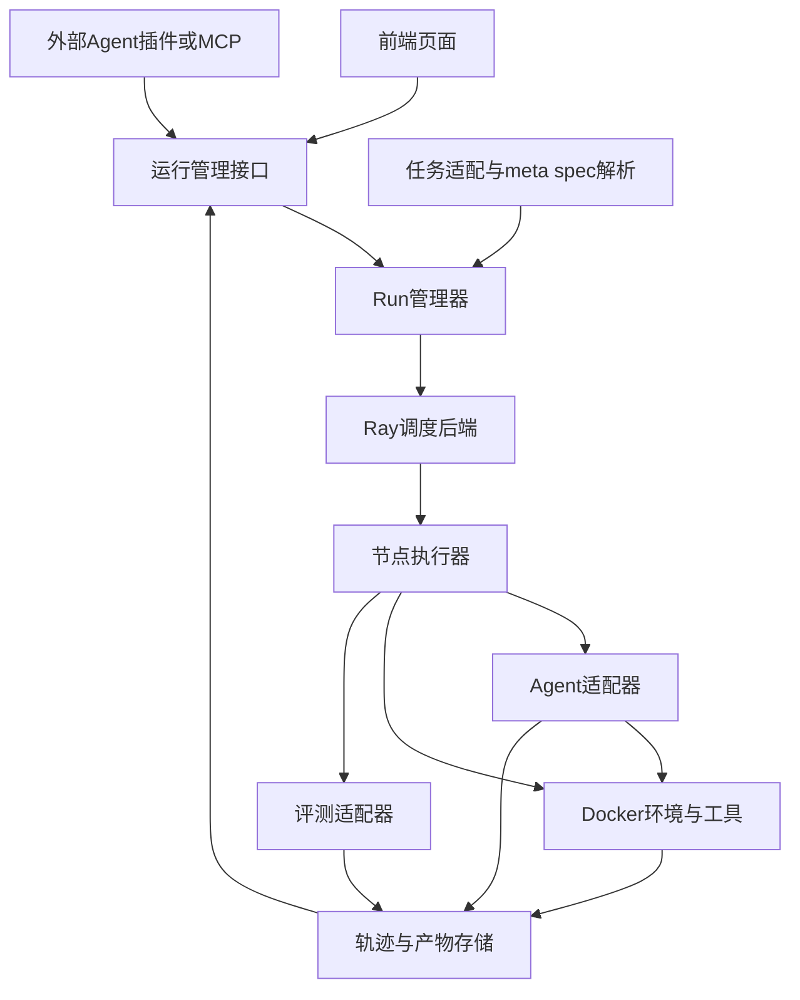

# Agent Infra目标与架构设计

版本：v0.1  
日期：2026年9月13日  
用途：团队架构讨论、需求确认与后续开发拆解

本文定义一个统一的Agent运行与评测基础设施。它接入Codex、Claude Code、AIDE和自研Agent，接入具有不同组织方式的科研任务与benchmark，在保留任务原有规则的前提下，管理环境、计算资源、执行过程、轨迹与评测结果，并提供可视化前端。

本轮已经明确两种运行方式：日常科研时，服务器上的Agent CLI通过插件或MCP控制任务容器；刷bench时，将Agent与任务执行环境部署在同一Docker容器中。跨节点调度首期实现“将不同任务分配到不同节点”，使用Ray作为调度后端。任务组织采用meta-spec索引多个说明及配置文件，保留各benchmark的原生差异。

文中的状态含义如下。“已确认”表示需求与方向已经在讨论中明确，不表示代码已经实现；“建议方案”表示可供开发采用的设计草案；“待明确”表示仍需团队决定；“后续扩展”表示保留方向，暂不作为首期交付门槛。本文中的接口名、字段名、模块目录和示例均为建议方案。

## 1 项目目标与当前决策

### 1.1 三个核心应用

1. **Agent可插拔。**支持完整自动化Agent、具有固定工作流程的Agent，以及轻量自研Agent。适配后，可以由同一套运行管理能力启动或接入，保留各自的内部执行逻辑。
2. **任务可适配。**不同benchmark和科研任务可以接入统一任务入口。统一任务发现、环境准备、执行和评测的接口，保留原任务说明、文件组织、工具要求与评分标准。
3. **任务可运行和评测。**支持单任务执行、批量实验、多节点分发、结果收集和榜单口径的成绩汇总。对需要官方提交的benchmark，生成所需交付物并记录提交结果。

“刷榜”在基础能力层面指按原协议完成运行、评测和结果导出。是否进一步实现自动向外部榜单提交，作为独立功能另行确定。

### 1.2 配套能力

- 资源管理：CPU、GPU、内存等计算资源的申请、分配、监测和释放，包括跨节点调度。
- 环境管理：Docker任务环境、工作目录、工具与服务的启动、连接和清理。
- 轨迹管理：保存并展示Agent与环境交互的过程，将执行事件、日志、产物和成绩关联起来。
- 前端页面：展示资源调度，展示Agent轨迹，为简单ReAct Agent提供对话入口。
- 人工参与：支持科研场景中的对话与干预；评测场景遵循benchmark对人工参与的原有规定。

### 1.3 已确认的设计边界

| 编号 | 已确认事项 | 对架构的影响 |
| --- | --- | --- |
| D01 | Agent需要可插拔，目标包括Codex、Claude Code、AIDE、自研Agent | 提供Agent适配层，不要求统一内部推理或搜索流程 |
| D02 | 图中的Auto指Codex、Claude Code这类全自动Agent | Auto属于Agent类型，不代表自动演化模块 |
| D03 | 日常科研使用服务器上的Agent CLI | 支持接入外部已运行的Agent，不能只支持平台新建Agent进程 |
| D04 | 外部Agent通过插件或MCP操作任务Docker | 需要容器操作接口，以及Agent与指定任务环境的绑定 |
| D05 | 刷bench时Agent与任务执行环境可在同一Docker中 | 提供容器内运行方式，处理认证、网络和轨迹导出 |
| D06 | 使用meta-spec描述任务包含哪些说明或配置文件 | meta-spec作为索引，允许被索引文件保留原生格式 |
| D07 | 转换后符合原benchmark标准 | 评测协议、输入可见性、资源预算和汇总规则必须保留 |
| D08 | 前端提供资源展示、轨迹展示和简单Agent对话入口 | 前端与运行后端、事件服务对接 |
| D09 | 硬件指CPU、GPU等计算资源调用 | 当前范围以计算基础设施为主 |
| D10 | Ray首期支持不同Run分配到不同节点 | 一个Run的主要计算资源首期在单节点内满足 |
| D11 | 更复杂的跨节点协作后续逐步实现 | 保留资源拓扑和远程作业扩展点 |
| D12 | 资源分配与实际使用需要对应 | 调度记账、运行限制、监测和回收需要共同实现 |

### 1.4 原图元素的对应关系

| 原图元素 | 当前设计中的对应位置 |
| --- | --- |
| Agent以及Auto和AIDE workflow | Agent适配层与不同Agent运行方式 |
| Env | 环境定义、环境实例和工具服务 |
| Tool有状态与无状态 | 工具目录、会话标识与工具生命周期 |
| CPU GPU Mem | 资源请求、节点选择与资源监测 |
| TaskSpec和dir file | meta-spec、原生文件与解析后的运行配置 |
| user.prompt.md | Agent可见任务说明的一种文件形式，文件名不强制统一 |
| eval | 原benchmark评测入口及适配器 |
| Ray与Docker | 跨节点调度后端与任务环境运行后端 |
| Human in the Loop | 交互入口、介入记录与运行模式标记 |
| 前端 | 资源页面、轨迹页面与对话页面 |
| Traj | 统一事件记录与Agent原始轨迹归档 |

原图中的AutoModelForCausalLM目前只保留为统一入口的类比，不据此要求Agent遵循模型加载接口。右下角其他未被后续讨论确认的手写内容，不升级为已确认需求。

## 2 使用场景与首期范围

### 2.1 场景A 日常科研

用户已经在服务器上运行Agent CLI，通过自然语言要求它执行科研任务。Agent调用infra提供的插件或MCP工具，申请任务环境，在Docker中执行命令、编辑文件、启动训练、读取结果，完成后归档产物或保留环境继续工作。

这个场景的重点是降低使用门槛，并让执行环境、资源和任务产物得到管理。接入已有CLI会话时，infra不一定拥有该Agent进程的生命周期。平台可以管理它创建的环境和作业，能够采集哪些Agent内部事件则取决于适配方式。

### 2.2 场景B Benchmark运行

用户选择benchmark、任务集合、Agent、模型配置和运行预算。平台为每个任务创建独立Run，将Agent及任务执行环境部署到容器中，再按原协议运行、收集产物、执行评测和汇总成绩。

同一个任务需要多次尝试或多个随机种子时，每次执行独立记录，最终采用benchmark规定的汇总方式。Agent与任务同容器，不意味着最终评分器、隐藏答案和全部认证材料也进入Agent可访问的工作区。

### 2.3 场景C 简单Agent交互运行

用户在前端选择一个自研ReAct Agent并输入任务。后端运行模型调用、工具执行与结果回传循环，前端显示消息和工具事件，并接受后续用户输入。

简单ReAct的后端循环可以由Agent插件提供，也可以由infra提供一个参考实现。两种方式使用同一组环境与轨迹接口；默认参考实现的具体模型后端和能力范围待定。

### 2.4 首期范围与扩展顺序

| 范围 | 首期目标 | 后续扩展 |
| --- | --- | --- |
| 运行方式 | 外部CLI控制容器、Agent与任务同容器两条链路 | 更复杂的远程会话与跨节点工具调用 |
| Agent接入 | 验证完整CLI Agent与简单ReAct两种差异明显的适配方式 | 补齐Claude Code、AIDE及更多自研Agent适配器 |
| 任务接入 | meta-spec索引、原生适配器、至少两种不同结构的任务样例 | 更多benchmark适配器、辅助生成接入文件 |
| 资源调度 | Ray将不同Run分配至不同节点，单个Run在单节点内满足资源 | 一个Run提交远程子作业、多节点联合训练 |
| 前端 | 资源、轨迹、对话三类基础页面 | 更细的对比分析、批量实验配置和可恢复交互 |
| 故障处理 | 识别失败、归档已有结果、清理资源、显式重试 | Agent与环境联合检查点恢复 |
| 评测 | 保留原评测入口、规则和结果格式 | 外部榜单自动提交与状态同步 |

上表中的首期样例数量与接入顺序是建议验收安排，具体选择哪些Agent与benchmark仍需确认。完整CLI Agent样例可优先采用团队日常使用的Codex；目标兼容范围仍包括Claude Code、AIDE和DIY Agent。

## 3 总体架构

### 3.1 模块关系



图中表示逻辑职责，模块是否独立进程部署由实现决定。外部CLI通过控制接口操作节点执行器管理的环境；容器内模式由节点执行器启动Agent。评测适配器按原benchmark协议安排评测位置，必要时使用独立评测环境。

### 3.2 核心模块职责

| 模块 | 主要职责 | 主要输入与输出 |
| --- | --- | --- |
| Task Adapter | 读取meta-spec和原生描述文件，枚举任务并生成可执行配置 | 任务索引与原生文件 → 解析结果及校验报告 |
| Agent Adapter | 接入或启动Agent，传入任务，采集事件，处理终止 | Agent配置与环境连接信息 → 会话句柄与事件 |
| Env Manager | 准备镜像、工作目录、工具与服务，创建和回收环境 | 环境要求与资源分配 → 环境实例 |
| Tool Gateway | 将外部Agent操作转发至指定环境，管理长任务与有状态会话 | 环境标识与工具请求 → 作业标识或结果 |
| Run Manager | 管理任务执行状态、尝试次数、预算、归档与评测 | 任务和运行请求 → 状态与结果 |
| Scheduler | 根据资源请求选择节点，维护分配生命周期 | 资源请求 → 节点与分配标识 |
| Node Worker | 在目标节点启动、观察和停止实际进程或容器 | 已分配Run → 执行状态与日志 |
| Evaluator Adapter | 调用原评测逻辑，保留指标与官方输出 | 交付物与评测配置 → 评分记录 |
| Event Store | 接收统一事件，保留原始轨迹引用，支持查询与订阅 | 事件流 → 可展示和可导出的记录 |
| Artifact Store | 保存输入版本、配置快照、产物与评测输出 | 文件或对象 → 持久引用与校验值 |
| Frontend | 展示资源与轨迹，提供简单Agent对话入口 | 状态接口与事件订阅 → 用户界面 |

上述划分不要求首期启动十余个服务。建议初期将控制接口、Run管理和元数据访问放在同一后端，节点执行器独立部署，先保持代码职责清楚，再根据实际规模拆分进程。

### 3.3 核心对象

| 对象 | 含义 | 生命周期 |
| --- | --- | --- |
| TaskPackage | 包含meta-spec及其引用内容的任务包 | 随任务包版本管理 |
| TaskInstance | 一个具体任务实例，包含原生任务ID、数据划分或种子等信息 | 可被多个Run重复使用 |
| ResolvedTask | 适配器解析并校验后的任务运行配置 | 创建Run前生成并快照 |
| Run | 一个Agent配置在一个任务实例上的执行记录 | 从提交到归档 |
| Attempt | Run内一次具体启动或重试 | 每次重试新增，不覆盖前次记录 |
| EnvInstance | 某次执行创建的容器、目录与工具会话 | 按清理策略结束或保留 |
| ResourceAllocation | 某次执行的节点与资源分配 | 从分配到确认释放 |
| AgentSession | 平台启动或接入的Agent会话 | 可能与Run一一对应，也可能外部长期存在 |
| Artifact与Event | 产物文件和执行事件 | 应独立于容器生命周期保存 |
| EvaluationResult | 原始评分、规范化指标与协议元数据 | 与Run及交付物版本绑定 |

已有科研CLI会话可能连续执行多个任务。建议通过显式绑定把工具调用归属到Run，避免把同一Agent会话的全部操作混成一个任务。首期是否允许一个外部会话同时绑定多个Run，列为待明确问题。

## 4 两种Agent与环境连接方式

### 4.1 模式A 外部Agent通过插件或MCP控制容器

**已确认部署形态：**Agent CLI运行在服务器上，任务进程运行在Docker内。Agent通过infra暴露的能力控制容器中的操作。

建议执行过程如下：

1. 用户向现有CLI Agent提出任务，并明确要使用infra管理环境。
2. Agent调用插件或MCP创建Run，提交任务引用或自定义科研任务描述。
3. infra解析任务、申请资源、创建Docker及工作目录，返回环境标识和可用工具信息。
4. Agent通过容器工具执行命令、读写文件、启动训练或查询后台作业。
5. 工具网关记录调用与返回值，节点执行器持续报告作业和资源状态。
6. Agent读取结果并继续工作；前端可查看已采集的轨迹和资源分配。
7. 用户或Agent显式结束任务，infra归档产物；是否立即清理环境按配置决定。

这里需要区分插件和MCP的职责。插件可以负责说明如何使用infra、注册命令或配置连接；MCP可作为工具调用协议。两者不必同时存在，也不强制所有Agent使用同一种接入机制。具体采用哪条路径，由各Agent适配器验证。

**工作目录语义。**宿主机文件与容器内文件必须有明确映射。建议每个Run使用独立工作目录，返回的路径同时标明属于宿主机还是容器。Agent通过容器工具操作时，当前目录、环境变量、退出码和标准输出都以目标容器为准。

**使用边界。**外部CLI仍可能使用自身原生终端操作宿主机。infra能够保证经其工具通道发生的操作被路由和记录；若要强制全部任务操作进入容器，还需限制或重新绑定Agent的原生执行工具。首期建议将该模式定位为协作科研模式，不仅凭插件安装就宣称完整隔离或完整轨迹覆盖。

**首期节点策略建议。**任务容器优先放在外部CLI所在的已登记节点，并申请该节点资源。整个集群中的不同科研任务仍可在各自节点运行。将固定节点上的CLI透明连接到任意其他节点的环境，归入后续远程工具扩展，避免提前引入跨节点文件一致性问题。

### 4.2 模式A需要的容器操作能力

| 能力 | 建议行为 | 需要解决的问题 |
| --- | --- | --- |
| 环境创建与查询 | 根据任务或环境配置创建容器，返回env_id | 幂等创建、准备进度、失败回收 |
| 文件读写 | 在指定环境工作区中读取、写入、列出文件 | 路径解释、文件体积、修改记录 |
| 短命令执行 | 返回退出码与输出，设置执行超时 | 命令参数、当前目录、超时后的进程处理 |
| 长作业启动 | 立即返回job_id，后台继续执行 | 训练不被一次RPC超时中断 |
| 长作业观察 | 按游标读取增量日志、状态和退出码 | 断线续读、重复读取、输出截断 |
| 长作业停止 | 对该作业及其相关进程执行停止流程 | 清理子进程、确认GPU释放 |
| 有状态会话 | 为终端会话或服务实例返回session_id | 状态保持、并发控制、超时回收 |
| 产物归档 | 将输出归档并返回持久引用 | 大文件传输、校验、失败重试 |

不要假定连续两次独立命令会保留同一个shell的当前目录或环境变量。独立命令应显式传入这些参数；确实需要交互式shell时，使用有状态会话接口。

### 4.3 模式B Agent与任务执行环境位于同一容器

**已确认部署形态：**用于bench运行，将Agent及其所需运行依赖加入任务环境，使其直接访问容器内工作区和执行工具。

建议执行过程如下：

1. Task Adapter读取任务包，确定任务镜像、Agent安装要求、可见输入与评测协议。
2. 平台创建Run，选择兼容的Agent与任务镜像组合。
3. Ray分配节点和资源，节点执行器建立工作目录与输出目录。
4. Env Manager注入可见输入、运行配置以及本次需要的认证引用，并完成网络预检查。
5. Agent Adapter在容器内启动Agent，传入任务说明并采集其原生事件或日志。
6. Agent直接执行容器内操作；平台观察运行状态和预算。
7. 执行结束后先导出轨迹与交付物，再按原协议进入评测。
8. 保存评测结果并确认清理完成后，回收容器和资源。

### 4.4 模式B的三个首要工程问题

**认证。**每个Agent适配器需要验证可支持的认证方式、凭证有效期、非交互启动条件及失败表现。建议镜像只包含软件依赖，运行时按适配器要求注入凭证。不同产品的账户登录与API认证是否可互换、是否支持容器内无人值守，不能在本设计中预设成立。

**网络。**分别描述模型服务访问、依赖和数据准备、任务允许的外部访问。准备阶段可以联网，不代表正式任务阶段可以联网；允许访问模型服务，也不自动允许Agent浏览外网。代理、DNS和证书需要在实际节点与容器中验证。网络策略由任务协议约束，实际强制范围与现有部署条件待确认。

**轨迹导出。**优先使用Agent提供的结构化事件或稳定日志接口，同时保留原始输出。日志和产物写入持久挂载或持续传出，避免容器删除后才发现没有导出。Agent未暴露的内部内容不能由平台补造为“完整轨迹”。

### 4.5 两种模式的统一点与差异

| 维度 | 外部CLI模式 | 容器内Agent模式 |
| --- | --- | --- |
| Agent进程由谁管理 | 通常由用户或已有CLI管理 | 由平台启动与停止 |
| 环境操作路径 | 插件或MCP转发到容器工具 | Agent直接操作容器工作区 |
| infra管理的基本对象 | Run、环境、工具会话、作业 | Run、Agent进程、环境、作业 |
| 轨迹采集来源 | 网关事件加可获得的CLI事件 | Agent原生事件加容器运行日志 |
| 首期节点安排 | 建议环境与外部CLI同节点 | Ray为整个执行单元选择节点 |
| 主要适用场景 | 日常科研、交互探索 | 标准化批量运行与评测 |
| 共同输出 | 配置快照、事件、产物、可选评测 | 配置快照、事件、产物、评测 |

## 5 Agent适配层

### 5.1 统一外部接口 保留内部执行方式

Agent适配器只承担接入、任务传递、环境连接、事件采集与生命周期管理。Codex和Claude Code保留自身自动执行机制，AIDE保留工作流程或搜索逻辑，自研ReAct保留模型与工具循环。

建议提供两类适配入口：平台启动型接收任务并创建Agent会话；外部接入型绑定现有会话与Run。外部接入型不应被要求实现其无法控制的进程重启能力。

### 5.2 建议接口

| 接口 | 用途 | 是否必需 |
| --- | --- | --- |
| describe_capabilities | 声明运行模式、交互、事件、恢复等能力 | 所有适配器必需 |
| validate_configuration | 检查配置、环境要求和可用认证条件 | 所有适配器必需 |
| launch | 在已准备环境中启动Agent | 平台启动型必需 |
| attach | 将已有会话绑定至Run | 外部接入型必需 |
| send_input | 发送初始或后续用户消息 | 按能力声明支持 |
| read_events | 获取增量执行事件或日志 | 必需，粒度可以不同 |
| get_status | 返回Agent或连接状态 | 必需 |
| stop或detach | 停止平台启动的进程，或解除外部绑定 | 按所有权区分 |
| export_trace | 导出原始轨迹与统一事件引用 | 必需，说明覆盖范围 |
| checkpoint与resume | 保存与恢复Agent内部状态 | 后续可选 |

能力声明建议包含：支持的部署模式、能否接收追问、是否支持有状态工具、轨迹详细程度、支持的终止方式、能否恢复，以及是否会自行启动并行子进程。

### 5.3 兼容性检查

启动前比较任务需求与Agent能力。例如，任务要求某种工具服务，Agent适配器必须能连接该服务；任务要求终端执行，纯文本问答适配器不能被直接标为可运行。若组合不兼容，返回明确原因。

任务插件不应为每个Agent重复实现一套完整环境，Agent插件也不应硬编码每个benchmark。两者通过环境能力和任务运行配置对接。确有差异的组合，可增加小范围兼容配置，并记录这种差异对原协议的影响。

## 6 Meta spec与任务表示

### 6.1 设计意图

**已确认：不同benchmark可以保留不同的文件组织方式。meta-spec描述这个任务有哪些文件、各文件承担什么角色，以及由哪个适配器解释。**

例如，一个任务的说明在README中，环境在Dockerfile中，评测由脚本提供；另一个任务的说明来自JSON字段，环境由多个服务构成，评测使用独立程序。这些差异由Task Adapter解释，无须先重写成相同目录结构。

建议采用三层表示：

1. meta-spec：轻量索引，声明版本、任务标识、文件引用、角色和适配器。
2. 原生描述文件：保留Markdown、JSON、YAML、Dockerfile、脚本或其他原有格式。
3. ResolvedTask：由适配器解析得到的机器可执行配置，供Run Manager和Scheduler使用。

meta-spec负责发现和组织，ResolvedTask负责执行。自然语言说明可以提供给Agent阅读，但资源调度、预算执行和评测启动应由确定的解析规则产生，不能每次临时依赖Agent猜测。

### 6.2 文件角色与可见性

| 建议角色 | 描述内容 | 典型消费者 |
| --- | --- | --- |
| instruction | 任务目标和上下文说明 | Agent |
| input | 数据、初始代码或任务材料 | Agent与环境 |
| environment | 镜像、依赖、服务和工作区要求 | Env Manager |
| tools | 工具说明与连接配置 | Agent适配器与Tool Gateway |
| resources | CPU、GPU、内存等需求 | Scheduler |
| execution_policy | 预算、计时、网络和人工介入规则 | Run Manager |
| output_contract | 交付物位置和格式 | Agent与归档模块 |
| evaluation | 评分入口、指标及汇总规则 | Evaluator Adapter |
| native | 未统一解释的原生补充内容 | 对应Task Adapter |

这些角色是候选公共词汇，不强制每个角色独占一个文件。一个文件可以包含多类内容，一个角色也可以由多个文件共同描述。特定benchmark需要新增语义时，使用带命名空间的扩展字段，并通过版本约定避免歧义。

可见性建议区分agent、orchestrator和evaluator。字段标注必须落实到挂载、复制、服务接口和权限上；只在YAML中写“不可见”不能形成隔离。如果一个原生文件混合可见和隐藏内容，适配器应生成Agent可见投影，不能直接把整个文件交给Agent。

### 6.3 建议的meta-spec示例

下例是虚构任务包的格式草案，用于说明索引机制，不代表任何真实benchmark的官方文件结构。字段、适配器和路径均需在开发中定义；它不能直接用于启动任务。

```yaml
schema_version: "0.1"
task_id: "example_bench/task_001"
adapter:
  id: "example_bench"
  version: "0.1.0"

origin:
  benchmark: "example_bench"
  revision: "pinned-upstream-revision"
  native_task_id: "task_001"
  split: "test"

documents:
  - id: "task_description"
    roles: ["instruction"]
    path: "original/README.md"
    format: "markdown"
    audience: ["agent"]

  - id: "native_config"
    roles: ["environment", "resources"]
    path: "original/task.json"
    format: "json"
    audience: ["orchestrator"]

  - id: "tool_description"
    roles: ["tools"]
    path: "integration/tools.md"
    format: "markdown"
    audience: ["agent", "orchestrator"]

  - id: "run_policy"
    roles: ["execution_policy"]
    path: "integration/policy.yaml"
    format: "yaml"
    audience: ["orchestrator"]

  - id: "deliverables"
    roles: ["output_contract"]
    path: "original/submission.md"
    format: "markdown"
    audience: ["agent", "orchestrator"]

assets:
  - id: "visible_dataset"
    role: "input"
    path: "original/data"
    audience: ["agent"]
    access: "read_only"

evaluation:
  adapter_ref: "example_bench.official_evaluator"
  config_ref: "evaluator-config/task_001"

extensions:
  example_bench:
    native_config_ref: "native_config"
```

evaluation中的引用由控制服务解析，不要求隐藏评测数据实际位于Agent任务包中。完整meta-spec也不默认整体暴露给Agent。建议为每个Run保存完整的控制侧快照，再生成只包含允许信息的Agent侧任务视图。

### 6.4 解析后的运行配置

ResolvedTask建议至少包含下列机器可执行信息，具体字段可在原型开发时确定：

| 字段组 | 最低内容 |
| --- | --- |
| identity | 任务包版本、原生任务ID、数据划分、种子及来源 |
| agent_input | 可见说明、数据与初始代码的引用，以及容器目标路径 |
| environment | 镜像引用、服务定义、工作目录与准备步骤 |
| capabilities | 任务需要的工具与交互能力 |
| resources | 节点内CPU、GPU、内存和可选设备约束 |
| policy | 执行预算、计时起点、网络、人工参与及重试规则 |
| outputs | 必须交付的文件、允许的归档范围与大小策略 |
| evaluator | 已登记评测适配器、配置和原生输出保留方式 |

资源和预算的来源必须可追溯。例如benchmark强制规定的GPU数量不能被用户运行参数静默覆盖。建议规则为：原协议约束形成可行范围，任务默认值补足缺省项，用户覆盖只能在可行范围内生效；超出范围则拒绝或显式标记为自定义实验。

### 6.5 Meta spec需要的校验

- schema版本受支持，任务及文档标识不重复。
- 文件或对象引用存在，路径范围可解析，版本或校验信息可追溯。
- 对当前任务类型必需的说明、环境和评测信息能够被解析。
- 混合可见性内容已生成正确投影，Agent视图不带入隐藏评测材料。
- 原协议、任务文件与用户覆盖之间没有未处理冲突。
- 对应适配器能够产出确定的ResolvedTask；缺少必要机器配置时明确报错。

首期建议人工编写或由确定脚本转换meta-spec。自动读懂陌生benchmark并生成适配器属于可选后续方向，不能作为现阶段已经具备的能力。

## 7 Benchmark适配与评测一致性

### 7.1 接入一个benchmark的工作

1. 固定原仓库、数据和评测程序的版本，识别任务枚举方式。
2. 列出Agent可见信息、允许工具、资源和时间预算，以及人工参与要求。
3. 编写meta-spec或确定性的转换脚本，保留原生任务ID及文件。
4. 实现Task Adapter，将原生描述解析为ResolvedTask。
5. 定义环境准备、输入投影、Agent启动和输出收集方式。
6. 封装原评分入口，保留原始评测记录与全部必要指标。
7. 用代表性任务检查原运行方式与infra适配方式的输入、预算和评分一致性。
8. 登记支持的Agent能力、已验证运行模式，以及尚未覆盖的原生特性。

接入对象可以是单个任务，也可以是可枚举多个任务的benchmark包。两者使用同一任务实例接口，枚举逻辑由对应适配器提供。

### 7.2 保持原标准需要记录的内容

| 类别 | 需要保留的信息 | 典型偏差 |
| --- | --- | --- |
| 数据 | 版本、划分、种子、可见范围 | 额外暴露测试答案或替换数据 |
| 环境 | 镜像、依赖、启动方式、初始状态 | 初始文件或依赖差异改变任务难度 |
| 工具 | 原本允许的操作和网络访问 | 增加原协议不允许的检索或执行能力 |
| 预算 | 时间、调用量、计算资源、尝试次数 | 排队与执行混算，重试获得额外预算 |
| 人工参与 | 是否允许及介入记录 | 人工补充提示后仍标为全自动成绩 |
| 评分 | 评分代码或模型配置、阈值、随机性 | 替换评分器或改变阈值 |
| 汇总 | 分母、失败处理、多次运行汇总方法 | 丢弃失败任务或只报告最好的一次 |

保留原标准并不意味着接入后必然得到完全相同的分数。模型采样、外部服务和随机评分可能引入波动。协议一致性与分数波动需要分别记录。

### 7.3 评测器与Agent的边界

容器内模式中，Agent可以直接访问任务执行环境。最终评分器如果依赖隐藏标签、私有测试或独立环境，应由平台在执行结束后按原协议调用。原benchmark允许Agent使用的验证程序可以保留在其环境中，不能因为统一封装而删掉原本允许的反馈。

如果某个原生benchmark必须在同一环境内评测，适配器应保留该协议并明确实际隔离边界。统一接口不能代替对具体bench实现的检查。

### 7.4 建议的评测结果结构

结果至少关联run_id、attempt_id、task_id、原生任务ID、交付物校验值、评分器版本和执行时间。指标以名称到值的映射保留，另附原生评分输出引用。

“主指标”由benchmark配置指定，不强制所有任务变成一个0到100的分数。评分程序失败、任务正常完成但得零分、Agent异常退出，应记录为不同状态。需要原官方服务评分的任务，使用“等待外部评分”等明确状态，不以本地代理分数冒充官方分数。

## 8 资源管理与Ray调度

### 8.1 首期调度范围

**已确认：首期将不同Run分配至不同节点，每个Run的主要执行单元在一个节点内满足资源要求。**

例如，集群有四个节点，提交二十个独立任务。调度后端按各节点可用资源启动若干任务，其余等待资源。节点有空闲并不等于能运行任意任务，还需要满足GPU型号、镜像和工作数据等条件。

建议由infra定义资源请求对象，Ray Backend将其映射到Ray资源声明。这样前端和任务包不直接依赖Ray的全部底层接口，后续调度能力也有明确扩展位置。

### 8.2 首期资源请求

| 字段 | 用途 | 首期建议 |
| --- | --- | --- |
| cpu_count | 声明CPU需求 | 支持 |
| gpu_count | 声明GPU数量 | 支持整数数量 |
| memory_bytes | 声明内存需求 | 支持，区分调度记账与运行限制 |
| gpu_type | 要求特定型号 | 作为可选约束，节点登记能力需验证 |
| node_id | 指定节点 | 用于已有CLI同节点绑定等情况 |
| disk_bytes | 工作目录和产物空间预估 | 建议预检查，精确配额方式待定 |
| topology | 同机或多机要求 | 首期限定single_node，保留版本扩展 |

GPU显存容量和“几张GPU”是不同要求。首期可记录节点显卡型号与显存用于匹配和展示，但不承诺按显存精确切分资源。GPU共享、分数GPU和硬件分区的策略后续单独验证。

### 8.3 调度与容器执行的衔接

建议用每个Attempt的监督执行单元持有资源分配，并由它在目标节点管理Docker生命周期。监督单元必须在容器实际运行期间持续保持资源占用，不能启动容器后立即返回并释放Ray资源。

建议流程为：提交资源请求，确认分配，启动环境，记录实际设备映射，运行并监测，停止相关进程，确认容器结束，最后释放资源。评测若需要额外资源，应按协议单独申请，并记录与任务执行阶段的关系。

如果采用监督单元在宿主机启动容器的方案，需要显式把分配到的设备映射进容器。不能假设宿主进程中的设备环境变量会自动转成正确的容器设备范围。也要避免同一资源在监督单元与内部子作业两侧被重复预留。

Ray资源声明主要用于逻辑调度，并不自动限制进程的全部物理资源使用。CPU与内存限制需要结合容器或操作系统机制落实，GPU可见设备和共享策略需要另外验证。相关边界见[Ray资源文档](https://docs.ray.io/en/latest/ray-core/scheduling/resources.html)。

### 8.4 外部CLI模式的资源归属

外部CLI通常在创建Run前已经存在。建议将“外部Agent宿主进程”和“infra分配的任务容器”分开记录。首期可对任务容器执行资源分配与限制，对外部CLI仅记录其节点和已知进程信息，不将未纳入控制的进程宣称为已精确计量。

容器内Agent模式可将Agent及任务进程纳入同一容器资源边界。使用远程模型API产生的请求速率和费用属于另一类预算；本地部署模型时所需GPU是否作为共享服务管理，留作后续明确。

### 8.5 监控与排队

前端分别展示节点总资源、已分配资源和实际使用率。正在等待模型返回的任务可能已占有GPU但利用率低；这类情况不应被视为资源已释放。

建议首期实现简单的有界并发和可解释排队，明确显示“缺GPU”“指定节点离线”“资源请求无法满足”等原因。是否需要严格先进先出、用户优先级或公平配额，属于调度策略待定项，不能仅使用Ray就默认宣称具备这些产品语义。

### 8.6 后续跨节点扩展

| 阶段 | 扩展能力 | 额外问题 |
| --- | --- | --- |
| L1 当前首期 | 多个独立Run分配到多个节点 | 节点登记、资源生命周期、结果归档 |
| L2 后续 | 一个Run向其他节点提交计算作业 | 远程工具、数据位置、作业依赖、结果回传 |
| L3 后续 | 单个计算作业联合使用多个节点 | 分布式启动、通信、成组分配、联合故障处理 |

Ray Placement Groups支持成组预留资源，但每个bundle仍须在一个节点内满足。多节点联合训练还依赖训练程序的分布式能力。相关技术边界见[Ray Placement Groups文档](https://docs.ray.io/en/latest/ray-core/scheduling/placement-group.html)。

## 9 Run生命周期与失败处理

### 9.1 状态和结果分开记录

建议Run记录当前执行阶段，结果记录任务完成情况和评分。正常完成执行但得零分，不应被误记为基础设施故障；反过来，评分服务不可用也不等于任务得零分。

| 建议状态 | 含义 |
| --- | --- |
| created | 请求已创建，尚未完成校验 |
| queued | 校验通过，等待资源 |
| preparing | 已分配节点，正在准备环境和认证连接 |
| running | Agent或任务进程正在执行 |
| waiting_input | 按运行模式等待用户输入 |
| collecting | 正在归档轨迹与产物 |
| evaluating | 正在执行评测 |
| awaiting_external_evaluation | 按协议等待外部评分 |
| completed | 执行和所需归档评测已完成 |
| failed | 某阶段发生无法继续的错误，另附错误类型 |
| cancelled | 用户或策略取消，另附清理状态 |
| lost | 节点失联等导致执行结果暂时无法确认 |

状态集合是草案。清理完成状态建议单独记录，使“执行已终止”和“资源已确认回收”可分别观察。lost需要后续核实，不能立刻等同于所有进程已死亡。

### 9.2 Attempt与重试

Run标识一次逻辑执行请求，Attempt标识一次实际启动。基础设施故障后的重试新增attempt_id，保留前次轨迹、预算消耗和原因，不覆盖旧记录。

算法失败、得分不理想和基础设施故障需要分开处理。前两者是否允许重跑由实验或benchmark协议决定。infra不能自动挑选最好的一次作为该Run结果。采用哪次有效结果、失败是否进入分母、已消耗预算是否计入，都由对应协议明确。

创建环境和提交作业建议使用请求幂等标识。客户端断线重发同一请求时，应能取回已有环境或作业，避免重复启动昂贵训练。对于已经产生外部副作用的操作，不直接假定可安全重放。

### 9.3 取消与清理

取消操作需要传递到Agent、容器内任务进程和平台管理的关联作业。停止主进程后还要观察子进程与GPU占用是否消失，再确认释放资源。

科研场景可提供显式保留环境选项，并展示保留期间的资源占用。评测场景建议归档完成后自动清理。清理失败需要显示并允许后续回收，不能从前端列表中静默消失。

### 9.4 检查点与恢复

首期建议做到失败可诊断、记录可保留、显式重新运行。恢复到Agent中途状态需要同时恢复会话、工作目录、工具状态和后台作业，不能仅凭进程重启宣称“继续原任务”。

Ray Actor重启后的应用状态恢复需要自行实现；跨节点恢复的检查点需要新节点能够访问。详见[Ray Actor容错文档](https://docs.ray.io/en/latest/ray-core/fault_tolerance/actors.html)。因此，联合检查点恢复列为后续扩展，Agent适配器通过能力声明决定是否支持。

## 10 轨迹 产物与可复现记录

### 10.1 统一事件与原始轨迹同时保留

统一事件用于前端展示、搜索和跨Agent分析；原始轨迹用于保留各Agent特有信息和排查适配转换问题。两者通过来源标识互相关联。

最小事件字段建议包括event_id、run_id、attempt_id、producer_id、producer_sequence、timestamp、event_type、payload和artifact_refs。工具调用再记录call_id及关联作业或会话标识。

跨节点时不同机器时间可能存在偏差。建议按生产者顺序号和调用关联关系还原局部先后顺序，接收时间用于展示辅助；不要仅对所有事件按墙上时钟排序就声称得到了精确全局执行顺序。

### 10.2 需要记录的事件类型

| 类型 | 示例 |
| --- | --- |
| 用户与Agent消息 | 初始任务、用户补充、可获得的Agent输出 |
| 工具事件 | 调用参数、执行位置、返回值、退出码 |
| 作业事件 | 训练启动、状态变化、完成、停止 |
| 环境事件 | 创建、准备失败、服务就绪、销毁 |
| 资源事件 | 排队、分配、使用快照、释放 |
| 产物事件 | 文件生成、归档、校验值和引用 |
| 评测事件 | 评分启动、指标、原生输出和失败原因 |
| 生命周期事件 | Run状态变化、介入、重试、取消 |

建议在每个Run中明确记录轨迹覆盖等级，例如“工具通道记录”“Agent结构化事件加工具记录”“仅进程日志”。缺少某类事件时显示未采集，不伪造空白之外的内容。

### 10.3 长输出与断线续读

长日志按分块或文件保存，事件只携带摘要和完整日志引用。实时订阅和历史查询使用游标，断线后从已确认位置恢复，并以event_id去重。大文件通过产物存储获取，不强行塞进一次MCP响应或对话上下文。

### 10.4 持久化边界

建议每个Run保存任务包和解析配置快照、Agent与模型配置、镜像引用及摘要、原生数据版本、事件、原始轨迹、交付物、评分输出和重试记录。敏感认证值不进入可导出配置快照，只保留可识别配置来源的非敏感引用。

首期可以使用控制节点可访问的持久目录作为最终归档位置，节点本地磁盘用于执行和缓存；也可以采用共享文件系统或对象存储。具体后端待部署条件确认，但最终归档不能仅留在即将删除的容器内部。

“可复现记录”表示能够追溯配置、输入、过程和评分。涉及远程模型和随机过程时，这些记录不能自动保证再次执行生成逐字相同的输出。

## 11 前端功能设计

### 11.1 资源调度页面

展示节点在线状态、CPU和内存、GPU型号与使用情况、已分配资源、各节点上的Run，以及排队原因。点击资源占用可以跳转到对应任务，点击Run可以查看实际分配节点。

对于等待输入但仍保留资源的运行，需要继续显示其占用。监测值注明更新时间，节点失联时显示数据已过期，避免旧值被当作实时状态。

### 11.2 Agent轨迹页面

按Run展示用户消息、Agent输出、工具调用、命令输出、训练作业、产物和评测结果。支持展开长日志、切换Attempt，并标明失败、重试和人工介入位置。

不同Agent的原始记录可单独下载或展开。前端根据适配器能力显示已采集范围，不要求所有Agent都有相同的事件粒度。

### 11.3 简单Agent对话页面

支持选择Agent及模型配置、输入任务、绑定环境、显示消息与工具事件、发送后续输入和停止运行。后端负责实际ReAct循环、工具执行与会话状态。

Agent运行中收到新消息时，是立即加入、在下一步加入，还是先等待当前工具执行结束，需要后端定义一致行为。首期建议采用“当前工具调用完成后在下一模型调用前处理”，同时记录消息接收与消费时点；具体策略待确认。

### 11.4 人工参与与评测标记

对话科研Run与标准评测Run使用明确的运行模式。标准评测是否开放发送消息由原协议决定。需要人工参与的任务可以正常使用交互入口，但其介入事件必须留存。

前端关闭或网络断开不应自动终止后端Run。用户重新进入后能够通过Run标识恢复查看；是否恢复可交互会话取决于Agent能力。

## 12 认证 网络与环境准备

### 12.1 认证设计待完成项

- 明确每个目标Agent支持并实际验证的认证路径。
- 定义认证在宿主机、容器与模型访问服务之间的传递位置。
- 定义凭证失效、刷新失败和无人值守登录失败的错误分类。
- 日志、轨迹和配置导出应处理认证值，保留诊断所需的非敏感信息。
- 容器清理时回收临时认证材料；避免把个人完整配置目录默认复制到所有任务环境。

首期不预先要求所有Agent共用一个模型网关。若后续引入网关，需要验证它与原Agent功能、模型参数和评测协议是否兼容。

### 12.2 网络准备与执行阶段

建议区分镜像和依赖准备、模型服务连接、正式任务执行、评测及归档等阶段。各阶段可采用不同网络需求，但正式执行必须满足原任务规则。

在正式计时前完成哪些准备，由benchmark协议决定。平台应记录准备耗时和正式执行耗时；若原协议将依赖安装计入预算，就不能通过统一预热流程把它移出预算。

需要在原型中验证DNS、代理、证书、模型端点连通性、镜像拉取和外部数据访问。外部访问失败应定位到具体阶段，便于区分环境故障与Agent任务失败。

### 12.3 镜像组合策略

建议以任务原环境为基础，采用可重复的方式加入Agent所需依赖，并记录最终镜像摘要。若Agent依赖与任务依赖冲突，应由适配器明确处理，不静默升级原任务环境中的关键依赖。

多服务任务可以由主任务容器连接辅助服务，是否允许这种部署取决于原协议。“Agent与任务同容器”主要描述执行位置，不要求所有外部服务或评测器都塞进一个容器。

## 13 建议代码组织与接口归属

以下路径用于说明模块边界，不代表已经存在的代码仓库。

| 建议路径 | 主要内容 |
| --- | --- |
| core/models/ | TaskInstance、ResolvedTask、Run、Attempt、Event等数据模型 |
| core/contracts/ | Agent、Task、Env、Scheduler、Evaluator接口 |
| core/runner/ | Run状态管理、预算与Attempt管理 |
| adapters/agents/ | Codex、Claude Code、AIDE、ReAct及DIY适配器 |
| adapters/tasks/ | 各benchmark解析、任务枚举与协议校验 |
| adapters/evaluators/ | 原评分器启动、输出解析与指标映射 |
| environments/docker/ | 容器准备、执行、目录映射与回收 |
| gateways/mcp/ | 外部Agent使用的容器工具接口 |
| schedulers/ray/ | 资源请求转换、节点选择与监督执行 |
| workers/ | 节点执行器与运行状态报告 |
| storage/ | 元数据、事件、原始轨迹与产物存储 |
| api/ | Run管理、查询、交互和事件订阅接口 |
| frontend/ | 资源、轨迹与对话页面 |
| schemas/ | meta-spec、解析配置与事件的版本化Schema |
| examples/ | 两种部署模式与不同任务结构的示例 |
| tests/integration/ | 真实接入链路、评测一致性与故障清理检查 |

接口应通过共享数据模型传递明确标识，避免前端直接读取Docker日志路径、任务包直接依赖Ray Actor对象，或Agent适配器自己实现独立成绩汇总。不同模块通过稳定契约组合，具体技术选型可以后续调整。

## 14 实施阶段与验收标准

阶段划分用于安排开发顺序，不附加未经确认的工期或人员承诺。P0到P3组成首期交付，P4为后续扩展。

### 14.1 P0 明确契约并建立任务样例

产出核心对象、meta-spec草案、两种Agent接入接口、Run状态与事件字段。选择两种文件结构明显不同的任务样例，至少一种能使用原评分器验证。

验收：任务包可以被确定性解析；保留原生文件与身份信息；缺少必需配置时返回明确错误；Agent可见投影与控制侧配置分开。

### 14.2 P1 打通两种单节点运行链路

外部CLI模式完成环境创建、文件读写、短命令、长作业查询与停止。容器内模式完成至少一个完整CLI Agent的启动、认证连接、任务执行、轨迹导出与评分。补充简单ReAct参考适配器，验证接口不会只适合完整CLI。

验收：同一工作目录语义清楚；长训练不因单次工具请求超时而丢失；取消后平台管理的相关进程被清理；容器删除后仍可查看轨迹和产物。

### 14.3 P2 实现Ray跨节点分发

在至少两个真实节点上验证独立Run分发、资源匹配、排队和资源释放。容器内模式按资源选择节点；外部CLI模式验证指定节点绑定。

验收：没有满足资源的节点时任务保持等待或报告不可满足；不同节点的事件与产物可汇总；监督执行期间资源不会提前释放；节点失联后能识别lost并核实清理，重试不覆盖旧Attempt。

### 14.4 P3 完成前端与批量评测闭环

交付资源页面、轨迹页面和简单Agent对话页面。支持批量任务运行、按原规则汇总、导出结果及复现实验记录。

验收：前端断线后能重新查看历史过程；资源分配与使用率分别显示；人工介入可追踪；失败任务的汇总处理符合协议；相同交付物通过原评分器与适配后的评分入口获得一致的确定性结果。

随机评分器按原协议固定配置和重复次数，并评估允许的波动，不能将逐次分数相同设为不合理验收条件。

### 14.5 P4 后续扩展

- 一个Run调用其他节点的计算作业。
- 单个训练任务同时使用多个节点。
- Agent与Env联合检查点恢复。
- 更多Agent与benchmark的兼容矩阵。
- GPU共享、更复杂的队列优先级和多用户配额。
- 辅助生成meta-spec和任务适配代码。
- 外部榜单自动提交与评分状态同步。
- 基于轨迹的失败分析与后续优化能力，具体算法另行设计。

上述内容是扩展方向，不将自演化、模型训练或真实实验设备控制加入当前已经确认的基础交付范围。

### 14.6 首期重点验证矩阵

| 验证项 | 场景 | 通过条件 |
| --- | --- | --- |
| 外部CLI连接 | 已有CLI操作任务Docker | 操作发生于指定环境，路径与事件关联正确 |
| 容器内Agent | Agent与任务共同部署 | 认证、网络、任务执行和轨迹导出可完成 |
| 长作业 | 启动一个持续运行的计算进程 | 工具返回job_id，可续读日志并明确停止 |
| 异构任务组织 | 两种原生结构不同的任务包 | 不重写成同一目录也可通过适配器解析 |
| 评分一致性 | 同一交付物走原入口及infra入口 | 确定性评分一致，随机评分遵循原协议 |
| 隐藏信息边界 | 含Agent不可见材料的任务 | Agent实际工作区及工具返回不包含该材料 |
| 多节点调度 | 两节点运行资源需求不同的Run | 分配满足约束，资源不足不超额启动 |
| 清理与故障 | 取消、容器崩溃、节点失联 | 状态明确，保留已有记录，核实资源回收 |
| 前端恢复 | 断开后重新打开页面 | 历史轨迹和当前状态可恢复查看 |
| 简单Agent交互 | 前端运行ReAct | 消息、工具结果和后续输入关联到同一会话 |

## 15 必须解决的工程问题

本节列出已知需要实现的事项。它们本身无需再次确认“是否需要”，具体方案可按第16节的待定项选择。

| 编号 | 问题 | 所需结果 | 优先级 |
| --- | --- | --- | --- |
| E01 | 外部Agent到任务容器的操作路由 | env_id绑定、文件语义、命令及长作业接口 | 首期 |
| E02 | 容器内Agent启动与认证 | 至少一个实际可用且可重复的启动流程 | 首期 |
| E03 | 容器网络与准备阶段划分 | 连通性验证、协议约束和阶段性错误信息 | 首期 |
| E04 | 原生轨迹采集与导出 | 覆盖范围说明、统一事件和原始记录归档 | 首期 |
| E05 | meta-spec解析与原生任务映射 | 版本化索引、适配器和ResolvedTask | 首期 |
| E06 | 任务适配后评测标准保持 | 原评分入口、预算和结果汇总校验 | 首期 |
| E07 | Ray分配与Docker实际生命周期一致 | 监督执行、设备映射和确认回收 | 首期 |
| E08 | 多节点文件和产物汇总 | 持久归档路径及故障时已有结果保留 | 首期 |
| E09 | Run和Attempt语义 | 不覆盖重试历史，失败与得分分别记录 | 首期 |
| E10 | 前端三类功能 | 资源、轨迹、简单Agent交互可用 | 首期 |
| E11 | 兼容能力声明 | 提前发现不可运行的Agent与任务组合 | 首期 |
| E12 | 复杂跨节点协作 | 远程子作业、多机训练与通信管理 | 后续 |
| E13 | 中途状态恢复 | Agent、环境和工具状态联合恢复 | 后续 |

## 16 仍需进一步明确的决策

以下给出建议默认值，便于原型开发推进。建议不代表已经获得团队确认。

| 编号 | 待明确问题 | 建议默认值 | 最晚决定时间 |
| --- | --- | --- | --- |
| Q01 | 首期具体接哪些Agent | 一个完整CLI Agent加一个简单ReAct，其他目标按顺序扩展 | P0 |
| Q02 | 首期具体接哪些benchmark | 两种结构差异明显且团队能实际运行的任务包 | P0 |
| Q03 | 外部CLI首期是否必须同节点操作环境 | 默认CLI与任务容器同节点，显式登记节点 | P0 |
| Q04 | 插件与MCP分别承担什么 | 工具接口由网关提供，插件负责发现与使用引导；按Agent验证 | P1前 |
| Q05 | 是否强制外部Agent全部操作经infra | 首期仅保证经infra通道操作的路由与记录，强制绑定另做验证 | P1前 |
| Q06 | meta-spec公共字段和扩展规则 | 小型公共索引加版本化适配器，保留原生描述文件 | P0 |
| Q07 | meta-spec是否支持批量任务模板 | 先支持单实例与适配器枚举，再决定模板复用语法 | P0 |
| Q08 | Docker运行于宿主机执行器下还是Ray运行环境内 | 首期选一种并验证设备映射与生命周期，暂不两套并行实现 | P2前 |
| Q09 | 现有集群是否已由其他调度系统分配资源 | 先确认CPU和GPU实际可分配范围，避免两套系统重复管理 | P2前 |
| Q10 | Agent使用何种认证与模型接入方式 | 按各Agent实际支持能力选一种验证，记录模型与配置 | P1前 |
| Q11 | 元数据与产物保存在哪 | 元数据集中管理，产物有统一持久归档位置 | P1前 |
| Q12 | 简单ReAct循环由谁提供 | infra提供可替换参考实现，自研Agent也能自行提供 | P1前 |
| Q13 | 一个科研CLI会话能否同时绑定多个Run | 首期一个显式活跃Run，工具参数仍带明确标识 | P1前 |
| Q14 | 人工等待时是否继续占用资源 | 首期显式显示占用与超时策略，释放恢复后续扩展 | P3前 |
| Q15 | 失败重试的预算与成绩规则 | 每个benchmark按原协议配置，科研任务显式配置 | P1前 |
| Q16 | 队列是否需要优先级与多用户公平性 | 首期简单有界并发，记录可解释等待原因 | P2前 |
| Q17 | 环境默认保留多久 | 科研可显式保留，bench归档成功后清理 | P1前 |
| Q18 | 网络限制要强制到什么程度 | 按首批benchmark规则明确模型访问与任务访问的边界 | P1前 |
| Q19 | 前端是否允许向完整CLI Agent继续发消息 | 通过能力声明开放，不承诺所有Agent支持 | P3前 |
| Q20 | 是否需要直接提交外部官方榜单 | 首期完成符合要求的产物与结果导出，自动提交后续决定 | P3前 |

Q01、Q02、Q03和Q06最影响首个原型的接口与样例选择，建议先确定。其余问题可在对应阶段验证时收敛，不需要在文档讨论阶段一次性决定全部实现细节。

## 17 主要风险与处理方式

| 风险 | 实际后果 | 处理方式 |
| --- | --- | --- |
| 把meta-spec做成单一固定目录模板 | 不同benchmark仍需大量重写 | 统一索引和解析结果，保留原生内容 |
| 每接一个Agent就重写全部任务 | 适配数量随组合快速增长 | 按能力契约对接，在启动前检查兼容性 |
| 外部CLI绕过容器工具执行 | 任务位置和轨迹记录不完整 | 明确通道覆盖边界，验证工具绑定方案 |
| 容器已运行但Ray资源提前释放 | 超额调度、GPU冲突 | 监督单元持有分配直到确认清理 |
| 节点上已有其他任务未纳入调度 | 声明空闲与实际空闲不一致 | 确认可分配资源池，明确集群管理归属 |
| 轨迹只写在容器内 | 失败或清理后丢失过程 | 持久挂载或持续传出，先归档再删除 |
| 同容器封装暴露隐藏评测材料 | 评测成绩不符合原协议 | 按可见性生成工作区，评测按原规则隔离 |
| 自动重试被当成额外优化机会 | 成绩和预算不可比较 | 保留Attempt并按协议处理尝试次数 |
| 依赖或认证在某节点不可用 | 任务大量启动失败 | 准备阶段预检查并报告具体原因 |
| 简单Agent前端只有聊天外观 | 无法真正执行工具与管理会话 | 后端提供完整可替换的最小执行循环 |
| 首期同时追求三层跨节点能力 | 文件、通信与恢复复杂度过高 | 先完成独立Run多节点分发 |

## 18 资料与设计依据

本设计的需求依据为团队手绘框架，以及后续关于前端、两种运行方式、meta-spec和Ray首期范围的确认。工程接口和开发阶段为本版本提出的实现草案。

Ray相关技术边界参考以下官方文档，查阅日期为2026年9月13日：

- [Ray资源声明与逻辑资源](https://docs.ray.io/en/latest/ray-core/scheduling/resources.html)：说明资源声明用于调度，以及声明与实际物理资源使用之间的边界。
- [Ray Placement Groups](https://docs.ray.io/en/latest/ray-core/scheduling/placement-group.html)：说明成组资源预留和单个bundle的节点约束。
- [Ray Actor容错](https://docs.ray.io/en/latest/ray-core/fault_tolerance/actors.html)：说明重启、应用状态恢复以及跨节点检查点访问要求。

Codex、Claude Code等产品的认证、事件接口和容器启动细节需在选定版本后实际验证。本文不把尚未验证的具体命令、登录方式或事件格式写成已实现契约。
