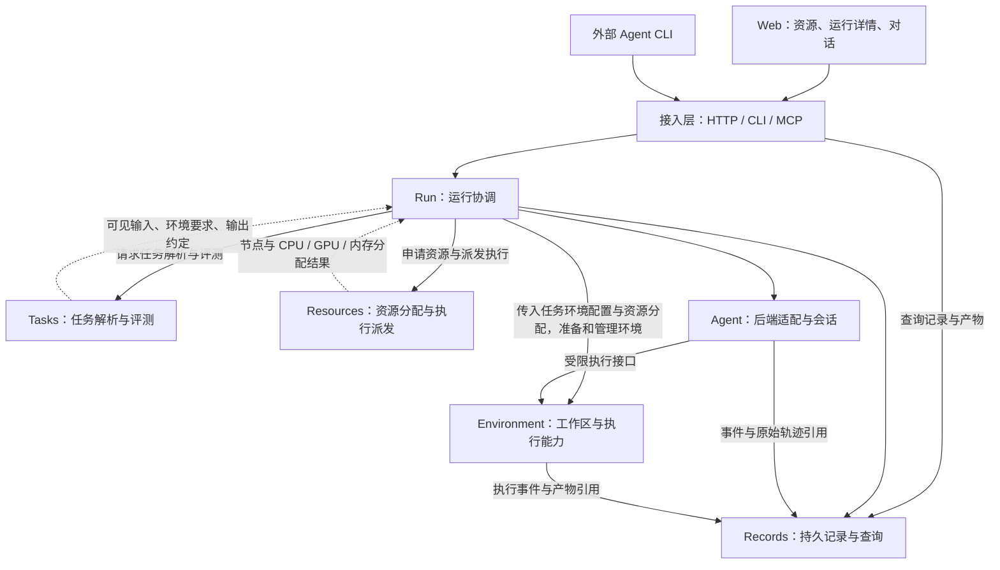

# Agent Infra 模块划分与开发边界

版本：v0.2（模块目录在 S0 落地；业务接口仍为草案）

日期：2026-09-14

范围：模块职责、依赖方向、接口能力、源码组织和开发顺序。

**建议围绕 Agent 和 Environment 两个核心，按功能模块组织代码。Run 负责把两者连接为一次受管理的运行；任务与评测、资源调度、运行记录提供支撑；API 和 Web 提供使用入口。首期保持一个模块化后端，不按模块拆成微服务。**

本文依据[目标与架构设计](Agent_Infra_目标与架构设计_v0.1.md)，承接[前一版仓库设计](repository-architecture.md)。S0 已按本文迁移一级功能模块目录并建立工程检查，见[S0 工程基础](../development/s0-engineering-foundation.md)。本文中的业务接口、后端子目录与运行流程仍是后续设计建议，不代表已有实现；方法签名、HTTP 路径、消息字段和数据库表尚未确定。

关于自然语言建环境、Ray 集群初始化与监控、轨迹保存和两种运行模式的落地流程，见[正式开发前的四个问题](environment-operations-qa.md)，其中包含 ASI-Bench 的接入核查与待验证边界。

## 1. 整体如何拆分

Agent 回答“如何理解任务、作出决策并推进工作”，Environment 回答“工作在哪里执行、可以操作什么、执行状态如何”。两者各自可以开发、替换和验证，再由 Run 协调。



图中**实线表示逻辑调用，标签可注明调用携带的信息；虚线补充任务解析和资源分配的结果流向**，不表示反向代码依赖。图中未展开所有返回值、评测与清理步骤，也不表示进程位置；跨节点时由代理和 Worker 入口传递调用。Web 和外部 CLI 是可选入口。Python 导入边界见第 4 节。

Tasks 与 Resources 的结果经 Run 传入 Environment：Tasks 给出允许访问的任务输入、环境与工具要求、输出约定，Resources 给出实际资源分配，Environment 据此准备独立 Docker、工作区和执行能力。Environment 无需自己解析 benchmark 或选择集群节点。Run 在每次 Attempt 上关联任务版本、Agent 会话、环境与资源分配；默认每次 Attempt 使用独立任务容器和工作区，评测环境按原协议安排，资源占用持续到实际清理完成。

| 模块 | 负责的功能 | 不承担的职责 |
| --- | --- | --- |
| **Agent** | 接入不同 Agent；声明能力；管理 Agent 会话、输入与输出；解释原生轨迹 | Docker 管理、集群调度、benchmark 评分 |
| **Environment** | 准备工作区；管理容器及进程；提供文件、命令、作业、会话和工具能力；收集输出并清理 | 决策循环、Agent 选型、任务评分、集群资源选择 |
| **Run** | 管理 Run/Attempt 生命周期；协调任务、资源、环境、Agent、评测和清理 | 实现某个 Agent 的推理流程或某个 benchmark 的评分算法 |
| **Tasks：任务与评测** | 索引和解析原始任务；给出可见输入与执行要求；执行、解释和汇总原生评测协议 | Agent 会话管理、资源调度、通用容器管理 |
| **Resources：资源调度** | 发现节点和资源；分配资源；派发执行；维护占用、租约和释放结果 | 理解任务内容、决定 benchmark 重试规则、管理 Agent 对话 |
| **Records：运行记录** | 持久保存元数据、事件、原始轨迹和产物引用；提供读取与检索 | 决定业务状态迁移、触发新一轮执行或评测 |
| **接入层** | HTTP、CLI、MCP 和 Worker 协议转换；身份与访问范围检查；调用业务接口 | 复制运行流程、直接操作 Docker/Ray/数据库 |
| **Web** | 展示资源、运行进度、轨迹和评测结果；发送用户输入及控制请求 | 调度执行、运行 Agent 决策循环、直接访问后端存储 |

以上是当前建议的**八个一级功能模块**：Agent、Environment 是两个核心；Run 负责协调；Tasks、Resources、Records 提供支撑；接入层与 Web 提供入口。它们用于明确代码归属与开发边界，不等于八个独立部署的服务。

模块内部按需要继续拆组件，例如 Environment 内的工作区、工具和 Docker 后端，Tasks 内的任务解析与评测适配器，Resources 内的本地与 Ray 后端。Tool 首期归属 Environment；Docker 与 Ray 分别是环境和调度的后端实现，不额外算一级模块。后续只有出现明确的独立职责或复用需求时，再调整一级边界。

`contracts` 与 `bootstrap` 是工程设施：前者承载少量公共契约，后者组装具体实现。它们不增加新的业务模块。

## 2. 两个核心模块的边界

### 2.1 Agent：保持不同 Agent 的自身运行方式

Agent 模块通过后端适配器接入完整 CLI Agent、工作流 Agent 和简单 ReAct Agent。统一的是平台需要的会话与控制能力，不要求所有 Agent 实现相同的 `step()` 循环。

- **后端适配**：封装具体 Agent 的启动配置、输入方式、输出解释和原生轨迹获取方式。
- **会话能力**：声明是否支持交互输入、取消、恢复、工具接入等；调用方按声明使用，暂不承诺所有后端都支持全部能力。
- **执行依赖**：通过 Environment 的公开执行契约使用工作区、进程和工具；Agent 代码不构造 Docker 客户端，也不接触 Ray 对象。
- **模型调用**：参考 ReAct Agent 的模型客户端先留在 Agent 模块内部；只有出现明确的独立复用需求时，再评估是否单独拆模块。

对于完整 CLI，Agent 适配器决定“如何启动这个 CLI、如何理解其输出”，Environment 决定“如何在指定环境中创建和管理这个进程”，Run 决定“何时启动、何时结束和如何处置结果”。三者各自持有不同职责，避免重复管理同一生命周期。

### 2.2 Environment：把执行能力做成独立组件

Environment 模块包含工作区准备、进程/作业执行、状态化终端会话、文件操作、工具与服务接入、输出收集及清理。工具先作为环境能力的一部分；Agent 侧只保留工具选择与协议适配。

环境接口分成两个权限范围：

| 接口范围 | 提供的能力 | 主要使用者 |
| --- | --- | --- |
| **EnvironmentControl** | 根据已分配资源准备环境、查询生命周期、收集输出、销毁环境并返回清理结果 | Run 的受信执行逻辑 |
| **EnvironmentAccess** | 在已绑定工作区内操作文件、执行命令、查询/停止作业、使用会话及获准工具 | Agent 适配器、经授权的 MCP 调用、评测执行器 |

Agent 获得的是与当前运行绑定的执行权限。环境创建、资源分配和全局销毁等管理能力由 Run 协调；MCP 用户需要新环境时，也通过相应的 Run 用例申请。

首个环境后端按已有需求采用 Docker。接口使用项目自己的请求、状态和资源引用，Docker 容器对象留在后端内部。Environment 应能在没有 Agent、Web、Ray 和真实数据库的情况下，通过本地资源与内存记录替身完成独立验证。

## 3. 支撑模块怎样配合

### 3.1 Run：统一协调，保持流程可读

Run 负责一次用户意图及其执行尝试。一个 Run 可以有多个 Attempt；每次尝试分别关联资源、环境、Agent 会话、产物和执行结果。

Run 内部按“创建与准备、执行协调、交互与取消、评测与收尾、恢复核对”等用例组织。节点上的执行逻辑仍属于这一模块；Worker 只是承载或接收执行请求的入口，不能再建立一套不同的业务状态机。

Run 根据任务协议管理预算和重试，并协调失败后的收尾。执行失败、评测失败、有效零分、清理失败分别记录。一次环境释放请求发出后，必须根据实际清理结果再核销资源；节点失联不能直接等同于资源空闲。

交互输入是否开放也由运行模式和任务协议决定，接入层与 Web 遵循这一决定；允许的人工介入进入运行记录。

### 3.2 Tasks：解析与评测分接口，同一 benchmark 的协议放在一起

任务模块用 meta-spec 索引原始任务材料，保留各 benchmark 的原始目录与运行方式。解析结果供 Run 编排，Run 再把所需信息分别交给 Agent、Environment 和评测执行器。

- **任务发现与解析**：提供任务索引、固定版本的解析结果、执行要求，以及面向 Agent 的可见任务视图。
- **评测与汇总**：提供独立的评测、分数解释和结果聚合接口，保留原协议的预算、重试和结果选取规则。
- **材料隔离**：隐藏标签和评测私有材料不进入 Agent 可见视图；Run 按可见性要求交给相应执行环境。

建议把同一 benchmark 的解析、评测和汇总适配代码放在同一个目录，内部接口分开。这样更容易共同审查协议一致性。评测可以读取已经冻结的运行产物独立执行，无需重新启动 Agent；若评测需要环境或资源，由 Run 安排，评测器接收准备好的受限执行能力。

### 3.3 Resources：管理资源与派发，不解释业务

资源模块对外提供资源视图、分配结果、执行派发状态及占用记录。先实现本地后端，再接入 Ray；调度后端只处理稳定的执行请求，不解释 Agent 或 benchmark 的内部逻辑。

首个分布式阶段仍是跨节点分发独立运行，每个 Attempt 的主要资源落在单节点。资源模块决定节点与配额，Environment 在目标节点落实设备映射和运行限制。调度分配、实际隔离与释放核算需要共同验证，不能仅凭调度器中的数字视为资源已经受控。

### 3.4 Records：让运行结果脱离执行环境保存

记录模块保存运行所需元数据、规范化事件、原始轨迹和产物索引，并提供查询。业务模块拥有各自的状态规则，Records 负责持久化；例如 Run 决定状态变更是否合法，Records 不再解释一套 Run 状态机。

事件和产物使用 Run/Attempt、来源及稳定引用建立关联，支持增量读取和去重；不把不同进程的墙钟时间当作严格因果顺序。记录应独立于任务容器存续，Agent 自带的原生轨迹与平台采集事件分别保留来源和覆盖范围。

首版可按已有工程建议，以元数据存储配合文件产物存储实现。调用者只依赖写入、读取和引用契约，不传递数据库会话或依赖后端表结构。模块开发可先注入内存记录或测试替身，存储实现可以独立替换。

## 4. 模块之间通过哪些接口连接

以下是需要建立的接口能力清单，名称仅用于讨论边界；下一轮再确定具体类型和方法。

| 提供方 | 接口能力 | 主要调用方 |
| --- | --- | --- |
| Agent | 能力发现、配置检查、创建或关联会话、输入与取消、会话状态和事件输出 | Run |
| Environment | `EnvironmentControl`：准备、检查、收集与清理；`EnvironmentAccess`：文件、执行、作业、会话和获准工具 | Run；Agent；获得限定权限的接入层和评测器 |
| Run | 创建与查询运行、发起获准的重试、交互输入、取消、完成外部会话及结果状态 | HTTP/CLI/MCP；Worker 内部执行入口 |
| Tasks | 任务索引与解析、可见输入和执行要求、评测计划、产物评分与结果汇总 | Run；接入层的任务发现接口 |
| Resources | 资源发现、分配与派发、等待取消、占用查询与释放确认 | Run；接入层的资源查询接口 |
| Records | 元数据保存与读取、事件追加与增量查询、轨迹和产物归档及访问引用 | Run、Agent、Environment 等记录产生方；查询入口 |

接口设计遵守以下依赖规则：

1. **Run 依赖各模块的公开契约，具体对象由 `bootstrap` 注入。** 新增 Agent 不应要求在 Run 中新增按厂商分支的执行流程。
2. **Agent 可以依赖 Environment 的执行契约，Environment 不依赖 Agent。** Agent 面向抽象执行能力开发，Environment 独立验证；双方不导入彼此的实现目录。
3. **Task 解析不依赖 Agent。** Run 将解析结果映射成接收方需要的输入，不能把包含隐藏材料的完整任务对象透传给 Agent。评测执行部分可使用环境执行契约。
4. **记录依赖保持单向。** 业务模块可以依赖记录接口，记录实现不反向导入 Agent、Run 或 benchmark 规则。持久化需求通过明确契约表达。
5. **资源后端不反向依赖运行实现。** Ray 等后端需要的 Worker 执行入口由组装层注入，通过稳定执行请求连接。
6. **共享契约保持小。** Run/Attempt 标识、产物引用、通用事件封装等真正跨模块的类型进入 `contracts/`；Agent 配置、环境执行请求、评测结果等由所属模块维护。禁止形成装下所有模型的公共目录。

各模块的公开入口应只导出协议、数据类型和面向调用方的接口，不在导入时连接数据库、启动容器或初始化后端。内部仍区分领域规则、用例和适配实现，但不要求每个小模块复制一整套分层目录。

## 5. 对使用者暴露什么 API

模块内部接口与对外协议分开设计。同一个运行用例可以由 HTTP、CLI 或 MCP 触发，业务规则只保留一份。

| 入口 | 对外能力范围 | 需要守住的边界 |
| --- | --- | --- |
| **HTTP API** | 发现 Agent/任务/环境能力；创建和控制 Run；查看 Attempt；发送输入；查询资源、事件、轨迹、产物和评测结果 | 创建、取消、重试等命令进入 Run；查询走公开查询接口；访问范围由后端校验 |
| **Infra CLI** | 提交、查询、取消运行，查看资源和下载结果等命令行操作 | 复用运行用例；部署使用时可通过 HTTP 客户端访问，避免复制流程 |
| **MCP / Agent 插件** | 申请或绑定研究环境；对当前绑定环境进行文件、命令、作业和工具操作；查询或结束相应研究运行 | 运行管理经 Run，执行访问经绑定后的 EnvironmentAccess；不获得任意集群管理或隐藏评测材料访问能力 |
| **Worker 内部接口** | 接收分配的执行请求，回报心跳、事件、执行与清理结果 | 平台内部协议，不作为 Web 或外部 Agent 的通用控制入口 |
| **Web** | 资源页、运行与轨迹页、对话页 | 只使用公开 HTTP API 及事件流，不直接导入 Python 实现或访问数据库、Docker、Ray |

接口定义有一个维护源：模块契约在所属模块，对外 HTTP 模型在接入层；Web 客户端从对外 schema 生成或校验。内部对象不直接成为 HTTP 响应。具体协议、字段、错误码、鉴权机制和版本策略留到接口设计阶段。

## 6. 两种运行方式如何复用模块

| 维度 | 外部 CLI 研究模式 | 平台托管 benchmark 模式 |
| --- | --- | --- |
| Agent 进程由谁启动 | 用户已有 CLI；平台关联其会话或调用上下文 | Run 调用 Agent 适配器，经 Environment 启动 Agent 进程 |
| 环境如何使用 | CLI 通过 MCP/插件访问绑定的任务环境；初期按同节点接入验证 | Agent 与任务运行在同一个任务容器中，使用工作区和适配后的执行能力 |
| 平台管理范围 | 环境、平台作业、资源和运行记录；不默认接管用户的整个 CLI 进程 | 受托管 Agent 进程、任务环境、资源和运行记录 |
| 轨迹覆盖 | 记录经平台入口发生的操作，以及实际可获取的原生事件 | 收集可获取的原生轨迹与平台事件；不能假设所有 CLI 内部操作都经过工具网关 |
| 结束与评测 | 用户或适配器显式结束，Run 收尾；按需要评测 | Run 根据任务协议执行评测和汇总；评测环境与私有材料按原协议隔离 |

完整 CLI 可以使用自身工具操作容器内工作区，平台不强制重写它的决策与工具循环；因此原生工具路径与经 EnvironmentAccess 的路径需要分别声明支持范围。同容器部署是进程放置关系，不改变源码模块边界。外部会话掉线后的终止、保留或重连规则，以及各 Agent 的登录与轨迹接入细节，后续通过适配原型确定。

## 7. 建议的源码组织

S0 已从初始的全局横向分层调整为**按功能集中代码、模块内部按需分层**。一个开发任务通常修改自己的模块、对应测试和文档，更容易分配责任并控制上下文范围。

```text
src/
├── agent_infra/
│   ├── contracts/             # 少量跨模块标识、引用和通用事件契约
│   ├── agents/
│   │   ├── api.py             # Agent 的公开契约
│   │   └── backends/          # Codex、Claude Code、AIDE、ReAct 等
│   ├── environments/
│   │   ├── api.py             # 环境管理与受限执行契约
│   │   ├── workspace/         # 输入准备、可见材料与输出收集
│   │   ├── execution/         # 进程、后台作业和状态化会话
│   │   ├── tools/             # 工具及服务能力
│   │   └── backends/          # 首先实现 Docker
│   ├── runs/
│   │   ├── api.py             # 运行控制与查询契约
│   │   └── execution/         # 节点执行协调；其余运行用例按需增加
│   ├── tasks/
│   │   ├── api.py             # 任务解析、评测与汇总契约
│   │   └── benchmarks/        # 每个 benchmark 集中维护自己的协议实现
│   ├── resources/
│   │   ├── api.py             # 资源分配、派发及释放契约
│   │   └── backends/          # Local、Ray
│   ├── records/
│   │   ├── api.py             # 记录、归档与查询契约
│   │   └── backends/          # 元数据、事件和产物存储实现
│   ├── gateways/              # HTTP、CLI、MCP、Worker 薄入口
│   └── bootstrap/             # 配置装配、后端选择、依赖注入
└── web/                       # Web 应用，按资源、运行详情、对话等功能组织
```

`api.py` 表示模块的公开 Python 边界，不是 HTTP 路由文件；规模增大后可以拆成 `api/` 包，调用方仍通过这一入口导入。树中只列关键位置，其他内部文件随实现需要增加，不预建大量空抽象。

仓库外围继续按用途分开：`docs/` 放设计和进度，`tests/` 放测试，`examples/` 放小型任务样例，`schemas/` 保存由源码生成的契约快照，`configs/` 放可提交配置，`deploy/` 放部署定义，`scripts/` 放工程辅助脚本，`.github/` 放托管平台协作配置；源码保持在 `src/`。根目录只保留项目入口和工具要求放在根部的文件，例如 README、AGENTS、`.gitignore` 和构建清单。

S0 迁移参考关系如下（旧目录均为空；按功能归属替换，不预建后端实现）：

| 当前骨架 | 建议归属 |
| --- | --- |
| `domain/`、`ports/`、`application/` | 规则、契约和用例分别回到 `runs/`、`agents/`、`environments/` 等所属模块 |
| `adapters/agents/`、`adapters/environments/` | 对应模块的 `backends/` |
| `adapters/benchmarks/` 与评测用例 | `tasks/benchmarks/` 与任务模块的公开评测接口 |
| `adapters/schedulers/`、`adapters/storage/` | `resources/backends/`、`records/backends/` |
| `application/tools/` | 通用执行和服务能力进入 `environments/`；Agent 特有工具协议适配进入 `agents/` |
| `entrypoints/`、`adapters/control_client/` | `gateways/` 下对应的入口及协议客户端 |
| `contracts/`、`bootstrap/`、`src/web/` | 保留用途，随模块边界调整内容 |

S0 不保留两套并行业务目录，已同步导入、测试、文档和开发规则；上图的 api 与后端细分目录随实际实现增加。单一 Python 发行包和少量部署进程的建议不变，后续出现明确隔离需求再评估独立服务或插件包。

## 8. 如何拆任务并行开发

先确定一组足以跑通最小闭环的契约与替身实现，再让各模块沿自己的边界开发。初期不需要一次实现表中全部能力。

可以按一级模块分配负责人，不要求八个模块对应八个人。团队可分别认领 Agent、Environment、Tasks、Resources、Records、Run、接入层和 Web；人数较少时可以合并职责，但仍保留接口边界。Run 负责人牵头最小链路集成，各接口的提供方与调用方共同确认输入输出、能力声明、错误与取消语义，并维护契约测试和可用替身。其他模块据此独立推进，接口调整时同步更新双方。模块目录分开只是分工基础，能用替身开发、替换实现并通过集成验证，才说明解耦成立。

| 模块 | 首个可交付结果 | 依赖与独立验证方式 |
| --- | --- | --- |
| Environment | 单节点工作区、文件操作、前台命令、后台作业、输出收集和清理 | 用本地资源描述与记录替身运行脚本，不启动 Agent |
| Agent | 一个参考 ReAct 后端和一个完整 CLI 后端，保留各自运行方式 | 用假环境验证契约，再用真实环境验证进程、输入、取消和轨迹覆盖 |
| Tasks | 两个不同原始目录结构的任务样例，以及独立的解析与评测实现 | 固定样例材料和产物验证可见性与原生评分、汇总规则，无需 Agent |
| Resources | 本地分配与派发、取消等待和释放核对 | 使用假 Worker 验证接口；Ray 阶段再以真实节点和资源验证 |
| Records | 运行元数据、事件追加与读取、原始轨迹和产物归档 | 使用固定记录验证写入、重读和归档，独立于任务容器 |
| Run | 一次单节点运行，从任务准备到 Agent 执行、记录归档、评测和清理 | 先用上述替身覆盖控制流程，再连接真实后端验证完整链路 |
| 接入层 | 提交、查询、交互、取消及环境工具入口 | 用相同业务用例验证不同入口行为一致，覆盖访问范围 |
| Web | 资源、运行详情和对话页面的最小流程 | 可先用 API 样例并行开发，再接真实服务；后端闭环独立于 Web |

建议按现有阶段推进：

1. **S0：确认模块边界，建立可用工程基础。** 落地构建、检查与协作配置及一级功能目录迁移，验收见 S0 计划。
2. **S1：定义最小契约和替身。** 先约定 Run 与两核心的连接点、任务可见视图、资源引用、事件和产物引用，并准备两个任务样例。接口不追求一次覆盖未来所有需求。
3. **S2：完成单节点闭环。** 先打通一条最小托管执行链，再完成外部 CLI 接入；把记录、取消、收尾和原生评测纳入验收。真实 Agent、Docker 和任务协议都需要实际证据。
4. **S3：扩展到两节点。** 替换本地调度后端，验证 Ray 分发、资源核算、节点失联及清理恢复，保持上层业务契约稳定。
5. **S4：完善使用与批量运行。** Web 可以从 S1 起用接口样例并行开发，完整验收随真实后端完成；批量评测复用单次运行流程和 benchmark 汇总规则。

协作时，每个模块同时维护公开接口、实现和对应验证。新增适配器的 PR 应主要落在本模块、对应测试及文档；跨模块接口变更在一个明确任务中同时更新生产者和消费者。Git 分支与进度记录继续遵守 [AGENTS.md](../../AGENTS.md)，具体责任人待团队分工时确定。

## 9. 用什么判断解耦是否成立

- 换一个 Agent 后端，不需要修改 Docker 或调度实现；同一任务可以选择不同 Agent。
- 换一个环境后端，只要满足所需能力，Agent 的决策逻辑和任务评分规则不需要改动。
- 新增 benchmark 主要增加自己的任务与评测适配目录，不给 Run 添加专用评分分支。
- 本地调度换成 Ray，不改变 Agent 的输入协议；Web 页面也不需要知道节点如何派发。
- 每个核心和支撑模块能通过替身独立验证；集成测试再证明真实后端之间的行为一致。
- 关闭 Web 仍能完成运行；任务环境销毁后仍能读取已归档记录、产物和评测结果。
- 隐藏评测材料、运行失败、评测结果、清理状态各有清楚的归属，不通过全量对象共享或一张含混状态表相互污染。

下一轮优先细化 Agent、Environment 与 Run 之间的最小契约、能力声明及生命周期，再确定对外 API 字段、错误语义和持久化方案。数据库表、完整状态机、鉴权实现、高级调度与恢复细节留在对应设计任务中展开。
