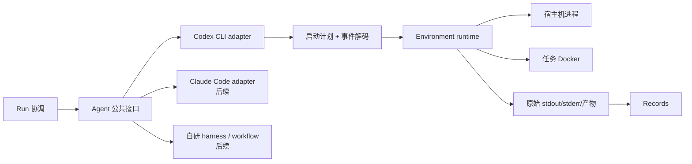

# Agent 模块设计与 Codex 首个实现

状态：首个实现，基于 `feat/agent-codex`；文中明确标出的后续能力尚未实现。

## 1. 目标与边界

Agent 模块负责把不同 Agent 的能力、认证状态、启动参数和原生轨迹转换成项目内稳定的表达。首批支持 Codex CLI，后续可增加 Claude Code、DeepSeek harness、自研 Agent 框架和 `workflow + LLM API`。

Agent 模块不创建 Docker 容器、不分配 CPU/GPU、不维护进程和超时，也不写数据库。Environment 执行 Agent 给出的启动计划，Run 协调生命周期，Records 保存标准事件和完整原生轨迹。这个边界使更换 Agent 不需要修改 Docker/Ray 后端，更换执行后端也不需要重写 Agent 适配器。



## 2. 公共抽象

当前公共接口在 `src/agent_infra/agents/api.py`，分为两层：

| 接口 | 用途 |
| --- | --- |
| `AgentAdapter` | 所有 Agent 的发现层：描述 provider、集成类型、能力，并检查安装和认证状态 |
| `CommandAgentAdapter` | Codex、Claude Code 等命令行 Agent：生成无 shell 的启动计划并解码事件流 |
| `AgentRunRequest` | Run 提供的稳定输入：run ID、提示词、工作区、运行位置、模型、推理强度，以及预留的恢复会话 ID |
| `AgentLaunchPlan` | Environment 消费的启动要求：argv、cwd、stdin、环境变量、挂载和容器镜像 |
| `AgentEvent` | 少量统一事件种类，加上 `native_type` 和完整原生 payload |
| `AgentProbe` | 安装版本、登录状态和容器认证是否可复用；不返回账号名或凭据内容 |

统一事件只用于跨 Agent 查询，包括 session、message、tool call、tool result、usage、completed 和 error。原生 JSONL 仍应完整保存，因此不会因统一格式丢掉 Codex、Claude Code 或自研框架的特有字段。Records 接入后保存原始流和标准事件；本次只实现解码，不实现持久化。

自研 Agent 有两种接入方式。已有 CLI/harness 可实现 `CommandAgentAdapter`；Python workflow 或 LLM API 服务实现共同的发现接口，并在后续 Run 契约中提供进程内或服务型执行端口。当前不会为了 Codex 提前固定所有自研框架的异步、流式和检查点语义。

## 3. 两种运行场景

### 3.1 日常科研：Agent 在宿主机

用户继续使用宿主机已经登录的 Codex。平台生成宿主机启动计划时保留用户的 Codex 配置，默认采用 Codex 的 `workspace-write` 沙箱，并通过 stdin 传提示词。未来 Environment 暴露受控的容器创建、命令、日志和产物接口后，宿主机 Codex 通过这些接口控制训练容器；Agent 不直接管理 Docker 生命周期。

本模式适合交互研究、持续对话和人工调整。用户目前可直接使用宿主机 Codex 交互界面；项目已能发现 Codex、检查登录和生成非交互启动计划。由项目托管交互会话，以及完整的宿主机 Agent → Environment → Docker 执行链路属于后续 Environment/Run 集成。

### 3.2 榜单评测：Agent 与任务在容器内

容器镜像安装固定版本的 Codex，工作区挂载到 `/workspace`，每个 Run 的独立 Codex home 挂载到 `/home/agent/.codex`。外层 Docker 已承担隔离时，计划才允许使用 Codex 的 `--dangerously-bypass-approvals-and-sandbox`；宿主机计划会拒绝这个组合。评测模式同时忽略宿主机用户配置和规则，避免个人 MCP、plugin 或 exec policy 改变榜单结果。

`deploy/docker/codex-cli.Dockerfile` 提供固定版本的基础镜像。真正的任务镜像应由 Environment 将任务依赖与 Agent 层组合，并记录最终镜像 digest；当前仓库还没有该镜像组合器和 Docker runtime。

## 4. 安装与认证

执行以下命令进行无副作用检查：

```bash
agent-infra agent doctor codex
```

执行以下命令保证 Codex 存在；已安装时不会重复安装，缺失时调用官方 npm 包安装命令。登录仍由用户完成，因为浏览器、device code 或 API key 的选择属于账号操作。

```bash
agent-infra agent setup codex
codex login
```

诊断结果会给出版本、登录状态和容器认证是否可复用，不包含账号标识。官方说明 `CODEX_HOME` 默认是 `~/.codex`，其中的 `auth.json` 等同密码。实现只把 `auth.json` 复制到任务私有目录，权限设为目录 `0700`、文件 `0600`；不会复制个人 `config.toml`，不会输出认证命令的 stdout，也不会挂载整个宿主机 home。

任务私有认证目录以读写方式挂载，使 Codex 可以在长任务中刷新 token；刷新结果不回写宿主机文件。Environment 完成实际运行后必须删除该目录。若宿主机使用系统 keyring 而没有 `auth.json`，诊断会报告宿主机已登录但不能直接复用到容器，用户需要选择文件型存储或为自动化配置 API key/access token。

ASI-Bench 同样只向容器暴露 Codex 的 `auth.json`，并为受限运行创建独立 home。本实现保留这个隔离原则，同时采用每 Run 副本，避免多个容器直接竞争或刷新同一个宿主机文件。

相关官方资料：

- [Codex CLI 安装与使用](https://developers.openai.com/codex/cli)
- [Codex 认证、CODEX_HOME 与 Docker 复制方式](https://developers.openai.com/codex/auth)
- [codex exec 参数与 JSONL 输出](https://developers.openai.com/codex/cli/reference)

## 5. Codex 启动与轨迹

Codex 适配器使用 `codex exec --json`，提示词从 stdin 输入，避免 shell 注入和命令行长度限制。宿主机计划使用实际工作区路径；容器计划使用固定的 `/workspace`。模型和推理强度由结构化请求转换成 argv，不拼接 shell 字符串。Codex 的 resume 子命令具有不同的参数集合，当前适配器会明确拒绝恢复请求，待会话生命周期设计完成后单独实现。

JSONL 的每一行会保留为原生 payload，同时映射到统一事件。工具调用和工具结果因此都可保存；实际 stdout/stderr 文件、事件追加、去重和查询由 Records 模块实现。格式异常的行转成 error 事件而不会导致整条轨迹静默丢失。

## 6. 后续开发接口

下一步按以下顺序接通实际执行：

1. Environment 实现本地进程和 Docker runtime，消费 `AgentLaunchPlan`，负责超时、取消、日志流和清理。
2. Run 将 Task 输入、Resource allocation、Agent request 和 Environment runtime 组装成 Attempt。
3. Records 同时保存统一事件、Codex 原生 JSONL、stderr、最终消息和产物引用。
4. 增加真实的最小 Codex 宿主机运行；随后构建任务镜像并做一个受限 Docker 端到端运行。
5. 以 `CommandAgentAdapter` 增加 Claude Code/DeepSeek harness，再根据真实自研 workflow 确定进程内和服务型执行协议。

本次没有调用模型，也没有声称 Docker 执行链路可用。已经实现并可验证的是发现、安装入口、认证复用准备、启动计划、事件解码和 Codex 基础镜像定义。
