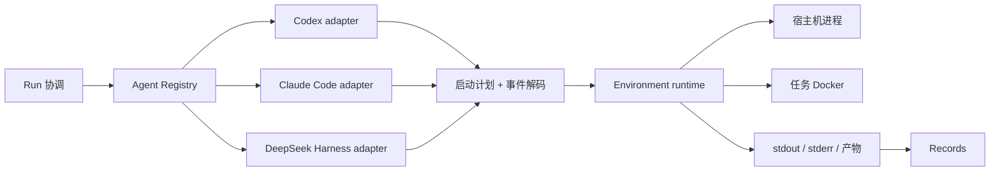

# Agent 模块设计与可替换 CLI Agent 实现

状态：首批 Agent adapter 和单节点 Docker Environment 已合入 `main`；真实模型 Agent
任务尚未验证。

## 1. 目标与边界

Agent 模块把不同 Agent 的能力、安装状态、启动参数和原生轨迹转换成项目内稳定的表达。当前接入 Codex CLI、Claude Code 和 DeepSeek Harness（DSH）；Run 或用户通过 provider 名称选择实现，不需要修改业务流程。

Agent 模块不创建 Docker 容器、不分配 CPU/GPU、不维护进程和超时，也不写数据库。Environment 执行 Agent 给出的启动计划，Run 协调生命周期，Records 保存标准事件和完整原生轨迹。这个边界使更换 Agent 不需要修改 Docker/Ray 后端，更换执行后端也不需要重写 Agent 适配器。



## 2. 代码结构与公共抽象

| 位置或接口 | 作用 |
| --- | --- |
| `agents/api.py` | provider 无关的请求、能力、启动计划、挂载、诊断和事件类型 |
| `agents/_cli_support.py` | npm CLI 探测、安装和私有配置文件复制，只供适配器内部复用 |
| `agents/registry.py` | 按 provider 选择适配器；支持少量用户友好的别名 |
| `agents/codex.py` | Codex 原生命令、认证和事件映射 |
| `agents/claude_code.py` | Claude Code 原生命令、认证和事件映射 |
| `agents/deepseek_harness.py` | DSH headless/profile 协议、配置和事件映射 |
| `AgentAdapter` | 所有 Agent 的发现层：描述 provider、集成类型、能力并探测状态 |
| `CommandAgentAdapter` | 外部命令 Agent：生成无 shell 的启动计划并解码事件流 |
| `AgentRunRequest` | Run 提供的稳定输入：run ID、提示词、工作区、位置、模型、推理强度和恢复 ID |
| `AgentLaunchPlan` | Environment 消费的 argv、cwd、stdin、环境变量、挂载和镜像要求 |
| `AgentEvent` | 统一事件种类、版本化规范载荷，并保留 `native_type` 和完整原生 payload |

新增一个同类 CLI Agent 时通常需要增加适配器文件和测试，并在 composition root 注册；若使用现有 npm/JSONL 约定，可以复用公共辅助层和通用镜像。仅增加一个 Python 文件不足以让 CLI、镜像、配置复制和测试自动认识新 provider。

自研 CLI/harness 可以实现 `CommandAgentAdapter`。进程内 Python workflow 或 `workflow + LLM API` 不必伪装成命令行；它们实现共同的发现接口，并在 Run 契约确定后增加进程内或服务型执行端口。

## 3. 三个 provider 的共同点与差异

Canonical provider 为 `codex`、`claude-code` 和 `dsh`。CLI 也接受 `claude`、`claudecode`、`deepseek` 和 `deepseek-harness` 别名。

| Provider | 非交互命令 | 模型选择 | 会话恢复 | 容器私有目录 |
| --- | --- | --- | --- | --- |
| Codex | `codex exec --json`，提示词走 stdin | 每 Run 的 `model`、`reasoning_effort` | 当前明确拒绝 | `/home/agent/.codex` |
| Claude Code | `claude --print --output-format stream-json --verbose`，提示词走 stdin | 每 Run 的 `model`、`reasoning_effort` | `--resume` | `/home/agent/.claude` |
| DSH | `dsh --profile headless --json`，提示词走 stdin | 由 DSH active profile 管理 | `--session-id` | `/home/agent/.dsh` |

公共请求不会抹平原生限制。DSH 0.1.5-rc.1 没有结构化事件和恢复参数，因此实现固定到已发布的 `0.1.6-alpha.1`，诊断会把其他版本标成不兼容，`agent setup dsh` 会安装所需版本。DSH 仍处于 developer preview，升级前必须重新验证 headless 协议。

统一事件包括 session、message、tool call、tool result、usage、completed 和 error。适配器保留每条
原生 JSON payload，并额外输出供跨 provider 查询的规范载荷。规范化不是复制全部原生字段，而是
稳定提取事件核心语义：message 的 role/text，工具的 call ID/name/arguments/result/status，usage 的
input/output/cache/reasoning token，以及 session/completion/error 的公共标识和状态。

一条原生消息可能包含多个 content block 或多个并行工具调用。适配器必须将每个 message block、
tool call 和 tool result 分别输出为独立 `AgentEvent`，同时保存 `native_sequence` 与 `part_index`，
使规范事件既有唯一顺序，也能回到同一原生 JSONL 行。无法识别的事件生成 `unknown`，不能猜测
不存在的字段。

Records 接入后同时保存原始 stdout/stderr、完整 native payload 和版本化规范事件。格式异常的行
转成 error 事件，不会让整条轨迹静默丢失。规范字段用于 Web、查询、统计和轨迹派生；native 与
raw stream 用于审计、重新解析和兼容 provider 升级。

## 4. 宿主机与容器模式

日常科研时，Environment 将宿主机计划作为本地进程执行，Agent 使用用户已经配置的原生 home。未来宿主机 Agent 通过 Environment 的受控接口操作训练容器；Agent 适配器仍不直接持有 Docker client。

榜单评测时，Environment 为每个 Run 创建私有配置目录和工作区，再按 `AgentLaunchPlan` 挂载进任务容器。Codex 只复制 `auth.json`；Claude Code 只复制 `.credentials.json`；DSH 复制 `settings.yaml`（或等价格式）和 `.credentials.yaml`。目录权限为 `0700`、文件为 `0600`，不复制个人规则、MCP、会话历史或 `.env`。运行结束后由 Environment 删除副本。

Claude Code 使用系统 keychain/OAuth 而没有 `.credentials.json` 时，宿主机模式仍可用，但诊断会报告容器认证不可复用。DSH 使用环境变量提供密钥而没有 `.credentials.yaml` 时也一样；Environment 后续需要实现显式 secret injection，当前不能把整个宿主机 home 当作替代方案。

容器模式只有在外层 Environment 提供隔离时，才允许适配器关闭 Agent 自身的交互审批。Codex 使用外层 sandbox 模式；Claude Code 使用 `bypassPermissions` 并关闭个人 customization；DSH 的工具和审批策略由固定 headless profile 管理。

## 5. 安装、诊断与镜像

```bash
agent-infra agent doctor codex
agent-infra agent doctor claude-code
agent-infra agent doctor dsh

agent-infra agent setup codex
agent-infra agent setup claude-code
agent-infra agent setup dsh
```

`doctor` 不修改状态，输出安装、版本、认证、兼容性和容器配置可复用性，不包含账号标识或凭据内容。`setup` 仅在缺失时安装 Codex/Claude Code；DSH 还会校准到 headless JSON 协议所需版本。登录和模型/API key 配置由用户在各 Agent 的原生界面完成。

`deploy/docker/node-agent-cli.Dockerfile` 是三个 Node CLI Agent 共用的固定版本基础层。例如：

```bash
docker build -f deploy/docker/node-agent-cli.Dockerfile \
  --build-arg AGENT_NPM_PACKAGE=@openai/codex \
  --build-arg AGENT_VERSION=0.154.0 \
  -t agent-infra/codex-cli:0.154.0 .
```

Claude Code 使用 `@anthropic-ai/claude-code`/`2.1.272`，DSH 使用 `@deepseek-ai/dsh`/`0.1.6-alpha.1`。真正的任务镜像应由 Environment 把任务依赖和这个 Agent 层组合，并记录最终 image digest；通用 Dockerfile 本身不等于该组合器。

官方接口依据：

- [Codex CLI](https://developers.openai.com/codex/cli)、[Codex authentication](https://developers.openai.com/codex/auth) 和 [Codex CLI reference](https://developers.openai.com/codex/cli/reference)
- [Claude Code CLI reference](https://docs.anthropic.com/en/docs/claude-code/cli-usage) 和 [Claude Code setup](https://docs.anthropic.com/en/docs/claude-code/getting-started)
- [DeepSeek Harness repository and headless CLI](https://github.com/deepseek-ai/deepseek-harness/blob/master/apps/cli/README.md)

## 6. 尚未完成的执行链路

1. Environment 实现本地进程和 Docker runtime，消费 `AgentLaunchPlan`，负责超时、取消、日志流和清理。
2. Run 将 Task 输入、Resource allocation、Agent request 和 Environment runtime 组装成 Attempt。
3. Records 同时保存统一事件、原生 JSONL、stderr、最终消息和产物引用。
4. 在明确模型费用和运行资源后，分别完成宿主机最小任务和任务容器端到端验证。
5. 根据真实自研 workflow 确定进程内和服务型执行协议。

当前验证范围不调用模型。已实现的是 provider 选择、发现与安装、私有配置准备、启动计划、事件解码和基础镜像定义；没有 Environment runtime 时，平台仍不能真正执行这些计划。
