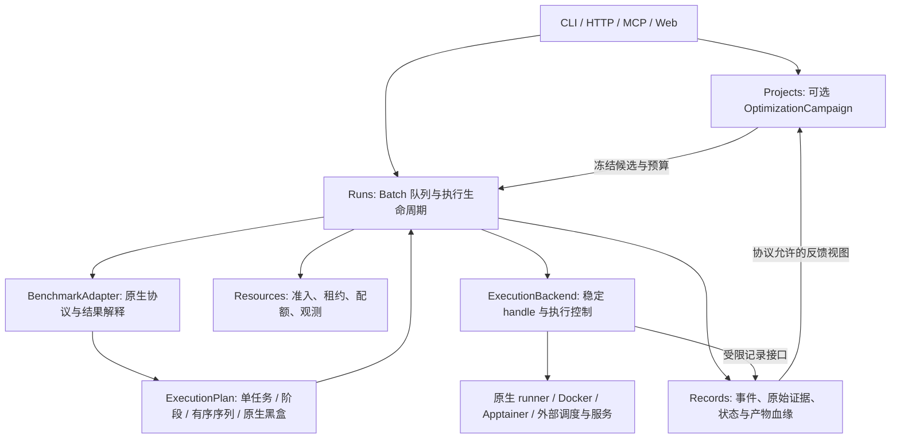

# Benchmark 接入层：通用执行、资源调度、轨迹与迭代优化

状态：**设计 v0.5；BM00/BM01/BM02-A/BM02-B 已进入本地 `main`，BM05-A、BM03、BM04 在叠加任务分支实现**。2026-09-23 修订，覆盖 ASI-Bench、Terminal-Bench-Science、PostTrainBench、PAST-Bench。已实现部分见 [SDK 参考](../reference/benchmark-sdk.md)、[执行参考](../reference/benchmark-execution.md)与各适配器操作说明，集成状态以[项目状态](../project-status.md)和 Git 为准。TB-Science 与 ASI-Bench 已有有限 CPU 原生证据；PAST-Bench 与 PostTrainBench 已完成无模型协议工程验收，尚未运行真实 Agent，PostTrainBench 的 H100/HTCondor/Apptainer 路径也尚未做真实集群验收。主要取舍见[协议与执行分离 ADR](../adr/20260922-benchmark-protocol-execution.md)。

## 1. 结论与通用性的边界

目标是：新 benchmark 接入时，增加协议适配、必要的执行后端和兼容性验收，复用平台的资源管理、记录、界面和迭代机制，**不修改 Run 的通用状态机来容纳每一个 benchmark**。

上一版“原生 runner + adapter”可以保留，但其独立单任务、同步 `run_trial()` 和 Docker 中心的假设不够通用。新方案明确三个边界：

1. **BenchmarkAdapter 定义原生语义**：评测单位、材料可见性、阶段依赖、状态继承、评分、反馈、汇总和提交资格。
2. **ExecutionBackend 执行并观测工作**：本机受管进程、Docker、原生 runner、外部调度器/远端服务，以稳定 handle 返回进度、结果与清理证据。
3. **OptimizationCampaign 管外层改进**：基于允许反馈形成新候选版本，按固定预算与比较规则运行，不改写 benchmark 本身。

“任意 bench 可接入”指架构不把协议限制为某两个数据集、某个 Agent 或 Docker。它不意味着给一个 URL 就零开发自动刷榜；UI、浏览器、模拟器、私有 API、在线交互、特殊硬件等仍可能需要 executor/工具扩展。外部权限、官方规则和资源可用性也不是接口能消除的限制。支持情况以 **benchmark 版本 × Agent × backend × 协议配置** 的验收矩阵表达。

## 2. 四种 benchmark 对抽象的检验

| Benchmark | 合理的运行单位 | 必须保留的协议差异 | 对平台的要求 |
| --- | --- | --- | --- |
| ASI-Bench | task 实例、seed、prompt level 对应的原生运行单位 | seed31415 本地评分；seed42 官网私有评分、OS Docker provenance 与提交确认 | 产物、评分、提交分离；原生 ID/seed/level 不丢失 |
| TB-Science | 固定 task 的 Harbor trial | 求解与独立 verifier，原生声明的 artifacts、资源、网络和时间约束 | 原生 task 包与容器协议保留，Agent/结果通过 Harbor 接口适配 |
| PostTrainBench | 指定目标基础模型与下游评测任务的一次限时训练实验 | 求解 Agent 可在预算内训练和评估；最终模型需评估，并有原生 judges | 长时 GPU、权重存储、阶段预算；solver/目标模型/judge 身份分开 |
| PAST-Bench | 一个 family 的有序 episode 序列及协议要求的配对比较 | fresh session、允许的持久状态、persistence on/off、原生汇总 | family 不能拆成无依赖任务；状态分支隔离；记录记忆读写和更新证据 |

ASI 的官方与本地评分边界、TB-Science 的独立 verifier 必须沿用源协议，而非由平台选择。[ASI 入门](https://github.com/apexin-ai/ASI-Bench/blob/main/docs/guide/getting-started.md)、[ASI 评分](https://github.com/apexin-ai/ASI-Bench/blob/main/docs/guide/how-scoring-works.md)、[TB-Science 规范](https://github.com/harbor-framework/terminal-bench-science/blob/main/CONTRIBUTING.md)。

### 2.1 PostTrainBench 的核对结论

官方仓库当前以 HTCondor 调度、Apptainer 容器为主，描述了 H100 上 10 小时的后训练任务；Harbor 接入 PR #8 仍为 open，不能把它写成已合并的稳定入口。实际接入需固定 upstream commit 和配置；缩短时间、换 GPU 或采用未合并适配分支时，记录为不同实验条件。[README](https://github.com/aisa-group/PostTrainBench/tree/3ed1d32ff1ec1f41282be6f8ebbcec07b19fc3d1)、[Harbor PR #8](https://github.com/aisa-group/PostTrainBench/pull/8)。

原生提示允许查询 `evaluate.py` 和多次实验，要求保存 `final_model`，并对基础模型、测试数据训练、额外模型 API 使用等作出限制。不能把所有 eval 都设为隐藏，也不能默认给求解 Agent 增加研究助手、用户交互或额外 API。[固定版本提示模板](https://github.com/aisa-group/PostTrainBench/blob/3ed1d32ff1ec1f41282be6f8ebbcec07b19fc3d1/src/eval/general/prompt.txt)。

结果处理还包括分析 Agent 轨迹的 judges，其 verdict 会影响分数处理或是否需要复核。只保存准确率和 `final_model` 不足以复现整套协议；应保存 judge 输入引用、版本、输出、重评关系和原生聚合结果。[Judge 说明](https://github.com/aisa-group/PostTrainBench/blob/3ed1d32ff1ec1f41282be6f8ebbcec07b19fc3d1/src/judges/README.md)。

### 2.2 PAST-Bench 的核对结论

原生运行入口围绕 family 展开，生成逐 episode、sequence summary 和 paired comparison。平台的“可调度单位”至少需要包含完整序列及比较条件；内部 episode 可以展示，不能任意乱序或并行。[官方 README](https://github.com/Gen-Verse/PAST-Bench/tree/f8223517ae7491e776b69793d9f11e9d074ab42e)。

论文描述每个 episode 清除易失对话上下文，持久信息通过原生 memory/skill/history 等机制传递；persistence-off 对照移除对先前状态的访问。提升需要结合原生机制证据判断，不能只计算末轮分数。[论文协议](https://arxiv.org/html/2608.04003v1)。

源代码还表达 history anchors、分支、preseed 和每个 episode 的 persistence/session 配置。平台要读取固定 manifest 的原生策略，不能只靠“每轮换一个 Docker”实现清理，也不能替 Agent 注入平台总结来增强其记忆。[Sequence 模型](https://github.com/Gen-Verse/PAST-Bench/blob/f8223517ae7491e776b69793d9f11e9d074ab42e/src/past_bench/models/self_evolve.py)、[原生 runner](https://github.com/Gen-Verse/PAST-Bench/blob/f8223517ae7491e776b69793d9f11e9d074ab42e/src/past_bench/runner/self_evolve.py)。

## 3. 逻辑架构与模块职责



以上是业务调用关系，不表示所有组件可以相互 import。

| 模块 | 负责 | 不应放进来的逻辑 |
| --- | --- | --- |
| `benchmarks`（新增） | 固定来源、能力协商、原生计划、可见性/状态/反馈策略、解析/聚合/资格检查 | 通用队列、数据库后端、修改 Agent 的推理循环 |
| `tasks` | 公开材料索引、Task 身份和快照；供展示与平台任务使用 | 强制把原生 task 包搬成一个统一目录 |
| `runs` | 计划推进、operation ID、唯一的 Batch 等待队列、状态恢复、取消、重试策略执行 | 在通用代码中解析每个 bench 的原生文件 |
| `agents` | Agent 配置与运行能力、会话与原生事件适配 | 让所有 CLI 默认拥有原生框架的持久记忆能力 |
| `environments` | 本机进程/容器执行、文件/服务生命周期与隔离；提供后端公共接口 | 评测权重、family 聚合、外层方案选择 |
| `resources` | 准入、持久租约、后端分配映射、资源采样、配额与预算 | 决定哪些答案正确或允许多少次官方尝试 |
| `records` | 原始证据、派生视图、artifact/state 引用、可见性与导出 | 自动把私有 grader 结果交给优化 Agent |
| `projects` | 用户目标与外层 Campaign：候选修订、授权范围、停止/选优 | 替代 benchmark 内部已经规定的学习或训练过程 |
| `bootstrap` / `gateways` | 注册已审核 adapter/backend；薄的入口与身份检查 | 通过不可信 manifest 任意 import Python 模块或执行宿主机 shell |

原生 runner 内部已有阶段调度时，由它负责内部次序；平台提交一个 `native_job` 并观测子事件。平台只有在拥有相应执行权、且 adapter 提供完整语义时，才调度显式阶段。两层不能同时给同一批子任务排队、计预算或释放同一 GPU。

## 4. 从“独立任务”改成“协议定义的工作单位”

保留目录与执行的区别：`Suite → Case/Family` 是固定数据集目录；`Campaign（可选）→ Batch → Trial → Attempt` 是运行血缘。Case 是引用，不是又一套业务状态机。一个 Trial 内允许含有顺序阶段和多个 episode；一个 native job 也可能产生多个原生 trial，adapter 必须给出一对多映射，不能丢掉子身份。

| 概念 | 必要字段与语义 |
| --- | --- |
| `SuiteRef` | benchmark/release、task 集合摘要、runner/adapter 版本、配置与数据 revision；`latest` 在规划时解析为固定版本 |
| `WorkUnit` | case 或 family 引用；`single` / `sequence` / `paired_sequence` / `native_job`；原子边界由协议决定 |
| `CandidateRef` | solver Agent/harness 版本、模型、提示/工具/skill 配置；目标训练模型与 evaluator/judge 另存独立引用 |
| `ExecutionPlan` | 工作单位、阶段依赖、执行所有者、资源/预算请求、会话/状态/反馈策略、原生不可变配置与计划摘要 |
| `ExecutionHandle` | backend ID、原生 job ID、operation ID、owner、状态游标；不返回 Docker client/Ray handle |
| `StateRef` / `ArtifactRef` | 版本/摘要、存储引用、大小、可见性、产生者及父引用；复用现有 ArtifactRef，新增恢复语义元数据 |
| `Outcome` | 执行、评测、协议有效性、清理、记录完整性分别表达；原生分数向量、聚合器版本与证据引用 |

首期只实现独立任务、顺序阶段、原生托管序列这三种计划形态。依赖字段预留表达能力，不先写完整通用 DAG 平台。交互式远端 API 可作为一个运行单元持续返回观测；需要新执行能力时增加 backend，不改 Case 的含义。

**Attempt、Episode 和候选迭代不同**：Attempt 是一次物理启动/恢复记录；Episode 是原生协议里的学习/评测环节；修改方法形成新 Candidate。平台重试、原生采样和优化迭代各自计数，不能靠“基础设施重试”重置原生次数或时间。只有确实未开始求解且协议允许的失败才可安全重试；其余默认保留失败或交由原生恢复规则处理。

## 5. 对外接口：协议、执行与证据分开

以下为职责示意，不是可执行 API。各领域的契约放其公开 `api.py`，`contracts/` 仅放真正跨领域的轻量引用，不放所有 benchmark DTO。

```python
class BenchmarkAdapter(Protocol):
    def discover(self, source: SuiteRef) -> Catalog: ...
    def plan(self, selection: Selection, candidate: CandidateRef) -> ExecutionPlan: ...
    def validate(self, plan: ExecutionPlan, capabilities: Capabilities) -> Preflight: ...
    def interpret(self, evidence: EvidenceRef) -> BenchmarkOutcome: ...
    def aggregate(self, outcomes: tuple[BenchmarkOutcome, ...]) -> AggregateResult: ...
    def submission_spec(self, results: ResultSetRef) -> SubmissionSpec | None: ...

class ExecutionBackend(Protocol):
    def submit(self, operation_id: str, spec: ExecutionSpec) -> ExecutionHandle: ...
    def observe(self, handle: ExecutionHandle, cursor: str | None) -> ObservationPage: ...
    def cancel(self, handle: ExecutionHandle) -> CancelReceipt: ...
    def reconcile(self, operation_id: str) -> Reconciliation: ...
    def collect(self, handle: ExecutionHandle) -> EvidenceManifest: ...
    def cleanup(self, handle: ExecutionHandle) -> CleanupReceipt: ...
```

Run 把 Benchmark 层的 `ExecutionPlan` 翻译成 Environment 公共 `ExecutionSpec`：通用命令/原生作业描述、受控输入、资源限额、预算、状态范围和所有权引用。后者不 import Benchmark 层或 Resources 的类型；数值来自已批准的租约/配额，沿用现有 ProcessCommand/InputMount 等契约，避免低层依赖高层。checkpoint/resume 是独立的可选 capability，不能给所有 backend 提供一个空实现而声称支持。原生语义无法按阶段暴露时，adapter 产出固定参数的黑盒计划，由后台监督器运行，事件覆盖明确标为有限。

`submission_spec` 只生成提交计划；真正上传、外部 job 启动由 Run 经执行接口执行，继续受既有授权与预算约束。这样不再把上传、等待官网和评分塞进一个同步 `run_trial()`。

提交前先持久化 intent；外部成功但本地尚未保存 handle 的窗口，通过原生幂等 key/ownership tag 查询。上游没有幂等或查询能力时，状态设为 `unknown` 待对账，不承诺 exactly-once、不盲目再提交。恢复后预算累计不归零；失联也不等于资源已清理。

## 6. 状态、会话与可见性必须显式声明

`StatePolicy` 至少分别表达：`session`（fresh/resume/native）、`workspace`（reset/preserve/native）、`persistent_state`（none/native_scoped/指定 snapshot）、`scope`（episode/sequence/condition/trial）、以及由哪个原生组件 reset/snapshot/restore。权重 checkpoint、Agent memory、对话记录和系统状态不可混成一个“持久目录”。

PAST adapter 第一版让原生 runner 管理整个 family 和配对分支；平台记录各 episode/session ID、分支 ID、前后状态摘要与原生事件。需要复制或清除哪些 home、memory、skill、session index 由原生 adapter 实现并验证；不能只删提示词。配对状态与不同 family 的状态不能交叉；原生规定共享的 cold/anchor 按协议引用。Records 中保存了历史，不等于求解 Agent 自动获得历史读取权限。

PostTrainBench 的训练进程可能在一个 session 内多次更新目标模型；这些是同一个限时 trial 的内部行为。保存恢复 checkpoint 不自动授权额外训练时间或额外尝试，官方模式是否可以 resume 由原生规则决定。

`VisibilityPolicy` 需要按角色和阶段区分 solver、训练代码、公开自检、私有 grader、outer optimizer 和管理员。PostTrainBench 原生允许的 evaluation 工具应继续可见；ASI 私有评分和 TB verifier 不因此开放。平台摘要、外层助手、MCP 工具、缓存、错误日志和预置记忆同样受策略控制。

如果评测器必须加载候选模型/代码，按原生契约在受限 evaluator 环境执行，隔离宿主机与无关私密数据；不能强制套用现有“所有 scorer 都只读纯数据”的通用样例。若原生协议隔离能力不足，标出验证边界；修改隔离方法须验证不会改变评分语义。

## 7. 资源监控、调度与原生执行权

资源管理需区分四项事实：**要求是什么、谁获准分配、实际分配了什么、观测到用了多少**。上一版 `admitted/enforced/observed_only` 不应是互斥的一个状态；新版分别记录 admission、allocation、enforcement evidence 与 telemetry coverage。

| 能力 | 需要补齐的内容 |
| --- | --- |
| 请求与配额 | CPU/内存、GPU 数量与型号/显存/UUID、磁盘容量、工作目录与模型缓存；必要时 GPU 拓扑及同组启动 |
| 持久调度 | Run 维护等待队列与优先级/公平性，Resources 维护原子租约、心跳、陈旧观测处理和分配对账；不能仅有进程内 `_leases` |
| 阶段资源 | 构建、solver、训练、评测、judge、sidecar 的资源图；顺序共享或并发峰值、服务就绪与就近数据 |
| 实际限制 | CPU/memory cgroup、指定 GPU 设备及进程可见范围；`CUDA_VISIBLE_DEVICES` 单独不能作为安全隔离证据 |
| 监测归属 | 主机利用率 + job/cgroup/container 的 CPU、RSS、GPU 显存/利用率、磁盘/IO、时间；共享 GPU 只报告可归属数据 |
| 外部调度 | HTCondor/其他队列/云 API 返回的 job ID、节点/设备分配、实际开始/结束、计费与取消回执 |
| 长时预算 | 队列、构建、Agent、训练、评测、judge、收集时长分别计量；起算点遵守原生规则 |

本机执行由 Resources 发放实际租约，backend 将限额应用到它创建的资源。外部调度模式由平台发放配额授权、由上游 allocator 分配实际节点，平台记录映射；不能同时在本机预占一张 GPU 又把同一请求交给远端队列。外部资源不足保持 queued，不用本机 `nvidia-smi` 冒充远端监测。

**原生 runner 不是天然可安全托管的程序。** 当前检查的 PostTrainBench `run_task.sh` 在最终评估前包含枚举可见 GPU 进程并 kill 的操作，以及带固定路径的工作区处理。这反映了它的运行环境假设，直接在共享宿主机调用可能影响其他任务。必须先审计并建立独占节点/VM/有效权限隔离，或实现经验证的 scoped-cleanup 适配；不能只包 `subprocess` 就启动。[固定版本运行脚本](https://github.com/aisa-group/PostTrainBench/blob/3ed1d32ff1ec1f41282be6f8ebbcec07b19fc3d1/src/run_task.sh)。同样检查 Docker socket、宿主机目录挂载和服务端口。

ASI 原生 runner 如只支持 `--gpus all`，不能在共享多卡节点宣称指定卡独占；Harbor/云 provider 的资源策略也须实测。后台 Agent 退出不等于训练进程、容器或外部服务退出；收到任务资源不存在的证据后才释放租约。失联时进入 quarantine/reconciling，不按超时自动超卖。

Ray 可在后续作为分布式派发/Worker 实现，实际限额仍由 backend/OS/provider 执行。兼容多节点的契约现在明确，本轮不要求先引入 Ray、Kubernetes 和所有集群后端。

## 8. 记录：从最终结果扩展到全过程证据

复用 Records 的 raw stream、EventEnvelope、ArtifactRef、可见性与 normalization version，新增引用与关联，不再建一个平行日志系统。

| 数据 | 用途与要求 |
| --- | --- |
| 执行证据 | operation/native job ID、phase/episode/session、命令与结果、结束原因、清理和资源回执 |
| 原生 Agent 轨迹 | 请求、消息、tool call/result、原生 session/step；可获取多少记录多少，缺失/截断/脱敏明确标注 |
| 训练证据 | 配置、代码/data/base-model revision、指标、checkpoint/final-model、父 checkpoint 和预算消耗 |
| 持久状态证据 | memory/skill/history 的实际写入/检索/更新事件、状态前后摘要与差异、分支和 anchor；仅有文件 diff 不能证明实际读取 |
| 评测证据 | 原生结果、judge 输入引用与版本、允许反馈视图、评测重跑关系、聚合公式与纳入/排除原因 |
| 候选血缘 | campaign/candidate/parent、更改说明、依据的允许反馈、训练/验证/正式数据用途、比较结果 |

“框架外部运行”可以先保存原生文件和低覆盖的事件，但预检要声明不能承诺看见每条容器指令、模型请求或 memory read。需要细粒度分析时为原生 runner/Agent 增加钩子；不为凑齐标准格式捏造缺失步骤。时间戳之外保留 producer 序号和调用关联，避免并行日志被简单按时间排序后错误配对。

大模型产物不能靠把 HTTP 下载上限调大解决。Records 保存清单、大小、checksum、可用性与受控存储引用；大文件流式/分块传输、断点续传，支持本地或对象存储。共享 volume 仅在 quiesce 后形成只读快照或受控副本并校验，不能让 evaluator 读仍被训练端修改的权重。固定基础模型和公开数据可复用只读缓存；PAST 的 memory、测试结果缓存等不得串 trial。

保留原始格式以便以后重新解析，正常运行证据保存在仓库外；凭据不归档，必要脱敏留标记。RL 导出另外检查许可、split、完整 observation/action/tool result、reward/终止、行为策略版本等。现有 CLI 轨迹不保证 token ID/logprob，也不能仅凭原生 JSONL 就声称可直接用于任意 PPO/GRPO 训练；具体训练算法需单独的数据充分性检查。

## 9. 评分与“循环优化刷榜”

### 9.1 保留多维结果，遵守原生失败语义

Outcome 分为 execution、evaluation、protocol validity、cleanup、capture、submission 六个维度。评分包含原生指标、方向、单位、粒度和来源；聚合由 adapter 解释，保留原始输出。不能默认所有 benchmark 都是 pass@1、平均分或越高越好。

平台不把基础设施失败擅自改成零分，但若原生规则明确规定超时计零、违规回退 baseline 或某类错误需要人工复核，应记录该原生处理及原因。PAST 论文报告了超时/崩溃 episode 不重跑并计零的设置，具体执行以锁定 runner 为准；PostTrainBench 部分 judge verdict 会触发 baseline 回退。原始失败仍要保存，不能仅留下一个 0。[PAST 复现实验设置](https://arxiv.org/html/2608.04003v1)、[PostTrainBench judge 结果处理](https://github.com/aisa-group/PostTrainBench/blob/3ed1d32ff1ec1f41282be6f8ebbcec07b19fc3d1/src/judges/README.md)。

### 9.2 区分三种循环

| 循环 | 谁决定 | 平台怎样处理 |
| --- | --- | --- |
| 单次 Trial 内训练/试验 | 原生协议与被测 Agent，如 PostTrainBench | 保留评估工具与同一总预算，不自动拆成无限新 trial |
| 协议规定的跨 Episode 学习 | 原生 sequence runner，如 PAST | 遵守顺序、状态与配对规则；不额外注入外层优化反馈 |
| 多次 Trial 之间改 Agent/方法 | 平台可选 OptimizationCampaign | 每次形成不可变候选，通过明确反馈视图和预算校验后运行 |

外层流程为 `冻结基线 → 运行允许的开发评测 → 分析允许反馈 → 提出候选修订 → 确定性校验 → 新 trial → 按预设规则比较/停止 → 固定候选进行最终评测`。优化对象可以是 harness、prompt、skill、训练代码或超参数，但不能包括受保护 grader、数据切分、原生预算和测试答案。

`FeedbackPolicy` 指定可见字段/日志、接收者、释放时机、可查询次数与用途；`OptimizationPolicy` 指定允许修改范围、原生开发/验证/正式 split、总 trial/时间/GPU-hour/模型调用预算、并发上限、停止条件和候选选择规则。可以一次授权一个清晰范围，使 Agent 在范围内自行迭代，不要求每一步人工确认；已有 I 批的“冻结 Task 集合授权”需扩展为可校验的新候选范围。

不强加每个 bench 都有 train/dev/test：没有独立开发集时如实说明，使用自有代理任务的结果不能叫官方分数；原生允许在任务内查 eval 的情况也不擅自禁掉。正式结果不能默认重新注入优化循环；若原协议允许有限反馈，按其次数和可见性执行。报告保留所有规定尝试、随机种子、完整 pair/family、费用和置信信息（可估计时），不能只挑最高分冒充官方平均。

模型费用还需 provider usage/计费数据或可拦截的调用预算。当前实现只有次数/时间/资源等边界，没有硬费用上限；不足以精确计费时标注 estimate/soft limit，并说明超额窗口，不把预算配置写成保证。

## 10. 四个 adapter 如何落地

| Adapter | 第一条可验收路径 | 特别验收 |
| --- | --- | --- |
| `asibench` | 原生 pull → produce-only → seed31415 scorer；seed42 另走 bundle/provenance 校验 | prompt level/seed 不变、本地/官网分开、Agent/sandbox 兼容、原生 GPU/清理能力 |
| `harbor` + TB-Science profile | 固定数据集与 Harbor → 原生 trial → reward/trajectory 导入 | 独立 verifier、声明 artifacts、网络/资源、取消与残留对账 |
| `posttrainbench` | 固定主分支的受支持隔离 HPC 路径；或明确标为实验性的固定 Harbor PR commit | 目标模型身份、GPU 型号/预算、完整 judges/聚合、权重交接、共享主机安全性 |
| `pastbench` | 原生 family runner 管理配对序列 → episode/summary/comparison 导入 | fresh session 与状态保留分离、对照无跨组污染、原生顺序/失败计分与机制证据 |

同一个 Harbor backend 可运行多个 bench，但 PostTrainBench 的 judges、模型约束和报告不是 TB-Science profile 的参数别名；需要自己的协议 adapter。PAST 已有特定 Agent runtime 适配，不能因为平台会运行 Codex 就声称 Codex 满足其 native memory/skill/history 契约；先验证已有原生 Agent，再单独做新的 Agent 桥接。

## 11. 代码结构与兼容迁移

按现有领域扩展，适配器采用**独立 Python 发行包**。公共 SDK 随核心提供，适配包只导入公开接口。
安装之后通过管理员配置显式启用 distribution/version/entry point；不修改核心注册表或按 bench 名增加 CLI 分支。
核心 SDK、包和原生 runner 分别版本化，不允许 Task manifest 指定任意 import 路径。

```text
src/agent_infra/
  benchmarks/
    api.py                 # 已实现：SDK 1.0 协议对象与规划接口
    registry.py            # 已实现：显式启用、entry point、版本检查
    planning.py            # 已实现：目录快照、冻结、能力检查
    testing.py             # 已实现：公开 conformance helper
  runs/
    benchmark_batch.py     # 分批实现，复用 Run/Attempt 与控制存储
  environments/
    execution_api.py       # handle/observe/cancel/reconcile；已有能力可桥接
    native_process.py      # 受管进程与可追踪原生 runner
    backends/              # 按需要加入 Harbor/HTCondor 等执行桥
  projects/
    benchmark_campaign.py  # 复用候选修订、授权与分析模式
  resources/               # 扩展持久分配、设备能力与采样
  records/                 # 扩展关联、状态/大产物清单与轨迹导入

examples/benchmark-adapter/ # 已实现：独立可安装模板 + 四类合成 fixtures
adapters/                  # 后续：四个独立 Python 项目，可独立迁仓发布
  asibench/
  tb-science/
  posttrainbench/
  pastbench/
```

除标为已实现的入口外，上面仍是拟议目录。执行后端不理解分数/答案，原生语义模块不操作数据库或直接分配资源。导入方向：`bootstrap → gateways → projects → runs → benchmarks → agents/tasks → environments/resources → records → contracts`；同行仍独立、跨模块只调用公共契约。BM00 已更新 import-linter 并补反向依赖测试；bootstrap 组装注册器，只有明确启用的受信任包才可加载。

现有科研命令继续使用原流程。`agent-infra benchmark adapters/inspect/plan/check` 在 BM00 实现，
只做元数据、确定性规划与离线声明检查，`runtime_ready` 保持 false；配置、摘要和源码漂移均检查。
`run/status/cancel/results/optimize` **尚未实现**。后续 run 依据同一 plan digest 执行，参数/数据变更要求重新规划。
最初 CLI 完整后再接 Web，HTTP/MCP 复用同一业务用例。

包入口使用 `agent_infra.benchmarks.v1`，SDK 精确版本握手；不同 major 不隐式加载。
支持矩阵至少保留 adapter/source/runner/profile 与 Agent 版本、模型、backend 的组合，
包可加载、计划有效、声明兼容、真实执行通过、官方接受分别记录。独立样例 wheel 的安装验收
在源码树外进行，不能仅用 `PYTHONPATH` 注入来证明包独立。
扩展者入口见[开发指南](../development/benchmark-adapters.md)。

## 12. 当前实现差距与修改顺序

| 当前证据 | 距离通用目标的缺口 | 应修改的位置 |
| --- | --- | --- |
| `tasks/importers.py` 只做工作区索引；无四套原生 adapter | 没有协议执行/等价性 | `benchmarks` 与 Tasks 只读目录桥 |
| `bootstrap/run_preflight.py` 限 Codex、无评测科研 Task | 不能提交原生协议、任意 Agent 或原生工具 | 按执行策略分流；保留拒绝未知能力，不能删 guard 就算接通 |
| `runs/controller.py` 单活动槽；重启以中断/清理为主 | 无持久批量队列、远端 handle 恢复与顺序依赖 | Run 控制状态与 Batch；先本机顺序、再并发 |
| `resources/local.py` 进程内租约，CPU/mem/GPU 单节点准入 | 无远端 allocator 映射、长作业租约、GPU 型号约束和完整逐 job 监测 | Resources 和 backend enforcement |
| `environments/docker.py` 与既有阶段配方主要面向 Docker | 缺 Apptainer/HPC/服务端执行、原生清理隔离与 sequence 状态契约 | 公共 execution handle 与按需后端 |
| Records 已有原始流/派生轨迹；HTTP 下载有大小边界 | 缺 family/condition/candidate 血缘、原生 memory 事件、大权重可靠传输 | 扩展现有 Records/存储，不建第二份总日志 |
| `projects/iteration.py` 仅授权已冻结 Task；Planner 只在此集合中操作 | 无受控生成新候选和 benchmark feedback-aware Campaign | Projects 迭代服务 + adapter 策略校验 |
| 当前 Web 是科研工作流与 Run 视图 | 缺 Batch、配对序列、模型产物、官方资格与反馈权限展示 | 在相同 Query API 上增加视图 |

阶段统一使用 **BM 前缀**，替代上一版 B0–B4，避免与已经实现的科研规划 B01–B05 混淆：

| 阶段 | 最小交付 | 可验证结果 |
| --- | --- | --- |
| BM00 协议与独立 SDK | 独立适配包、SDK、启用/兼容检查、来源/WorkUnit/Plan/state/feedback、四类 fixtures | 独立 wheel 无需改核心；未启用/不兼容拒绝；四种协议可表达；保留序列与公开 eval；无模型运行 |
| BM01 执行与恢复契约 | operation/handle、observe/cancel/reconcile、证据游标 | 提交丢响应不重复启动、重启查询/失联隔离、取消与清理顺序可测 |
| BM02 两个首批 adapter | ASI CPU 本地评分 + TB-Science CPU 原生 trial | 同一产物评测/解析等价；真实 Agent 结果有随机性，不要求两个独立求解分数完全相同 |
| BM03 序列验收 | PAST 一个完整 family/配对；先原生支持的 Agent | 顺序、fresh session、on/off state、机制事件和原生汇总均可核对 |
| BM04 训练与产物验收 | PostTrainBench 一项训练的隔离后端、权重交接与完整 judges | 先有限预算工程 smoke 标为非标准条件，再按原生硬件/预算单独验收兼容性 |
| BM05 资源与 Batch | 持久租约/队列、并发、逐 job 监测、阶段预算 | 在共享节点不越权、不超卖；外部调度分配可追溯；大产物中断可恢复 |
| BM06 外层优化 | Candidate、FeedbackPolicy、预算/停止/选优、对照记录 | 至少两候选基于允许反馈迭代；不给 optimizer 隐藏评测；保留全部比较依据 |
| BM07 交付与扩展 | Batch/Campaign Web、原生 submission bridge、第三方扩展验收与兼容矩阵 | 模板已在 BM00 提供；无官方 API 时待外部确认；新 bench 不修改 Run 主状态机 |

BM00/BM01 先定义 BM03/BM04 所需的状态和产物扩展；BM05-A 的最小持久队列/租约对账提前到长任务接入前，BM05-B 才扩大并发。BM04 前落实实际 GPU 限额、清理范围和权重交接。初期持久状态复用本地数据库和单调度进程，后续 Worker/Ray 作为独立阶段推进。逐阶段检查点见[实施顺序](../development/benchmark-development-plan.md)，每阶段交付后等待用户检查再继续。

每阶段分别记录结构/契约测试、替身测试、真实 backend 与真实模型验收。自造 fixtures 只证明平台语义，不能证明原生评分等价；采样的评分对照也不能证明全 benchmark 无差异。原生版本/工具变更触发相关兼容用例，缓存和已完成 trial 均按计划摘要识别。

## 13. 接入验收与文档维护

新 benchmark 至少提交固定 source/runner 版本、只读 catalog、支持矩阵、计划/可见性/状态/反馈声明、执行与结果适配、取消/失败证据及原生对照用例。黑盒托管也可成为初始能力，但界面必须显示监测与轨迹覆盖，不能自动升级成“完整可优化”。

兼容等级分别表示：`indexed`、`runnable`、`scored`、`protocol_validated`；官方提交资格、恢复能力、资源 enforcement、轨迹 completeness、optimization 能力另列。没有官方上传入口时保留外部引用/人工状态，不虚构统一“自动上榜”API。最终官方是否接受由 benchmark 方决定，平台的验证矩阵不等于官方认证。

本设计的依据版本：Agent Infra 文档修订基于 `7841d23`；PostTrainBench `3ed1d32ff1ec1f41282be6f8ebbcec07b19fc3d1`；PAST-Bench `f8223517ae7491e776b69793d9f11e9d074ab42e`。ASI/TB-Science 沿用前轮官方文档核对，正式实现时重新固定对应源码与数据版本。公开资料、PR 状态仅表示检查时的事实。

关联阅读：[Tasks 建模](task-model.md)、[Run/Environment 契约](run-environment-contract.md)、[Records 设计](records-design.md)、[当前科研迭代](../reference/research-iteration.md)、[本任务记录](../changes/20260922-benchmark-layer-design-6a4d9e.md)。
