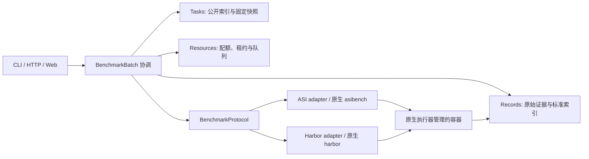

# Benchmark 接入层设计：ASI-Bench、Terminal-Bench-Science 与后续基准

状态：**设计草案，尚未实现**。本文描述目标接口和分阶段落地方案，不表示 Agent Infra 已能运行或正式提交这两个 benchmark。实际能力以[项目状态](../project-status.md)、[Tasks 参考](../reference/tasks.md)和代码为准。

## 1. 目标与边界

Agent Infra 要统一管理一批 benchmark 的任务发现、资源准入、运行状态、原始轨迹、结果查询与对比，但**不替代 benchmark 官方定义的任务生成、容器协议、评分规则和提交资格检查**。同一个 Web/CLI 入口应能选择数据集固定版本、任务子集、Agent、模型、资源上限与尝试次数，随后看到每个 trial 的真实结果及其来源。

首期支持两条原生路径：

- ASI-Bench：由固定版本 `asibench` 拉取实例、运行 Agent、收集输出；seed31415 调用原生本地评分，seed42 保留 Docker OS provenance 并按官方流程生成待确认的提交。平台不自行计算 seed42 官方分数。
- Terminal-Bench-Science（下称 TB-Science）：由固定版本 Harbor 读取数据集/任务并管理求解容器、声明的 artifacts 和独立 verifier；平台读取 Harbor job/trial 产物，不复制 `tests/`、`solution/` 到 Agent 环境。

先做**原生执行器托管模式**：一个 trial 的容器由原生执行器全权创建和清理，Agent Infra 在外层提供预检、调度与记录。现有 `LocalRunService` 的平台求解/评测路径保留给科研 Task 和已证明等价的集成；不能在同一 trial 中既让原生 runner 管容器，又让 `Environment` 再管一套容器。以后只有在上游扩展点可用且通过等价性验收时，才允许平台托管内部容器。

**非目标**：用统一 YAML 重写任意 benchmark 的 grader；把公开本地分数称为官方分数；绕过官网认证或人工确认；保证所有原生 runner 都能准确限制指定 GPU。Benchmark adapter 是可验证的协议连接器，不是无须开发和测试的万能转换器。

## 2. 经官方协议核对的差异

| 方面 | ASI-Bench | TB-Science / Harbor | 接入要求 |
| --- | --- | --- | --- |
| 固定身份 | 实例集 seed、原生 task ID、B1–B4 prompt level、原生版本 | Harbor 数据集版本、任务 ID、task 包与 Harbor 版本 | 批次与每次 trial 均记录不可变来源；不默认 `latest` |
| 求解材料 | 拉取的 prompt/input，原生 builder 准备工作区 | `instruction.md`、`task.toml`、`environment/` | 仅索引实际允许 Agent 读取的材料，保留原生路径 |
| 原生执行 | `asibench run`；内置 Agent 与通用 `--agent-cmd` 的 sandbox 能力不同 | `harbor run`；内置或自定义 Agent、环境 provider | 先做可用 Agent × sandbox/provider 能力检查 |
| 评测 | seed31415 可本地评分；seed42 网站私有评分 | 声明 artifacts 经独立 verifier，产生 reward | 分开记录评测状态、原生分数、正式状态 |
| 提交 | seed42 只接受有效 OS Docker provenance 的结果；上传 draft 后须网页确认 | Harbor job/trial 与其结果查看、可能的 Hub/榜单流程 | 官方资格由原生协议判定，不由平台推断 |
| 资源 | 原生 sandbox 决定实际容器启动参数 | `task.toml` 声明 CPU、内存、存储、GPU，provider 有各自执行策略 | 同时核对任务要求、平台配额和原生执行器实测限制 |

TB-Science 任务的 `tests/` 与 `solution/` 不可见于求解 Agent；它要求独立 verifier，并仅传递 `task.toml` 声明的 artifacts。ASI-Bench seed42 的私有参考答案在官网，公开本地评分与正式评分是不同结果。[ASI-Bench 入门](https://github.com/apexin-ai/ASI-Bench/blob/main/docs/guide/getting-started.md)、[ASI-Bench 评分](https://github.com/apexin-ai/ASI-Bench/blob/main/docs/guide/how-scoring-works.md)、[TB-Science 任务与评测规范](https://github.com/harbor-framework/terminal-bench-science/blob/main/CONTRIBUTING.md)、[Harbor 任务格式](https://www.harborframework.com/docs/tasks)。

## 3. 与当前模块的关系



- **Tasks** 保存可见任务索引、原生 ID/revision、材料来源和能力声明。现有 `import_asibench_workspace()` 仅完成 `indexed_only`；新增 adapter 不把原生 `task.toml` 或评测配置强行改写为平台 `task.yaml`。TB-Science 可做只读公开索引，但完整 task 包仍由 Harbor 解释。
- **Agent** 描述平台支持的 provider/模型/能力；adapter 将其映射到原生 runner 的已验证 Agent 选项。平台有 Codex adapter 不代表 ASI 的任意 `--agent-cmd` 可用于 seed42 官方模式；不兼容时预检拒绝或开发上游兼容 adapter。
- **Runs** 负责 Batch/Trial/Attempt 生命周期、幂等提交、取消、重试和最终汇总。它只调用 `BenchmarkProtocol`，不 `if benchmark == ...` 解析原生文件或分数。科研 Run 与 benchmark Trial 共用 Records/Resources 基础设施，但流程互不冒充。
- **Environment** 在原生托管模式下不创建求解或评分容器；它可提供宿主机 Docker/镜像诊断、所有权检查与清理证据。原生 runner 内部的容器 ID、状态和 provenance 通过 adapter 回报。平台托管模式以后另行设计。
- **Resources** 先根据 task 原生硬约束、平台配额和 provider 能力做 admission；分配租约后才启动 runner。必须验证子容器确实受 CPU/内存/GPU 限制，不能把外层租约当作已执行的隔离。
- **Records** 保留原生 job/result/trajectory/评分报告作为不可改写证据，再生成统一查询视图。隐藏评测日志、答案和凭据按既有可见性分类，不暴露给 Agent 或普通前端。
- **Web** 展示数据集版本、Batch/Trial 状态、资源、原生轨迹入口、评分来源与官方提交状态；操作按钮依赖 adapter 能力，不能为未实现的提交协议显示“已刷榜”。

建议新增 `src/agent_infra/benchmarks/`（`api.py`、`asib/`、`harbor/`、`registry.py`），只放原生协议适配与结果解释；中立的少量值对象/协议放 `src/agent_infra/contracts/benchmark.py`，由 `bootstrap` 注入 Run。`runs` 不直接依赖具体 adapter；具体 adapter 也不访问 `runs`、Records 或 Resources 的内部实现。实现前需把新包纳入 `pyproject.toml` 的 import-linter 规则，并给出允许方向；不能用动态导入绕过现有边界。目录名是建议，接口边界比目录名重要。

## 4. 最小公共契约（拟议）

保持小的强类型公共结构，原生特有字段放命名空间扩展与原始文件引用，不塞进通用 `TaskDefinition` 的不相干字段。

| 对象 | 最小内容 | 要求 |
| --- | --- | --- |
| `SuiteRef` | `benchmark_id`、固定数据集版本/commit、runner 版本、来源摘要 | 一次 Batch 锁定；禁止正式运行时解析漂移的 `latest` |
| `CaseRef` | 原生 ID、variant（如 ASI B level）、实例 seed、公开指令/输入的安全引用、原生资源要求 | 不猜测源协议没有的字段；材料路径可以隐藏 |
| `TrialSpec` | Suite/Case、Agent 与模型、Attempt 编号、预算、平台资源上限、原生选项快照 | 原生选项通过 adapter 白名单校验；不能直接拼 shell |
| `CapabilityReport` | 支持的 Agent、sandbox/provider、GPU、网络、评测、官方提交、取消和轨迹级别 | 同时给出 `ready`/`unsupported`/`needs_input` 与原因 |
| `TrialOutcome` | execution/evaluation/cleanup 各自状态、原生结果引用、公开反馈、资源实际值、provenance | 退出码 0、评测运行成功、答案正确是三件事 |
| `SubmissionStatus` | `not_applicable`/`ineligible`/`ready`/`draft`/`awaiting_confirmation`/`submitted`/`official_scored`，外部引用 | 只有官方回执才能推进到正式状态 |

拟议协议示意；具体签名以首个实现 PR 的契约测试定稿：

```python
class BenchmarkProtocol(Protocol):
    def discover(self, suite: SuiteRef) -> tuple[CaseRef, ...]: ...
    def preflight(self, spec: TrialSpec, host: HostCapabilities) -> CapabilityReport: ...
    def run_trial(self, spec: TrialSpec, owned_dir: Path, cancel: Cancellation) -> TrialOutcome: ...
    def collect(self, outcome: TrialOutcome) -> NativeEvidence: ...
    def prepare_submission(self, batch: BatchRef) -> SubmissionStatus: ...
```

`prepare_submission` 对无对应机制的 adapter 返回 `not_applicable`，不得模拟官方提交。长时运行应由 Run 包装成可恢复的状态机；上面同步签名只说明职责，不要求线程阻塞实现。各 adapter 必须提供稳定的 operation ID、任务所有权标签/目录和可重复的结果解析。取消只作用于本次任务的子进程、容器和临时文件；原生 runner 已创建的 trial 要逐一对账。失败或重启时先查原生 job 状态，不能盲目重跑产生重复官方尝试。

## 5. Batch 与资源执行规则

层级为 `BenchmarkBatch → Case → Trial → Attempt`。Batch 指明数据集固定版本、任务选择、Agent/model、重复次数、并发上限、预算和评分范围；Case 是 benchmark 定义的任务；Trial 是一次规定配置的独立尝试；Attempt 仅用于同一 Trial 的平台级重试。原生协议若将重试计入新的尝试或禁止重复，adapter 必须映射或拒绝平台重试。

每个 Trial 的计划在启动前冻结：原生 task 与输入摘要、镜像/runner 版本、Agent/模型、种子或 prompt level、时间/费用、网络及资源要求。容量不足进入持久 `waiting`，不可满足的要求返回 `unsatisfiable`，不能默默降配。配额应覆盖 Agent 容器、可能的 verifier 容器和 runner 自身；两阶段顺序可复用租约，若 provider 并行使用则按峰值预留。

**资源控制分三档记录**：`admitted`（平台有空闲配额）、`enforced`（已证明原生子容器受指定限额）、`observed_only`（只能监测，不能证明限额）。需要严格 GPU 独占的正式运行仅接受 `enforced`。尤其应单测 ASI 原生 OS sandbox 是否能指定租约中的 GPU UUID；如果 runner 只支持 `--gpus all`，共享多卡宿主机上不能声称单卡隔离。可先在整机独占节点上验收，或通过受支持的 runner/provider 扩展落实设备绑定，然后再开放共享调度。Harbor 也要按所选 provider 核对其资源策略与实际 Docker/云端分配，不假定 `task.toml` 的数值自动强制执行。[Harbor 资源说明](https://www.harborframework.com/docs/tasks)、[TB-Science 资源约束](https://github.com/harbor-framework/terminal-bench-science/blob/main/CONTRIBUTING.md)。

现有 Controller 一次只允许一个活动 Run，且没有持久 Batch 队列。这是未来 Batch 调度器需补的能力；首个原生 trial 可以顺序运行，不应先做大并发。多节点/Ray 是后续 executor 选择，不进入 adapter 的任务/评分语义。

## 6. 评分、轨迹和提交

Records 至少保存：`suite/case/trial/attempt` 关联、固定版本、运行命令的脱敏结构化参数、原生 job 目录清单与摘要、Agent 原生轨迹、标准化轨迹、资源/时间采样、退出与清理证据、原生评分文件，以及官方回执。Harbor 的 job 通常包含 `config.json`、`result.json`、每个 trial 的 `agent/trajectory.json` 和 `verifier/reward.*`；具体文件以所锁定 Harbor 版本实测。不能以抽象的 `process.exited` 事件代替 Agent 轨迹；缺失则记录 `unavailable`/`partial`，不伪造。[Harbor 结果结构](https://github.com/harbor-framework/harbor/blob/main/docs/content/docs/run-jobs/run-evals.mdx)。

成绩分层显示：`produced`（提交产物已收集）、`local_scored`（原生本地评测成功）、`draft`/`awaiting_confirmation`（待官网确认）、`official_scored`（取得官方结果）。另外保留 `evaluation_error`，避免评测基础设施失败被当作 0 分。汇总只使用同一 suite 版本、规则、variant 和官方性级别的数据；原生聚合公式仍是权威，平台计算的统计标注为分析值。Agent 是否可见评分与允许反馈次数遵守原生协议，不能自动把隐藏反馈喂回下一轮。

## 7. 两个 adapter 的实施细节

### ASI-Bench adapter

1. 锁定 `asibench` 发行版/源码 commit、实例仓库 revision、seed、task ID 和 B level；调用原生 pull/loader，不手工模拟输入生成。
2. 预检 Agent 与 sandbox 组合。seed42 正式候选必须使用官方接受的 `os` 运行方式和兼容 adapter；通用 `--agent-cmd` 的可用范围不能外推到正式提交。[ASI-Bench Agent 与 sandbox 文档](https://github.com/apexin-ai/ASI-Bench/blob/main/docs/guide/getting-started.md)。
3. `run` 阶段仅产生输出与原生 provenance。seed31415 可在隔离的本地评分阶段调用原生 `score`；seed42 不调用本地 scorer。
4. 先用原生命令的本地校验确认 seed42 bundle 合格，再由独立提交动作生成/上传 draft。官网确认和正式评分需要外部结果回写；不在无人授权的后台流程中自动确认提交。
5. 原始 prompt、实例数据、run 结果、score 报告、bundle 摘要分别存引用；私有答案从不进入求解容器。官方 provenance 校验失败时不得手工修改 metadata 伪装合格。

### TB-Science / Harbor adapter

1. 锁定 TB-Science 数据集 tag/digest 与 Harbor 版本；先读 task 元数据和 capability，不复制整个任务目录给平台 Agent。
2. Harbor 负责构建 `environment/Dockerfile` 和 `tests/Dockerfile`，运行选定内置或自定义 Agent，按 `artifacts` 搬运输出并在独立 verifier 评分。平台只传已验证的 Agent/model/provider 配置。
3. 读取 Harbor job/trial 的原始结果、trajectory、verifier reward 和错误分类。保存原始证据，归一化时保留来源字段与版本。Oracle/nop 只用于任务/环境验收，不作为实际 Agent 成绩。
4. GPU 任务需验证选定 provider 真的提供要求的设备和资源限制。TB-Science 示例建议某些 GPU/大资源任务使用 Modal；本地 Docker 支持与否必须按具体 task 实测，不能因 Harbor 能启动 CPU task 就宣称全套可跑。[TB-Science 运行说明](https://github.com/harbor-framework/terminal-bench-science/blob/main/README.md)。

## 8. 接入第三种 benchmark 的最低清单

1. 固定上游版本与任务集；写一个只读目录/元数据解析器，标记 solver 可见、仅 controller 可见、仅 evaluator 可见的材料。
2. 标明执行权威：原生 runner、平台 runner 或外部 API；列出 Agent、sandbox、GPU、网络、时限、轨迹、取消、重试、评分和提交能力矩阵。
3. 实现 adapter 的预检、执行、收集与结果解释；保留原生原始证据。没有的字段保持 `unspecified`/`unsupported`，不补造。
4. 用同一固定输入分别执行原生命令和 Agent Infra 接入路径，对照输出、provenance、分数/错误分类及清理；无法等价则标为实验性兼容。
5. 给官方提交资格另设验收。能跑一个任务、能本地评分、能产生有效官方结果是三个不同里程碑。

对于 Harbor 格式的后续 benchmark，可复用 Harbor 执行 adapter，只增加 suite 配置和特殊协议校验；非 Harbor benchmark 仍需少量连接代码和真实验收。这是“丝滑接入”的合理边界。

## 9. 分期开发与验收

| 阶段 | 交付 | 验收门槛 |
| --- | --- | --- |
| B0 契约与预检 | `BenchmarkProtocol`、版本固定、能力报告、两个 benchmark 的只读目录索引 | 无模型/无 Docker；公开/私有材料不混、缺能力拒绝、版本变化拒绝 |
| B1 Harbor 单 trial | TB-Science 固定 CPU task 的原生 Harbor 启动、结果/轨迹导入 | 同配置原生命令与接入路径的 reward、产物和执行状态一致；取消后无任务容器残留 |
| B2 ASI 双评分路径 | seed31415 本地评分与 seed42 produce-only/provenance 校验 | 本地分数标非官方；seed42 不读取私有答案；原生 bundle 校验结果一致 |
| B3 Batch | 持久队列、Case/Trial/Attempt、限额与恢复、Web 列表 | 重启不重复执行已完成 trial；资源不足等待；失败原因和原生证据可追溯 |
| B4 官方与 GPU | 授权的 draft 提交、外部状态同步；真实 GPU 指定卡测试 | 官方回执与本地结果分开；实测子容器仅可见已租 GPU；清理后租约释放 |

B1/B2 的真实验收需另外明确任务、模型费用、CPU/GPU、运行时长和数据下载预算；本文没有执行这类运行。每阶段有独立任务记录与 PR；B0 的协议必须由生产者、Run/Resources/Records 消费者共同审查，后续可并行实现两个 adapter。

## 10. 本仓库当前起点

- 已有 `TaskDefinition`、安全可见视图、`import_asibench_workspace()` 和隔离评测 Python 内核，适合复用基础身份、材料和 Records 契约；ASI importer 的兼容性标记是 `indexed_only`。
- `prepare_compiled_run()` 明确拒绝原生执行策略、缺失工具绑定和非空 evaluation；正式 Controller 目前只支持 Codex 无评测科研 Task。
- `LocalRunController` 只有一个活动执行槽，没有 Batch 队列。GPU 已有本机诊断和租约设备映射，但原生 runner 的子容器强制限额尚未验证。

相关既有设计：[Tasks 建模](task-model.md)、[Run/Environment 契约](run-environment-contract.md)、[项目状态](../project-status.md)。这些是接入层的基础，不是两个 benchmark 已通过官方刷榜验收的证据。
