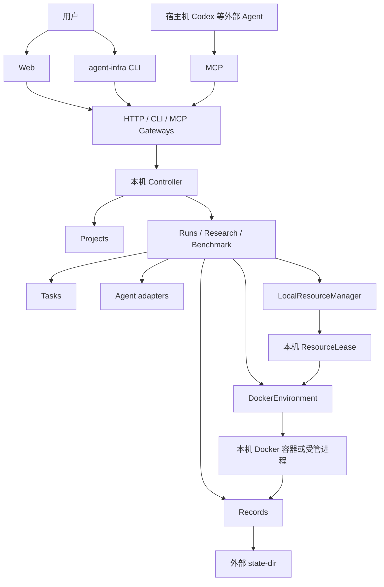
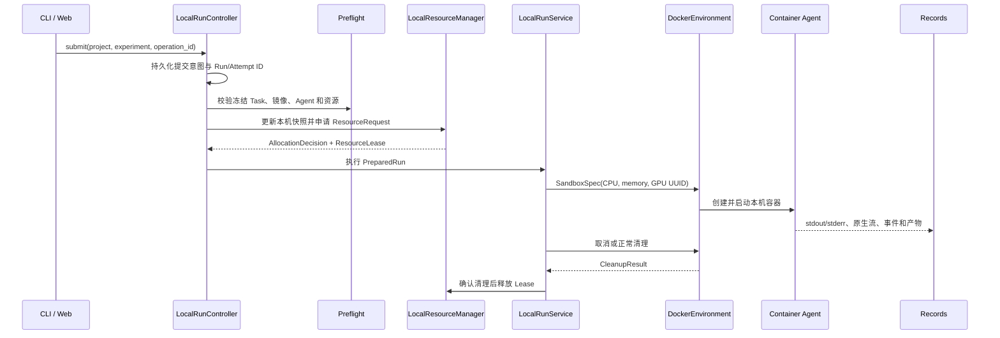

# 当前实现框架与 Ray 多节点定位

状态：当前实现说明与后续架构边界。本文以 `main` 的 `00d8b09` 为代码基线，整理日期为
2026-09-24；已实现能力仍以[项目状态](../project-status.md)和对应任务记录为准。

## 1. 结论

当前 Agent Infra 是一套**单机 Controller、本地资源管理、Docker 执行、持久化 Records**
组成的模块化系统。单节点执行没有引入 Ray：仓库当前没有 Ray 运行时依赖、Ray 调度后端、
可运行的节点 Worker 或两节点验收证据。

这与[开发顺序](../development/development-sequence.md)的主线一致。原计划先建立可以验证取消、
清理、资源释放和结果归档的单机闭环，再在 S3 增加 Ray 与跨节点部署。当前不是把 Ray 从目标
架构中删除，而是尚未进入多节点实现阶段。

Ray 的预期定位是**多节点逻辑准入、节点选择、执行派发和故障通知**。它不替代宿主机资源
观测、Docker 的物理限制、Run 状态机、Records 或节点残留清理。单机 Local backend 以后仍应
保留，不应要求只有一台机器的用户为了运行 Agent Infra 而部署 Ray。

## 2. 当前系统框架

### 2.1 运行时总览



这张图描述当前主要职责关系，不表示所有入口已经具备相同的 Agent、GPU、评测和恢复能力。
正式科研 Run、长期科研环境和 Benchmark 使用不同的上层协议，但复用一部分资源、环境、记录
和持久状态基础设施。

### 2.2 功能模块

| 模块 | 当前主要职责 | 不应承担的职责 |
| --- | --- | --- |
| `projects/` | 项目标识、工作区初始化、研究方案、实验版本和编译 | 启动容器、分配 GPU |
| `tasks/` | Task 解析、可见输入、输出和评测要求 | 选择节点、调用 Agent CLI |
| `agents/` | Codex、Claude Code、DSH 等启动计划和原生事件适配 | 创建 Docker、维护资源租约 |
| `runs/` | Run/Attempt 生命周期、预检、执行协调、取消和清理 | 暴露 Docker/Ray 句柄给入口层 |
| `resources/` | 请求、授权容量、宿主机快照、准入决策和租约 | 创建容器、解释 benchmark 业务 |
| `environments/` | Docker 环境、进程、文件、日志、收集和清理 | 再做一套资源选择 |
| `records/` | 事件、原始流、统一轨迹、日志和产物引用 | 决定任务是否重试或选择成绩 |
| `benchmarks/` | 原生 benchmark 协议、执行适配、评分与交付边界 | 绕过公共运行和记录契约 |
| `gateways/` | CLI、HTTP、MCP，以及未来 Worker 的协议转换 | 复制完整运行状态机 |
| `bootstrap/` | 加载配置、选择具体 backend、组装依赖和启动服务 | 承担领域规则 |

当前源码采用按功能划分的一级模块，而不是把所有代码强制拆成 domain/application/adapters
目录。跨模块调用通过公开契约完成，具体 backend 在 `bootstrap` 组装。这是早期仓库分层草案
经过后续模块设计后的落地形态，并未改变 Agent、Environment、Resources、Run 和 Records 的
核心责任边界。

### 2.3 当前部署单元

当前主要是一个本机 Controller 进程。它在启动时组装：

```text
LinuxHostResourceMonitor
  + LocalResourceManager
  + DockerEnvironment
  + LocalRecordsStore
  + LocalRunService
  + LocalRunController / ResearchController
  + loopback HTTP control server
```

`LinuxHostResourceMonitor` 读取当前主机资源；`NodeCapacity` 表示管理员授权给平台的 CPU、
内存和 GPU 范围；`LocalResourceManager` 只在当前节点中签发租约；`DockerEnvironment` 将租约
中的 CPU、内存和 GPU UUID 落实到容器；Records 与控制状态保存在 `AGENT_INFRA_STATE_DIR`
指定的仓库外持久目录。

当前主机锁、Controller 恢复、Docker ownership 日志和本地路径均带有明确的单机假设。

## 3. 当前单机 Run 调用链

一条冻结 Task 的正式 Run 目前经过以下步骤：



关键约束如下：

1. Task 中的资源 YAML 转换为公共 `ResourceRequest`；
2. `LocalResourceManager` 同时检查授权容量、实时宿主机快照和已有租约；
3. 分配成功后返回带 `node_id` 和 GPU UUID 的 `ResourceLease`；
4. `LocalRunService` 当前明确拒绝远程节点租约，因为它只能在本机执行；
5. Lease 中的资源直接进入 `SandboxSpec`，Environment 不重新选择 GPU；
6. 容器和进程确认清理后才能释放 Lease；清理结果不确定时不能把资源重新分配。

这个单机闭环用于先证明资源不超卖、容器限制正确、取消可观察、失败可区分、产物可归档，
以及 Controller 崩溃后可以核对自己拥有的本机容器。

## 4. Ray 当前处于什么状态

截至本文基线，Ray 属于**设计存在、公共语义部分预留、运行实现尚未开始**：

- Python 项目和锁文件中没有 Ray 依赖；
- Controller 组装的是 `LocalResourceManager` 和 `DockerEnvironment`；
- `gateways/worker` 没有可运行的 Worker 服务；
- 没有 Ray scheduler/resource backend、节点注册、心跳或集群部署命令；
- 没有两节点 CPU/GPU 派发、节点失联或残留容器恢复的真实验收；
- [项目状态](../project-status.md)仍将 S3 标记为 `not_started`。

已经预留的部分主要是运行时无关的公共对象：`ResourceRequest`、`NodeCapacity`、
`HostResourceSnapshot`、`AllocationDecision`、`ResourceLease`、`node_id`、节点标签和 GPU UUID。
`LocalRunService` 依赖 `ResourceManager` 协议而不是直接声明 `LocalResourceManager` 类型，因此未来
可以增加另一个 backend；但这只解决接口入口，不等于跨节点执行链已经存在。

## 5. Ray 在目标架构中的作用

### 5.1 多节点逻辑准入与节点选择

假设集群包含：

```text
node-a：4 × RTX 3090，label pool=research
node-b：8 × A100，label pool=training
node-c：CPU-only，label pool=preprocess
```

一个任务请求 16 CPU、64 GiB 内存、2 张至少 40 GiB 显存的 GPU，并要求
`pool=training`。未来 Ray backend 应把公共资源请求映射为 Ray 资源和节点标签约束，将 Attempt
监督执行单元派到 `node-b`。目标节点随后仍需根据本机观测把 Ray 分配的设备映射为稳定 GPU
UUID，核对外部进程和本地占用，再由 Docker 只暴露最终获准的设备。

```text
Controller
  → ResourceRequest
  → Ray 全局 reservation / 节点选择
  → 目标节点 Attempt supervisor
  → 节点侧资源与占用复核
  → DockerEnvironment
  → Agent / 实验程序
```

不能让 Local allocator 和 Ray 各自维护一套彼此不可见的全局调度。采用 Ray backend 时，Ray
reservation 是集群逻辑准入依据；节点侧保留硬件事实核对和容器启动互斥，不再独立争抢另一份
全局容量。

### 5.2 分发相互独立的 Run

Ray 首期最有价值的场景是把独立 Run 分发到不同节点，例如：

```text
学习率 1e-3  → node-a
学习率 3e-4  → node-b
数据预处理    → node-c
```

这可用于超参数实验、多个 benchmark task、不同模型配置以及多个项目共享资源。每个 Run 仍有
独立身份、Attempt、租约、事件和产物；Ray 只决定它由哪个节点执行，不改变 Task、Agent 或
Records 的业务语义。

### 5.3 多节点联合训练

需要一次获得多台机器资源时，可以使用 placement group 进行成组预留。例如 8 GPU 训练可
声明两个各含 4 GPU 的 bundle，避免只获得半套资源就启动。

Ray 的成组预留不会让普通 `train.py` 自动具备分布式训练能力。任务仍须明确使用
`torchrun`、PyTorch Distributed、DeepSpeed、FSDP 或其他经过选择和验证的训练协议，并处理
rank、通信地址、checkpoint 共享和故障恢复。原始首期目标是“不同 Run 分发到不同节点，单个
Run 的主要资源位于一个节点”；联合训练应作为后续独立能力验收，不能被普通单容器请求隐式
触发。

### 5.4 远程执行监督与故障通知

未来的 Attempt supervisor 应在容器整个生命周期内持续持有 Ray reservation，并负责上报：

- 目标节点和实际设备；
- 准备、运行、归档和清理阶段；
- 心跳、进度和远程日志游标；
- Actor 退出、节点失联或派发失败；
- 本机容器和进程的最终清理回执。

Actor 消失或 Ray 认为逻辑资源已释放，并不能证明宿主机 Docker 容器和 GPU 进程已经消失。
独立于单个 Actor 的节点服务必须核对残留；状态未知的节点或设备应停止新准入，直到实际清理
得到证明。

## 6. Ray 不负责什么

| 能力 | 责任模块 | Ray 的边界 |
| --- | --- | --- |
| Task 解析和冻结 | Projects / Tasks | 不解释研究任务或 benchmark 文件 |
| Agent 启动参数和轨迹适配 | Agents | 不决定 Codex/Claude Code 命令 |
| Run/Attempt 状态与重试 | Runs | 不建立第二套业务状态机 |
| 宿主机真实资源观测 | 节点 Resources | Ray 逻辑资源不等于物理实时状态 |
| CPU/内存/GPU 物理限制 | Environment / Docker / OS | Ray 声明不能替代 cgroup 和设备映射 |
| 事件、日志、轨迹和产物 | Records | 不作为权威实验记录库 |
| 残留容器和外部进程清理 | Worker / Environment / Resources | Actor 退出不构成清理证明 |
| 分布式梯度通信 | 任务选择的训练框架 | placement group 只负责资源成组预留 |

Codex 也不应直接持有 Ray 地址或 Actor handle。Codex 通过项目的 CLI、MCP 或受控任务入口表达
操作；控制面把任务和资源请求交给调度 backend。

## 7. 单节点为什么不使用 Ray

单节点采用 Local backend 可以直接形成：

```text
Controller → LocalResourceManager → DockerEnvironment
```

如果只为了同一台机器引入 Ray，链路会变成：

```text
Controller → Ray → 本机 Actor/Worker → DockerEnvironment
```

后一条链路增加部署、进程、端口、版本、认证和恢复面，但不会增加物理 CPU/GPU。当前阶段更
重要的是先验证 GPU UUID 映射、容器限制、取消、崩溃对账、Lease 释放以及轨迹和产物完整性。
这些语义在单机上稳定后再扩展到节点失联场景，故障定位更清楚。

因此单机不用 Ray 是有意的阶段选择。未来引入 Ray 后，Local backend 仍应作为单机部署、开发、
诊断和低运维成本使用方式保留。

## 8. 与最初方案的符合程度

### 8.1 没有偏离的部分

| 最初目标 | 当前情况 |
| --- | --- |
| 模块化的 Agent、Task、Environment、Resources、Run、Records | 已按功能模块落地，边界总体保留 |
| Docker 作为任务执行和物理隔离后端 | 已实现本机链路；GPU 基础链已局部验收 |
| 外部 Agent 通过 MCP 控制科研环境 | 已有本机 CPU 路径 |
| 容器内 Agent 执行正式任务 | 已有 Codex CPU 证据，完整 GPU Run 未验收 |
| Ray 作为多节点调度 backend | 仍在目标架构中，尚未实现 |
| 一个 Attempt 首期主要位于单节点 | 当前 Local 执行天然满足，未来 Ray 首期仍应保持 |

资源公共契约包含节点和设备身份，Run 通过 `ResourceManager` 和 `Environment` 协议使用具体
backend，这些设计仍支持以后更换调度方式而不改变 Agent 输入协议。

### 8.2 发生调整的部分

开发优先级已从原始编号产生交错：Web、科研规划、环境准备、结果分析和 BM00–BM07 的部分
工程能力在 S3 之前推进，而 Worker/Ray 尚未开始。开发序列本身说明编号是集成顺序，模块可以
并行；2026-09-18 的科研工作流细分计划也显式调整了近期实施重点。

因此更准确的判断是：

> 项目没有放弃最初的多节点目标，也没有把 Ray 错误地塞入 Agent 或 Docker 模块；但产品优先级
> 选择了先提高单机科研与 benchmark 可用性，多节点里程碑明显后移。

早期仓库草案曾写“首期调度使用 Ray”，后续开发顺序和本机 Controller ADR 则选择先实现
Local。这是经记录的阶段收敛，不是无意中出现的两套运行架构。

## 9. 当前扩展风险

虽然公共资源接口预留了 Ray 位置，但多节点不能只靠新增一个 `RayResourceManager` 完成。当前
仍有这些单机假设或缺口：

- Controller 使用同一 OS 用户范围的本地主机锁；
- Local Run 明确拒绝 `node_id` 不同的远程 lease；
- Worker gateway 尚无运行实现；
- 节点注册、认证、心跳、drain 和版本协商不存在；
- 控制状态、Records、Docker ownership 和工作目录主要依赖本地状态目录；
- 远程日志、事件和大产物上传没有跨节点传输协议与恢复验收；
- 集群权威 Lease、分配代次和节点侧占用登记尚未形成完整闭环；
- 节点失联后的孤儿容器、GPU 进程和重新准入规则尚未实测；
- 多节点镜像、输入、凭据和 checkpoint 如何到达目标节点仍需部署方案。

如果持续增加仅适用于本机路径的功能而不验证远程边界，这些假设会逐渐固化。未来开始 S3 时，
需要把“替换一个资源类”扩大为完整的控制面、节点面、数据面和恢复面任务。

## 10. 建议的后续顺序与验收

如果近期仍以当前单台 GPU 服务器为主要使用环境，建议先完成：

1. 冻结 Task + Codex 单 GPU Run 的真实验收；
2. 长期科研 MCP 环境的显式 GPU 入口；
3. 单机多 Run/GPU 的授权容量、取消、清理和重启对账；
4. 确认跨节点所需的第二台机器、私网/认证、镜像和存储条件；
5. 再进入最小两节点 Ray 原型。

最小 Ray 原型不应直接从多节点联合训练开始，建议依次验证：

| 阶段 | 最小范围 | 必须取得的证据 |
| --- | --- | --- |
| S3-A | 两节点 CPU、一个独立 Run | 正确选点、远程 Docker、日志与产物回传、正常清理 |
| S3-B | 两节点 CPU 并发与排队 | 不重复分配、取消等待、容量和状态可解释 |
| S3-C | 单 GPU 远程 Run | Ray 设备分配、稳定 UUID、Docker 可见设备三者一致 |
| S3-D | Actor 失败和节点失联 | 停止新准入、核对残留、恢复或人工隔离路径明确 |
| S3-E | 部署生命周期 | `plan/apply/verify/drain/remove` 可重复且认证失败可诊断 |
| 后续 | 多节点联合训练 | 成组预留、训练框架通信、checkpoint 和故障策略独立验收 |

每一阶段都应保持 Run 结果、评测状态和清理状态相互独立，不能因为 Ray 报告任务失败就假定
容器已清理，也不能因为容器退出就假定实验产物已经完整归档。

## 11. 相关文档

- [项目当前状态](../project-status.md)：实际能力、阶段和缺口的权威概览；
- [开发顺序](../development/development-sequence.md)：为何先单机闭环、后 Ray 两节点；
- [初始目标与架构设计](Agent_Infra_目标与架构设计_v0.1.md)：最初确认的多节点目标和范围；
- [模块划分与开发边界](agent-environment-modules.md)：功能模块以及 Local/Ray backend 边界；
- [资源管理、Docker 与 Ray](resource-management.md)：资源请求、准入、设备映射和集群设计；
- [Resources 实现解读](../implementation/resource-implementation-guide.md)：当前单节点代码和 Ray
  后续接入位置；
- [Controller 实现与恢复](../implementation/local-run-controller.md)：本机控制、持久意图和清理
  对账；
- [单机 GPU 操作说明](../operations/gpu-local.md)：当前 GPU 诊断、授权和实际验收范围。
