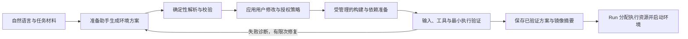
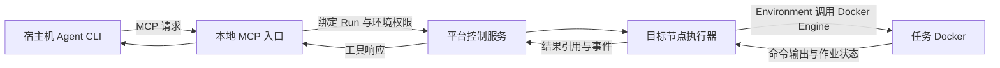

# 正式开发前的四个问题：环境构建、集群、轨迹与运行模式

日期：2026-09-15

状态：设计建议与公开资料核查，尚未实现或实机验证。

本文记录用户提出的四个问题，衔接[模块设计](agent-environment-modules.md)与[初始需求](Agent_Infra_目标与架构设计_v0.1.md)。保留八个一级模块，补充模块之间的实际运行流程。文中的配置对象、命令名称、默认值与目录样例都是建议，不是当前已经可用的产品接口。

## 1. 当前设计考虑到了多少

| 用户的问题 | 已有设计覆盖 | 仍需补充的设计与实现 | 本文结论 |
| --- | --- | --- | --- |
| 自然语言能否自动构建环境，允许人修改资源？ | Tasks 解析任务，Environment 准备环境，Run 组合；原需求第 6 节将自动生成陌生任务适配列为后续方向 | 环境方案生成、可编辑配置、构建验证、有限次修复、可复用模板 | 可以作为产品目标；先支持已知模板与明确输入，不承诺任意任务一次成功 |
| Ray 如何协调资源、监控宿主机、方便地组成集群？ | Resources/Ray 分配，Environment 落实限制；原需求第 8、11 节区分分配与实际使用 | 节点服务、初始化向导、授权资源池、健康检查、可供 Agent 执行的运维流程 | 需要我们提供产品化安装与节点接入能力，安装 Python 包本身不等于部署完成 |
| 轨迹如何统一和保存，是否含工具结果？ | Agent 输出原生事件，Records 保存规范化事件、原始轨迹与产物；原需求第 10 节已有覆盖 | 事件映射、可靠采集、文件布局、断线续传与缺失标记 | 统一可观察事件，保留原生结构；保存工具请求和结果，但明确实际采集范围 |
| 宿主机 Agent 控制 Docker、Agent 与任务同容器是否都支持？ | 两种模式都是原需求第 4 节及模块设计第 6 节的既定方向 | MCP 接入、长作业与会话、容器内 Agent 启动、原生 benchmark 对接 | 两种都要实现，共享任务环境和运行记录，保留进程所有权差异 |

**当前需要补足的是准备、接入与运维流程，而不是重新拆分一级模块。设计覆盖不代表功能已实现；仓库仍处于 S0。**

## 2. 问题一：能否用自然语言自动构建 Environment

### 2.1 使用体验与自动化边界

建议支持这样的请求：“用这个仓库和这份数据训练一个模型，使用一张 GPU，保存权重、训练日志和结果报告。”准备助手检查用户提供的材料，提出环境方案，然后在用户已经授权的范围内完成构建和验证。

用户可以只输入自然语言，平台内部仍需要生成一份**确定、可检查、可保存的环境方案**。自然语言负责表达意图，正式执行读取固定配置，不在每次启动时重新猜测依赖和资源。

| 输入条件 | 建议自动化程度 |
| --- | --- |
| 已有受支持任务包、镜像或环境模板 | 自动解析、准备和启动；缺少必要参数时再询问 |
| 有项目仓库、依赖文件和数据引用，但没有环境定义 | 助手生成构建方案，构建失败后在限定预算内修复并重新验证 |
| 只有研究目标，缺少数据、软件来源或任务约束 | 先提出少量关键问题或带明确假设的草案；不能假装环境已经可用 |
| 原生 benchmark 已规定环境与执行协议 | 优先保留原生环境；自动化用于接入和验证，不擅自更换依赖、数据或评分标准 |

常规操作可以由预设策略授权，例如限定镜像来源、CPU/GPU 上限、可挂载目录、网络与构建预算。只有超出授权范围、缺少必要条件或涉及新的系统级改动时，才需要额外人工处理。资源推荐是估计，不是充分性保证。

### 2.2 从一句话到可运行环境



构建阶段也需要资源和日志，但与正式执行分别记账；GPU 验证按需申请测试资源。是否将准备时间计入任务预算，遵循 benchmark 协议，不能统一从正式计时中扣除。

建议方案至少表达以下内容，具体 schema 在后续接口设计中确定：

- 任务和输入的版本、来源、可见性，以及输出要求。
- 基础镜像或构建配方、依赖版本、目标平台、工具与必要服务。
- CPU、GPU、内存、磁盘需求，以及时长和模型调用预算。
- 工作区和输入输出挂载、运行用户、所需网络和凭证引用。
- 最小验证步骤、推荐理由、尚未验证的假设。

例如助手推荐 **2 CPU、1 GPU、16 GiB 内存**，用户在启动前改成 **3 CPU**：系统保存用户覆盖值，再检查任务规则和资源可满足性；调度请求和容器限制都使用 3，而不是一个改了、另一个仍是 2。CPU 配额不是自动独占三个物理核；需要独占或绑核时另设约束。Docker 提供 CPU 与内存限制配置，实际创建时必须显式应用。[Docker 资源限制](https://docs.docker.com/engine/containers/resource_constraints/)

启动前的资源修改通常不需要重建软件镜像。启动后的资源调整首期建议通过停止并新建 Attempt 实现，不默认支持无缝扩容；正式评测不允许的资源修改必须被拒绝或标记为非标准实验。

### 2.3 怎样判断“构建好了”

不能只以镜像构建成功为准。至少要证明任务输入可读、工作区可写、所需命令存在、依赖可导入；需要 GPU 时验证实际设备访问；需要模型服务时验证相应连接；再用小样例执行并产生符合约定的输出。

失败时保留构建日志、诊断和每次方案修改。限制修复次数、时间与资源；无法解决时返回具体缺项，例如“数据路径不存在”或“节点驱动不满足镜像要求”。通用冒烟测试也不能证明科研方法或最终评分正确。

缓存按构建内容、依赖锁定信息、基础镜像摘要、平台与必要 Agent 安装层识别。不同运行可以复用镜像，但每次 Attempt 使用独立工作区与会话状态。成功准备后保存配方、最终镜像摘要和验证报告，供后续直接复用。

### 2.4 放在哪些模块

| 工作 | 归属 |
| --- | --- |
| 读取材料、推荐依赖和资源、提出修复 | Agent 模块中的准备助手，通过已有 Agent 接入能力实现 |
| 生成并校验任务视图、输入输出和原生协议 | Tasks |
| 构建镜像、准备工作区、执行验证脚本 | Environment |
| 校验授权、协调准备流程、冻结方案和启动正式 Attempt | Run |
| 构建/验证/执行各阶段的资源申请与分配 | Resources |
| 保存方案版本、构建记录和验证报告 | Records |
| 展示建议、允许修改、查询准备进度 | 接入层与 Web |

准备助手是已有 Agent 能力的一种用途，可以运行在已有宿主机会话或基础工具环境中，不依赖尚未构建的目标任务环境。Environment 接受确定方案执行，不自行嵌入一套强制使用的 LLM 决策循环。首期先实现“模板或已有环境 → 确定配置 → 自动验证”，再逐步增加自然语言生成和修复能力；陌生 benchmark 的评分器自动生成仍是独立扩展。

## 3. 问题二：Ray 资源协调、实时监控与跨节点初始化

### 3.1 四个数要分别看

| 视图 | 含义 | 主要来源 |
| --- | --- | --- |
| 硬件总量 | 节点实际拥有的 CPU、内存、GPU、磁盘 | 节点发现与宿主机采集 |
| 允许平台使用的容量 | 管理员授权的资源池，扣除系统或其他用途的预留 | 部署配置 |
| 已分配和可调度资源 | 本平台运行所占用的额度与排队条件 | Ray 分配状态及平台运行/租约关联 |
| 实际使用量 | CPU 利用率、内存占用、GPU 利用率/显存、磁盘等采样值 | 宿主机、容器和 GPU 指标 |

Ray 的资源主要用于逻辑准入与调度，不自动将声明变成容器 CPU/内存限制；节点逻辑容量也不能当作随利用率实时伸缩的数值。Actor 的资源需求应显式配置，避免依赖默认值。[Ray 资源模型](https://docs.ray.io/en/latest/ray-core/scheduling/resources.html)

**GPU 利用率为零不等于 GPU 可以重新分配。** 一个任务可能正在等待数据或模型结果，但仍持有资源。相反，宿主机上的平台外程序可能正在占用设备；监控只能发现这种情况，不能凭空获得对它的管理权。共享机器应先明确平台资源池；外部占用冲突时暂停该资源上的新任务并提示处理，不自动终止他人的进程。

### 3.2 单次运行怎样获得资源

建议由 Resources 将需求提交给 Ray，让一个显式申请 CPU/GPU/内存的 Attempt 监督执行单元被调度到目标节点；其存续覆盖任务容器的实际使用期。执行单元调用节点上的 Environment 后端创建容器，再将分配结果和容器引用关联到 Attempt。

Environment 根据分配设置 CPU/内存限制，并把**具体 GPU 设备**映射进容器。NVIDIA 容器运行配置支持按设备索引或 UUID 选择设备；本项目建议保存稳定设备标识并验证容器内实际可见范围，不直接照搬可能重新编号的进程环境变量。[NVIDIA GPU 设备映射](https://docs.nvidia.com/datacenter/cloud-native/container-toolkit/latest/docker-specialized.html)

宿主机外部 Agent 的自身进程不自动计入任务容器配额；托管模式下，容器内 Agent 与任务进程共同使用该容器的配额。远程模型调用的费用和速率预算另行管理。

Resources 记录 Ray 的分配及平台租约，不再独立做一套竞争性的全局调度。需要补充的是故障核对：Ray 执行单元退出后，宿主机 Docker 可能仍有残留任务。建议节点服务维护实际容器与设备占用，新环境启动必须经过本地占用核对；冲突时不启动，失联或状态不明的节点先停止接单，确认清理后恢复。

节点服务应独立于单个 Attempt 存活。不能仅依赖 Ray Actor 重启恢复业务会话或清除外部容器；这些需要应用自己的恢复逻辑。[Ray Actor 故障处理](https://docs.ray.io/en/latest/ray-core/fault_tolerance/actors.html)

首期仍限定一个 Attempt 的主要执行资源在同一节点，多个任务可以分发到多个节点。单任务跨节点训练需要后续单独设计。

### 3.3 安装后如何监控宿主机

需要区分“安装软件包”和“启用服务”：安装提供代码与工具，初始化负责登记节点、配置资源池、启动常驻节点服务和控制服务。

建议每台执行节点有一个轻量节点服务，承载执行入口、健康检查、宿主机采集与容器核对；它不是新的一级业务模块。资源采集逻辑归 Resources，容器操作归 Environment，进程入口归 gateways，具体装配归 bootstrap。

建议先以可配置的 2–5 秒周期采样并上报，Web 标明最后更新时间。连续多个心跳周期缺失时标记过期/离线，旧指标不继续显示为实时值。该周期是产品建议，后续按节点规模和开销验证。

采集覆盖宿主机 CPU/内存/磁盘、GPU 型号/利用率/显存、容器使用量，以及本平台运行关联。Ray 的系统指标和 Dashboard 可提供部分资源观测，Docker stats 可提供容器统计；本平台还需要补充授权资源池、平台外占用、租约与任务关联。[Ray Dashboard](https://docs.ray.io/en/latest/ray-core/ray-dashboard.html)、[Docker stats](https://docs.docker.com/reference/cli/docker/container/stats/)

首期给 Web 提供最新快照和必要的历史摘要；较长期的监控可接指标存储系统。监控时间序列和任务轨迹分别管理，避免把每个指标采样都塞进对话事件。

### 3.4 面向小白的两种初始化路径

**单机路径：** 用户选择可用 CPU/GPU、工作目录和必要服务地址；向导检查 Docker、GPU 运行能力及网络，生成配置并启动控制/节点服务，运行一个最小容器检查。单机可以先用 Local 调度后端，无需用户先理解 Ray。

**多机路径：** 用户提供 head 节点地址、worker 节点列表、受信连接方式、各节点授权资源，以及镜像/输入/产物的可达位置。随后工具完成检查、配置与部署。Ray 官方支持手动启动 head/worker，也支持在已有节点清单和 SSH 访问条件下使用 cluster launcher。[Ray 本地集群部署](https://docs.ray.io/en/latest/cluster/vms/user-guides/launching-clusters/on-premises.html)

| 步骤 | 自动化工具应完成什么 | 需要用户预先提供的条件 |
| --- | --- | --- |
| 发现与预检 | 检查系统架构、软件版本、Docker、GPU 驱动、磁盘、端口、节点双向可达性 | 明确节点清单及被授权的访问方式 |
| 生成部署计划 | 固定项目/Ray 版本，生成节点角色、资源池、服务和存储配置 | 允许使用的硬件、目录、网络与部署范围 |
| 安装与加入 | 部署一致版本，启动 head、worker 和本项目节点服务 | SSH 已授权，或用户分别在节点运行加入命令 |
| 数据与镜像检查 | 验证每个执行节点能获取镜像和输入、上传产物 | 镜像仓库与数据来源可访问；不假设各节点本地路径共享 |
| 验收 | 在每个节点实际运行容器，再跨两节点提交任务，验证记录、GPU 映射、取消和释放 | 有符合测试要求的节点和资源 |
| 交付 | 输出人类可读摘要和结构化健康报告，保存可重复执行的部署配置 | 确定后续维护责任人 |

只开放 head 的一个端口不构成完整网络配置，还要处理 Ray 节点间通信所需的端口与地址可达性；跨公网或 NAT 的机器通常需要先建立受控互通网络。Ray 控制接口应只供受信平台组件访问，Web 和任务 Agent 不直接访问集群管理端点。[Ray 部署说明](https://docs.ray.io/en/latest/cluster/vms/user-guides/launching-clusters/on-premises.html)、[Ray 安全边界](https://docs.ray.io/en/latest/ray-security/index.html)

软件无法自行猜出哪些机器属于用户、获取登录权限或替用户接受系统改动。管理员先给出权限和配置边界，之后可以由 Agent 自动执行已授权的步骤。缺少权限、驱动或网络时，工具应定位具体问题，避免只给一段难以解读的 Ray 报错。

### 3.5 能否让 Agent 按文档自主完成

可以，前提是同时交付**可重复执行的工具和可验证的操作文档**。建议后续提供以下 CLI 能力；这里只列产品接口意图，目前这些命令尚未实现：

| 拟提供的能力 | 预期行为 |
| --- | --- |
| `infra doctor` | 只读预检，输出具体缺项、修复建议及结构化结果 |
| `infra cluster plan` | 根据节点清单计算变更计划，展示将修改的服务与配置 |
| `infra cluster apply` | 在已授权范围内应用计划，重复执行不创建重复服务或破坏已有运行 |
| `infra node join` | 在用户指定节点执行注册与配置，适用于无法由 head 直接 SSH 的环境 |
| `infra cluster verify` | 运行已选择的 CPU/GPU/跨节点验收，并生成证据 |

运维文档需要覆盖前置条件、参数来源、预计修改、成功判据、常见错误、失败恢复、排空与移除节点。命令要有稳定退出码、机器可读输出及中断后重试语义；有业务运行时先排空，再进行影响资源池或服务的变更。Agent 执行时应根据检查结果推进，而不是反复重装整套系统。

第一版将 Linux 单机和两节点内网作为支持目标，具体发行版与版本矩阵在安装实现时锁定。其他系统、复杂网络和已有 Slurm/Kubernetes 资源池需要明确适配方式，不能让两套调度系统重复占用同一批资源。

## 4. 问题三：轨迹是否统一，保存在哪里，工具结果是否保留

### 4.1 统一事件与原生记录同时保存

不同 Agent 的原始轨迹不要求相同。建议由 Agent Adapter 将能获取的内容映射为统一事件，用于 Web 展示和跨 Agent 查询；同时保留原生记录的结构、来源版本及必要的转换/脱敏说明，便于排错和后续重新解析。

统一的是“发生了什么可观察事件”：用户输入、Agent 可获得的输出、工具请求与返回、作业状态、环境与资源事件、产物、评测结果。没有暴露的内部推理或工具细节标为未采集，不通过终端日志推测并补造完整轨迹。

| 来源 | 应保存的内容 | 采集边界 |
| --- | --- | --- |
| 经平台 MCP/执行接口的工具 | 工具名称、脱敏参数、目标环境、工作目录、时间、结果或结果引用、错误与退出状态 | 平台负责采集与关联 |
| Agent 自己的原生工具 | 适配器实际能读取的结构化事件或原生轨迹 | 不保证所有 Agent 都有相同粒度 |
| 容器内长作业 | 启动请求、作业标识、stdout/stderr、状态、退出码和输出产物 | 由 Environment 的执行管理器持续采集 |
| 直接在宿主机做的操作 | 仅保存可获得的外部 Agent 事件 | 未经过平台的命令不宣称已经被完整记录 |

### 4.2 文件和数据库分别负责什么

建议首版采用元数据数据库加文件存储：数据库保存 Run/Attempt 状态和查询索引，文件保存事件流、原始轨迹、长输出与大产物。统一由 Records 提供写入和查询接口，Web 不直接读取服务器路径。

以下是一次 Attempt 的**归档逻辑布局建议**，实际目录或对象存储键可以不同，也不创建到代码仓库中：

```text
runs/<run-id>/attempts/<attempt-id>/
├── manifest.json                  # 版本、配置引用、文件校验与采集覆盖
├── snapshots/                     # 任务视图、执行配置、镜像摘要等
├── events/<producer-id>/          # 各生产者独立的 JSONL 分块
├── raw/<agent-backend>/            # 原生轨迹及解析版本信息
├── jobs/<job-id>/                  # stdout、stderr、作业结果
├── artifacts/                     # 权重、报告、图像、其他交付物
└── evaluation/                    # 评分输出与协议信息，独立访问范围
```

事件文件建议按生产者独立写入并轮转，不让多个节点同时追加同一个公共文件。事件文件是事件内容来源，数据库事件索引可重建；Run 状态的权威记录仍在元数据存储。状态变更与相关事件的可靠提交方式，需要在存储契约中明确，不能假定两次独立写入天然原子。

单机可归档到宿主机持久目录，多机可上传到控制侧归档服务或共享/对象存储。节点先缓冲，再按块上传并等待校验确认。容器删除前确认必需文件已经离开容器；远端上传失败时保留待上传状态与本地副本，不能报告完整归档成功。

### 4.3 工具结果怎样存，断线怎么办

**工具调用的请求和结果都要保存。** 短结果可以放进事件；长日志、二进制输出和大文件保存为产物，事件只携带摘要、大小、校验信息和引用。给 Agent 返回的截断摘要不能替代归档内容；受容量或保留策略限制时必须标出截断、缺失或已清理状态。

工具调用、后台作业和事件通过稳定标识关联，保留请求及完成/失败事件。断线后按游标继续读取，重传按事件标识去重；同一生产者按序列还原顺序，跨节点不只依靠墙钟时间排序。大规模运行需要背压、磁盘限额和日志保留策略，采集失败需要显式暴露。

Docker logs 主要反映容器入口程序的标准输出/错误，程序也可能将日志写入自己的文件；因此不能只收集 Docker logs 就宣称拿到了全部工具结果。[Docker 日志说明](https://docs.docker.com/engine/logging/)

执行接口要直接捕获其启动命令的输出流，长作业持续写入管理器控制的日志；原生 Agent 的事件或文件则走独立采集器。Secrets 不写入导出配置与普通轨迹；评测私有材料也不通过日志或产物查询返回给 Agent。

## 5. 问题四：宿主机 Agent 与容器内 Agent 如何运行

### 5.1 模式 A：日常科研，Agent 在宿主机



建议初期由 CLI 以 stdio 方式启动本地 MCP 入口，入口连接独立存活的平台服务。MCP 定义了 stdio 和 Streamable HTTP 等通信方式；网络接入时可以适配后者，并验证具体 Agent 客户端支持情况。[MCP 传输规范](https://modelcontextprotocol.io/specification/2025-06-18/basic/transports)

宿主机执行器通过 Docker Engine 的执行接口在容器内运行命令，不要求给每个任务容器开启 SSH。Docker exec 支持指定工作目录、环境变量和终端，但其命令依赖容器主进程存活，容器重启也不会自动恢复该命令。[Docker exec](https://docs.docker.com/reference/cli/docker/container/exec/)

例如 Agent 请求“在绑定环境中启动训练”，执行接口接收工作目录、命令和资源上下文，节点执行器在相应容器启动作业，立即返回 `job_id`。之后 Agent 查询状态、增量日志、产物或请求停止；训练生命周期由独立执行管理器负责，不依赖一条 MCP/HTTP 请求持续连接。

长作业需要持久作业记录、进程组管理和输出采集，不能只做一次 detached exec 后忘记进程。交互式 shell 则使用显式 `session_id` 与 PTY；独立命令之间不默认继承上一次的 `cd` 或 shell 环境。

文件操作使用环境内路径与授权工作区，宿主机挂载路径只由后端维护。首期外部 CLI 和任务环境优先位于同一节点；跨节点时沿控制接口路由，并按引用传输文件，不能假设路径名相同就共享文件。

这种模式可以让 Agent 控制 Docker 内训练，同时保留用户自己的 CLI。插件只是接入与使用引导；若 Agent 仍能用原生终端直接运行宿主机命令，平台不会自动拦截或完整采集这些操作。用户关闭 CLI 后是否保留研究环境，由明确策略决定，保留期间继续计量占用。

### 5.2 模式 B：Agent 和任务都在 Docker 内

Run 解析任务并分配资源，Environment 准备任务镜像和独立工作区，Agent Adapter 提供该 Agent 的启动配置，Environment 在容器内启动它。Agent 直接访问任务工作区并使用自己的工具，适配器采集其可获得的原生输出，平台同时管理容器、预算和产物。

镜像优先保留任务原有依赖，按需增加所选 Agent 的安装层。每次运行隔离可写 HOME 与会话状态，避免上次任务的历史或记忆进入下一任务；认证材料按所需范围在运行时配置，不能假定所有 Agent 都支持相同的非交互认证。

容器只获得模型服务及任务协议允许的网络访问。正式评测的数据可见性、依赖准备计时、人工输入和重试规则都由 Tasks 的协议约束。评测可在另一个受限环境执行；Agent 同容器并不意味着隐藏参考答案也放进去。

这里容器内执行普通任务命令不需要再经 MCP 绕回宿主机。确需平台工具时再提供限定接口；Docker 管理端仍留在受信执行器，不默认把宿主机 Docker socket 交给任务 Agent。

### 5.3 对 ASI-Bench 的核查与接入建议

本文将用户提到的 asibench 理解为 [apexin-ai/ASI-Bench](https://github.com/apexin-ai/ASI-Bench)。核查日期为 2026-09-15；读取的源码提交为 `a797bf69683400bed0f38c4add507bb3d404b833`。以下是公开文档/源码事实，未运行其 Docker 或评分流程。

官方说明中，`os` 使用 Docker，且要求兼容的内置 Agent Adapter；通用 `--agent-cmd` 文件交换入口不能直接等同于受支持的 Docker 模式。其任务基础镜像可由 `runtime.dockerfile` 定义，再叠加所选 Agent 的安装层。因此，接入既涉及任务环境，也涉及 Agent harness 与运行协议。[ASI-Bench 使用指南](https://github.com/apexin-ai/ASI-Bench/blob/a797bf69683400bed0f38c4add507bb3d404b833/docs/guide/getting-started.md)、[官方 README](https://github.com/apexin-ai/ASI-Bench/blob/a797bf69683400bed0f38c4add507bb3d404b833/README.md)

其指南区分 seed31415 的本地公开参考评分和 seed42 的私有评分；后者提交要求 Docker 来源记录。我们的本地执行与归档不等于已经取得官方评分或提交资格，应保留它的原生产物、来源证明和提交规则。[ASI-Bench 运行与评分说明](https://github.com/apexin-ai/ASI-Bench/blob/a797bf69683400bed0f38c4add507bb3d404b833/docs/guide/getting-started.md)

源码还显示：`OSSandbox` 为 Docker 设置 CPU/内存参数，但在 `requires_gpu` 为真时追加 `--gpus all`。这意味着外层 Ray 申请了一张 GPU，并不能据此认定其子容器只获得这一张 GPU。[固定版本的 Docker 命令构建代码](https://github.com/apexin-ai/ASI-Bench/blob/a797bf69683400bed0f38c4add507bb3d404b833/ai4sci_bench/runner/os_sandbox.py#L515)

基于以上事实，建议这样接入：

1. **Tasks 适配原任务和评测协议。** 保留任务版本、提示条件、输入输出、预算、结果与评分入口，不重新解释成绩口径。
2. **优先验证原生 runner 路径。** 为原生环境执行增加受控适配，把启动、查询、取消、容器标识和产物纳入本项目 Run/Environment 契约；具体 hook 是否足够需要原型核查。
3. **一个容器只有一套创建与清理责任。** 原生 runner 管理 Docker 时，Environment 后端委托并追踪它，不再额外启动一套相互竞争的任务容器；不默认采用嵌套 Docker。
4. **对齐实际资源边界。** 原生 Docker 启动必须能够接收平台分配的设备与额度，或以符合原协议的方式扩展适配。无法保证 GPU 映射时，不能宣称支持安全的多任务共享节点；也不能伪造或绕过官方来源校验。
5. **先验证一个受支持 Agent 与一个任务。** 检查原生运行、输入可见性、日志与产物、取消、资源释放和结果一致性，再扩展批量任务。需要官方提交时，另按平台规则验证导出包与提交链路。

以上是本项目的接入建议，不是 ASI-Bench 已提供本项目插件的声明。首次适配应固定其版本；升级时重新检查启动、设备限制和来源记录。

## 6. 下一步怎样落实与验收

| 工作包 | 主要模块/归属 | 最小验收证据 |
| --- | --- | --- |
| 确定性环境准备 | Tasks、Environment、Run | 一个已有任务包自动准备并产生约定输出；用户将 2 CPU 改为 3 后，分配与容器限制一致 |
| 自然语言准备助手 | Agent、Run，调用前述准备接口 | 从明确材料生成可保存方案；故意缺依赖时能诊断并有限次修复；缺数据时提出具体问题 |
| 单机安装与观测 | Resources、gateways、bootstrap，配套 deploy/scripts/docs | 新机器按文档完成预检与初始化；显示硬件、授权额度、占用和带时间戳的实际指标 |
| 两节点安装与调度 | Resources、Environment、Run | 依文档自动加入节点；两节点执行；无资源时排队；节点故障和残留容器不导致设备被重复使用 |
| 轨迹与产物 | Agent、Environment、Records | 两种 Agent 原生格式可保留并显示统一事件；长工具输出可取回；断线重传不重复；删除容器后仍能查询归档 |
| 科研接入 | MCP 接入层、Environment、Run | 宿主机 Agent 启动容器内长训练；断开工具连接仍运行；重连可读日志并停止完整进程组 |
| 托管 benchmark | Agent、Tasks、Environment、Run | Agent 与任务同容器，独立会话和可见输入；按原协议评测；ASIBench 额外验证设备映射与来源记录 |

建议顺序：先落实最小任务/环境/资源/记录契约及 Local 单机闭环，再接外部 CLI 和一个原生 benchmark；随后完成 Ray 两节点与安装向导。自然语言准备先基于有限模板开发，复用同一准备接口，避免与底层执行同时引入过多不确定性。Web 可使用这些接口的样例并行开发。

S0–S4 的已有验收不能仅凭本文标为完成。自然语言生成与一键集群部署是此次明确的产品方向，需拆成有证据的后续工作包；具体版本矩阵、首个 Agent/任务、存储后端和授权默认值在相应实现前确定。

## 7. 本次核查的范围

本次完成本地设计核对、Ray/Docker/MCP/NVIDIA 官方文档查阅，以及 ASI-Bench 固定提交的指南和 Docker 执行源码检查。各事实旁附有来源链接，方案与推断明确以“建议”标识。没有安装集群、构建镜像、登录 Agent、执行 benchmark 或向外部榜单提交；因此本文给出可实施方向与验收条件，不宣称已经证明端到端可用。
