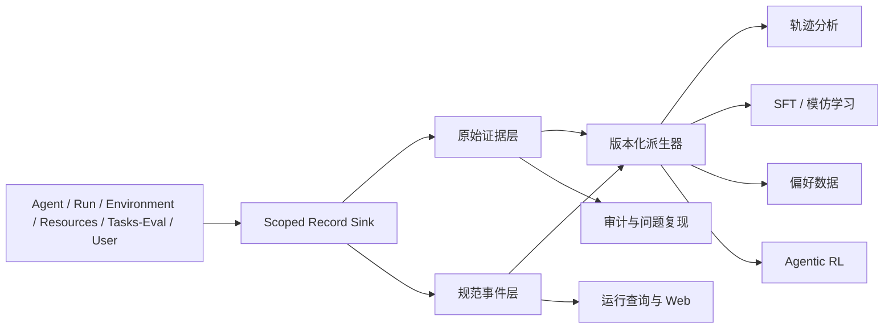
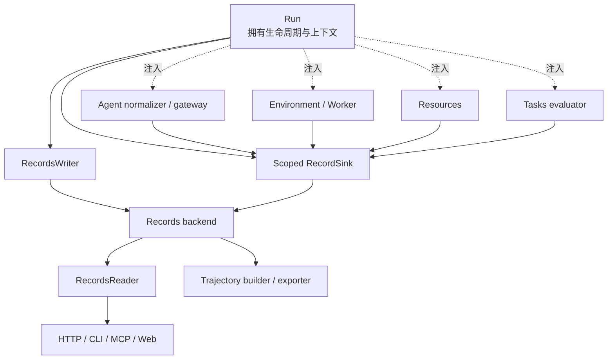

# Records 模块详细设计

> 状态：**Proposed**<br>
> 范围：运行证据、Agent 轨迹、环境执行、产物、指标、评测结果，以及面向后续轨迹分析和 Agentic RL 的数据基础<br>
> 不在本文范围：具体训练算法、奖励模型实现、Web 页面设计和远端对象存储选型

## 1. 设计结论

Records 不应只是“把日志写到文件里”的模块。它应当是一次任务执行的**事实记录层**：接收各模块产生的可观察事实，可靠地保存原始证据和统一索引，再从这些事实派生面向排障、实验比较、评测、数据集构建和训练的不同视图。

建议采用三层数据模型：

1. **原始证据层（Raw）**：原样保存 Codex、Claude Code、DeepSeek Harness、进程输出、评测器等生产者公开给平台的数据。
2. **规范事件层（Canonical）**：把不同来源映射成稳定、可查询的统一事件与调用关系，同时保留回到原始证据的引用。
3. **派生数据层（Derived）**：按带版本的规则，把事件图转换为 episode、step、reward、偏好对或训练样本。派生层可以重建，不能反过来成为唯一事实来源。



这个分层有两个直接收益：

- 新 Agent 只需增加原生事件解码和规范化适配，不必改变底层存储以及上层分析接口。
- 将来改变 step 切分、奖励归因或训练算法时，可以从同一份原始事实重新生成数据，不必重新运行昂贵任务。

Records 只记录和读取事实，不决定 Run 是否允许某个状态迁移，不决定 benchmark 如何评分，也不执行 Agent、Docker 或资源调度。

## 2. 设计目标与非目标

### 2.1 目标

- 完整记录一次 Run/Attempt 中平台可观察的输入、决策、工具调用、进程执行、资源使用、输出、评测和清理结果。
- 同时保存提供方原始格式和跨 Agent 的统一格式；规范化失败不能导致原始数据丢失。
- 支持宿主机 Agent 控制容器、Agent 在容器内运行，以及外部 Agent 通过 MCP/API 连接三种场景。
- 允许多节点、异步和并行事件安全汇聚，能够说明事件顺序、因果关系以及缺失范围。
- 为实验复现保存足够的配置快照和内容摘要，但不把凭据、私有答案或大型模型权重复制进普通记录目录。
- 支持按 Run、Attempt、Agent、工具、任务、模型、节点、评测指标和时间范围查询。
- 支持从不可变事实派生多种粒度的轨迹，并标注某条轨迹是否具备训练所需的完整信息。
- 明确持久化失败、磁盘不足、上传延迟、日志截断和清理失败时的行为。

### 2.2 非目标

- 不依赖或推测模型未公开的内部思维过程。只保存平台实际收到的消息、可公开的 reasoning summary 或提供方明确返回的字段。
- 不承诺所有运行可以逐字节确定性复现。GPU 算子、外部服务和模型服务可能具有非确定性，Records 只声明有证据支持的复现等级。
- 不把统一事件格式设计成某个训练框架的输入格式。训练框架需要的 token、mask、advantage 等属于派生数据。
- 不让每个业务模块直接操作 SQLite、文件路径或对象存储客户端。
- 不把 `docs/changes/` 的开发任务记录与产品运行时 Records 混为一谈。

## 3. 当前实现与缺口

当前 `src/agent_infra/records/local.py` 中的 `LocalRunJournal` 能够追加 `events.jsonl` 并原子写入 `result.json`。Run 已记录少量生命周期事件，Environment 会保存 stdout、stderr 和部分输出目录，Agent 适配器也能将原生输出解码为 `AgentEvent`。

它足以验证最小 Run 流程，但还存在以下关键缺口：

- 没有稳定的 Records 公共协议、schema 版本、Attempt/Phase/Span 模型和查询接口。
- Agent 解码事件没有接入 Run，Environment 输出与 Run 事件分散在不同目录中。
- 没有统一的 `tool_call_id`、`job_id`、`span_id` 和产物索引，无法重建一次工具调用的输入、执行、输出和错误链路。
- 没有原始数据、规范事件和派生轨迹之间的 lineage。
- 没有记录覆盖度、截断、脱敏、落盘确认和采集缺口。
- 没有私有评测数据、用户数据和普通日志之间的访问边界。
- 没有支持训练的数据版本、策略快照、奖励版本和数据集导出清单。

因此下一步不应继续向单个 `events.jsonl` 添加临时字段，而应先建立稳定的 Records 契约和本地后端。

## 4. 核心概念

### 4.1 实体层级

| 实体 | 含义 | 说明 |
| --- | --- | --- |
| `Experiment` | 一组希望比较或共同分析的 Run | 例如同一训练方案的多组超参数实验；可选 |
| `Run` | 用户的一次逻辑执行请求 | 保存任务、策略、预算和运行模式；可包含重试 |
| `Attempt` | Run 的一次实际执行 | 是默认 rollout/episode 边界；每次重试创建新 Attempt |
| `Phase` | Attempt 内隔离的执行阶段 | 如 `solve`、`submit`、`evaluate`、`cleanup`；科研任务可只有 `solve` |
| `Session` | 一段 Agent 会话 | 一个 Attempt 可有多个 Agent、子 Agent 或恢复后的会话 |
| `Span` | 有起止时间的操作 | 如 Agent turn、模型调用、工具调用、Docker job、评测；可嵌套并可相互链接 |
| `Event` | 不可变的事实记录 | 如状态变化、消息、进程退出、指标样本；只能追加 |
| `Stream` | 连续的字节或文本数据 | 如 stdout、stderr、Agent 原生 JSONL；适合分块保存 |
| `Artifact` | 有名字、媒体类型和摘要的内容对象 | 如提交、checkpoint、图表、报告、预测文件 |
| `Metric` | 带名称、数值、单位和上下文的观测 | 如 GPU 显存、loss、耗时、准确率 |
| `Evaluation` | 评测器产生的结构化结果 | 保留原始分项、聚合结果、评测器版本和可见反馈 |
| `PolicySnapshot` | 产生 Agent 行为的版本化配置 | 模型/检查点、prompt、workflow、工具 schema、采样参数等；避免与计算资源模块混名 |
| `TrajectoryView` | 从事件和证据派生的 episode/step 视图 | 有构建器版本和完整性说明，可重建 |
| `DatasetExport` | 一次训练/分析数据导出 | 固定筛选条件、split、schema、样本摘要和 lineage |

### 4.2 身份标识

- 使用全局唯一、不可复用的字符串 ID；推荐可按时间排序的 UUIDv7。不能依赖数据库自增 ID 进行跨节点关联。
- `run_id`、`attempt_id`、`phase_id`、`session_id`、`span_id`、`event_id`、`job_id`、`tool_call_id`、`artifact_id`、`evaluation_id` 都有独立语义。
- 外部系统 ID 保存在 `external_ids` 中，不能直接替代平台 ID，因为不同提供方可能重复、缺失或改变格式。
- 内容对象另有 `sha256` 等内容摘要；对象 ID 和内容摘要不能混用。

### 4.3 Attempt 为什么是默认 rollout 边界

一个 Attempt 固定了任务快照、策略快照、环境快照和资源预算，并以成功、失败、取消、超时或基础设施错误结束，因此最适合作为一次 rollout 的默认边界。

但 Records 不把“一个 Attempt 必须产生一条固定粒度训练轨迹”写死。一个 Attempt 可以派生：

- 一条完整 episode；
- 每个 Agent session 一条 episode；
- 以 turn、工具调用或模型调用切分的 step 序列；
- 只保留符合某种训练资格的子轨迹。

切分规则属于带版本的 `TrajectoryBuilder`，以后修改规则不影响原始记录。

## 5. 三层数据模型

### 5.1 原始证据层

原始证据层尽量按生产者提供的内容保存，不要求所有提供方具有相同格式，例如：

- Codex、Claude Code、DeepSeek Harness 的 JSONL、stdout 和 stderr；
- MCP 请求与响应的原始协议体；
- Docker/进程的输出字节流；
- 调度器和资源探针的原始响应；
- benchmark evaluator 的原始结果文件；
- 用户上传的输入和 Agent 产生的提交产物。

每段原始证据至少携带：

```yaml
raw_record_id: raw_...
run_id: run_...
attempt_id: attempt_...
producer_id: producer_...
producer_kind: agent_cli
native_schema: codex_jsonl
native_schema_version: unknown
content_ref: blob:sha256:...
content_sha256: ...
byte_length: 12345
media_type: application/x-ndjson
captured_at: 2026-09-16T00:00:00.000000Z
visibility: controller
data_class: internal
capture_status: complete
```

“原始”不等于“任何秘密都永久保存”。凭据、认证头、环境变量值和私有答案应在采集前排除，或进入权限和保留期独立的受限存储。被过滤的数据必须留下 `redacted` 或 `not_collected` 事实，不能悄悄消失。

### 5.2 规范事件层

规范事件层为跨来源查询提供稳定语义。推荐事件信封：

```yaml
schema_version: records.event.v1
event_id: evt_...
event_type: tool.completed

run_id: run_...
attempt_id: attempt_...
phase_id: phase_...
session_id: session_...

producer_id: producer_...
producer_kind: agent | run | environment | resource | evaluator | user
producer_sequence: 42

observed_at: 2026-09-16T00:00:00.000000Z
ingested_at: 2026-09-16T00:00:00.010000Z
monotonic_ns: 1234567890

trace_id: trace_...
span_id: span_...
parent_span_id: span_parent_...
links:
  - relation: caused_by
    span_id: span_tool_request_...

correlation:
  tool_call_id: call_...
  job_id: job_...
  model_call_id: model_call_...

payload_schema: records.tool_completed.v1
payload: {}
raw_refs: [raw_...]
artifact_refs: [artifact_...]

visibility: agent
data_class: internal
capture_status: complete
normalizer:
  name: codex
  version: 1.0.0
idempotency_key: producer_...:42
```

关键约束：

- `event_id` 和 `(producer_id, producer_sequence)` 均唯一，重试上传不得产生重复事件。
- `observed_at` 表示生产者观察时间，`ingested_at` 表示 Records 接收时间。跨节点时不能仅用时间戳推断因果关系。
- 同一生产者内部由 `producer_sequence` 给出稳定顺序；跨生产者使用 span、link、call ID 和显式同步事件表达关系。
- `payload` 必须由 `payload_schema` 解释；信封字段保持稳定，事件载荷可以独立演进。
- 大文本、二进制、密集 token 数据和高频日志只放引用，不内嵌到每个事件中。
- 规范化器必须无副作用、可离线重放，并记录名称和版本。

### 5.3 派生数据层

派生层包括运行摘要、关键路径、调用树、成本统计、episode/step、偏好对和训练数据集。每个派生对象必须保存：

- 输入 Run/Attempt/Event/Artifact 的 ID 或查询快照；
- 构建器名称、版本、参数和代码版本；
- 生成时间与 schema 版本；
- 缺失字段、排除原因和完整性等级；
- 输出内容摘要；
- 若使用评测或人工标签，保存标签来源和版本。

派生数据可以删除后重建。原始证据和规范事件不能因生成了派生数据而被覆盖。

## 6. 事件分类

首版应定义有限而稳定的事件族，不追求把每个提供方字段都提升为顶层事件。

| 事件族 | 典型事件 | 主要生产者 |
| --- | --- | --- |
| Run/Attempt | `run.created`、`attempt.started`、`attempt.finished`、`attempt.cancelled` | Run |
| Phase | `phase.started`、`phase.finished`、`phase.failed` | Run |
| Agent | `agent.session_started`、`agent.message`、`agent.turn_completed`、`agent.handoff` | Agent adapter / gateway |
| Model | `model.requested`、`model.responded`、`model.usage`、`model.failed` | Agent adapter / workflow |
| Tool | `tool.requested`、`tool.started`、`tool.completed`、`tool.failed` | Agent / MCP gateway |
| Job/Process | `job.submitted`、`process.started`、`process.exited`、`stream.chunk_committed` | Environment / Worker |
| Environment | `environment.preparing`、`environment.ready`、`environment.cleanup_finished` | Environment |
| Resource | `lease.requested`、`lease.granted`、`resource.sampled`、`lease.released` | Resources |
| Artifact | `artifact.discovered`、`artifact.committed`、`artifact.rejected` | Environment / Run |
| Evaluation | `evaluation.started`、`metric.recorded`、`reward.assigned`、`evaluation.finished` | Tasks evaluator / Run |
| User | `user.message`、`user.intervention`、`approval.recorded` | HTTP/CLI/MCP gateway |
| Records | `capture.gap`、`capture.truncated`、`redaction.applied`、`upload.failed` | Records collector |

事件名表示已观察的事实。命令“请求执行”和进程“确实启动”必须是两个事件；Agent 返回成功和进程 exit code 为 0 也不能混为同一个状态。

### 6.1 Span 与 link

同步嵌套操作使用父子 Span，例如一个 Agent turn 包含模型调用和工具调用。并行、异步、跨进程或后补评测不一定能形成严格的树，因此还需要显式 link：

- `caused_by`：工具执行由某个 Agent action 触发；
- `result_of`：工具结果对应某个请求；
- `evaluates`：评分对应某份冻结提交；
- `continues`：恢复的 Session/Attempt 延续先前上下文；
- `forked_from`：分支 rollout 从某个事件或 checkpoint 开始。

这使记录既能作为可视化调用树，也能表示多 Agent 和并行工具形成的事件图。

## 7. 必须保存的运行快照

### 7.1 Task 快照

- task ID、schema 版本和转换器版本；
- Agent 可见 manifest 的固定副本或内容摘要；
- 私有评测 manifest 的受限引用；
- 输入数据、参考资料、工具声明和输出契约的摘要；
- task 来源 benchmark、原始 task ID 和版本；
- solver 可见范围以及 evaluator 可见范围。

### 7.2 PolicySnapshot

PolicySnapshot 说明“什么配置产生了这些行为”，至少包含：

- Agent adapter、CLI/harness、workflow 及其版本；
- 模型提供方、模型名、可验证时的 checkpoint/revision；
- system/user prompt 模板版本和最终可见 prompt 的受控引用；
- 工具 schema、MCP server 及技能/插件版本；
- temperature、top-p、max tokens 等可获得的采样参数；
- tokenizer 名称和 revision；
- workflow 源码 commit、依赖锁文件摘要和 dirty 状态；
- 允许的工具、预算、超时和安全策略。

对于闭源 CLI，拿不到的 checkpoint、token ID 或 logprob 必须明确为 `unavailable`，不能根据模型名伪造。

### 7.3 Environment 与资源快照

- 镜像 tag 和不可变 digest、启动参数、挂载声明、网络策略；
- 工作区初始快照或输入摘要；
- 操作系统、Python/关键依赖锁文件、CUDA/驱动信息；
- 节点和设备的非敏感硬件信息；
- 请求资源、实际 lease、容器限制和运行期资源采样；
- 随机种子及其作用域；
- 外部服务版本和数据集 revision（如果可获得）。

环境变量只记录允许公开的名称和值；secret 只保存不含秘密值的引用或“已注入”事实。

### 7.4 输出、评测和清理

- 提交文件清单、路径、类型、大小、摘要和冻结时间；
- 越界路径、符号链接和大小限制检查结果；
- evaluator 名称、版本、配置、输入提交摘要；
- 分项指标、聚合指标、奖励和用户可见反馈；
- 容器、进程、lease、临时凭据目录的实际清理结果；
- 未能归档或清理的对象及处置状态。

## 8. Agent 轨迹采集

### 8.1 两份格式都保留

不同 Agent 的原生协议不会完全一致。正确做法不是只增加 `claude_code.py` 或 `deepseek_harness.py` 后强行输出一个最低公分母，而是让每个适配器提供两个能力：

```python
class AgentTraceNormalizer(Protocol):
    native_format: str
    normalizer_version: str

    def normalize(
        self,
        raw: RawRecord,
        context: TraceContext,
    ) -> Iterable[CanonicalEvent]: ...
```

- 原生记录完整进入 Raw 层；
- normalizer 提取共性的 message、model、tool、usage、error 和 completion 语义；
- 无法识别的原生事件生成 `agent.native_event` 或只保留 raw ref，不能丢弃；
- 每个规范事件能定位到原始记录的字节范围或对象引用；
- normalizer 升级后可以离线重建新的规范事件版本。

现有 `AgentEvent` 可作为过渡表示，但需要补充 context、raw ref、调用关联、可见性和完整性字段。

### 8.2 三种运行方式

#### 平台启动宿主机 Agent

Run 通过将来的 Host Process Environment 启动 Agent，并注入 scoped record sink、Run 上下文和工具网关。平台可采集 Agent 原生输出、MCP 调用、Docker job、退出状态和资源信息。

#### Agent 在任务容器中运行

容器内 collector 将原生 stream 和规范事件写入本地 spool，再按批次发送给 Records。容器突然退出时，控制面仍应能收集最后的 spool、Docker logs 和退出状态。

#### 用户自行启动外部 Agent

平台只能记录经过其 HTTP/MCP/Environment API 的操作。Agent 在平台之外读取的文件、调用的服务和内部决策不可观察。Records 必须在 Attempt manifest 中标记覆盖范围，不能把这类记录描述为“完整 Agent 轨迹”。

示例覆盖声明：

```yaml
coverage:
  agent_native_stream: unavailable
  prompts: partial
  model_calls: unavailable
  platform_tool_calls: complete
  environment_jobs: complete
  stdout_stderr: complete
  artifacts: complete
  evaluation: complete
```

### 8.3 命令和工具调用关联

所有通过平台执行的命令都必须经过 Environment 的 job API，并携带 `tool_call_id` 和 `job_id`：

```text
agent action
  -> tool.requested(call_id)
  -> job.submitted(call_id, job_id)
  -> process.started(job_id)
  -> stdout/stderr stream refs
  -> process.exited(job_id, exit_code)
  -> tool.completed(call_id, result refs)
```

命令记录应保存参数数组、工作目录、超时、非敏感环境配置、exit code 和输出引用。不要只保存拼接后的 shell 字符串，也不要记录 secret 环境变量值。

## 9. 评测、指标与奖励

### 9.1 三者分开

- **Metric** 是客观观测，例如 accuracy、latency、GPU memory 或训练 loss。
- **Evaluation** 是某个 evaluator 对特定提交执行协议后的结构化结果。
- **Reward** 是训练或 credit assignment 使用的信号，可能来源于一个或多个 Evaluation、规则、人工反馈或奖励模型。

不能在入库时把所有结果提前压成单个 `score: float`。推荐 Reward 结构：

```yaml
reward_id: reward_...
name: task_success
value: 1.0
direction: maximize
scope:
  kind: attempt
  target_id: attempt_...
source:
  kind: evaluator
  evaluation_id: eval_...
assignment:
  method: terminal
  version: reward-policy-v1
confidence: null
visibility: agent
assigned_at: ...
```

一个 Attempt 可以同时有任务成功、成本、时延、安全约束等多个 reward component。训练时如何标量化应由带版本的奖励策略决定。

### 9.2 私有评测边界

求解环境不能读取私有 evaluator、参考答案和隐藏测试数据。Records 中应至少区分：

- `agent`：可反馈给执行中的 Agent；
- `user`：任务拥有者可以查看；
- `controller`：平台控制面可以访问；
- `evaluator`：仅隔离评测阶段可访问；
- `admin`：受控运维访问。

私有评测原始日志、输入和答案进入 `evaluator` 范围；返回 solver 的只有原协议允许的公开指标和反馈。普通导出或 Web 查询不得因为持有 artifact ID 就绕过这一边界。

## 10. 面向 Agentic RL 的轨迹模型

### 10.1 先保存事实，再定义 step

不同训练方法对 step 的理解不同：一次模型生成、一次工具调用、一个 Agent turn 或一组并行动作都可能是 step。因此规范事件层保存事件图，派生器再生成训练视图。

建议的通用 `TrajectoryStep`：

```yaml
schema_version: records.trajectory_step.v1
trajectory_id: trajectory_...
step_index: 7

observation_refs:
  - artifact:sha256:...
action:
  actor: agent
  kind: tool_call
  content_ref: artifact:sha256:...
next_observation_refs:
  - artifact:sha256:...

reward_refs: [reward_...]
terminated: false
truncated: false
termination_reason: null
discount: null

policy_snapshot_id: policy_...
behavior_data:
  prompt_ref: artifact:sha256:...
  response_ref: artifact:sha256:...
  token_ids_ref: null
  logprobs_ref: null
  availability:
    token_ids: unavailable
    logprobs: unavailable

source:
  attempt_id: attempt_...
  event_ids: [evt_..., evt_...]
  span_ids: [span_...]

training_eligibility:
  eligible: false
  reasons: [missing_behavior_logprobs]
```

`observation_refs` 应能恢复 Agent 实际可见的上下文，而不是事后把 Agent 当时不可见的信息加入 observation。私有 evaluator 信息只能进入 reward/label 的受限来源，不能倒灌到求解 observation。

### 10.2 训练所需的 lineage

为了支持后续算法，至少保留下列关系：

- trajectory -> Attempt -> TaskRevision；
- trajectory/step -> PolicySnapshot；
- step -> 原始消息、事件、Span、tool call 和 artifact；
- reward -> evaluator/人工/奖励模型及其版本；
- dataset row -> trajectory builder、筛选器、转换参数和源码版本；
- 模型更新 -> 输入 DatasetExport、训练配置和输出 checkpoint 引用。

训练后的 checkpoint 不需要复制到 Records blob 中，可以保存外部 URI、不可变 revision、摘要和权限信息。

### 10.3 多种训练视图

同一批 Attempt 可以派生：

- **SFT**：observation/prompt 与被接受 action/response；
- **偏好学习**：相同或可比较上下文下的 chosen/rejected 轨迹，加上 judge 和准则版本；
- **结果奖励 RL**：整条 rollout 与 terminal reward；
- **过程奖励/credit assignment**：step/span 与后补的局部奖励或 advantage；
- **行为克隆/工具策略**：状态、工具选择、参数和结果；
- **故障学习**：失败类型、恢复动作和最终结果。

这些都是派生视图，不应让运行期事件格式迁就某一种训练库。

### 10.4 分支、恢复和反事实轨迹

需要支持从中间状态继续探索：

```yaml
lineage:
  parent_attempt_id: attempt_parent_...
  fork_event_id: evt_...
  fork_span_id: span_...
  environment_checkpoint_ref: artifact:sha256:...
  fork_reason: alternative_tool_strategy
```

只有实际具备可恢复环境 checkpoint 时才能声称可执行分支；否则可以复用对话前缀创建新 Attempt，但要标记环境是重建而非恢复。

### 10.5 人工介入和多 Agent

- 用户修改 prompt、批准命令、手动终止或直接给出答案时，记录 `user.intervention`，并把对应 action 的 actor 标为 `human`。
- 多 Agent 系统要给每个 Agent 独立 `session_id` 和 `producer_id`，handoff 使用显式 link。
- 训练导出默认不能把人工 action 误标为目标策略 action，也不能把 evaluator 的私有反馈误标为执行时 observation。

### 10.6 训练资格不是二元的“有日志”

每条轨迹应计算或声明特征矩阵，例如：

| 能力 | 可能状态 |
| --- | --- |
| observation 可恢复 | complete / partial / unavailable |
| action 可恢复 | complete / partial / unavailable |
| token IDs | complete / unavailable |
| behavior logprobs | complete / partial / unavailable |
| tool 调用关联 | complete / partial |
| terminal reward | present / absent |
| step reward | present / absent |
| 人工介入 | none / annotated / unknown |
| 私有信息污染检查 | passed / failed / not_run |

不同算法按所需特征筛选数据。CLI Agent 没有 logprob 仍可用于轨迹分析、SFT 或结果评估，但不能被伪装成满足特定离线策略梯度算法的数据。

## 11. 存储架构

### 11.1 首版本地后端

建议首版使用：

- **SQLite（WAL）**：Run/Attempt、事件信封、Span、Artifact 元数据、指标、评测、索引、权限标签和物化摘要；
- **内容寻址文件存储（CAS）**：原生 JSONL、大文本、stdout/stderr、提交、图片和其他 blob；
- **本地 spool**：Worker/容器暂时无法连接控制面时缓存待上传批次。

这个组合不引入外部数据库即可工作，适合单机科研；公共 API 不暴露 SQLite，因此以后可以替换为 PostgreSQL、对象存储和消息系统。

建议逻辑目录：

```text
<records-root>/
├── records.sqlite3
├── blobs/
│   └── sha256/ab/cd/<digest>
├── spool/
│   └── <producer-id>/
├── exports/
│   └── <dataset-export-id>/
└── quarantine/
    └── <restricted-or-corrupt-records>
```

目录结构不是公共查询协议。调用者通过 ID 和 Records API 访问数据，不能拼接内部路径。

### 11.2 大对象与去重

- Artifact 元数据与内容分离，内容通过 digest 寻址。
- 写入使用临时文件、计算摘要、`fsync`、原子 rename，再在 SQLite 事务中提交元数据引用。
- 重复内容只保存一次，但每个逻辑 Artifact 仍保留独立名称、来源、权限和 lineage。
- 删除使用引用计数或标记清理；不能因为一个 Run 过期而删除仍被 DatasetExport 引用的 blob。
- 大模型 checkpoint、数据集和容器镜像通常只保存外部不可变引用与摘要，不复制进本地 CAS。

### 11.3 并发和顺序

- 每个生产者独立递增 `producer_sequence`，不要让多个 Worker 竞争追加同一个 JSONL 文件。
- Collector 批量提交事件；数据库唯一约束负责幂等。
- 读取使用不透明 cursor，cursor 至少固定排序键与查询快照，避免用“第 N 页”导致并发写入时漏读。
- 高频 stdout、资源采样和 token 数据按块/segment 保存，事件只记录块提交和范围。
- 跨节点延迟上传时保留生产者时间和接收时间，并在 manifest 中记录时钟同步状态。

### 11.4 一致性和落盘确认

Records 返回的写入回执应区分：

- `accepted`：已进入内存或本地队列；
- `durable_local`：事件和 blob 已在本节点可靠落盘；
- `durable_primary`：控制面的主存储已确认；
- `archived`：远端长期存储已确认（后续能力）。

求解结束后，Run 只有在强制记录已达到配置要求时才允许销毁环境。若未能保存，应明确记录 `capture.gap` 和清理决策，不能把“进程退出”当成“运行证据已安全保存”。

## 12. 公共接口

Records 模块建议提供后端无关的写、读、stream 和派生接口。示意接口如下，具体 Python DTO 在实现任务中确定：

```python
class RecordSink(Protocol):
    def append_events(self, events: Sequence[EventDraft]) -> WriteReceipt: ...
    def put_blob(self, source: BlobSource, metadata: BlobMetadata) -> BlobRef: ...
    def commit_artifact(self, draft: ArtifactDraft) -> ArtifactRef: ...
    def append_stream(self, stream_id: str, chunk: bytes, offset: int) -> WriteReceipt: ...
    def finalize_stream(self, stream_id: str, status: StreamStatus) -> StreamRef: ...

class RecordsWriter(Protocol):
    def begin_run(self, manifest: RunManifest) -> RunRecord: ...
    def begin_attempt(self, manifest: AttemptManifest) -> AttemptRecord: ...
    def scoped_sink(self, context: RecordContext) -> RecordSink: ...
    def finish_attempt(self, result: AttemptResultRecord) -> WriteReceipt: ...

class RecordsReader(Protocol):
    def get_run(self, run_id: str) -> RunRecord: ...
    def get_attempt(self, attempt_id: str) -> AttemptRecord: ...
    def list_attempts(self, query: AttemptQuery) -> Page[AttemptSummary]: ...
    def read_events(self, query: EventQuery, cursor: str | None) -> Page[Event]: ...
    def read_trace(self, attempt_id: str) -> TraceGraph: ...
    def open_blob(self, ref: BlobRef, access: AccessContext) -> BinaryIO: ...
    def list_artifacts(self, query: ArtifactQuery) -> Page[ArtifactMetadata]: ...

class TrajectoryStore(Protocol):
    def build(self, request: TrajectoryBuildRequest) -> TrajectoryView: ...
    def export(self, request: DatasetExportRequest) -> DatasetExport: ...
```

接口约束：

- 业务模块看不到数据库 session、CAS 路径或云存储 client。
- `RecordSink` 在 Bootstrap 中注入，Run 为每个 producer 生成带上下文的 scoped sink。
- producer 只能提交自己的事件草稿，Records 补齐不可伪造的 Run/Attempt/producer context。
- 读接口执行权限和可见性过滤；Artifact ref 本身不是访问凭证。
- 批量写入必须返回每项结果和持久化等级，不能只返回一个模糊布尔值。

## 13. 模块集成边界



实际依赖规则：

- `records` 只依赖共享 `contracts` 和基础库，不导入 Agent、Environment、Resources 或 Tasks 的实现。
- Agent 模块负责理解提供方原生事件，输出 Records 公共 DTO；它不选择存储路径。
- Environment 负责真实命令、stream 和 artifact 的产生，并通过 sink 记录；它不判断训练 step。
- Resources 记录请求、分配、采样和释放事实；它不读取 Agent 原始轨迹。
- Tasks/evaluator 产生结构化评测和指标；Run 决定何时进入评测阶段。
- Run 创建 RecordContext、关联各模块 ID、决定生命周期，并确保归档与清理顺序；Records 不替 Run 决策。
- Web 和接入层只通过 Reader/查询服务访问，不直接读取 SQLite 或运行目录。

## 14. 安全、隐私与保留策略

### 14.1 分类与可见性分离

每个事件、stream 和 artifact 同时具有：

- **visibility**：哪些运行角色可以访问，如 agent/user/controller/evaluator/admin；
- **data_class**：数据敏感类型，如 public/internal/user_private/private_evaluation/credential/secret。

这两个维度不能合并。一个 evaluator 可见对象仍可能是 secret，一个内部指标也可能允许用户查看。

### 14.2 不进入普通 Records 的内容

- API key、OAuth token、SSH key、cookie 和完整认证 header；
- Agent 临时 home 中的凭据文件；
- 未经允许的宿主机文件；
- 原 benchmark 禁止暴露的答案或 evaluator 实现；
- 任意环境变量全集和包含秘密的命令行；
- 未经许可的隐藏模型思维过程。

应记录“使用了哪个 secret reference、何时注入、是否清理成功”，不记录 secret 值。现有 Agent credential home 需要在实现阶段纳入临时敏感数据清理，而不能把它当普通 Artifact。

### 14.3 保留、配额和降级

保留策略应按类别配置，例如：

- Run/Attempt 元数据和关键事件长期保留；
- 高频资源采样、完整 stdout/stderr 保留较短时间或压缩归档；
- 用户 Artifact 按项目策略；
- 私有评测材料依 benchmark 许可；
- credential 永不进入长期存储；
- DatasetExport 和训练 lineage 保留到相关模型退役。

当磁盘或上传队列超过限额时，系统按预先声明的优先级处理：先降低非关键高频采样，再截断可截断 stream，并产生明确事件。关键提交、退出状态、评测结果和 manifest 不能静默丢弃。

## 15. 完整性、失败和恢复

### 15.1 记录策略

每个 Run 在开始前声明 `recording_policy`：

```yaml
mode: required        # required | best_effort
durability_before_cleanup: durable_primary
capture:
  agent_native: true
  stdout_stderr: true
  resource_samples: true
  artifacts: required
limits:
  stream_bytes_per_job: 8388608
  total_bytes_per_attempt: 1073741824
```

- benchmark 和训练数据采集建议使用 `required`。强制记录不可用时不开始或安全终止 Attempt。
- 交互式科研可以选择 `best_effort`，但结果页必须显示缺失和截断状态。

### 15.2 崩溃恢复

- Run 启动时写 Attempt manifest 和开始事件，再启动环境。
- Worker 本地 spool 使用已提交 offset 和 batch ID 重传，Records 通过幂等键去重。
- 控制面恢复时对比 Run 状态、环境状态、lease 和 Records 最后事件，补写 `attempt.orphaned` 或恢复采集。
- 未完成的临时 blob 可按事务日志恢复或垃圾回收。
- 不能根据“没有 finish 事件”直接推断 Agent 失败；需要 reconciliation 给出明确终态或 unknown。

### 15.3 归档先于清理

推荐结束顺序：

1. 停止接受新的 Agent action；
2. 终止或等待相关进程并收集 exit 状态；
3. flush Agent、job、stdout/stderr 和 collector spool；
4. 冻结并校验提交 Artifact；
5. 达到 recording policy 要求的持久化等级；
6. 执行评测（如果需要）并持久化结果；
7. 清理容器、工作区、lease 和临时凭据；
8. 记录清理结果，最终关闭 Attempt。

若策略允许在归档失败后仍清理，必须记录不可恢复的数据范围和执行该决策的策略，不能报告为完整轨迹。

## 16. 查询、分析与导出

首版查询应支持：

- 按 Run/Attempt/Task/Agent/model/status/时间范围筛选；
- 获取 Attempt 时间线、Span 图和工具调用链；
- 检索失败进程、非零 exit、Agent error、超时、截断和采集缺口；
- 查询 Artifact、评测分项和资源/成本摘要；
- 比较同一 Task 的不同 PolicySnapshot 和 Attempt；
- 计算时长、token、工具成功率、重试、资源利用和 reward 分布；
- 按权限下载原生轨迹或派生数据。

DatasetExport 必须固定：

- 输入查询和数据截止点；
- schema 和格式；
- trajectory/reward builder 版本；
- train/validation/test split 方法和 seed；
- 按 task、来源数据或近重复分组的防泄漏策略；
- 每条样本的 lineage 与排除原因；
- 导出文件摘要和统计。

不要直接从不断变化的生产数据库查询结果训练模型而不生成固定 export manifest。

## 17. 复现等级

Attempt manifest 应声明可验证的复现等级：

| 等级 | 含义 |
| --- | --- |
| `trace_only` | 可以查看发生了什么，但缺少重建执行所需信息 |
| `command_replayable` | 命令、输入和依赖引用足以尝试重放关键 job |
| `environment_rebuildable` | 镜像 digest、输入、配置和依赖足以重建环境 |
| `best_effort_reproducible` | 还保存 seed、版本和外部依赖，具备尽力复现实验条件 |

即使达到最高等级，也不应默认声称结果确定性一致。记录中需要列出外部模型服务、网络数据、非确定性 GPU 操作等已知限制。

## 18. 推荐的实现顺序

### R0：契约与 schema

- 在 `records/api.py` 定义 ID、context、event、artifact、stream、evaluation、receipt 和 reader/writer 协议。
- 建立 schema 版本和兼容规则。
- 用 provider fixture 定义 Codex/Claude/DeepSeek 的规范化期望。

验收：各业务模块可依赖协议和内存 fake，Records 不导入上层模块。

### R1：本地可靠存储

- 实现 SQLite migrations、事件批量幂等写入、CAS blob 和流式写入。
- 实现基础 Run/Attempt/Event/Artifact 查询。
- 将 `LocalRunJournal` 包装为兼容适配器，提供旧目录导入器或明确只读兼容。

验收：进程重启、重复批次、半写 blob 和并发 producer 测试通过。

### R2：Run 与 Environment 全链路

- Run 创建 manifest/context；Environment 记录 job、stream、Artifact 和 cleanup。
- 建立 `tool_call_id -> job_id -> stream/artifact` 关联。
- 实现 recording policy 和“归档先于清理”。

验收：真实 Docker 最小任务能从 Run 查询到完整命令、输出、提交和清理状态。

### R3：Agent 原始轨迹与规范化

- 接入三类 Agent 的 native stream；实现版本化 normalizer。
- 保存 message/model/tool/usage/error 事件及 raw refs。
- 对缺字段和未知事件进行覆盖度标注。

验收：固定原生 fixture 可稳定生成事件，升级 normalizer 可离线重建且不改 Raw 数据。

### R4：宿主机与外部 Agent

- 实现平台管理的 Host Process Environment 采集。
- 为外部 MCP/API Agent 建立 scoped session 和覆盖声明。

验收：宿主机 Agent 控制 Docker 时，平台工具调用和 Docker 执行链可以关联；平台外活动明确显示为不可观察。

### R5：评测、轨迹视图和数据导出

- 接入私有评测访问控制、Reward 版本和人工反馈。
- 实现可替换的 trajectory builder、资格检查和 dataset export manifest。
- 首先支持通用 JSONL/Parquet 导出，再增加训练框架适配器。

验收：同一 Attempt 可以重建两种 step 粒度；每条训练样本可回溯到原始事件和 reward 来源。

### R6：多节点和远端后端

- Worker spool、批量上传、断点续传、时钟状态和 backpressure。
- 增加 PostgreSQL/对象存储等后端，保持公共协议兼容。

验收：Worker 断网和重连不产生重复事件，控制面能显示上传滞后和完整性状态。

## 19. 首轮实现应冻结的最小契约

为了尽早连接现有模块，第一轮代码只需冻结以下内容：

1. `RecordContext`：Run、Attempt、Phase、Session、producer 身份。
2. `EventEnvelope` 与首批生命周期/job/tool/artifact/evaluation 载荷。
3. `BlobRef`、`ArtifactRef`、`StreamRef` 和内容摘要规则。
4. `WriteReceipt` 与 durable level。
5. `RunManifest`、`AttemptManifest`、`PolicySnapshot`、coverage 与 recording policy。
6. `RecordSink`、`RecordsWriter`、`RecordsReader`。
7. schema/normalizer/migration 的版本策略。

Episode/Step、具体 Parquet 字段和某个 RL 框架转换器可以稍后实现，但上述 manifest、原始引用、事件关联和 reward lineage 必须从第一版开始保留，否则历史运行无法补回。

## 20. 需要后续 ADR 确认的决策

本文推荐但尚未通过实现验证的事项应分别形成 ADR：

1. 本地后端是否采用 SQLite WAL + filesystem CAS；
2. Event/Span schema 的兼容与废弃政策；
3. 私有评测记录的加密、密钥和默认保留期；
4. `required` 模式下 Records 不可用时 Run 的停止语义；
5. 远端主存储、对象存储与消息传输方案；
6. DatasetExport 的默认格式、split 和去泄漏策略。

## 21. 外部设计依据

- [OpenTelemetry Generative AI semantic conventions](https://opentelemetry.io/docs/specs/semconv/gen-ai/) 提供了 Agent、模型调用、工具执行和敏感输入输出的可观测性语义。该规范仍在演进，因此本项目应记录映射版本，而不是直接把内部 schema 绑定到其当前字段。
- [OpenTelemetry 通用语义约定](https://opentelemetry.io/docs/specs/semconv/general/) 支持用 trace/span/event 表达跨组件操作，同时将具体领域载荷放在版本化语义中。
- [RLDS 论文](https://arxiv.org/abs/2111.02767) 将数据组织为 episode 与 step，并强调 observation、action、reward、discount、终止状态和元数据在记录与回放中的一致语义。
- [Agent Lightning 论文](https://arxiv.org/abs/2508.03680) 展示了将任意 Agent 执行建模为 MDP、分离 Agent 执行与训练，以及通过层级 credit assignment 将轨迹转换为训练 transition 的方法。
- [Agent Lightning 的 Store/Runner/Algorithm 设计](https://github.com/microsoft/agent-lightning/blob/main/docs/how-to/write-first-algorithm.md) 将任务、rollout、attempt、span 和版本化资源交给独立 Store，使算法不依赖 Agent 的实现细节。
- [OpenAI Agents SDK tracing](https://openai.github.io/openai-agents-js/guides/tracing/) 使用 trace 与嵌套 span 记录 Agent、generation、function、handoff 等操作，并明确输入输出可能包含敏感数据，需要由采集和导出策略控制。

这些资料用于校准通用概念。Agent Infra 的 Records schema 仍由本项目控制，并通过 adapter/exporter 与外部规范或训练框架连接。
