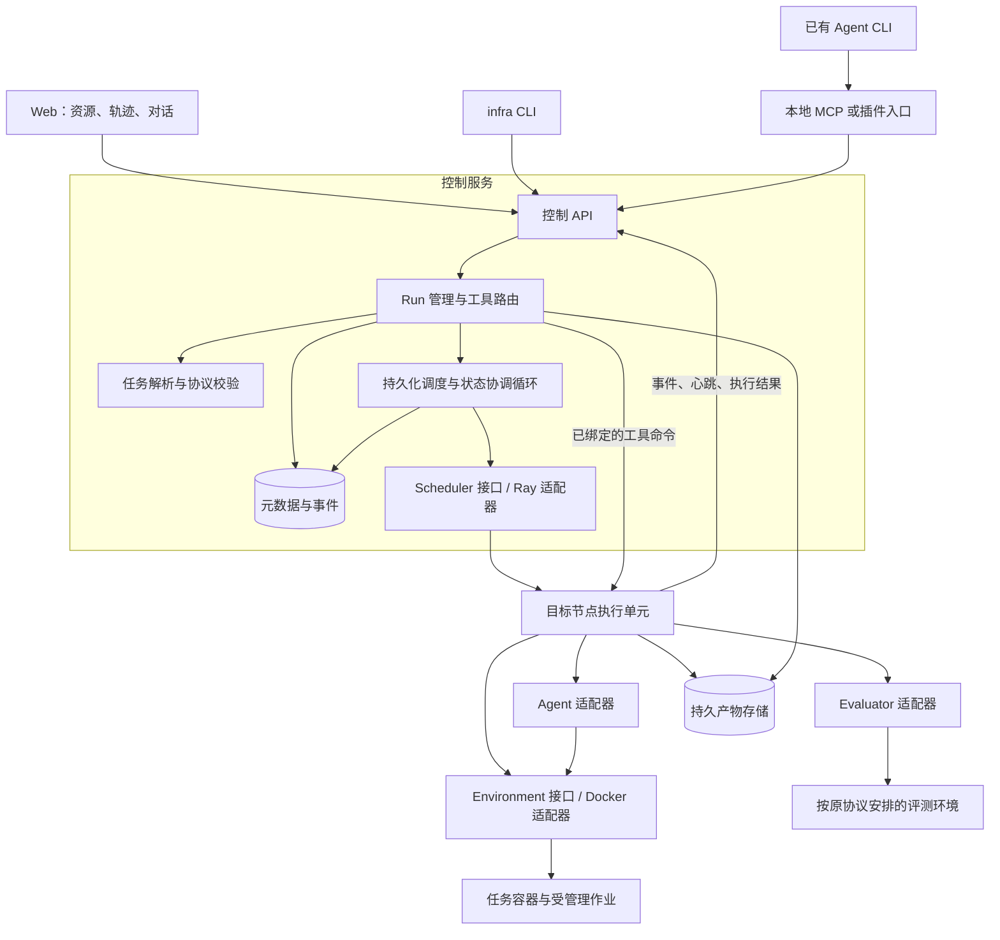
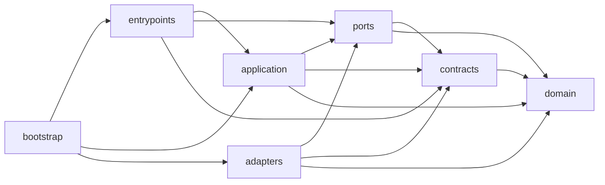

# Agent Infra 工程架构与代码仓库设计

版本：v0.1（设计草案）  
日期：2026-09-14  
用途：确定项目的工程边界、源码布局和团队协作方式，作为初始化仓库与拆分开发任务的依据。

**推荐采用一个 Monorepo：Python 模块化后端 + 独立 Web 前端。项目自身的产品源码统一进入 `src/`，项目文档进入 `docs/`，Git 与协作配置遵循工具约定；首期按模块分工，按少量进程部署。**

本文完成两个设计任务：把手写架构和需求文档落实为可开发的工程架构；设计适合 AI 辅助开发及多人 Git 协作的代码仓库。目录树、接口名称、技术栈和协作规则均为本稿建议，尚不表示已有实现。

需求依据是现有的[目标与架构设计 v0.1](Agent_Infra_目标与架构设计_v0.1.md)和[手写架构原图](arch.jpg)。本文继承前者标为“已确认”的需求，并细化其第 13 节的代码组织建议；不把原图中尚未确认的文字扩展为新功能。

## 1. 先确定的工程方向

| 决策 | 本稿建议 | 原因 |
| --- | --- | --- |
| 仓库边界 | 后端、前端、内置适配器、测试和部署配置放在同一个仓库 | 一次接口变更可以在同一个 PR 中更新所有消费者 |
| 源码入口 | 后端为 `src/agent_infra/`，前端为 `src/web/` | 路径明确，避免根目录逐渐出现多套业务代码入口 |
| 后端组织 | 一个 Python 发行包，内部按职责划分模块 | 首期共用版本和开发环境，减少跨包发布与依赖同步成本 |
| 部署方式 | 一个控制服务、各节点的执行单元、一个 Web 应用 | 代码模块不直接等同于微服务 |
| 扩展方式 | Agent、benchmark、环境、调度、存储通过接口适配 | 接入新的 Agent 或 benchmark 时，主要修改其自己的目录 |
| 运行模型 | 外部 CLI 接入与容器内 Agent 运行共用 Run、Attempt、环境及事件契约 | 复用管理能力，同时保留进程所有权和轨迹覆盖差异 |
| 首期调度 | Ray 分发独立 Run；每个 Attempt 的主要执行资源位于单节点 | 与已有需求一致，暂不引入一个任务的多机联合执行 |
| 协作方式 | 短分支、PR、模块责任人、独立工作目录、自动化检查 | 让多人和多个 AI 开发会话能够分开修改、持续集成 |

“源码统一进入 `src/`”指产品实现及其运行必需资源。测试代码放 `tests/`，工程辅助脚本放 `scripts/`，部署声明放 `deploy/`，示例输入放 `examples/`；这些目录具有明确用途。Python 构建时显式包含 `agent_infra` 包，不把前端和仓库工具一并打进 Python 发行包。`src` 布局需要安装项目后再导入，这也有助于发现只在仓库根目录运行才成立的打包问题。[PyPA 的 src 布局说明](https://packaging.python.org/en/latest/discussions/src-layout-vs-flat-layout/)

## 2. 从手写图到可部署系统

### 2.1 逻辑架构



图中的箭头表示运行时调用和数据流。Python 的导入方向另见第 5 节。逻辑上的 Worker 是节点执行能力；建议首先由目标节点上的 Ray Attempt Actor 承载，使用宿主机 Docker 服务管理容器。这个实现选择对应原文 Q08 的建议默认值，仍需原型验证设备映射、控制服务重启和孤儿容器回收。

### 2.2 进程与职责

| 部署单元 | 首期承载内容 | 明确边界 |
| --- | --- | --- |
| 控制服务 | HTTP API、Run 管理、任务解析、调度循环、工具路由、结果查询 | 保存管理状态；提交请求后不在 HTTP 请求中等待整个任务结束 |
| 节点执行单元 | 环境准备、Agent 启动或绑定、作业操作、轨迹采集、评测、清理 | 操作本节点容器；通过内部接口汇报事实，不直接改控制数据库 |
| MCP 入口 | 将外部 Agent 的工具请求转换为控制 API 调用 | 可随 CLI 运行；共享后端工具语义，不再实现一套 Run 管理 |
| Web 应用 | 资源页、Run/轨迹页、简单 Agent 对话页 | 通过公开 API 和事件订阅访问后端 |
| 持久化服务 | 元数据、事件索引、配置快照、轨迹和产物 | 生命周期独立于任务容器 |

首期只启动一个活跃的控制协调循环，API 与它可同进程运行。以后扩展多个 API 副本时，需要显式安排协调循环的单实例或租约归属，不能让每个 Web 进程都无条件调度同一批任务。

数据库保存待处理命令和状态，控制循环按记录推进。外部调用与数据库事务之间使用“先记录意图，再执行并回写结果”的方式；重启后核对已有执行单元，不凭内存队列重新启动所有任务。首期可用数据库表完成这件事，不必先部署独立消息系统。

### 2.3 两种运行方式的落点

**科研模式：**已有 Agent CLI → MCP/插件 → 控制服务 → 指定节点执行单元 → 任务 Docker。首期建议显式绑定 CLI 所在节点，每次工具请求携带 `run_id`、`attempt_id`、`env_id`。一个外部会话默认只有一个活跃 Run。解除会话绑定与结束 Run 分开：结束 Run 按策略停止平台管理的作业，显式保留环境时继续记录占用及回收期限；外部 CLI 进程仍由其拥有者管理。平台记录经其通道发生的交互，并声明可获得的 Agent 原生轨迹范围。

**Benchmark 模式：**用户提交实验 → 展开成 Run → Ray 选择节点 → 容器准备 → 在任务容器内启动 Agent → 归档交付物 → 按协议评测 → 清理与释放。Agent 与任务同容器，隐藏评测材料由控制侧或评测侧保管。原协议允许的本地验证工具仍可提供给 Agent。

前端对简单 ReAct 的对话也走 Run 和 Agent 接口。模型调用与工具循环在后端参考 Agent 中运行；前端负责输入和展示。是否支持追问、何时消费新消息，由能力声明和后端消息队列决定。

## 3. 推荐的仓库目录

下面是**目标布局**，不是要求初始化时一次性建立全部空目录。只在首个实现或资料实际进入时创建相应目录；不靠大量 `.gitkeep` 伪造完整工程。

```text
infra/
├── README.md                         # 项目介绍、快速开始、文档入口
├── AGENTS.md                         # 面向开发助手的全仓库简明约定
├── CONTRIBUTING.md                   # 人与 AI 共用的贡献流程入口
├── LICENSE                           # 确定许可证后加入
├── pyproject.toml                    # Python 包、依赖、工具配置、CLI 入口
├── uv.lock                           # Python 依赖锁，提交 Git
├── .python-version                   # 团队验证过的 Python 版本
├── package.json                      # 前端工作区命令、包管理器版本
├── pnpm-workspace.yaml               # 首期只登记 src/web
├── pnpm-lock.yaml                    # 前端依赖锁，提交 Git
├── .node-version                     # 团队验证过的 Node 版本
├── Makefile                          # 统一开发命令的薄封装
├── .editorconfig                     # 编码、换行、缩进约定
├── .env.example                      # 可提交的环境变量样例
├── .gitignore                        # 忽略运行数据、缓存和私密配置
├── .gitattributes                    # 文本换行和二进制文件属性
├── .github/                          # 采用 GitHub 时使用
│   ├── workflows/                    # CI 流程，只调用统一工程命令
│   ├── ISSUE_TEMPLATE/               # 缺陷、功能、接入任务模板
│   ├── pull_request_template.md      # 问题、变更、验证、兼容性
│   └── CODEOWNERS                    # 路径与负责团队的映射
│
├── docs/                             # 项目文档的主体
│   ├── README.md                     # 文档导航
│   ├── product/                      # 目标、需求、范围和验收口径
│   ├── architecture/                # 本文、模块说明、运行模型
│   │   └── repository-architecture.md
│   ├── adr/                          # 已作出的重要技术决策及原因
│   ├── development/                  # 本地开发、贡献、调试和模块接入指南
│   ├── operations/                   # 部署、节点登记、回收与恢复手册
│   ├── reference/                    # 协议语义、兼容矩阵、配置说明
│   └── assets/                       # 原图、架构图片等文档资源
│
├── src/
│   ├── agent_infra/                  # 一个 Python 导入包
│   │   ├── __init__.py
│   │   ├── domain/                   # 实体、状态规则、预算和协议不变量
│   │   ├── contracts/                # API、事件、meta-spec、执行消息 DTO
│   │   ├── ports/                    # Agent/Task/Env/Scheduler/Storage 等接口
│   │   ├── application/              # 可独立验证的业务用例与编排
│   │   │   ├── runs/                 # 提交、取消、Attempt、状态协调
│   │   │   ├── tasks/                # 解析、可见投影、能力兼容检查
│   │   │   ├── execution/            # 节点侧准备、执行、采集、清理流程
│   │   │   ├── tools/                # 文件、命令、后台作业、会话用例
│   │   │   ├── evaluations/          # 评测安排和按协议汇总
│   │   │   └── queries/              # 资源、轨迹、产物与结果查询
│   │   ├── adapters/                 # 外部系统与具体实现
│   │   │   ├── agents/
│   │   │   │   ├── codex/
│   │   │   │   ├── claude_code/
│   │   │   │   ├── aide/
│   │   │   │   └── react/            # 自研 ReAct 参考实现，与 Web 的 React 无关
│   │   │   ├── benchmarks/
│   │   │   │   └── <benchmark_id>/   # 同一 bench 的解析、评测和汇总规则
│   │   │   ├── environments/
│   │   │   │   └── docker/           # 挂载、设备、命令、作业、销毁
│   │   │   ├── schedulers/
│   │   │   │   ├── local/            # 开发用单节点实现
│   │   │   │   └── ray/              # Ray 对象和资源请求转换封装于此
│   │   │   ├── storage/
│   │   │   │   ├── sql/              # 表映射、查询、事务、数据库迁移
│   │   │   │   │   └── migrations/
│   │   │   │   └── filesystem/       # 首期集中式产物目录
│   │   │   └── control_client/       # CLI/MCP/Worker 访问控制服务的客户端
│   │   ├── entrypoints/              # 协议与进程入口的薄封装
│   │   │   ├── http/                 # 路由、认证上下文、输入输出转换
│   │   │   ├── cli/                  # infra 命令行
│   │   │   ├── mcp/                  # 面向外部 Agent 的工具入口
│   │   │   └── worker/               # 节点执行命令与观察结果入口
│   │   └── bootstrap/                # 加载配置、插件发现、装配依赖和启动
│   │
│   └── web/                          # 独立前端工程
│       ├── package.json              # 前端运行与开发依赖
│       ├── index.html
│       ├── vite.config.ts
│       ├── tsconfig.json
│       ├── public/
│       └── src/
│           ├── app/                  # 路由、页面框架、全局初始化
│           ├── features/
│           │   ├── resources/        # 资源页
│           │   ├── runs/             # Run 与轨迹页
│           │   └── chat/             # 简单 Agent 对话页
│           ├── components/           # 多页面实际共用的展示组件
│           └── api/
│               ├── generated/        # 根据后端契约生成，禁止手工维护
│               └── client.ts         # 请求、鉴权、订阅与错误转换
│
├── schemas/                          # 从源码生成并提交的协议快照
│   ├── meta-spec/                    # 如 0.1.schema.json
│   ├── events/                       # 事件信封与版本化负载
│   ├── execution/                    # 控制服务与 Worker 之间的消息
│   └── api/                          # OpenAPI 快照
├── tests/
│   ├── unit/                         # 按后端源码模块镜像组织
│   ├── contracts/                    # 适配器共同语义与序列化兼容
│   ├── integration/                  # 数据库、Docker、Ray、原评分器
│   ├── e2e/                          # 两种运行链路与浏览器关键流程
│   ├── web/                          # 前端组件、交互和 API 消费测试
│   ├── fixtures/                     # 小型、可公开、确定性的测试输入
│   └── fakes/                        # 假 Agent、假调度器、内存仓储
├── examples/
│   ├── task-packages/                # 两种不同原生组织方式的示例
│   ├── research/                     # 外部 CLI 模式配置和使用样例
│   └── benchmark/                    # 容器内批量评测样例
├── configs/                          # 可提交的非敏感应用配置
│   ├── defaults.yaml
│   └── profiles/                     # local / development / cluster 样例
├── deploy/
│   ├── docker/                       # 控制服务、执行节点等产品镜像配方
│   ├── compose/                      # 本地及小型部署的服务组合
│   └── ray/                          # 集群启动与节点资源配置样例
├── scripts/
│   ├── dev/                          # 开发启动、检查环境的薄脚本
│   ├── codegen/                      # 导出 Schema、生成 API 客户端
│   └── ci/                           # 构建、架构检查与变更范围计算
└── var/                              # 仅本地开发运行数据，整体忽略
```

`src/web/src/` 的两层 `src` 分别属于仓库和前端工程，含义不同；保留前端工具惯例即可。数据库迁移是随版本交付的实现，归属存储适配器并纳入 Python 包资源；执行迁移的操作说明归属 `docs/operations/`。

内置 Agent 名录表示目标扩展位置。首期只创建实际接入的 Agent 目录，保留原文建议的“一个完整 CLI Agent + 一个简单 ReAct”验证范围。

## 4. 文件放置与配置边界

### 4.1 根目录允许放什么

根目录保留项目入口和工具需要发现的配置。完整架构、开发教程和会议结论进入 `docs/`；`README.md`、`CONTRIBUTING.md`、`AGENTS.md` 保持简短，通过链接指向详细内容。

Git 相关内容分三类：

- `.git/` 由 Git 管理，不放项目源码、CI 脚本或文档，也不提交；linked worktree 中的 `.git` 可能是文件。
- `.gitignore`、`.gitattributes` 保留在根目录，分别管理忽略规则与文件属性。
- `.github/` 保存 GitHub 的 CI、模板和责任人配置。若采用 GitLab，再使用其平台入口；通用检查逻辑仍在 `scripts/`，不复制两套。

`AGENTS.md` 是开发约定，`pyproject.toml` 是构建与依赖配置，都不因为被 Git 跟踪就归入 `.github/`。不额外发明一个 `git/` 或 `code/` 目录作为杂物入口。

### 4.2 几类容易混放的内容

| 内容 | 应放位置 | 放置原则 |
| --- | --- | --- |
| 新 Agent 的启动、事件转换代码 | `src/agent_infra/adapters/agents/<id>/` | 与对应适配器一起版本化 |
| 运行必需的提示模板、内置工具说明 | 使用它的源码模块下，如 `prompts/` | 作为包资源交付；不能依赖部署机器还有 `docs/` |
| benchmark 接入代码 | `src/agent_infra/adapters/benchmarks/<id>/` | 解析、评测、汇总在一个责任边界内 |
| benchmark 原仓库与数据 | 外部版本化任务源和数据存储 | 主仓库保存来源、固定版本、校验值及小样例 |
| 演示任务的原生 Dockerfile | `examples/task-packages/<id>/` 内 | 它是任务原生输入，不是 infra 服务镜像 |
| infra 控制服务镜像、集群服务配置 | `deploy/` | 应用实现仍调用 `src/` 中的入口 |
| 环境准备和任务执行业务逻辑 | `src/agent_infra/` | `scripts/` 只封装工程命令，不成为第二套运行后端 |
| 大日志、模型权重、训练产物、原始轨迹 | 运行目录或产物存储 | Git 保存代码与可追溯引用，不保存每次运行数据 |
| 私人配置、Agent 登录材料、密钥 | 本机私密配置或部署凭证系统 | 仓库只存样例和非敏感引用 |
| 一次性探索脚本或笔记 | 本地 `var/scratch/` | 成为长期功能后整理进源码、示例或文档 |

任务执行工作区必须与 infra 开发工作区分开。平台运行任务时创建独立的 Attempt 目录并投影输入，不把正在多人开发的 infra checkout 当作 Agent 可修改的任务目录。

### 4.3 配置分层

应用配置建议按“内置默认值 → `configs/` 的选定 profile → 显式用户配置文件 → 环境变量 → 命令行显式参数”合并，统一由 `bootstrap/` 加载和校验。业务模块接收类型化配置，避免在模块各处读取环境变量。具体合并规则在配置参考文档中固定，未知公共字段报错。

这套优先级只适用于部署与用户偏好。benchmark 的资源、计时、可见输入、网络、人工介入和重试约束先形成允许范围；用户参数仅能在范围内覆盖，超出时拒绝或记录为自定义实验。

建议使用 `AGENT_INFRA_STATE_DIR` 指定运行数据根目录。开发默认 `var/`；团队部署使用仓库外的持久路径。节点本地目录用于执行和暂存，最终产物由统一存储提供稳定引用，API 不暴露任意宿主机文件路径。

忽略规则至少覆盖 `var/`、`.venv/`、`node_modules/`、构建和测试缓存、真实 `.env` 及本地 profile。显式保留 `.env.example`、锁文件、Schema 快照和小型 fixtures；不用 `*.json`、`*.yaml`、`*.log` 这类过宽规则误伤测试和协议样例。

## 5. 后端模块边界与依赖规则

### 5.1 每层只负责一类问题

| 层 | 内容 | 不应承担的工作 |
| --- | --- | --- |
| `domain/` | Run/Attempt 等实体、状态转换、预算与有效结果规则 | HTTP、数据库映射、Docker 或 Ray 对象 |
| `contracts/` | 传输 DTO、字段校验、协议版本、对外错误结构 | 执行调度、启动容器、数据库查询 |
| `ports/` | 应用依赖的抽象接口，用类型描述输入、结果和能力 | 默认连接第三方服务，隐藏具体适配器创建 |
| `application/` | 任务解析、Run 协调、执行流程、工具用例和评测安排 | 导入具体 Ray/Docker/数据库实现 |
| `adapters/` | 实现 ports，转换第三方对象、错误和数据格式 | 自行另建一套 Run 状态机、绕过协议选择成绩 |
| `entrypoints/` | HTTP/CLI/MCP/Worker 的参数解析和协议转换 | 在路由或工具函数里编排完整任务生命周期 |
| `bootstrap/` | 选择适配器、加载配置、注入依赖、启动进程 | 承担任务逻辑，成为其他层随意调用的全局服务容器 |

`domain/` 优先使用标准库的数据类、枚举和普通函数；`contracts/` 可使用 Pydantic 表达边界数据。确实相同的 ID 和枚举可由 domain 导出共用，不为同一状态在多层维护多套字符串。持久化模型和 API DTO 分开，避免数据库列变更无意间改变公开 API。

### 5.2 导入方向



箭头表示允许的包内导入，`bootstrap/` 还可引用装配所需的契约与接口。第三方框架限制在对应边界，例如 FastAPI 在 HTTP 入口、Ray 在调度适配器、Docker SDK 在环境适配器。

具体规则：

1. `domain/` 不依赖其他项目层；`contracts/` 不反向导入业务用例。
2. `application/` 只通过 ports 访问外部能力。控制侧和节点侧可以使用不同的存储、事件上传适配器。
3. `adapters/` 不导入 `application/`、`entrypoints/`、`bootstrap/`，适配器之间也不直接导入具体实现。需要协作时由应用编排，或经 ports 注入。
4. `entrypoints/` 不直接创建具体适配器，启动装配由 `bootstrap/` 完成。CLI/MCP 可注入控制 API 客户端接口，并不需要本地启动完整控制服务。
5. Ray Worker 的远程包装器由 bootstrap 注入节点执行入口或工厂。调度适配器只负责传输与运行包装，不为了启动 Worker 反向导入整个业务层。
6. 前端只使用公开 HTTP/事件契约。Ray Actor handle、Docker client、数据库 session 不能穿过公共契约。

通过静态导入检查验证方向。新建共享模块应有清楚职责和实际消费者；避免把不知放哪里的功能持续堆进 `common.py`、`utils.py` 或一个不断膨胀的 `core/`。

### 5.3 原设计模块如何落位

| 原设计概念 | 工程落点 |
| --- | --- |
| Task Adapter / meta-spec | `ports/tasks.py`、`application/tasks/`、具体 benchmark 目录 |
| Agent Adapter | `ports/agents.py`、`adapters/agents/<id>/` |
| Env Manager | `ports/environments.py`、`application/execution/`、`adapters/environments/docker/` |
| Tool Gateway | `entrypoints/mcp/`、`application/tools/`，复用控制客户端与节点工具接口 |
| Run Manager | `domain/` 的状态规则、`application/runs/` 的管理与协调 |
| Scheduler | `ports/scheduling.py`、`adapters/schedulers/` |
| 节点控制通道 | `ports/workers.py`；由 local/Ray 适配器提供对应传输实现 |
| Node Worker | `entrypoints/worker/`、`application/execution/`、`bootstrap/` 的节点装配 |
| Evaluator / 成绩汇总 | `ports/evaluation.py`、`application/evaluations/`、具体 benchmark 目录 |
| Event / Artifact Store | `ports/storage.py` 与存储适配器；大对象和查询索引分开 |
| Frontend | `src/web/`，按资源、Run/轨迹、对话划分功能目录 |

同一个 benchmark 的任务解析和评测代码放在同一目录，是对原文水平拆分建议的细化：它们必须共同维护原生协议，按 benchmark 分工更容易完成一次完整接入；对外仍然实现独立的 Task、Evaluator 和汇总接口。

## 6. 在并行开发前固定的最小契约

### 6.1 核心对象与关系

| 对象 | 最小职责与关联 |
| --- | --- |
| `TaskPackage` / `TaskInstance` | 来源版本、原生任务 ID、数据划分、种子；任务可被多次运行 |
| `ResolvedTask` | 确定性解析后的输入、环境、资源、预算、输出及评测要求，创建 Run 时快照 |
| `Experiment` | 一组明确列出的 Run 和汇总协议；首期可作为轻量批次记录 |
| `Run` | 一个任务实例、Agent 配置和实验条件下的逻辑请求；重复试验分别创建 Run |
| `Attempt` | Run 的一次实际执行或获准重试；每次新增 ID 和记录 |
| `AgentSession` / `SessionBinding` | 会话能力、进程所有权，以及当前绑定的 Run/Attempt/Env |
| `EnvInstance` / `Job` / `ToolSession` | 容器、后台作业、有状态工具会话；均明确归属 Attempt |
| `ResourceAllocation` | 节点、资源、实际设备、租约代次、持有与回收状态 |
| `Event` / `Artifact` | 关联 Run/Attempt 的事件或不可变产物版本；独立于容器保存 |
| `EvaluationResult` | 评分状态、原生输出、指标、评分器版本和交付物摘要；不等同于 Run 状态 |

一个 Experiment 包含多个 Run，一个 Run 保留全部 Attempt。首期同一个 Run 只允许一个当前有效的执行 Attempt；未确认旧执行结束时不能自动并行重试。评测如需重做，新增评分记录并绑定同一不可变交付物，不能覆盖原评分证据或默默重新运行 Agent。

### 6.2 应用需要的接口

以下是语义草案，不是已可调用的 SDK。实现时优先使用小型 `Protocol`，按能力拆分，不要求每个 Agent 实现所有可选方法。

| 接口 | 最小操作语义 |
| --- | --- |
| `TaskAdapter` | 枚举任务、校验原生输入、解析 `ResolvedTask`、生成可见输入清单 |
| `ManagedAgent` | 声明能力、校验配置、在已有环境中启动、观察、停止、导出可获得轨迹 |
| `AttachedAgent` | 声明能力、绑定外部会话、观察、解除绑定；交互按能力提供 |
| `EnvironmentBackend` | 幂等准备和查询环境、文件操作、短命令、后台作业、会话、确认销毁 |
| `Scheduler` | 提交执行规格和资源约束、查询分配、撤销尚未启动的申请、确认释放 |
| `WorkerControl` | 将带命令 ID 和分配代次的执行/工具/取消命令送到所属执行单元 |
| `Evaluator` | 以指定交付物和协议执行评分，返回原生输出引用及规范化指标 |
| `ResultAggregator` | 根据明确的期望任务集合、Attempt 选择规则和评分结果汇总 |
| `RunRepository` / `UnitOfWork` | 状态版本校验、事务内保存 Run、待执行命令与对应状态事件 |
| `EventStore` / `ArtifactStore` | 幂等接收、持久游标查询、对象写入与完整性确认 |

Scheduler 管理资源与执行单元的安排，WorkerControl 管理已分配执行单元上的命令；local/Ray 后端可以提供这两个接口的实现，应用层仍按职责分别使用。

长操作返回句柄，不把一次 RPC 挂到训练结束。独立命令显式传入 `cwd` 和环境变量；需要保留 shell 状态时使用 `session_id`。停止操作按平台实际所有权执行，最终回报执行状态和清理状态。

### 6.3 Schema 和客户端只有一个维护源

| 内容 | 人工维护源 | 生成并提交的结果 |
| --- | --- | --- |
| meta-spec 公共结构 | `contracts/` 的 meta-spec 模型 | `schemas/meta-spec/<version>.schema.json` |
| 事件与内部执行消息 | `contracts/` 的对应模型 | `schemas/events/`、`schemas/execution/` |
| HTTP API | HTTP 路由声明 + `contracts/` DTO | `schemas/api/openapi.json` |
| Web API 类型与调用代码 | 上述公开 API 和事件 Schema | `src/web/src/api/generated/` |

FastAPI 可输出 OpenAPI 和 JSON Schema，本稿据此选择从后端声明生成契约快照与客户端的路线。[FastAPI 官方功能说明](https://fastapi.tiangolo.com/features/)

数据库表结构不是公开 API 的生成源。内部 Worker 消息、凭证引用和完整控制侧任务快照不因为共用代码生成就进入公开 API。Web 只生成自己被允许消费的契约。

生成过程固定工具版本、排序和格式，并可在没有 Docker、Ray、数据库和真实凭证的环境运行。CI 重新生成并检查差异；开发者修改源定义后同步提交生成结果。旧版本协议保留对应模型或显式迁移代码，避免重新生成时用新模型覆写旧版 Schema。

meta-spec 延续原稿 `schema_version` 的思路，公共字段严格校验，benchmark 特有字段放带命名空间的 `extensions`。API、meta-spec、事件、插件接口分别记录版本，不能只靠仓库版本推断数据格式。首期控制服务与 Worker 使用同一发布版本，连接时校验协议兼容性；以后需要滚动升级，再明确版本兼容窗口。

### 6.4 运行状态、事件和副作用

Run 的正常阶段可表达为 `created → queued → preparing → running → collecting → evaluating → completed`；无需评分的科研 Run 在归档后完成，交互可进入 `waiting_input`，外部评分可进入 `awaiting_external_evaluation`。`failed`、`cancelled`、`lost` 等分支及允许转移在 domain 中定义；API、前端和 Worker 不分别实现不同的转换规则。

Run 另记录 `cleanup_status` 和评分状态。因此得零分、评分器故障、执行失败、资源尚未清理是不同事实。控制侧负责采纳 Worker 观察并提交权威状态；Worker 报告进程退出、归档完成、容器删除等事实。

需要固定以下行为：

- 创建 Run 使用作用域内唯一的幂等键，键重复而请求内容不同则报冲突。创建环境、启动作业和停止作业也保存命令 ID 与已知结果；结果未知时先查询已有对象，不直接重放训练或任意 shell 命令。
- 命令和 Worker 报告携带 `run_id`、`attempt_id`、`allocation_id`、分配代次和协议版本。控制侧用状态版本校验阻止过期 Worker 覆写新 Attempt。
- 事件至少有 `event_id`、来源、来源顺序号、时间、类型、关联 ID 和可选产物引用。接收端去重并分配持久化游标；墙上时间用于展示，不作为精确全局因果顺序。
- 节点日志先落本地可重传暂存区，控制侧持久接收后确认。断网可续传；节点磁盘彻底丢失时明确记录未上传区间和轨迹缺失。
- Web 首期采用 HTTP 命令与 SSE 事件订阅。先持久化再推送，重连按游标补历史；若游标对应数据已过保留期，明确要求重新加载快照。前端关闭不改变 Run 生命周期。
- 错误返回包含类别、阶段、可重试建议和已有诊断引用。重试是否执行仍由 Run/benchmark 策略决定，不由底层异常捕获无条件触发。

## 7. 资源、存储与评测的实施边界

### 7.1 Ray 分配必须覆盖真实执行生命周期

正常路径为：申请资源 → 确认节点与设备 → 准备容器 → 执行与监测 → 归档 → 停止相关进程并确认清理 → 释放分配。监督执行单元在此期间持续持有显式声明的资源；避免启动 Docker 后立即返回，也避免同一份资源被监督层与容器内子任务重复预留。

Ray 资源主要用于逻辑调度；Docker 默认不会自动按 Ray 声明限制资源。因此本项目的 Docker 适配器要显式配置 CPU、内存限制和已分配 GPU 的设备映射，并记录分配值与实际使用值。[Ray 资源说明](https://docs.ray.io/en/latest/ray-core/scheduling/resources.html)、[Docker 资源限制](https://docs.docker.com/engine/containers/resource_constraints/)

执行单元崩溃或节点失联时，不能假设 Ray 仍替容器持有资源，也不能仅把数据库 allocation 标为占用就阻止真实超配。P2 必须实现节点执行互斥/资源占用核对：发现存活的旧容器或无法核实的设备时，冻结对应节点或设备的 infra 新任务准入；由节点清理流程核实进程和容器结束，再解除冻结。分配代次阻止旧执行单元继续接收有效命令，但代次校验本身不能停止已经运行的进程。

节点核对逻辑归属 `application/execution/`，通过独立的 Worker 维护入口周期运行，不能依赖已失败的 Attempt Actor 自己清理。每次创建容器前都校验节点本地占用登记和实际容器；准入、占用登记和容器创建需要在节点内协调，不能只在控制侧排队时检查一次。节点失联期间停止新的有效准入，重新接入先完成核对。

首期关闭会盲目重放业务执行的自动恢复。控制服务重启后通过稳定的执行标识、容器标签和持久记录重新核对；执行单元是否存活以及是否能重新连接，列入真实 Ray 原型验收。此处的故障识别与回收不承诺恢复 Agent 中途推理状态。

外部 CLI 模式主要分配任务容器的资源，单独记录未受 infra 管理的 CLI 宿主进程。接入共享机器前登记本项目实际获准管理的 CPU/GPU 范围；其他调度系统的分配不能被本项目再次计入空闲池。

### 7.2 持久数据与容器分离

建议团队部署首期使用 PostgreSQL 保存 Run、Attempt、待执行命令、分配、事件索引和评分元数据。状态更新与相应的待发送状态事件放在同一事务中；这是本项目保证状态与通知可核对的设计选择，数据库事务能力见[PostgreSQL 官方说明](https://www.postgresql.org/docs/current/tutorial-transactions.html)。

大日志、任务快照、轨迹和交付物进入 `ArtifactStore`。首期可以由控制服务提供上传接口，最终落到集中式持久目录，节点无需假定共享同一路径。上传完成并校验后才登记可用引用；部分上传保留明确状态，归档失败按策略保留工作区或暂存文件。后续对象存储实现同一接口。

元数据删除、产物保留期和节点清理是不同操作。清理任务容器不能连带删除已经归档的结果。评测输入使用已冻结的交付物引用及摘要，避免评分时 Agent 仍在修改同一目录。

### 7.3 Benchmark 协议由适配器完整保留

meta-spec 只索引原生文件及其角色，Task Adapter 确定性解析，平台按可见输入清单准备工作区。混合可见和隐藏信息的原生文件必须生成可见投影；仅写 `audience` 标签不能实现隔离。

每次接入固定原任务来源、数据与评分器版本，记录预算、计时点、网络及人工参与规则。Run 保存最终有效配置，评分记录同时保留原生输出和规范化指标。

批量汇总以 Experiment 的期望任务清单为基准，处理缺失、失败、重试和外部待评分；不能只平均成功任务，也不能默认挑最高分。`ResultAggregator` 由 benchmark 协议提供，通用后端负责调用与归档。隐藏评测器若需要额外计算资源，单独申请并关联到同一 Run，按原协议安排是否释放或保留任务环境。

### 7.4 控制通道与任务可见范围

控制 API 校验用户或服务身份及 Run 访问范围；Worker 使用节点身份，只接受归属自己的有效命令。MCP 绑定并不是授权替代物，`env_id` 也不是秘密凭证。文件操作限定于该环境允许的路径，归档和下载经产物引用访问。

Agent 凭证在运行时按已验证的适配方式注入。任务容器不默认挂载宿主 Docker socket、整个 infra 仓库或用户完整认证目录。上述边界服务于本项目的任务隔离和隐藏评测要求；科研模式中外部 CLI 自身的宿主机操作仍可能处于 infra 记录范围之外。

配置快照、日志、原始轨迹和导出结果分别落实敏感值处理；可公开的快照仅保存非敏感配置来源引用。原始轨迹需要受控访问，不能因为它没有经过统一事件转换就默认可以向所有用户展示。

## 8. 依赖、技术栈与插件组织

### 8.1 建议的首期基线

| 部分 | 建议基线 | 本阶段约束 |
| --- | --- | --- |
| 后端 | Python、FastAPI、Pydantic | 控制流程使用类型化接口；框架局限于对应边界 |
| Python 工程 | 一个 `pyproject.toml` + `uv.lock` | 用 dependency groups 管理开发依赖，按 extras 管理可选后端能力 |
| 前端 | TypeScript、React、Vite | 内部控制台的三个核心功能区；首期使用客户端页面 |
| 前端工程 | pnpm workspace，首期一个 Web 包 | 一个根锁文件，不混用 npm/yarn/pnpm 锁 |
| 执行 | Docker + Ray；开发提供 local scheduler | 单节点原型和真实多节点验证分开 |
| 元数据与产物 | PostgreSQL + 集中持久目录 | 内存 fake 仅供单元测试，不代表生产持久化语义 |
| 质量工具 | Python 格式与静态检查、类型检查、pytest；前端类型检查和测试 | 初始化时固定一套工具及版本，统一从工程命令进入 |

uv 的项目与锁文件规则支持将解析后的依赖版本纳入仓库；pnpm workspace 需要根级配置。本稿采用这些机制管理两种语言，不额外引入统一构建平台。[uv 项目结构](https://docs.astral.sh/uv/concepts/projects/layout/)、[pnpm Workspace](https://pnpm.io/workspaces)

React 官方资料给出了 Vite 与 TypeScript 的应用搭建方式；采用此组合是本项目控制台范围下的建议，路由、数据获取和订阅仍需项目实现。[React 官方构建说明](https://react.dev/learn/build-a-react-app-from-scratch)

本稿不指定“最新版”。初始化时验证 Python/Ray、Node/前端工具、Docker/GPU 驱动与首个 Agent 的兼容组合，随后锁定版本；镜像记录不可变摘要。控制侧安装 infra 所需依赖，各任务的训练库和 Agent 原生运行依赖由对应镜像管理，避免把所有 benchmark 的 Python 环境混入根依赖。

### 8.2 一次新增适配器改哪里

一个 benchmark 目录建议包含 `task_adapter.py`、`evaluator.py`、`aggregation.py`、`manifest` 和必要的包内资源；根据实际复杂度合并小文件。一个 Agent 目录包含能力声明、配置校验、启动或接入、事件转换及原始轨迹导出逻辑。

首期采用受控的内置插件发现：每个插件目录提供统一格式的 manifest 和工厂入口，bootstrap 按约定读取，校验唯一 ID、接口版本、所需依赖和启用白名单，再装配实例。新增插件不需要给 Run Manager 添加 benchmark 或 Agent 名字的分支。任务包只引用已注册插件 ID，不能直接提供任意 Python 导入路径让控制服务执行。

插件缺少可选依赖时，应能列出“不满足依赖”的诊断；未启用的适配器不在普通导入时加载重型 SDK。不要在包顶层 `__init__.py` 一次导入所有适配器。

只有出现独立发布、独立依赖环境或外部团队维护需求，才把适配器拆成独立发行包；届时可通过 Python entry points 发现外部插件。协议语义保持不变，包拆分单独记录 ADR。[PyPA 插件发现说明](https://packaging.python.org/en/latest/guides/creating-and-discovering-plugins/)

| 开发任务 | 主要修改位置 | 必须同步的证据 |
| --- | --- | --- |
| 接入一个 Agent | `adapters/agents/<id>/` | 能力契约测试、脱敏原生事件 fixture、运行样例及兼容说明 |
| 接入一个 benchmark | `adapters/benchmarks/<id>/` | 两端评分对照、可见性检查、协议记录、小型示例 |
| 修改 Run 状态或重试语义 | `domain/`、`application/runs/` | 状态与预算测试、消费者兼容变化 |
| 增加一种存储 | `adapters/storage/<backend>/` | 存储契约测试、故障语义、迁移或部署说明 |
| 增加前端功能 | `src/web/src/features/<feature>/` | API 消费和关键交互测试；接口变化时同 PR 更新契约 |
| 新增跨节点调度能力 | `ports/scheduling.py`、对应 adapter 与执行编排 | 资源语义、故障回收和真实节点验证 |

## 9. 面向 AI 辅助开发的仓库约定

### 9.1 提供分层、短小的上下文

根 `AGENTS.md` 只说明项目地图、依赖方向、常用检查命令、生成文件规则和变更交付要求。规模增长后，在 `src/agent_infra/`、`src/web/` 或确有特殊规则的适配器目录添加局部 `AGENTS.md`，只写差异，不复制全仓库架构。完整说明仍放 `docs/`，局部文件链接到对应章节。

开发任务给人和 AI 使用同一种简短说明，建议记录：

```text
目标：新增 demo_bench 适配，保持原评分入口的结果语义。
背景：原生任务说明、输入、隐藏测试及计时规则的来源。
修改范围：该 benchmark 目录、对应测试、小型示例与接入说明。
使用契约：TaskAdapter、Evaluator、ResultAggregator 的指定版本。
验收：输入可见性正确；同一交付物的两种评分入口结果符合原协议。
异常情况：缺输入、评分器失败、任务得零分分别如何呈现。
验证命令：本任务相关的测试、格式和契约检查入口。
```

任务涉及公共接口时先把接口语义、样例和消费者同步范围说清，再进入模块实现。AI 遇到缺少的接口应指出具体缺口并在同一任务中补齐设计或实现，不另造一个并行的 `RunManagerV2`、重复 DTO 或绕过边界的临时入口。

### 9.2 降低上下文成本的日常规则

- 一个模块有一个清楚的公共入口，测试按模块组织，错误能定位到阶段与对象 ID。
- 可独立运行的假 Agent 和小型任务覆盖主要调用链；常规开发不依赖个人账户、真实付费模型或 GPU。
- 新增功能同时更新最接近它的指南和样例；代码生成文件带生成标记，修改源定义后重新生成。
- 仅对外协议、状态和预算语义、持久化方式、部署边界等重要决定新增 ADR。普通实现细节通过代码和 PR 说明表达。
- 文档区分“已经实现”“建议设计”“尚待验证”；运行示例只有真正可用后才进入快速开始。

开发指南建议先提供 `local-development.md`、`add-agent.md`、`add-benchmark.md`、`testing.md` 四篇。每篇描述一条完整路径，并链接到真实命令和示例；不维护多份内容相同、仅文件名不同的 AI 使用手册。

## 10. 多人 Git 协作规范

### 10.1 分支与工作目录

主分支使用 `main`，保持可构建和可演示。任务采用短生命周期分支，例如 `feat/agent-codex`、`feat/bench-demo`、`fix/run-cancellation`、`docs/repository-layout`。一个 PR 聚焦一个可审查结果，配套源码、契约、测试和文档可以一起修改。

不同开发者使用各自的 clone；同一开发者同时处理多个任务或多个 AI 会话时，为每个任务建立独立 worktree。Git worktree 支持在同一仓库关联多个独立工作目录，适合并行检出不同分支。[Git 官方 worktree 文档](https://git-scm.com/docs/git-worktree)

仓库已有初始提交且配置了 `origin/main` 后，可采用：

```bash
git fetch origin
git worktree add -b feat/agent-codex ../infra-agent-codex origin/main
git worktree add -b feat/bench-demo ../infra-bench-demo origin/main
```

同一工作目录同一时刻只交给一个主动编辑任务。Worktree 隔离文件修改，还需要各自的 `.venv`、本地环境配置、运行目录、端口、数据库命名空间和容器项目名。共享 GPU 仍经资源分配，不能因为目录不同就认为运行资源已隔离。

worktree 在主目录旁创建，避免被任务打包或递归扫描。清理前确认其中修改已提交或保留；共享分支不重写历史，个人分支在无人依赖时可更新到主线。主线合并方式建议 squash，使一个独立交付对应一个便于定位的提交。

### 10.2 按模块负责，按完整功能交付

| 责任范围 | 主要路径 | 协作重点 |
| --- | --- | --- |
| 核心与契约 | `domain/`、`contracts/`、`ports/`、Run 编排、`schemas/` | 状态、错误、版本和预算语义 |
| 运行基础设施 | execution、Docker、Ray、Worker、`deploy/` | 节点、设备、实际生命周期、故障回收 |
| Agent 接入 | 每个 `adapters/agents/<id>/` 及其测试 | 能力、认证验证、原生事件映射 |
| Benchmark 接入 | 每个 `adapters/benchmarks/<id>/` 及其测试 | 原生协议、可见性、评分与汇总 |
| 存储与查询 | storage、queries、迁移 | 事务、游标、归档和升级 |
| 前端 | `src/web/`、`tests/web/`、浏览器流程 | 公开 API、交互状态与历史恢复 |

这些是职责，不预设六个独立团队或具体人数。负责人维护边界与 review，其他开发者仍可提交相关修改。`.github/CODEOWNERS` 应覆盖实际路径与真实团队，包括测试、契约、生成文件及其自身；不写无法解析的占位账号。

CODEOWNERS 用于指定评审归属；需要强制相关评审通过时，还要配置托管平台的分支保护或 ruleset，单独提交这个文件不等于已经启用合并限制。[GitHub Code Owners 说明](https://docs.github.com/en/repositories/managing-your-repositorys-settings-and-features/customizing-your-repository/about-code-owners)

### 10.3 减少高频冲突

1. **共享契约先形成可合并基线。** 公共语义变更先提供模型、样例和测试；实现可跟随小 PR。短期未完成能力默认不启用，主线仍可运行。
2. **按插件目录分工。** 新 benchmark 不要求修改公共状态机和另一个 benchmark 的实现；入口发现遵循固定机制。
3. **依赖与锁文件一起更新。** 冲突时先合并依赖声明，再用固定版本工具重新解析锁文件并审查差异，不整份选择“我们的/他们的”。
4. **生成文件从合并后的源重新生成。** 不对 Schema 或生成客户端做独立的手工冲突修补。
5. **数据库迁移使用唯一 ID。** 多分支增加迁移时核对执行顺序和依赖，合并时处理分叉；已在共享环境执行的迁移通过新增迁移修正。
6. **格式化范围跟随任务。** 全仓库格式调整、文件大搬迁和功能变更分别交付，避免把几百个无关文件带进接入 PR。

PR 描述至少写清具体问题、最终行为、验证结果和兼容影响。CI 通过后由相关责任人评审；公共协议或持久化变更应说明现有调用方和数据如何继续使用。

## 11. 开发入口与验证策略

### 11.1 统一命令约定

以下命令是**初始化阶段要实现的接口**，当前文档交付不代表它们已经存在。Makefile 调用 Python/前端包管理器及短工程脚本，本地与 CI 共用实现。

| 命令 | 预期行为 |
| --- | --- |
| `make setup` | 按锁文件安装开发依赖，校验所需工具版本 |
| `make dev` | 启动本地控制台及所需持久化服务；使用 fake Agent/local scheduler |
| `make check` | 格式、静态检查、类型与导入方向检查 |
| `make test` | 不需 GPU、付费账户和外部集群的单元及契约测试 |
| `make test-integration` | 在已声明环境运行数据库和 Docker 等集成检查 |
| `make test-e2e` | 运行选定模式的完整链路和关键浏览器流程 |
| `make codegen` | 导出协议快照并生成 Web API 消费代码 |
| `make build` | 构建 Python wheel 与 Web 静态产物，验证必要包资源 |

Python 开发使用已安装的包；CI 至少验证一次安装构建出的 wheel，并在源码目录外导入和执行最小入口，避免靠 `PYTHONPATH=src` 掩盖打包遗漏。前端测试目录在 `tests/web/`，由前端测试配置显式包含。

### 11.2 按实际风险选择测试

| 类别 | 重点证据 | 默认运行位置 |
| --- | --- | --- |
| 单元测试 | 状态转换、预算来源、Attempt 规则、原生配置解析、指标汇总 | 普通开发与每个相关 PR |
| 契约测试 | 不同 Agent/Env/Storage 实现满足相同语义；旧数据可解析 | 公共契约或适配器变更 |
| 持久化集成 | 事务、幂等、重启核对、事件游标、迁移和上传确认 | 存储或运行编排变更 |
| Docker 集成 | 路径、短命令、后台作业、取消、归档后清理 | 执行、工具或环境变更 |
| Ray 集成 | 两真实节点分配、设备对应、监督生命周期、失联回收 | 调度变更及阶段验收 |
| 评测对照 | 同一交付物通过原入口和适配入口的结果符合原协议 | 每个 benchmark 接入或评测逻辑变更 |
| 前端测试 | Run 关联、Attempt 切换、等待输入、错误态、断线补历史 | 前端和公开 API 变更 |
| Agent 实机验证 | 已选版本的认证、启动、工具使用、原生轨迹导出 | 对应接入阶段与兼容升级 |

对失败行为的验证应产生可观测证据：重复提交不启动第二份昂贵作业；取消后进程和设备确认回收；节点失联时显示未知并冻结受影响准入；隐藏文件不进入 Agent 工作区和工具返回；不同 Attempt 保留各自日志和消耗。

确定性评分器比较同一交付物的结果；随机评分器遵循原协议的配置、重复次数和容许波动。fake 与 fixture 适合快速检查接口，真实 Agent 和两节点测试仍是对应里程碑的必要验收，缺少环境时明确报告未执行。

CI 按路径选择检查，但契约变更要覆盖后端和前端消费者，公共运行逻辑变更要覆盖相关适配器。文档修改主要检查 Markdown、链接和格式。分支保护所依赖的总检查始终给出结果，避免路径过滤让必需检查永久处于等待状态。

### 11.3 一个功能完成的标准

功能可通过规定入口使用；所属模块和依赖方向正确；相关错误与取消路径有证据；契约、生成文件、样例和必要文档同步；记录实际运行的验证以及未覆盖环境。涉及任务执行时，额外核对预算、轨迹归档和资源清理；涉及 benchmark 时，核对原协议一致性。

## 12. 从当前目录开始的落地顺序

### 12.1 当前交付与资料整理

本轮读取时目录只有原目标文档和手写 JPG，没有 `.git`、源码或既有 `AGENTS.md`。本轮新增本文至 `docs/architecture/repository-architecture.md`。这里列出的文件树和命令是后续初始化方案。

第一次初始化仓库时，建议按下面映射整理资料，并同步更新本文开头的两个相对链接：

| 现有内容 | 建议目标位置 |
| --- | --- |
| `Agent_Infra_目标与架构设计_v0.1.md` | `docs/product/goals-and-architecture-v0.1.md`，保留为需求基线 |
| `bc65d05888325ff33d239a892fbfdb51.jpg` | `docs/assets/architecture-sketch-original.jpg` |
| 本文 | 保持 `docs/architecture/repository-architecture.md` 为稳定入口 |

持续维护的文档使用稳定路径，在正文和 Git 历史记录版本；只有需要冻结的需求基线或历史资料保留版本后缀。根 README 链接当前设计与快速开始，docs README 提供详细导航。

### 12.2 建议的开发阶段

| 阶段 | 交付内容 | 验收结果 |
| --- | --- | --- |
| S0 仓库基础 | 初始化 Git、资料归位、最小 Python/Web 工程、协作配置、锁文件和基础检查 | 新 clone 能按文档安装、检查、构建；产品源码均有明确归属 |
| S1 契约与任务样例（对应原 P0） | 核心对象、ports、meta-spec、生成链路、fake Agent；两种原生结构样例 | 任务确定性解析，可见投影正确，契约检查可独立运行 |
| S2 单节点完整链路（对应原 P1） | 持久化 Run、Docker、外部工具入口、一个容器内 CLI Agent、ReAct、原评分器 | 两种模式各自完成执行、归档、评分或结束、取消清理 |
| S3 两节点与故障（对应原 P2） | Ray 分发、指定节点、设备映射、心跳、过期执行核对、节点准入冻结 | 独立任务分配到两节点；失败与重试有记录；真实资源不被重复占用 |
| S4 前端与批量闭环（对应原 P3） | 三类页面、Experiment、协议汇总、结果导出 | 断线可查看历史；失败和人工介入可追溯；汇总口径正确 |

前端团队可以从 S1 起基于已生成契约和 fake 数据开发，S4 是完整联调验收。S2 也应尽早提供至少一条可演示的 Run 路径，避免所有模块分别写完后才首次连通。

建议首批 PR 按依赖顺序组织为：仓库基础 → 契约与假实现 → 持久化和 Run 管理 → Docker 执行与工具 → 首个 Agent/benchmark 接入 → Ray 多节点 → 前端及批量联调。能独立开发的模块基于已合并契约并行推进，不预设工期和人员承诺。

### 12.3 实现前需要收敛的选择

| 事项 | 本稿默认建议 | 最晚验证阶段 |
| --- | --- | --- |
| 首个 CLI Agent 与两个任务样例 | 优先团队实际使用的 CLI；两种结构不同且可运行原评分器的任务 | S1 |
| Python、Node、Ray 和 Agent 版本 | 原型验证后固定到工具版本文件、锁文件及兼容矩阵 | S0–S2 |
| Git 托管平台与模块负责人 | 目录示例按 GitHub；平台和真实责任人落实后生成配置 | S0 |
| 元数据和归档位置 | PostgreSQL + 控制侧集中持久目录 | S2 |
| Ray 与宿主 Docker 集成 | 每个 Attempt 的监督执行单元在宿主机管理 Docker | S2–S3 |
| 集群资源归属与 GPU 配额 | 只登记明确可由本项目管理的资源范围 | S3 前 |
| Agent 认证、网络和隐藏评测边界 | 按首批 Agent 版本及 benchmark 原规则实机验证 | S2 |

这些选择在相应原型中收敛即可。后续出现独立发布需求时再拆包，出现可测量的部署或扩容瓶颈时再拆服务；当前先通过清晰的模块边界、共同契约和完整运行链路支撑协作开发。
