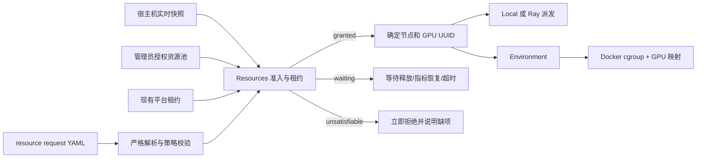

# 资源管理、Docker 限额与 Ray 多节点设计

状态：本地资源请求、宿主机观测、单节点租约及 Docker CPU/内存/GPU 约束链已实现；
完整 GPU 科研 Run 尚未验收，Ray backend 和多节点部署命令仍未实现。当前能力范围见
[项目状态](../project-status.md)，当前框架及 Ray 接入边界见
[当前实现框架与 Ray 多节点定位](current-framework-and-ray-role.md)。

## 1. 要解决的问题

资源管理需要同时回答四件不同的事：机器有什么、平台被允许使用什么、哪些资源已经分给了任务、任务实际上用了多少。系统不能因为 CPU/GPU 当前利用率低就把已经租给某个 Attempt 的资源再次分配，也不能只看平台租约而忽略宿主机上的外部进程。



模块边界保持不变：Resources 负责观测、准入、租约和派发；Environment 根据分配结果创建并限制容器；Run 负责等待、超时、取消和业务状态；Records 保存请求、快照引用、租约及释放证据。Ray handle、Docker client 和 NVML handle 都不进入公共契约。

## 2. YAML 如何变成资源分配

当前支持严格的 version 1 YAML：

```yaml
version: 1
request_id: train-001
resources:
  cpu: 3
  memory: 16GiB
  gpu:
    count: 1
    min_memory: 20GiB
    vendor: nvidia
    # device_ids: [GPU-...]  # 需要固定设备时才填写
placement:
  node_labels:
    pool: research
queue:
  wait_timeout: 30m
```

可执行样例在 `examples/resource-requests/single-gpu.yaml`。解析器要求显式单位、拒绝未知字段和非法数值，避免把拼错的 `gpus` 当成无 GPU 请求。验证命令是：

```bash
agent-infra resource validate examples/resource-requests/single-gpu.yaml
```

一次分配是 all-or-nothing：CPU、内存和全部 GPU 同时满足才签发 lease。结果有三种：

| 结果 | 含义 | Run 的处理 |
| --- | --- | --- |
| `granted` | 已确定节点、CPU/内存额度和 GPU UUID | 准备 Environment；启动失败仍要清理并释放 |
| `waiting` | 总容量可以满足，但当前有租约、外部 GPU 进程、可用内存不足或指标过期 | 进入有界队列；资源变化后重试；到 `wait_timeout` 后结束等待 |
| `unsatisfiable` | 单节点容量、GPU 型号/显存、固定设备或节点标签永远不能满足 | 立即返回结构化缺项，让 Agent 或用户修改 YAML |

相同 `request_id` 和相同内容重复申请会返回原 lease；相同 ID 配不同内容会报错。释放是幂等的。资源 lease 只有在 Environment 确认进程和容器已经停止后才能释放；清理失败时保留占用或进入人工核对状态。

当前 `LocalResourceManager` 实现一个节点的并发安全准入，不持久化队列或 lease。首个完整 Run 应由 Run 在 Records 中持久化等待截止时间和 lease，重启后再与实际容器核对。

## 3. 如何实时获取宿主机资源

`LinuxHostResourceMonitor` 当前采集：

- `/proc/stat`：相邻两次采样之间的 CPU 使用率；第一次为 `null`，因为单个累计值不能推导区间利用率。
- `/proc/meminfo`：物理内存总量和 `MemAvailable`。
- `nvidia-smi`：NVIDIA GPU UUID、索引、型号、总/空闲显存、利用率和 compute process 数量。
- 带时区的采样时间、节点 ID 和明确的采集问题。

```bash
agent-infra resource inspect
```

节点服务后续以 2–5 秒周期复用同一个 monitor 实例，第二次起得到 CPU 区间值。Web 展示 `captured_at`；超过配置的新鲜度就不再称为实时。缺少 `nvidia-smi` 时 CPU 任务仍可观测，GPU 指标以 issue 明确缺失；配置为 GPU 节点却没有新鲜 GPU 观测，或者无法确认外部 compute process 时，停止新 GPU 分配。

生产监控可以把实现换成 NVML Python binding，公共快照不变。NVML 可查询设备、显存、利用率、进程、拓扑和事件；MIG 下部分进程利用率接口有限，必须把 MIG instance 当作显式设备资源，而不是猜测父 GPU 的空闲状态。[NVIDIA NVML](https://docs.nvidia.com/deploy/nvml-api/latest/)

CPU 利用率只用于观测和告警。CPU 可调度量来自授权容量减平台租约；内存准入同时受授权剩余额度和实时 `MemAvailable` 限制；GPU 同时检查授权清单、平台租约、空闲显存和外部 compute process。

后续还要加入 Docker stats/cgroup 指标，将实际容器使用与 lease 关联。监控发现超限或外部占用时暂停新分配并告警，不自动杀死未被平台拥有的进程。

## 4. 如何给 Docker 落实资源

Resources 返回通用 allocation，Environment 的 Docker adapter 将其落实为：

| Allocation | Docker enforcement |
| --- | --- |
| `cpu_cores` | `NanoCpus = cpu × 10^9`，或等价的 CFS period/quota；要求独占核时另用 cpuset |
| `memory_bytes` | hard memory limit；swap 策略由部署 policy 明确，不能依赖宿主机默认值 |
| `gpu_device_ids` | NVIDIA DeviceRequest 使用 allocation 中的 UUID，只暴露选中的设备 |
| workspace/config | 使用 task-owned mount，不从资源 YAML 接受任意宿主机路径 |

Docker 默认没有资源限制，CPU 配额和内存限制必须在创建时显式设置。[Docker resource constraints](https://docs.docker.com/engine/containers/resource_constraints/) Environment 创建后还要 inspect 容器，确认限制和 GPU 可见范围与 lease 一致；不一致时停止容器并把 Attempt 标为准备失败。OOM、超时、Agent 失败、评测失败和清理失败保持为不同结果。

资源 YAML 是唯一的请求来源。Environment 不再接收第二套独立 `docker.cpu`/`docker.memory` 值，避免调度申请 3 CPU 而容器限制仍是 2 CPU。

## 5. Ray 在系统中的作用

Ray 用于多节点的逻辑准入、节点选择、派发和故障通知，不负责 Docker 的物理限制，也不替代宿主机监控。Ray 的 CPU/GPU/memory 是逻辑资源，可以与物理硬件不同；节点启动时必须按管理员授权资源池注册，而不是自动把整台机器全部交给平台。[Ray resources](https://docs.ray.io/en/latest/ray-core/scheduling/resources.html)

建议的 Ray backend 流程：

1. Resources 把公共 `ResourceRequest` 转成 Ray actor/task 的 CPU、GPU、memory 和节点标签要求。
2. Ray 把 Attempt supervisor 调度到一个满足条件的节点。首期一个 Attempt 的主要资源必须落在同一节点。
3. supervisor 从 `ray.get_runtime_context().get_accelerator_ids()` 获取 Ray 实际分配的 GPU ID，再交给节点 Resources 映射、核对稳定 UUID和外部占用。[Ray accelerator scheduling](https://docs.ray.io/en/latest/ray-core/scheduling/accelerators.html)
4. 同节点 Environment 使用最终 UUID 创建任务容器，并周期上报容器和节点状态。
5. actor 退出、节点失联或 Ray 报告资源释放时，平台先核对 Docker/进程实际清理，再结束本地 lease。

多节点训练需要一次保留多个 bundle 时使用 placement group 做 gang scheduling；每个 bundle 必须能装入单节点，PACK/SPREAD 由任务协议决定。[Ray placement groups](https://docs.ray.io/en/latest/ray-core/scheduling/placement-group.html) 这属于单节点闭环稳定后的功能，不能让一个普通单容器任务在多个节点上被隐式拆分。

不能同时让 Local allocator 和 Ray 做两套互相不知情的全局调度。Local backend 直接签发单机 lease；Ray backend 以 Ray 的 reservation 为集群准入依据，节点侧只做硬件、外部占用和容器启动前核对。

## 6. 多节点通信与认证如何做得顺滑

可以把初始化做成一套可重复执行的命令，但软件仍需要用户提供节点清单、管理员权限和可达的受信网络。跨公网/NAT、没有 SSH 权限或防火墙不允许节点端口时，程序不能自行绕过这些条件。

Ray 2.52 起支持 token authentication；当前官方文档版本为 2.58。集群启动时所有节点设置 `RAY_AUTH_MODE=token` 并读取同一权限为 `0600` 的 `RAY_AUTH_TOKEN_PATH`。Token 认证默认未开启、token 不自动过期，而且明文 HTTP 会暴露 token，所以它只能作为 defense in depth；节点间仍应位于私有 VLAN/VPN/overlay network，远程 Dashboard/Jobs 通过 SSH tunnel 或 TLS proxy 访问。[Ray security](https://docs.ray.io/en/latest/ray-security/index.html) [Ray token authentication](https://docs.ray.io/en/latest/ray-security/token-auth.html)

首个支持目标采用“已有 SSH 信任 + 私网”模式：

```text
cluster plan  -> 只读检查节点版本、时间、Docker/GPU、端口和授权容量
cluster apply -> 生成 Ray token 文件，安全复制配置，启动 head/worker/node service
cluster verify -> 检查心跳，在每个节点跑 CPU 容器，再做一次跨节点派发
cluster drain/remove -> 停止接单、等待或取消本平台任务、确认清理后移除节点
```

用户只执行一条 `apply` 命令的体验可以实现，但内部仍会产生可审查 plan，并逐节点报告结果。无 head→worker SSH 的环境提供 pull 模式：用户在每个节点运行一次短期 enrollment 命令，节点服务通过平台 HTTPS/mTLS 控制面取得集群配置；不能把长期 Ray token直接放在命令行或 Git YAML 中。

Ray 能执行任意 Python 代码，Dashboard、Jobs 和 Ray Client 等端口不能直接暴露到互联网。Agent 和 Web 只访问本项目有身份与权限检查的 gateway；它们不直接拿 Ray token或 Ray address。

## 7. 开发顺序与验收

| 阶段 | 实现 | 验收证据 |
| --- | --- | --- |
| R0：本任务 | YAML、宿主机快照、单节点 lease、CLI | 严格解析、并发不超卖、外部 GPU 占用、过期指标、幂等释放和本机只读实测 |
| R1：Docker | Environment Docker adapter、inspect、stats、清理核对 | CPU/内存限制实测；指定 GPU UUID 只在目标容器可见；OOM/取消后不提前释放 |
| R2：Ray 两节点 | 固定 Ray 版本、Ray backend、节点服务和状态恢复 | 两节点 CPU/GPU 派发、排队、节点失联、actor 失败和残留容器核对 |
| R3：部署自动化 | plan/apply/verify/drain、token、私网/TLS 接入指南 | 干净节点重复执行不重复部署；认证失败、端口失败和版本漂移有明确诊断 |

当前代码已经由 Local backend 启动和管理本机 Docker，但没有启动 Ray，也没有声明多节点已经
可用。公共输入、观测、分配和租约语义继续作为 Local 与未来 Ray backend 的边界，使后续替换
调度和派发方式时不必修改 Task、Agent 或 Run 的资源请求格式。
