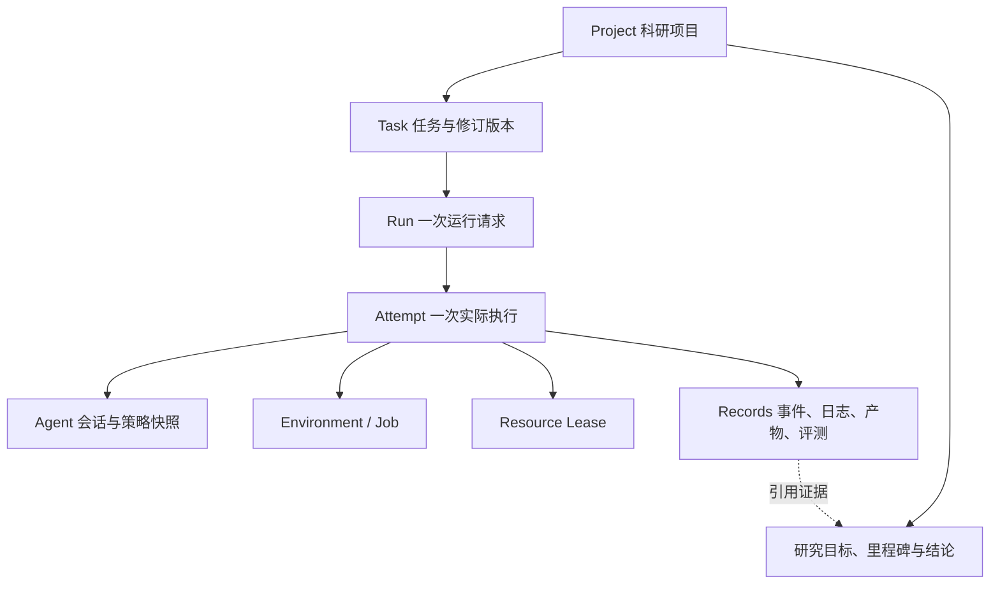

# Web 科研控制台功能与设计方案

状态：**Proposed**。基于 `main@c6acc18` 的代码核查；本轮只设计，不实现页面或 HTTP 服务。

## 1. 定位与现状判断

Web 应成为一个日常科研工作台：用户知道机器是否有空余资源、研究进行到哪里、Agent 正在做什么、结果保存在哪里，以及遇到问题后如何继续。

主线是：**科研项目 → 任务定义 → 一次运行 → Agent 轨迹与实验结果**。Tasks、Resources、Agents 和 Records 同时提供独立入口，方便查找与跨项目分析。

目前是“核心模块首版 + 单节点执行原型”，还不能称为只差页面的完整产品。现有 Python 能力可以支撑 Web 开发，但以下能力必须随 Web 接入补齐：

| 领域 | 当前源码能力 | Web 所需增量 |
| --- | --- | --- |
| Web | React / TypeScript / Vite 启动页 | 页面、导航、交互、数据获取、实时视图 |
| HTTP | 空的 gateway 入口 | 鉴权、业务 DTO、查询与命令接口、事件推送 |
| 科研项目 | 尚无 Project 实体 | 项目目录、任务归属、目标、里程碑、结果标记 |
| Resources | Linux/NVIDIA 快照、内存 lease 分配 | 常驻采样、历史窗口、可授权查询、运行关联 |
| Tasks | manifest 校验、可见视图、快照、导入 | 可查询目录、版本管理、表单、上传与缺失项展示 |
| Agents | provider 探测、启动计划、原生事件解析 | 可用能力目录、配置引用、诊断状态、运行关联 |
| Run / Environment | 同步 Python 调用、容器阶段与取消 Event | 后台执行服务、持久请求、运行列表、取消命令、恢复对账 |
| Records | SQLite/CAS、事件/产物查询、轨迹派生、CLI | 授权读模型、活动日志读取、增量规范化、分页检索与安全预览 |

特别注意：当前 Run 在 solver 阶段结束时调用 Agent 解码器；当前 Records 有 stream 写入能力，但 Reader 没有活动 stream 的增量读取协议。不能仅加一个前端定时器就宣称支持实时 Agent 对话。

既有测试证明了确定性 Docker 场景，不等于真实模型、GPU 训练、原生 benchmark、多节点和多人远程访问已验收。整体 S1/S2 仍按 [项目状态](../project-status.md) 认定。

## 2. 产品组织与数据关系



- **Project**：长期研究，例如“复现论文 A 并尝试方法 B”。包含多个 Tasks、运行和结论。
- **Task revision**：某个确定的实验要求及其输入、输出和资源意图。修改要求产生新 revision，已有 Run 继续引用旧快照。
- **Run**：使用特定 Task revision、Agent 配置和资源请求发起的一次执行。
- **Attempt**：一次真实求解/评测执行。首版保持现有单 Attempt；页面预留选择器，多次重试必须等后端生命周期扩展后再开放。
- **Milestone**：用户定义的研究阶段，如“完成基线”“完成消融”“整理报告”。以运行、报告或图表作为证据。

首版一个 Task 属于一个 Project；复用任务采用复制/导入新实例并保留来源，不在多个项目共享一个可变定义。已有历史 Run 可进入“未归档运行”，通过映射关联项目，不修改历史事件。Experiment 分组先用标签表达，避免一开始引入额外必填层级。

### 2.1 Project 的最小信息

`project_id`、名称、研究目标、负责人/可见范围、标签、创建/更新时间、状态、里程碑、Task 关联、选定的结果引用。

项目状态建议：计划中、进行中、受阻、已完成、已归档。状态由用户更新；后端可提示状态不一致，但不能根据某个进程退出自动宣布研究完成。

进度分两条展示：

- **执行概况**：运行中、等待资源、完成、失败、取消的数量，以及最近活动。
- **研究进度**：已验收里程碑 / 总里程碑、当前问题和下一步。没有里程碑时显示“尚未设置”，不生成虚构完成百分比。

训练进度只有在真实指标包含 `step/max_steps`、`epoch/epochs` 等信息时显示百分比；普通 Agent 流程只显示阶段、耗时、最近活动，不估算“思考完成 70%”。

## 3. 导航与页面结构

推荐固定左侧导航，顶部显示当前项目范围、搜索和连接状态，主区域承载工作内容。项目内页面可以跳到全局模块视图，筛选条件通过 URL 保存。

| 导航 | 页面目标 | 主要内容 |
| --- | --- | --- |
| 总览 | 快速了解机器和研究活动 | 资源摘要、活跃项目、运行、告警、最近结果 |
| 项目 Projects | 管理科研过程 | 项目列表、目标、里程碑、任务、运行、结论 |
| 任务 Tasks | 管理可执行任务 | 任务库、版本、材料、工具、资源、输出、校验 |
| 运行 Runs | 跟踪执行和排障 | 运行列表、详情、轨迹、日志、资源、产物、评测 |
| 资源 Resources | 判断可用性和占用 | 本机/节点、CPU/RAM/GPU、lease、采样时间、趋势 |
| Agents | 选择与诊断 Agent | Codex/Claude Code/DSH、自研适配器、能力、配置引用 |
| 记录 Records | 跨运行检索与分析 | 事件、工具、Artifact、评测、轨迹和导出 |
| 设置 | 管理工作台 | 存储用量、保留策略、节点/认证状态、偏好 |

Environment 首版放在 Run 详情的“环境与资源”中：用户一般关心某次运行用了什么环境。镜像模板管理成熟后再增加独立环境库，不把 Docker 管理面直接暴露给浏览器。

### 3.1 总览

一屏优先回答：机器还有资源吗？哪些任务在运行？哪些需要我处理？最近产出了什么？

- 顶部：CPU 利用率、可用 RAM、各 GPU 利用率与显存、活跃运行数量。
- 中部：进行中的项目和里程碑；运行中的任务及其 Agent、节点、阶段和耗时。
- 右侧或下部：失败、资源不足、数据过期、清理未完成、凭据不可用等需要操作的事项。
- 最近结果：新报告、checkpoint、评测结果，点击进入对应 Run。
- 常用操作：新建项目、创建/导入任务、发起运行。

无项目时提供创建入口；没有指标时说明未连接/暂不可用，不能把未知值显示为 0。

## 4. 科研项目工作区

项目详情包含五个页签：

| 页签 | 内容 |
| --- | --- |
| 概览 | 研究目标、状态、负责人、里程碑、最近成果、阻碍与下一步 |
| 任务 | 任务列表、版本、可运行状态、缺失条件 |
| 运行与实验 | 项目所有 Run，按任务、标签、Agent、配置、状态筛选 |
| 结果与报告 | 从 Artifact 选出的报告、图表、指标和用户结论 |
| 活动 | 用户修改、运行启动/结束、结果标记等可追溯活动 |

里程碑可以关联一份报告或一组 Run，人工标记验收。结果页支持“设为基线”“标记为候选最佳”“添加解释”。最佳结果是用户选择或明确比较规则的结果，不把不可比的 reward 自动排序成科研结论。

后续增加实验对比：选择 2–5 次运行，比较 Task revision、模型、prompt、参数、数据摘要、镜像、资源、耗时、指标和产物差异。跨数据集或 evaluator 版本要提示不可直接比较。

## 5. Tasks：查看、补全和准备运行

任务详情按用户已有的任务抽象组织：

1. 说明与用户提示词：Markdown 安全预览，可查看当前 revision。
2. 输入材料：文件/文件夹索引、角色、大小、摘要、是否已就绪、Agent 是否可见。
3. 工具：声明、版本、所需绑定、是否可用；“已声明”与“已安装可调用”分开显示。
4. 资源：任务硬约束、建议计划、用户最终选择；表单与 YAML 是同一份结构化数据的两个编辑视图。
5. 环境：镜像/模板、网络和执行方式；未解析的 native 环境显示适配要求。
6. 输出：应保存的路径、类型、必需性；无输出约定提示可能无法归档科研产物。
7. 评测：不评测/隔离评测、协议与反馈策略；科研任务不强制设置评分。

提供“Agent 可见视图”页签，用后端 Tasks 投影展示实际可见材料，不通过前端隐藏私有字段模拟隔离。普通用户只能看到权限允许的评测摘要；私有答案和评分脚本不随任务详情响应下发。

创建任务采用简短分步流程：描述目标 → 选择/上传材料 → 补全要求 → 校验并保存。自然语言自动补全先列为后续能力；当前已有的草稿检查可转成具体问题，如“输出文件放在哪里”“是否需要评测”。benchmark 导入保留原字段与未知状态，不为了表单完整而补造原协议。

上传引用受管理的文件 ID；不接受浏览器提供任意宿主机路径进行读写。大数据优先由管理员注册数据根或外部只读引用，前端查看清单，避免重复上传。

## 6. Resources：实时监控与分配解释

### 6.1 单机资源页

每个指标显示当前值、单位、采样时间、有效性和近期趋势：

- CPU：逻辑核数、利用率、load average（分开标注）。
- 内存：物理总量、可用量、使用趋势。
- GPU：逐卡型号、UUID/简短标识、利用率、显存总量/可用量、计算进程数；温度/功耗属于可选探针扩展，现有采样不保证提供。
- 平台容量：管理员授权 CPU/RAM/GPU、已分配 lease、剩余额度。
- 运行占用：关联项目、Run、Environment、申请资源和 lease 状态；实际容器用量需要新增运行级采样，不能用整机利用率代替。

**实际使用、平台预留、可申请额度必须分开**。外部程序也会占用宿主机，宿主机有空闲不代表平台额度充足；平台 GPU lease 也不等同显存硬隔离。

资源不足时区分：

- 当前忙碌：显示不足项目、现有可用量，用户可以稍后重试或调整请求。当前没有持久队列，不能显示“已自动排队”。
- 超过节点/授权容量：显示无法满足，建议用户改计划或选择其他节点；不得自动违反 Task 硬约束。
- 数据过期/探针错误：保留最近值但明显标记过期，禁止据此保证可分配。

### 6.2 实时机制

第一版由服务器单一采样服务周期采样，建议默认 2 秒，配置范围由实现确定。多个浏览器共享快照，不能每次刷新都触发一轮 `nvidia-smi`。

- 初期 HTTP 轮询最新快照；后台页降频，页面显示最后更新时间。
- 服务端保存有界近期窗口，例如 15 分钟；需要长期趋势时再接持久采样与降采样策略。
- 超过设定阈值未更新显示 stale；断开时保留图表并展示缺口，不补零。
- CPU 首次差分采样可能无利用率值，应显示“采样中”。

首版节点列表只有当前宿主机，结构预留 node ID。跨节点注册、认证、心跳和 Ray 状态仍由后端能力推进，前端不会凭一个“添加节点”按钮完成集群组建。

## 7. Agents：能力和配置管理

Agent 卡片展示 provider、版本、安装/认证状态、可支持执行方式、事件格式能力、最近探测时间和问题说明。

- 支持 Codex、Claude Code、DSH 的已有适配器；自研 workflow 根据后端 registry 声明能力出现，不由前端硬编码完整名单。
- 认证状态有“已认证 / 未认证 / 未知 / 不支持探测”，不能把 unknown 当成功。
- 配置档案记录名称、provider、允许的模型/参数、prompt 模板和凭据引用。运行固定配置快照；后续修改不改变历史运行。
- 初期提供服务端探测与安装/登录操作说明；Web 一键安装和 OAuth 交互待可靠安装作业与认证流程后再开放。
- 凭据只显示引用名称、状态和适用范围，不回传凭据文件；provider 不支持的参数不展示为可用。

宿主机 Agent 模式和容器 Agent 模式保留位置，但宿主机托管尚未实现时必须显示“暂不可用”及原因。更换 provider 重新校验镜像、认证、工具、参数和执行方式，不能只替换字符串后照常启动。

## 8. Run：执行入口和详情

### 8.1 发起运行

顺序为：选定 Task revision → 选择 Agent 配置 → 环境与资源 → 最终确认摘要。

摘要必须包括输入版本、输出路径、镜像、联网设置、CPU/RAM/GPU、超时、是否评测、原生预算限制和采集范围。模型费用只在存在可信用量与计价基础时估算，否则显示未知。

先做无副作用的 preflight，再提交正式请求；preflight 不占资源、不保证启动时资源仍可用。正式分配由 Resources 再次裁决。提交采用幂等键，避免双击或网络重试重复启动。

科研示例：创建项目 → 导入训练要求和数据 → 指定输出 checkpoint/报告 → 选 Agent/镜像 → 将建议 2 CPU 调为 3 CPU 并重新校验 → 求解结束 → 查看产物 → 人工验收里程碑。无需 evaluator。

benchmark 示例：导入原任务 → 查看 solver 可见输入 → 选 Agent → 求解 → 冻结提交 → 独立评测 → 查看协议允许反馈与结果；原协议不支持的重试或中途反馈不得由 UI 添加。

### 8.2 运行列表与详情

列表：项目、Task、Agent、执行模式、节点、开始时间、时长、执行状态、评测状态、清理状态。支持筛选、搜索、复制运行链接；状态拆分保持与后端一致。

详情建议采用如下布局：

```text
项目 / 任务 / Run                          执行中 · 已运行 12 分钟
Agent: Codex   当前阶段: 求解   节点: local    [取消运行]
任务版本 · 输入摘要 · 资源申请 · 数据更新时间
────────────────────────────────────────────────────────────
概览 | Agent 轨迹 | 命令与日志 | 环境与资源 | 产物 | 评测 | 配置
────────────────────────────────────────────────────────────
时间线 / 调用树          选中事件的内容、结果和原始数据入口
                        采集范围、截断/缺失说明
```

- 概览：阶段时间线、最近活动、资源、错误与建议操作。
- 轨迹：消息、工具调用、子会话及原始事件引用。
- 日志：按 job/stdout/stderr 筛选、跟随尾部、暂停滚动、搜索、按范围下载。
- 环境与资源：镜像及可获得 digest、lease、限制、进程退出与清理状态。
- 产物：文件清单、安全预览、下载、设为项目结果；不加载整块权重到浏览器。
- 评测：执行完成与通过/失败分开；科研无评测时显示“不需要评测”。
- 配置：可访问的冻结配置、Task/Policy/Environment 快照及复现限制。

第一版仅提供取消和复制配置重新运行。取消先显示“已请求取消”，后端确认停止、清理和释放后才展示最终结果；不能因请求返回 200 就宣布 GPU 已空闲。暂停、恢复、实时追加对话只在具体 provider 和运行控制契约都支持时启用。

## 9. Records 与轨迹体验

同一份数据提供三种视图：

1. **会话视图**：用户输入、Agent 消息、工具调用卡片和结果。
2. **时间线/调用视图**：展示阶段、span、并行与因果关联，适合定位耗时和失败。
3. **原始视图**：授权用户查看 provider 原生事件、版本和来源引用，用于诊断规范化问题。

每个工具卡片显示名称、输入摘要、状态、耗时、输出摘要和完整结果入口。有可靠 call ID 才合并请求与结果；无法关联时保留独立事件并标记，不能伪造调用链。

当前统一事件仍包含 native payload，Web 上线前需要 Agent 模块提供安全展示投影，例如 message blocks、tool name/input/output、usage。提供方字段解析留在 Agent 适配层，前端不分别堆叠 Codex/Claude/DSH 解析器。Render DTO 有版本；无法解码的数据作为“未知事件”保留。

不展示不存在的隐藏思维过程，也不从日志补造模型行为。外部 Agent 的平台外行为不可见时，轨迹页显示采集范围。

Records 全局页用于跨运行查找错误、工具调用、报告、评分和导出；不是复制一个 Run 详情。后续可加入轨迹标签、人工反馈、片段比较和训练数据集审阅。

Agentic RL 入口先展示已有轨迹的来源、构建器版本、reward 来源和缺失特征，提供受控导出。不能把当前 `sft_candidate` 等标记展示成“已通过训练资格验收”；SFT/RL 数据清洗、授权、脱敏、完整性审查仍需单独流程。

## 10. 前后端边界与代码组织

沿用现有 React / TypeScript / Vite 骨架，本轮不新增 UI、路由或图表依赖。实现时再按需求选型，保持功能模块独立。

```text
src/web/src/
  app/                 应用入口、路由、布局、错误边界
  features/
    overview/ projects/ tasks/ runs/ resources/ agents/ records/
  shared/
    api/               生成的 API 类型、请求与错误处理
    realtime/          游标、重连、订阅生命周期
    ui/                基础组件、表格、图表与文件预览容器
    format/            时间、单位、状态展示
```

页面负责交互和展示；领域校验、生命周期、资源分配、权限和轨迹语义由后端提供。前端状态分为服务器数据缓存、URL 筛选条件和临时表单，不另建第二套 Run 状态机。

| 责任 | 建议归属 |
| --- | --- |
| HTTP DTO、认证上下文、SSE 协议转换 | `gateways/http`，保持薄层 |
| 组装 HTTP 服务、采样服务、执行控制器 | `bootstrap` |
| Project/里程碑业务规则与运行关联 | 先放 `runs` 下的项目应用服务；不包含 Docker/SQL 实现 |
| 项目、Task 目录、配置引用的持久化 | Records 公共元数据接口；与不可变执行证据分表管理 |
| Task 解析、编辑校验、可见投影 | Tasks |
| Agent 能力、原生轨迹与安全展示投影 | Agents |
| 采样、授权容量、分配判断 | Resources |
| 后台运行、取消、状态对账 | Runs，通过 Environment/Resources 契约执行 |
| 事件、活动 stream、产物、授权查询与导出 | Records 公共接口和应用查询服务 |

Project 是新的业务能力，不能只存浏览器 localStorage，也不能让 HTTP gateway 直接写 SQLite。先以小型项目服务扩展现有模块；若后续涉及独立团队/实验治理，再通过 ADR 决定是否拆成新的一级模块和更新依赖图。

## 11. API 草案与后台执行

以下路径均为**拟议接口，当前不存在**。实施前先固定 DTO、错误模型、权限和契约测试，再由源定义生成 TypeScript 类型。

| 接口组 | 草案 | 前置工作 |
| --- | --- | --- |
| 系统能力 | `GET /api/v1/capabilities` | 返回已支持操作、禁用原因、schema 版本 |
| 项目 | `GET/POST /projects`、`GET/PATCH /projects/{id}` | Project 元数据、权限、修订冲突校验 |
| 项目里程碑 | `GET/POST /projects/{id}/milestones` | 目标、人工状态、证据引用 |
| 任务 | `GET/POST /tasks`、`GET /tasks/{id}/revisions/{rev}` | 持久目录与不可变修订 |
| 任务检查 | `POST /tasks/validate`、`GET /tasks/{id}/agent-view` | Tasks 校验与授权投影 |
| 资源 | `GET /nodes`、`GET /nodes/{id}/snapshot`、`GET /nodes/{id}/metrics` | 常驻采样与有界窗口 |
| Agent | `GET /agents`、`POST /agents/{id}/probe` | 能力目录、缓存、并发/频率限制 |
| 运行 | `POST /runs/preflight`、`POST /runs`、`GET /runs`、`GET /runs/{id}` | 后台作业、持久接收、幂等与列表查询 |
| 控制 | `POST /runs/{id}/cancel` | 可寻址取消句柄、请求幂等、状态确认 |
| 事件 | `GET /attempts/{id}/events`、`GET /attempts/{id}/event-stream` | 权限过滤、分页、SSE 游标 |
| 日志 | `GET /streams/{id}/chunks` | 活动 stream offset 读取与截断语义 |
| 产物 | `GET /artifacts/{id}`、`GET /artifacts/{id}/files/{file-id}` | 授权文件索引、范围读取、预览限制 |
| 导出 | `POST /exports`、`GET /exports/{id}` | 导出作业、受限目标目录、下载授权 |

统一响应包含资源 ID、更新时间、有效性/采集范围；列表用 cursor。写操作携带幂等键，更新 Project/Task draft 使用 revision 或 ETag 防止多人覆盖。错误分辨参数校验、权限、冲突、资源不足、依赖不可用，不在公开错误里返回 traceback、凭据或私有路径。

### 11.1 同步 Run 不能直接放进 HTTP 请求

`POST /runs` 应持久接收请求并返回 Run ID，执行在后台进行。现有 `LocalRunService.run()` 在方法内部生成 ID，需要改为支持控制器预分配 ID；原 Python 调用可保持兼容包装。

首版使用受控执行器与同一资源分配 authority，不能每个 HTTP worker 各自创建内存 ResourceManager。运行与取消句柄独立于浏览器生命周期。服务重启后根据运行状态、容器 ownership 和 lease 对账；不能确认的显示“状态待核对”，不宣布成功或释放资源。

后台执行请求暂存不等于资源等待队列。只有实现持久队列、超时和取消语义后，才提供自动排队 UI；当前资源不足可以返回明确的 waiting 结果及重试入口。

### 11.2 轨迹实时传输

推荐普通 HTTP 完成查询/控制、SSE 传递服务器单向事件；WebSocket 留给未来终端或双向会话，本期不需要引入。

- Agent stdout 增量解析应处理跨 chunk 的 JSONL 行、未知事件和长度限制；捕获时间与原生时间分别保留。
- 推送读取已持久化事实，使用事件 cursor；断线后补读、按 event ID 去重。
- 初始快照返回 watermark，再订阅后续事件，避免快照与订阅间漏读。
- 当前 Records 数字 cursor 需要补稳定查询/权限范围和快照边界，不能直接作为跨接口安全凭证。
- 断线展示连接状态并退避重连，失效 cursor 要求重新获取快照。
- 前端按批合并更新、日志与事件列表虚拟化，大输出按范围读取；不无限积累浏览器内存。
- 当前 Environment observation 是有限大小文本 chunk，接入前应保证退出后 drain 完全部分、取消尾部采集及原始字节/UTF-8 边界处理，不能把第一块结束输出标为完整日志。

## 12. 权限与安全展示

首版可从单用户本机访问起步，但仍应明确服务认证与浏览器边界。默认只绑定 loopback；多人或公网/内网开放前必须完成身份、TLS、项目权限和审计，不能将当前管理员 Records CLI 原样搬成公开接口。

- HTTP 身份映射到可访问项目及操作；每个 Run/Attempt/Artifact/Stream 都重新校验归属，不能只凭 ID 读取。
- Records 当前只有 visibility/data_class 标签和内部 `open_blob`；后端查询必须实际执行这些标签的规则。
- 先过滤再分页/聚合/推送；隐藏数据的数量、原始 blob 引用和错误消息也不能通过摘要泄露。
- 普通成员访问公开运行材料和允许反馈；评测维护者访问私有评测需要单独能力，不能默认把项目编辑权等同看答案权。
- 上传、下载与预览使用受控根目录和文件 ID，阻止路径越界；压缩包须检查展开大小和链接。
- Markdown 禁用不安全 HTML；日志作为文本；HTML/SVG 等产物默认下载或独立 sandbox 预览。Agent 输出一律视为不可信内容。
- 取消作业、修改资源计划属于有副作用操作，明确作用对象；归档项目与删除运行证据分开，首版不提供批量销毁证据。

## 13. 视觉与交互原则

以信息密度适中的桌面工作台为主，中文优先，保留 provider/字段的常见英文名称。使用克制的中性色、清晰表格、少量状态色和一致的按钮层级。

- 常用列表优先表格；指标用有单位和时间轴的折线图；执行过程用时间线。
- 状态同时使用文字/图标，不能只靠颜色；支持键盘操作、可见焦点和可读对比度。
- 时间默认本地时区，可查看精确时间；容量单位一致，CPU 核数与百分比不混用。
- 每个页面都有 loading、空数据、错误、无权限、过期数据、能力未接入状态。
- 运行详情 URL 可深链到 Attempt、event 或 Artifact；刷新保留筛选和选中项。
- 操作成功后显示真实服务端结果；网络断开不假定运行取消。
- 第一版不做嵌入式 IDE、通用 root 终端或复杂拖拽 workflow 编辑器，集中完成科研查看和受控执行。

## 14. 分期与可验收交付

以下 W0–W3 是 Web 交付阶段，不替代整个项目的 S0–S4。

| 阶段 | 交付内容 | 完成标准 |
| --- | --- | --- |
| W0 接入基础 | HTTP 组装、身份边界、安全 DTO、Project/Task/Run 关联、查询列表 | 不直连 DB/Docker；未经授权读取私有数据被拒绝；明确 capability |
| W1 只读工作台 | 总览、资源实时快照、项目/任务/Agent/运行列表、历史轨迹/产物 | 页面来自真实 API；项目进度可解释；重连/过期/空数据行为可验证 |
| W2 日常科研闭环 | 创建项目/任务、资源计划、后台 Run、取消、实时轨迹、结果标记 | 浏览器发起一次真实受控任务并查到日志和提交；刷新/断连不丢任务 |
| W3 分析与协作 | 实验对比、里程碑证据、轨迹标注、导出审阅、多人权限 | 比较口径明确；私有评测不泄露；导出可追溯；并发修改不覆盖 |

推荐先做一个 W0/W1 纵向切片：**Resources 真数据实时图 + Project 下的 Run 列表 + Run 历史轨迹/产物**，将各模块的可见入口连起来。W2 再打通“创建任务并启动”，这样页面不会先出现大量无法执行的按钮。

首轮团队可按以下边界协作，每人配独立分支/worktree，并先共定 DTO：

| 角色 | 负责内容 | 主要交接接口 |
| --- | --- | --- |
| A | 项目应用服务、Run 后台控制、HTTP 组装 | Project/Run/preflight/cancel DTO |
| B | 资源采样、环境作业观测、日志采集完整性 | NodeSnapshot/metrics/job stream |
| C | Web 页面与交互、Agent 能力及展示投影 | Capability/Agent/trace display DTO |
| D | Records 授权查询、事件分页与推送、产物与导出 | EventPage/stream chunks/Artifact view |

Tasks 现有契约由 A 与对应维护者协调；页面不自行解释 benchmark 私有语义。跨模块变更同步生产方与消费方，测试 fixture 必须标明模拟。

### 14.1 验证清单

- 资源：真实采样、未知 GPU/采样失败、过期、多个页面连接不重复探测。
- 项目：无里程碑时不显示假进度，运行失败不自动判定研究失败，历史 Run 可追溯。
- 数据：列表分页、深链、巨大日志、部分 stream、unknown Agent 事件均有明确表现。
- 控制：重复启动只创建一个 Run；取消未确认不释放状态；浏览器断连执行继续；服务重启显示待核对并对账。
- 权限：越权项目 ID、私有 scorer 事件、CAS digest、下载和 SSE 都不能绕过授权。
- 轨迹：增量与最终记录可对齐，不漏退出尾部数据，截断有标记，provider fixture 映射稳定。
- 闭环：本机确定性 Docker E2E 之后，用明确模型/时间/资源预算执行一次真实 Agent 科研任务；两个证据分别记录。

## 15. 方案范围与下一步

本方案覆盖前端功能与必要的后端接入；尚未批准具体 UI 库、HTTP 框架或数据库迁移。原有任务/资源/Agent/Records 设计继续作为领域规则依据。

下一步建议形成 W0/W1 开发计划，冻结 Project 最小 DTO、资源快照、Run 列表与轨迹安全投影，优先交付可查看真实数据的科研工作台。此时无需等待多节点 Ray、训练平台或完整 benchmark 批处理实现。
