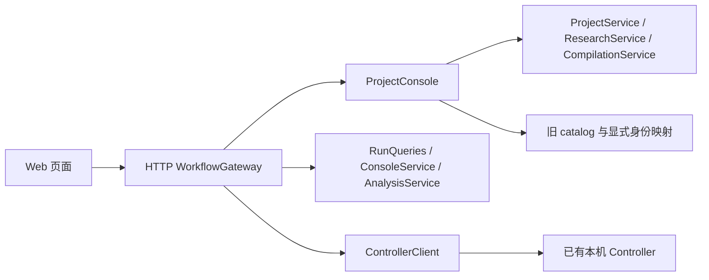

# W 批：科研工作流 Web 接入

状态：W01/W02 实现方案；验证结果见[任务记录](../changes/20260920-web-workflow-w84d2a.md)。
本方案补充[原 Web 方案](web-console-design.md)，复用 A–I 服务，不另建执行系统。

## 使用流程

1. 新建项目：填写名称、研究目标和服务器上的绝对目录，调用与 CLI 相同的 ProjectService。
2. Agent / CLI 完善并采用研究方案；Web 展示背景、目标、约束、未知项和实验。
3. 选择已采用实验，提供项目内执行 YAML；编译冻结材料，也可选已有编译快照。
4. 填写 Codex 模型、时限和联网授权，执行预检，查看资源及问题，再确认提交一次实验。
5. 从项目或运行列表进入持久 Run，刷新仍能恢复；可取消实验、查看 Job、轨迹、结果文件及分析。

没有 Controller 时仍能初始化项目、浏览持久方案与结果；执行按钮解释不可用原因。
预检不承诺稍后资源仍可用，提交时 Controller 会再次检查和准入。

## 边界与代码分工

- `projects/console.py`：联合项目视图与显式绑定；初始化、研究快照、编译仍使用原服务。
- `gateways/http/workflow.py`：窄路由、展示投影、当前已采用方案校验；控制动作转交 Controller。
- `bootstrap/web.py`：统一状态目录与依赖组装，浏览器不能获得 Controller 令牌。
- 前端按项目创建、详情、实验提交、运行详情、产物拆成小组件；接口类型集中维护。
- 不开放任意 HTTP 转发、Docker socket、宿主机路径下载或新状态机；不新增产品依赖。

## 兼容旧数据

旧 `--console-dir/projects.sqlite3` 的 `projects` 表原样保留，不推断研究内容，也不自动生成目录。
追加两个映射表：`workspace_bindings` 记录旧项目 ID → 新工作区项目 ID；`task_identities` 记录旧路径哈希 → 首次明确注册的任务 ID / revision。
重复打开或绑定同一映射幂等。绑定不同目标拒绝，目标必须已存在；一个工作区最多绑定一个旧项目。

新旧条目都保留，可通过旧 ID 和工作区 ID 分别访问；绑定关系是别名，不删除或合并条目。
因此项目列表数量是 catalog 与工作区条目总数，不是去重后的研究主题数量。
旧目标、里程碑和关联仍在旧条目；工作区的原始目标与研究版本保持权威，绑定不会覆盖任一方。

Task 映射在启动时针对显式 `--task` 注册项补充，已存在身份不被静默替换。
未注册、无法解析或 revision 不符均标记待处理，保留原路径哈希及已知身份。
编辑旧项目可以保留暂不可访问的已有 Task/Run 关联；新增关联仍要验证。

## 状态、提交与结果

项目状态来自 Projects / 原 catalog；Run 状态来自 Controller 持久库；Job 状态来自 H 的 Job 库。
界面不把项目“完成”等同于 Run 成功，也不把退出码等同于评测通过。结果、评测、归档、清理分别显示。

浏览器在 sessionStorage 保存操作 ID，网络异常或刷新后的同参数重试沿用 ID；服务端仍以 Controller 幂等记录为准。
收到成功响应后清除该请求的待重试 ID，再进入 Run 页面；之后手动重新提交是新的一次实验。
改变模型、时限、联网或 Task 会使前端已有预检结果失效。服务端拒绝跨项目或已经过时的采用版本。
请求只使用冻结 Task 身份；编译不自动确认研究方案，不启动模型。

产物列表及成员内容复用 D 的 RunQueries：可见性过滤、精确 manifest 成员校验、最大 16 MiB。
浏览器仅预览不超过 256 KiB 的文本格式，始终纯文本渲染；其他内容通过下载处理。
轨迹使用既有安全字段投影与分页，不暴露原生凭据引用、私有评测和完整 scorer 日志。
Analysis 显示 I 保存的观察、解释、不确定性、下一步建议和数值证据；不声明科学结论已被平台核验。

## 本批有意保留的范围

- 单管理员、loopback + Bearer + Host 校验；远程访问用 SSH 转发，不作为公网多用户服务。
- 页面提供 D 的 Codex 单实验启动/取消。H/E/I 已有运行和 Job 可查看；长期环境、环境构建和 Planner 的创建/结束仍用原 CLI/MCP。
- 研究编辑、确认和分析生成仍交给 Agent / CLI；不新增聊天系统或流程编辑器。
- 主机资源监控保留原实现，不混淆实测空闲与 Controller 的授权容量。
- 兼容查询与控制工作流分开端点，历史 `--records-root` 仍可浏览；控制工作流始终读取 `--state-dir/controller`。
- 页面按最近 100 个编译快照 / Run 和最近 20 份分析展示，运行总列表可翻页；历史完整检索仍用 CLI。
