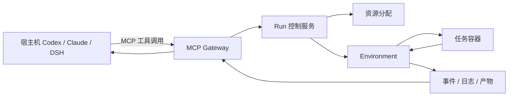
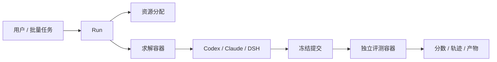

# Agent Infra 初期检查和复盘

状态：基于 `main@c567ebe` 的架构与实现核对，更新于 2026-09-17。

本文明确 Agent CLI 与 Docker 的控制边界、HTTP/CLI/MCP 的职责、
宿主机科研与容器内 benchmark 两种运行方式，以及项目当前真正可用的能力。
详细的阶段验收与最新集成状态仍以[项目当前状态](../project-status.md)为准。

## 1. 核心结论

设计目标支持宿主机上的 Codex、Claude Code 或 DSH 通过 MCP 操作 Docker
内的任务环境，但这条产品链路尚未实现。当前已实现 Docker 执行内核、
Agent 适配器、单机资源管理与 Records；HTTP、项目 CLI、Web 和 MCP 还没有
提供完整的 Run 提交和控制入口。

“Agent 控制 Docker”需要进一步区分：

- Agent 可以在已授权的任务环境中读写文件、执行命令、启动训练、查询日志和停止作业。
- Docker 容器的创建、资源限制、挂载、识别和销毁由受信的 Environment 后端完成。
- Agent 不获得 Docker socket，也不能越过 Run 和权限边界操作任意容器。

这个边界使资源限制、任务隔离、轨迹记录和清理责任可以一致执行，
也避免每个 Agent adapter 重复实现 Docker 逻辑。

## 2. Agent 模块的实际职责

[Agent 模块设计](agent-module.md)主要定义 Agent 适配层，包括：

- 发现 Codex、Claude Code 和 DSH，检查安装、版本与认证状态；
- 将 provider 无关的 `AgentRunRequest` 转换为具体的启动命令、环境变量和挂载；
- 为容器内 Agent 准备隔离的认证目录；
- 将不同 Agent 的原生 JSONL 映射为统一事件，同时保留原始 payload；
- 表达 Agent 运行在宿主机还是任务容器中。

Agent adapter 回答“如何启动这个 Agent，如何解释它的输出”。Environment
回答“在哪里启动，如何管理进程和容器”。Run 决定何时分配资源、
启动、评测、收尾和释放。

`agent-module.md` 中宿主机 Agent 操作训练容器的描述仍是目标设计。该文档
第 6 节也已部分过时：单机 `DockerEnvironment` 和 `LocalRunService` 后来已经落地，
但公共 Run 入口和真实模型 Agent 验收仍未完成。

## 3. HTTP、Infra CLI 和 MCP 的分工

三种入口服务于不同调用者，但最终应该调用同一套 Run 和 Environment
业务契约，不在 gateway 中复制运行逻辑。

| 入口 | 主要使用者 | 目标能力 | 当前状态 |
| --- | --- | --- | --- |
| HTTP API | Web、SDK、远程程序 | 提交和取消 Run，查询状态、轨迹、评测和产物 | 只读查询与 Project 管理，没有执行控制 |
| Infra CLI | 人、Shell 脚本、CI | 提交、查询、取消和下载结果 | 有诊断、任务处理和查询，没有 Run 提交 |
| MCP | Codex、Claude Code 等宿主机 Agent | 绑定环境，操作文件、命令、后台作业和日志 | 只有协议边界骨架，尚未实现 |
| Python API | 项目内部代码和测试 | 直接组装 Resources、Run 和 Environment | 已能执行单机 Docker fixture |
| Web | 产品用户 | 可视化查看和控制科研任务 | 能查看和管理 Project，不能启动或取消 Run |

### 3.1 HTTP API

HTTP 是 Web、SDK 和远程程序的通用入口。目标上它应支持 Agent 和 Task 发现、
Run 提交/取消/重试、资源查询、轨迹与产物读取。当前 `/api/v1/capabilities`
明确返回 `run_control=false`、`live_agent_trace=false` 和 `artifact_download=false`，
因此尚不能通过 HTTP 启动 Docker 任务。

### 3.2 Infra CLI

这里的 CLI 指 `agent-infra`，不是 Codex CLI。目标形态是为人和自动化脚本
提供 Run 提交、状态、日志、取消和产物下载命令。部署模式下 CLI
应当调用 HTTP 服务，而不是自己复制资源分配和 Docker 管理。

以下命令仅表示目标用户体验，**当前尚未实现**：

```bash
agent-infra run submit --task task.yaml --agent codex
agent-infra run status <run-id>
agent-infra run logs <run-id> --follow
agent-infra run cancel <run-id>
agent-infra artifact download <artifact-id>
```

### 3.3 MCP

MCP 是宿主机 Agent 访问科研环境的主要协议。目标工具集可包括：

```text
create_research_run
bind_environment
read_file
write_file
execute_command
start_job
get_job_status
read_job_logs
stop_job
list_artifacts
finish_run
```

具体调用链为：



Agent 只获得当前 Run 绑定的 `EnvironmentAccess`，不获得 Docker socket、
宿主机真实路径、其他用户容器或隐藏评测材料。

## 4. 两种 Agent 运行方式

### 4.1 宿主机 Agent 控制容器内科研任务

这是个人科研的主要模式。用户可以对宿主机上的 Codex 提出：

> 在两张 GPU 上训练这个模型，监控 loss，训练完成后整理指标和 checkpoint。

目标流程如下：

1. Codex 通过 MCP 创建或绑定一个科研 Run。
2. Agent Infra 根据 Task 和资源请求分配 CPU、GPU 和内存。
3. Environment 创建训练容器和工作区。
4. Codex 调用 `start_job` 在容器中启动训练，平台返回 `job_id`。
5. 训练脱离单次 MCP 请求独立运行；Agent 可以查询状态、增量日志和指标。
6. Agent 可以在授权范围内修改配置、重新运行实验或停止作业。
7. Records 保存 Agent 工具调用、容器命令、日志、产物和资源信息。
8. 用户关闭 Agent CLI 后，作业仍可按策略继续；之后通过 Web 或新 Agent 会话重新连接。

当前尚未实现 MCP Gateway、长作业管理、环境绑定和宿主机 Agent
的完整轨迹采集，因此这个模式现在还不可用。

### 4.2 Agent 和任务都在容器内

这是 benchmark、自动评测和无人值守任务的主要模式。



在这种模式下：

- Agent CLI 安装在任务镜像中，直接执行容器内的普通任务命令；
- 容器内 Agent 不需要通过 MCP 绕回宿主机；
- 求解容器不包含私有评测材料；
- 求解结束后停止并删除求解容器，冻结提交；
- 如果 Task 要求评测，则使用新的受信环境运行 submission 和 scorer；
- Records 保存执行轨迹、产物、评测结果和清理证据。

当前 `LocalRunService` 已实现这条链路的主要步骤，并且要求
`AgentPlacement.CONTAINER`。真实 Docker E2E 已经验证 fixture Agent，但公共
提交入口、镜像组合器和真实 Codex/Claude/DSH 验收还没有完成。

## 5. 产品定义

Agent Infra 可以定义为：

> 面向 AI Agent 的科研任务执行、资源管理、环境隔离和实验记录平台。

产品接受三类核心输入：

1. **Task**：任务目标、Agent 可见材料、工具、输出、环境要求和可选评测协议。
2. **Agent**：Codex、Claude Code、DSH 或自研 Agent，以及模型、推理参数和运行位置。
3. **Execution policy**：CPU、GPU、内存、镜像、网络权限、时间/费用预算和保留策略。

产品生成的可审计结果包括：

- Run 和 Attempt 状态；
- Agent 原始输出与标准化轨迹；
- 工具调用、容器命令和环境事件；
- 日志、checkpoint、图表和其他 Artifact；
- 评测分数、公开反馈和 reward；
- 任务、镜像、代码、资源与执行策略版本；
- 可用于轨迹分析和 Agentic RL 的导出数据。

## 6. 产品能够帮助用户做什么

### 6.1 个人科研

用户可以把自然语言研究要求转成可执行任务，用于训练/微调模型、消融实验、
数据处理、论文复现、超参搜索、结果分析和失败诊断。平台负责创建隔离环境、
分配 GPU、管理长时间作业、保存轨迹和产物，并在 Web 中汇总项目进度。

### 6.2 Benchmark 和榜单任务

平台可以导入 ASI-Bench、ResearchClawBench 等任务，保留原始目录和协议，
对 Agent 仅公开允许读取的材料，在容器中运行指定 Agent，再使用隔离的评测
环境处理私有材料。结果保留提交、轨迹、分数和可复现信息。

### 6.3 多 Agent 对比

同一 Task 可以使用 Codex、Claude Code、DSH、自研 workflow 或 ReAct Agent。
由于 Agent adapter 与 Environment 解耦，更换 Agent 时不需要重写 Docker
和资源管理。用户可以比较成功率、运行时间、Token/费用、工具策略、
错误恢复能力和最终分数。

### 6.4 团队资源管理

未来 Ray 和 Worker 落地后，平台可以统一观测多台机器，防止 GPU 重复分配，
根据资源 YAML 排队和派发，处理节点失联并集中归档。这部分当前尚未实现。

### 6.5 轨迹分析和 Agentic RL

Records 已经建立原始证据、规范事件、tool call/result、Artifact、评测反馈、
reward 和 JSONL 导出的基础。后续可以用于失败步骤分析、Agent 工具策略对比、
轨迹筛选/重放，以及 imitation、preference 和 reward 数据构建。

## 7. 当前可以怎样使用

当前项目是具有单机执行内核和观察界面的开发原型，还不是普通用户可直接
提交真实 Agent 任务的完整产品。

### 7.1 已实现的命令

检查 Agent：

```bash
uv run --locked agent-infra agent doctor codex
uv run --locked agent-infra agent doctor claude-code
uv run --locked agent-infra agent doctor dsh
```

查看宿主机资源：

```bash
uv run --locked agent-infra resource inspect
```

校验资源请求：

```bash
uv run --locked agent-infra resource validate \
  examples/resource-requests/single-gpu.yaml
```

还可以通过 CLI 创建/校验/冻结/准备 Task，查询本地 Records，以及启动本机 Web。
完整命令与限制见 [README](../../README.md)、[Tasks 参考](../reference/tasks.md)、
[Records 参考](../reference/records.md)和 [Web 使用说明](../operations/web-console.md)。

### 7.2 已实现的 Web 观察界面

```bash
pnpm build
uv run --locked agent-infra web \
  --records-root var/runs/_records \
  --console-dir var/console \
  --web-root src/web/dist \
  --task examples/task-packages/file-result/task.yaml
```

当前 Web 可以查看 CPU/内存/GPU、科研 Project 与里程碑、Task、Agent 安装/认证状态、
已有 Run、Agent 轨迹摘要、事件和产物元数据。Web 不能启动、取消或重试 Run。

### 7.3 仅可由 Python 组装的执行内核

内部模块已能完成：

```text
Task manifest
  -> 可见视图与资源要求校验
  -> LocalResourceManager 分配 Lease
  -> LocalRunService 协调 Attempt
  -> DockerEnvironment 启动求解容器
  -> 收集输出并冻结提交
  -> 可选的独立 submission/scorer 容器
  -> Records 归档
  -> 清理环境后释放 Lease
```

调用者仍需手工构造 Monitor、NodeCapacity、LocalResourceManager、DockerEnvironment、
Agent adapter、凭据目录和可选的受信评测 recipe。还没有 bootstrap 服务或公共命令
替普通用户完成这套组装。

## 8. 完整产品的目标使用流程

1. 安装并启动 Agent Infra 控制服务。
2. 注册已登录的 Codex、Claude Code、DSH 或自研 Agent。
3. 创建科研 Task，或者从原生 benchmark 导入 Task。
4. 审核自动生成或用户提供的资源、镜像和环境方案。
5. 通过 Web、Infra CLI、HTTP 或 Agent MCP 提交 Run。
6. 平台自动分配资源，准备工作区和 Docker 环境，启动 Agent。
7. 用户在 Web 或 CLI 中查看状态、日志、Agent 轨迹、资源和产物。
8. 科研任务直接归档结果；benchmark 任务继续进入隔离评测。
9. 用户下载、比较或导出结果；后续 Agent 从 Records 恢复项目上下文。

## 9. 下一阶段应优先打通的产品链路

### 9.1 Run 控制面

将现有 `LocalRunService` 组装成独立存活的控制服务，接入 CLI、HTTP 和 Web，
实现 submit/status/cancel/retry、后台执行、实时事件和崩溃对账。

### 9.2 真实容器 Agent

自动组合任务环境、Agent CLI 层和隔离凭据，记录镜像 digest，并首先使用
Codex 完成一次受控的真实单机端到端验证。

### 9.3 宿主机科研 MCP

实现 Run/环境绑定、文件和命令操作、后台作业、增量日志、停止、重连与轨迹归档。

完成前两项后，项目可以开始支持真实容器内 Agent 任务和 benchmark 原型。
完成第三项后，才形成“宿主机 Agent 控制 Docker 内长时间科研任务”的完整体验。
