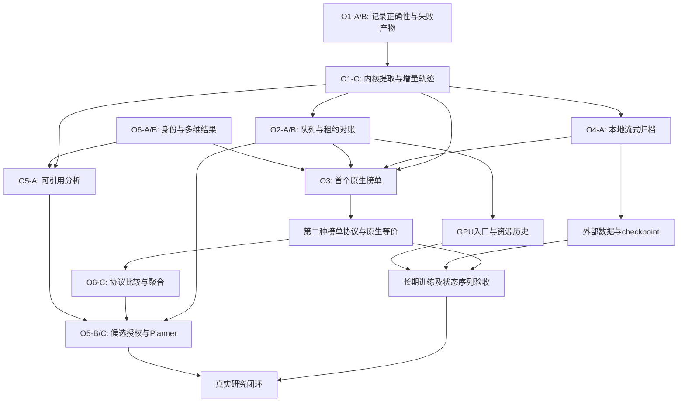

# 科研与榜单基础设施：现状审查与六项优化实施计划

状态：**待实施的开发计划**。本文完成现状分析和实施拆解，不表示所列缺陷已修复或新能力已交付。

审查日期：2026-09-22。源码基线：`57c8e4da0a9774cd149715424ee172aa143760ef`。
此前只读审查发生在文档分支 `7841d23`，当时 `src/`、`tests/`、`pyproject.toml` 与该基线一致。
本次文档从 main 建立独立分支，不包含另一工作树的 benchmark 专题草案提交。
文档交付与检查见[任务记录](../changes/20260922-infra-six-optimizations-c83e2a.md)。

## 1. 目标、范围与阅读方式

### 1.1 产品目标

Agent Infra 的目标是成为科研和榜单实验共用的执行基础设施：管理获准使用的计算资源，运行不同 Agent 和科研程序，忠实执行不同 benchmark 的协议，保留可追溯证据，并让上层 Agent 基于证据改进下一轮实验。

本文把“雇主 Agent”理解为上层研究协调者：它读取项目目标、轨迹、指标和资源消耗，提出实验或候选修改，并在授权范围内调用 infra。雇主 Agent 与被测 Agent、目标训练模型、评测器具有不同身份和权限；平台本身不绑定一种研究策略。

预期闭环为：

```text
用户目标 / 固定榜单协议
    → 形成可追溯的任务和候选版本
    → 准入、排队、资源分配
    → 执行、观测、取消与对账
    → 原始轨迹、产物、评测和资源证据
    → 雇主 Agent 分析并引用证据
    → 校验下一轮候选和预算
    → 新实验或停止
```

“任意榜单可扩展接入”意味着增加 adapter 或执行后端时可以复用公共能力。具体榜单仍需要固定版本、接入代码和原生等价验收；提供一个 URL 不构成兼容性证明。

### 1.2 本文边界与文档关系

- 本文负责横向现状审查、六项优化的实施步骤、依赖与验收，不新增可执行命令或运行时 API。
- [项目状态](../project-status.md) 继续描述已集成事实；[20260920 整理说明](20260920-integration-review.md) 保留其历史快照。该历史文档中 GPU 准入等描述不能代替当前源码。
- 既有架构依据包括 [Run / Environment](../architecture/run-environment-contract.md)、[资源管理](../architecture/resource-management.md)、[Records](../architecture/records-design.md) 和 [Task 模型](../architecture/task-model.md)。
- `docs/benchmark-integration-design` 分支的 `docs/architecture/benchmark-integration-layer.md` 承担 benchmark 专题设计；交付复核时其 v0.2 已提交为 `0c8527b`，尚未进入本地 main。开始 O3 实现时核对其实际集成版本，避免形成两套协议、队列或执行后端；本文不复制该分支文件。
- 以下拟议对象、状态和内部文件名用于明确职责，均需在对应实现任务中定稿。现有接口名称则附源码入口。

### 1.3 结论与六项优化

现有功能模块与依赖方向可以保留。下一步主要工作是完善已有执行内核和证据链，再扩展调度、协议、大产物与研究迭代。

| 编号 | 优化方向 | 直接解决的问题 | 完成后的可见结果 |
| --- | --- | --- | --- |
| O1 | [执行内核与证据生命周期](#o1) | 巨型协调方法、日志遗漏/重复、失败产物缺失、结构化轨迹延迟 | 同一执行链可靠处理成功、失败、超时和取消；运行中可查询轨迹 |
| O2 | [持久调度与资源对账](#o2) | 单执行槽、无等待队列、内存租约、缺少任务资源历史 | 批量提交、资源不足时等待、重启后对账、资源消耗可解释 |
| O3 | [原生 benchmark 协议适配](#o3) | 正式入口限定研究编译与 Codex，无原生评分等价 | 新榜单复用调度和记录，保留其执行、反馈、评分和提交语义 |
| O4 | [数据集、checkpoint 与大产物](#o4) | 全文件入内存、多次复制、体积限制、缺少外部不可变引用 | 大权重可归档/校验/传输，输入可复用且版本固定 |
| O5 | [雇主 Agent 与受控候选迭代](#o5) | 分析证据粒度有限、仅能选择预冻结 Task | 分析引用实际事件与产物，自动形成范围内的新候选 |
| O6 | [实验身份、结果和比较](#o6) | 配置血缘不完整、协议等价未验证、结果维度不足 | 能复核每次尝试、比较依据和最终候选选择理由 |

O1 的记录正确性修复优先于批量运行。O6 的最小身份字段要在 O3/O5 前确定；编号不是严格串行施工顺序。详细切片见第 10 节。

## 2. 当前实现：基础、限制与影响

### 2.1 已经具备、应该沿用的基础

1. **两条科研执行链**：冻结 Task 经 Controller 启动容器内 Agent；宿主机 Agent 经 CLI/MCP 操作长期 Docker 环境与 Job。两者服务不同使用方式，应共享底层设施并保留各自语义。
2. **任务身份与可见性**：Tasks 已有冻结摘要、Agent 可见投影、材料角色和显式评测声明。不能为方便接入把完整任务根目录直接交给求解 Agent。
3. **资源准入与清理意识**：授权容量、观测值和租约已有区分；清理不完整时保留占用/隔离状态。这些约束需要在并发和远端化时继续成立。
4. **记录体系**：原始流、规范事件、产物、派生轨迹分层，已有 producer 序号、幂等键、可见性、覆盖状态和版本字段。扩展应复用 Records。
5. **结果分析与有限迭代**：已有不可变产物引用、分析、用户决定、任务范围授权和可替换 Planner。
6. **工程验证**：依赖方向、类型、格式、单元测试与真实环境测试已经分开。真实 CPU/Docker 证据见既有任务记录，不能仅以单元测试替代。

### 2.2 不足清单及代码入口

| 现状 | 代码入口 | 对目标的影响 | 归属 |
| --- | --- | --- | --- |
| `LocalRunService.run()` 从约第 100 行延伸至第 910 行，混合解析、执行、采集、评测与清理 | [runs/service.py](../../src/agent_infra/runs/service.py) | 修改任何阶段容易影响取消、可见性和释放顺序 | O1 |
| 原生 Agent 事件在 phase 的 finally 中集中解码 | 同上 `phase()`、`_record_agent_events()` | 长实验进行中缺少持续规范事件；中断后需要重放恢复 | O1 |
| 正式预检限定 Codex、项目编译任务、无评测、无 required ToolBinding | [bootstrap/run_preflight.py](../../src/agent_infra/bootstrap/run_preflight.py) | 现有 adapter 数量不等于正式支持的 Agent/榜单组合数 | O1/O3 |
| Controller 使用一个 `_active` 主执行槽；繁忙时拒绝提交 | [runs/controller.py](../../src/agent_infra/runs/controller.py) | 闲余资源无法用于多个正式 Run；批量请求需要外部重试 | O2 |
| 租约使用进程内字典；重启恢复以中断和清理为主 | [resources/local.py](../../src/agent_infra/resources/local.py)、Controller `reconcile()` | 不能恢复调度队列，也不等于恢复训练进程 | O2 |
| 长期环境 `_open()` 仅构造 CPU/内存请求；迭代授权排除 GPU | [runs/research.py](../../src/agent_infra/runs/research.py)、[projects/iteration.py](../../src/agent_infra/projects/iteration.py) | 冻结 Task 的 GPU 基础链尚未成为所有入口的一致能力 | O2/O5 |
| Web 采样历史在有界内存 deque；RecordingPolicy 的资源采样字段没有接通任务持久采样 | [resources/sampling.py](../../src/agent_infra/resources/sampling.py)、[records/api.py](../../src/agent_infra/records/api.py) | 难以复盘历史 Run 的显存、利用率、资源闲置和成本 | O2 |
| 原生 workspace importer 仅做索引，evaluation/runtime 等价尚未证明 | [tasks/importers.py](../../src/agent_infra/tasks/importers.py) | 导入材料不能直接成为可正式刷榜的任务 | O3 |
| Docker 默认收集上限 1 GiB；Records 对单个文件 `read_bytes()`；下载上限 16 MiB | [environments/docker.py](../../src/agent_infra/environments/docker.py)、[records/_local_sink.py](../../src/agent_infra/records/_local_sink.py)、[runs/query.py](../../src/agent_infra/runs/query.py) | 常见模型权重无法顺畅走统一产物链 | O4 |
| Analysis 的证据引用以已完成 Run、产物成员和指标为主 | [projects/analysis.py](../../src/agent_infra/projects/analysis.py) | 无法统一引用某一段轨迹、资源曲线和候选修改依据 | O5 |
| 比较分组依赖指标名、单位、方向和调用方声明的数据版本，明确不保证协议等价 | 同上 `compare()` | 尚不能据此给出公平排名或自动选优 | O6 |
| 多处公共响应使用 `dict[str, Any]`，HTTP/TypeScript 手工维护 | [runs/control_api.py](../../src/agent_infra/runs/control_api.py)、[Web API](../../src/web/src/api/workflow.ts) | 扩展状态和结果维度时容易发生入口差异 | 六项共同要求 |

这些结论区分两类工作：已复现的问题需要修复；单机/单 Agent 等边界需要新增能力。不能把所有未实现目标都记为现有测试失败。

## 3. 已复现问题与证据边界

### 3.1 F1：退出后未读尽日志却标记完整

`DockerEnvironment.observe()` 每次对 stdout/stderr 各读取至多 65,536 字节。`LocalRunService` 看到终态后退出采集循环，没有继续读取剩余日志，随后可将流标记为 `complete`。

只读审查使用临时目录、替身执行生命周期和真实 `DockerEnvironment.observe()` 方法，构造一个已退出且有 200,000 字节 stdout 的环境，没有启动 Docker。结果为：

```text
available_bytes = 200000
recorded_bytes = 65536
capture_status = complete
run_status = completed
```

这证明终态与日志读取完成之间的接口/调用问题。尚未进行真实 Docker 进程的同场景复现。缺失内容可能包含最后一条指标、最终错误或 Agent 完成事件，不能被分析器视为完整轨迹。

### 3.2 F2：流文件与偏移提交之间的故障重试不一致

`append_stream()` 先追加文件并 fsync，再更新 SQLite 长度并提交。如果中间发生故障，实际文件长于数据库已提交偏移；当前重试以数据库偏移为依据继续 append。

只读审查在临时 Records 存储中注入“更新 `streams.size_bytes` 前抛错”，重新打开存储，再以原 offset 重试，得到：

```text
expected_bytes = abc
actual_bytes = abcabc
metadata_size = 3
blob_size = 6
capture_status = complete
```

这是一次确定性故障注入，不是断电测试，也不是多写入者压力测试。它足以说明文件与元数据需要恢复对账；修复后仍需覆盖提交成功但响应丢失、重复 finalization 和多进程访问等边界。

### 3.3 F3：失败或超时后的已有输出不进入产物记录

`phase()` 完成清理后先重新抛出执行异常，再走输出 collect。因此失败路径跳过正常输出归档。

显式替身在工作区先产生 `result.txt`，再报告 `timed_out`。验证观察到文件仍在工作区，`submission_root=None`，Records 仅有 `agent-visible-task-snapshot`。这不是“文件被删除”的证明，而是产物目录与查询链缺少失败输出的证明。

建议将停止执行、证据收集、是否允许评分分别处理。科研 checkpoint 可以在超时后保留；榜单是否接受超时前产物由固定协议决定，不能通过归档把失败改成成功。

### 3.4 本次审查能证明什么

- 前一轮执行 `uv run --locked pytest -q -m 'not integration and not e2e'`：308 passed、23 deselected、1 条 Pydantic 警告，耗时 89.09 秒。
- F1/F2/F3 是上述测试之外的定向复现；通过的既有测试没有覆盖这些失败窗口。问题尚未修复。
- 本次交付是文档；没有重新执行真实 Agent、Docker、GPU、多节点或原生榜单，不声称完成对应验收。
- 源码规模和 `read_bytes()` 支持维护性/内存风险分析，但本轮没有性能压测，不能给出未经测量的吞吐提升比例。

<a id="o1"></a>

## 4. O1：执行内核与证据生命周期

### 4.1 目标和保留边界

继续由 Runs 负责协调，Agents 生成启动计划/解释原生事件，Environments 控制进程与文件，Records 持久保存证据。先提取内部职责，再扩展能力；科研 Job 不必全部转换为冻结 Task。

| 拟议内部职责 | 接收与产出 | 不应承担 |
| --- | --- | --- |
| 流采集器 | 后端字节块/游标 → 原始流提交回执、规范事件、采集状态 | 任务评分、资源选择 |
| 阶段执行器 | 执行 spec + 已获准资源值 → 退出事实、停止/清理证据 | 编译科研方案、榜单聚合 |
| 产物收集器 | 已停止写入的输出集合 → 产物引用、缺失/部分/失败状态 | 将部分产物自动认证为有效提交 |
| Run 协调器 | 固定输入、取消意图和阶段结果 → 最终多维结果 | 内嵌每个 provider 的认证规则 |

这些可以先成为 `runs` 内部文件/类，不创建第二套 Run manager。对外保留 `LocalRunService.run()` 兼容入口，内部逐步委托。

### 4.2 先修 F1/F2/F3，再提取行为

**F1：区分进程终态、日志 EOF 和 capture limit。**

1. 给日志观测提供明确的读取完成信息，或提供独立字节读取契约；进程退出后仍可继续从游标读取。
2. 终态到达后继续 drain；成功、失败、超时和取消共用该收尾过程。
3. 后端生产日志的线程/远端上传尚未结束时，不能用一次空块判定永久 EOF。EOF 需要生产端关闭依据；无法确认则标记 `partial`。
4. 达到明确记录配额时保留 `truncated` 及原因。流按原始字节保存，文本显示和 JSONL 解析使用增量 UTF-8 解码，避免多字节字符跨块造成原始内容变化。

**F2：定义唯一的已提交偏移。**

1. 第一版保持每条流单写入者；用进程间所有权/锁约束实际 writer，不能仅依赖一个对象的 `RLock`。
2. 恢复时比较文件长度与数据库 committed offset。文件短于已提交长度视为损坏；文件更长视为未提交尾部。停止旧 writer 并确认所有权后，才按既定规则截断或校验接纳尾部。
3. 新块在期望位置写入并持久化，再提交偏移；重复请求校验已有区间的内容，不再次追加。
4. finalization 验证 committed size 与内容摘要，提交 blob/状态后再清理 spool。所有崩溃窗口都可重入；目录项的持久化也需纳入磁盘耐久性实现。
5. 多写入者或远端上传阶段可以引入不可变分块 manifest；不要用“保证 exactly-once”代替幂等键、恢复和对账。

**F3：让失败输出可查。**

1. 取消或超时后先确认相关 writer 停止；对未停止的工作区禁止生成“不可变最终产物”。
2. 在输出策略允许的范围内收集 checkpoint、日志和结果文件，记录其 partial/final 身份、缺失项与摘要。
3. 归档失败与执行失败分别保存；保留可恢复的源工作区和重试入口，不掩盖原始错误。
4. scorer 是否运行由协议决定。成功清理可释放计算资源，持久产物源的删除则要等待归档达到要求；两个动作不能混为一个布尔量。

### 4.3 改为增量规范化

当前 `decode_events(Iterator[str])` 的适配器接口可以保留，增加长生命周期的流解析桥接：累积完整行、保留半行、持续迭代解码并批量提交。需要状态的 provider decoder 在一次会话中持续存在，不能逐行重新初始化。

原始流先提交，再派生事件。解析检查点记录 stream ID、字节位置、原生序号、normalizer 版本；派生事件通过稳定幂等键避免重放重复。若 decoder 状态无法直接保存，可以从已保留原始流起点重放并去重，明确恢复成本。

解码失败保留已有成功事件、错误位置和原始引用；不能因为末尾一条损坏 JSONL 丢弃前面整批有效事件。Records 查询已有游标可继续使用，Web/MCP 不必一次加载整个长轨迹。

### 4.4 解耦任务来源与 Agent 选择

`prepare_compiled_run()` 保留为科研编译适配器。新增任务来源解析接口，将项目编译结果、受信任 Task catalog、原生协议工作映射为不可变执行输入，再由公共预检检查输入摘要、Agent 能力、环境、工具和预算。

`AgentRegistry` 已存在，应由 bootstrap 组装并注入 provider 选择/凭据准备能力。不能仅去掉 Codex 检查就宣布支持 Claude Code/DSH。每种组合需要实际认证、容器启动、取消、轨迹与退出处理验收。工具声明继续在缺少真实绑定时失败，不能把空 ToolBinding 当成功。

### 4.5 实施切片、迁移与验收

| 切片 | 改动范围 | 验收条件 |
| --- | --- | --- |
| O1-A | 修日志 drain 和流恢复一致性，增加定向回归 | F1 完整读取 200000 字节；F2 重试最终为 abc；损坏/截断如实标记 |
| O1-B | 失败产物策略与最终结果拆分 | 超时前生成的文件可查；执行仍为超时；归档失败可诊断；未确认停止不发布最终快照 |
| O1-C | 提取采集器/阶段执行器，接增量规范化 | 运行结束前出现规范事件；半行、Unicode 跨块、解析器重启去重正确 |
| O1-D | 任务来源和 provider 能力预检 | 原科研命令继续可用；不同来源复用同一生命周期；未验收组合明确拒绝 |

迁移先增加可选字段和兼容投影，不重写历史原始流。历史记录缺少完整性依据时显示 unknown；修复后的采集版本与旧版本可区分。每个切片保持现有取消、隐藏评测材料和清理失败保留租约测试。

真实 Docker 验收另设任务预算，覆盖快速退出的大日志、后台子进程、取消后最终日志及失败工作区收集；替身测试只证明协调逻辑。

<a id="o2"></a>

## 5. O2：持久调度、GPU 入口与资源对账

### 5.1 从单执行槽演进

目前 `_active` 同时阻止多个正式 Run 和长期科研环境并发，Planner 通过 companion 机制另行共享配额。第一步应把这几类执行的资源申请与所有权汇总到统一租约接口，而非简单把 `_active` 改成列表后启动更多线程。

建议分工：

- `runs/control_store.py` 演进为持久提交/队列状态的存储；Run 调度器持有唯一工作队列。
- `resources` 保留可分配性判断，新增持久租约存储和恢复对账；不另建任务等待队列。
- `environments` 或未来 Worker 返回实际执行 handle、资源绑定及清理证据。
- Projects、Web、CLI、MCP 均提交同一种调度意图，不各自实现轮询抢卡和重试策略。

### 5.2 最小持久对象与执行流程

以下是字段职责建议，不是已存在 schema：

| 对象 | 最小信息 | 权威事实 |
| --- | --- | --- |
| 队列项 | operation/run/attempt ID、固定执行输入、请求、入队时间、等待期限、取消意图、版本号 | 用户提交了什么、当前应推进到哪一步 |
| 租约 | lease/request ID、资源所有者、节点/设备、owner epoch、状态、创建/更新时间 | 哪部分授权容量已经被占用或待核实 |
| 执行关联 | attempt、backend/native job ID、ownership tag、确认状态 | 哪个外部资源属于这次实际尝试 |
| 预算账本 | 预算主体、维度、预留、已计量、待结算量、计量来源 | 剩余额度与不确定范围 |

提交顺序建议为：校验固定输入 → 持久入队 → 事务性领取队列项 → 申请幂等租约 → 持久执行意图 → 启动/查找外部执行 → 保存 handle → 持续观测 → 收尾与资源对账。

队列与租约若使用不同数据库，不能把两个本地事务当作原子提交。用稳定 request ID 和可恢复中间状态处理“已领取无租约”“已分配未启动”“已启动未保存 handle”的窗口。调度器重启时扫描这些中间状态并对账。

拟议状态可细化为 `queued / admitting / starting / running / finalizing / finished / reconciling`。执行结果仍单独表达；例如 `finished` 可对应 failed 或 timed_out。所有更新使用版本条件或事务约束，避免取消与启动竞态。

### 5.3 调度策略与实际限额

第一版采用确定性的 FIFO 和有界并发。请求超过授权总容量返回 unsatisfiable；只是暂时不足则保持 queued，并记录不足项。队头阻塞和可选回填策略要明确；复杂公平性和抢占放到有实际需求时实施。

CPU/内存/GPU/磁盘等物理资源、并发模型调用等服务配额、整场实验时间等预算是不同约束。资源请求获批后，backend 还需证明限额应用到对应 cgroup、容器或外部作业。界面显示“请求、分配、实际限制、观测”四项事实，不能把 GPU 利用率低误认为可自由分配。

长期科研环境复用 `GpuRequest`、Controller UUID 白名单和 Docker 设备映射。环境的驻留租约与环境内部 Job 不应重复扣同一张卡；Job 若启动外部工作则单独申请子租约并绑定父关系。环境闲置保留时间与显式关闭策略可配置，不能在用户未声明可恢复时随意回收工作区。

### 5.4 重启、失联和取消

| 场景 | 建议处理 | 禁止的推断 |
| --- | --- | --- |
| 等待中的任务取消 | 原子标记取消，移出可调度集合；不启动任何外部工作 | “客户端断线”等于取消 |
| 启动请求发出但回执丢失 | 按 operation ID/ownership tag 查找；无查询能力则 reconciling/unknown | 没回执所以一定没启动，可直接重试 |
| Controller 重启 | 恢复队列与账本，按后端能力选择重新附着或明确中断清理 | 业务状态恢复等于 Agent/训练进程续跑 |
| Worker 心跳超时 | 隔离该所有权范围，查询/停止实际资源，确认后结算 | TTL 到期就可以把同一 GPU 再分配 |
| 清理失败 | 保存残留 handle 与失败原因，阻止相关资源重用 | 删除本地 lease 就算清理完成 |
| 旧执行器恢复连接 | 用 owner epoch 拒绝过期状态更新；结合实际后端所有权继续对账 | 仅一个 fencing 数字就能自动停止旧进程 |

首版可以继续对不支持重新附着的执行采取 interrupt-and-clean，但必须保留等待队列和累计预算。checkpoint 恢复是独立能力，按工作类型和协议逐项开放。

### 5.5 资源历史与预算

采样以 Run/Attempt/Job/Lease 为关联键，包含采样时间、来源、覆盖与误差说明。优先保存容器 CPU/RSS、分配的 GPU UUID、可归属显存/利用率、磁盘用量与阶段耗时。主机总量和任务归属值分开；无法归属的 GPU 共享指标标 unknown，不能平均分摊后称精确计费。

长时间采样需要批量写入和分辨率/保留策略；高频原始样本与聚合视图分开，不把每秒指标全部塞入 Agent 上下文。雇主 Agent 默认读取区间摘要，必要时引用原始区间。

预算规则由上层授权/benchmark 决定，Runs 协调计量与停止，Resources 执行资源准入。账本至少区分排队、准备、求解、训练、评测、归档时间及尝试次数。哪些阶段计入正式预算由原协议决定；暂停和恢复不自动重置额度。

模型费用只有在存在足够 usage/计费证据或可拦截调用通道时才能形成可靠限制。缺少这些能力时只承诺时间、次数与资源边界，将费用标为 estimate/soft limit，不用一项 `max_cost` 配置冒充硬上限。

### 5.6 实施切片与验收

| 切片 | 内容 | 验收条件 |
| --- | --- | --- |
| O2-A | 持久队列、幂等提交和取消 | 同一 operation 重试只产生一个逻辑请求；排队取消不启动；重启不丢等待项 |
| O2-B | 持久租约与执行 handle 对账 | 覆盖每个提交窗口；不超卖；残留资源阻止释放；旧 owner 更新被拒绝 |
| O2-C | 有界并发与长期环境 GPU | 三项单卡请求在一张卡上依次推进；CPU/其他空闲设备任务按配额运行；Job 不重复预留父资源 |
| O2-D | 任务采样与预算账本 | 能从历史数据解释用量、等待原因和停止原因；重启后预算不归零 |
| O2-E | Worker/外部调度后端 | 两节点断连、恢复、日志/产物回传及所有权释放有真实证据 |

O2-E 在 O1/O4 和单节点队列稳定后实施。Ray 可以是后续派发实现，不能代替容器限额或清理证据；外部调度模式使用平台配额加上游实际分配映射，不同时预占无关本机 GPU。

数据库迁移采用显式 schema 版本和兼容读取。升级前停接新任务、备份状态并处理在途项；回滚若无法读取新版 schema，应拒绝启动或使用经过验证的备份恢复流程，不能直接降级二进制后清空新队列。

<a id="o3"></a>

## 6. O3：原生 benchmark 协议与执行后端

### 6.1 当前限制与接口分工

现有 Task importer 明确只索引原生准备好的材料；Python Run 内核支持已注册 `EvaluationRecipe`，正式 Controller 则尚未开放原生评测任务。后续不能通过给所有任务添加一个通用 scorer 来宣称接入成功。

| 组件 | 拟议职责 | 与现有代码的关系 |
| --- | --- | --- |
| 协议 adapter | 固定来源、发现工作单位、生成计划、校验能力、解释结果、原生聚合和提交资格 | 在 Task 索引能力之上补齐协议；复用 Task/Artifact 身份 |
| 执行 backend | submit/observe/cancel/reconcile/collect/cleanup；返回可持久引用的 handle | 扩展 Environments 既有执行契约，避免另建生命周期系统 |
| Run | 校验固定计划、排队、协调预算与执行、保存各阶段事实 | 复用 O1/O2，不按榜单名堆通用分支 |
| Projects | 自主科研或跨候选优化，可选绑定一次榜单实验 | 不要求每个榜单都先经历研究草稿采用流程 |

专题设计提出独立 `benchmarks` 模块。正式实施时应先确定其公开 API 和依赖位置：例如位于 Runs 下、Tasks 上，让 Runs 能协调它且 Tasks 不反向依赖。新增模块需同步严格依赖契约及评审，不提前放宽 `pyproject.toml`，不动态 import 绕过边界。

Environments 的执行 spec 只接收低层所需参数与轻量引用，不导入高层 BenchmarkPlan 或 ResourceManager 实现。Run 负责从已批准计划/租约转换，bootstrap 注册具体 adapter/backend。

### 6.2 固定执行计划需要包含什么

| 部分 | 要回答的问题 |
| --- | --- |
| 来源 | benchmark release/commit、数据 revision、任务集合摘要、adapter/runner 版本是什么？ |
| 工作单位 | 单 case、顺序阶段、完整 family、配对序列，还是原生 runner 管理的一组工作？ |
| 执行所有者 | 哪些阶段由平台调度，哪些由原生 runner 内部推进？谁创建和取消子资源？ |
| 输入与工具 | 求解器实际可见哪些材料、服务、工具和网络？ |
| 会话与状态 | 哪些会话必须 fresh，哪些 workspace/memory/checkpoint 允许继承？ |
| 预算 | 从哪个时点开始，包含哪些阶段，重试/采样如何计数？ |
| 评测与反馈 | 谁评分、谁能读评分输入和输出、反馈何时释放？ |
| 结果与提交 | 指标和聚合规则是什么，官方提交的资格与确认步骤是什么？ |

计划冻结后不允许 `latest` 在重试时解析成另一版本。原生不支持拆分时，第一版托管完整 native job，并保留其子任务/episode 身份。只实现已验收的独立任务、顺序阶段和原生托管序列，不提前建设全功能 DAG 系统。

### 6.3 四类榜单怎样落地

以下是 2026-09-22 审查已核对的公开协议要点；实际接入任务还需固定 upstream commit 并重新验证选用入口。

| 榜单 | 第一版接入策略 | 必须保留的语义 | 专项验收 |
| --- | --- | --- | --- |
| [ASI-Bench](https://github.com/apexin-ai/ASI-Bench) | 调用固定原生执行/评分入口，归档原生输出并映射身份 | seed、prompt level、本地产出/评分与官方提交分离；官方资格依赖原生 provenance | 同一产物的原生与适配评分符合原生标准；不把本地分数标官方；不具备资格的产物拒绝提交 |
| [TB-Science](https://www.terminal-bench-science.ai/run) | 通过固定 Harbor 版本运行原生 task/trial，导入事件与结果 | 原生环境、资源、时间和评测协议；Harbor 内外只保留一个实际调度所有者 | 同一任务/配置经原入口和平台入口运行，评分、状态、产物完整且可追溯 |
| [PostTrainBench](https://github.com/aisa-group/PostTrainBench) | 首先明确采用原生 HPC 路径或经过验收的替代后端 | 限时训练、目标基础模型、训练期间允许的 eval、最终模型、原生结果审查 | GPU/时间真实受限；final_model 可归档；公开反馈与最终评测分开；缩小 smoke 不当作正式结果 |
| [PAST-Bench](https://github.com/Gen-Verse/PAST-Bench) | 原生 runner 托管完整 family 及配对条件 | episode 次序、fresh session、持久 memory/skill/history 范围、on/off 隔离、原生聚合 | 顺序正确、状态按规则继承/清除、对照不串状态、逐 episode 证据与配对报告一致 |

ASI-Bench 当前 seed31415 支持公开参考的本地评分，seed42 的官方评分和提交有另外的限制。TB-Science 当前通过 Harbor 运行。PostTrainBench 官方 README 描述 H100 上 10 小时任务，当前主线以 HTCondor/Apptainer 为基础，不能把尚未确认稳定的其他入口当既成能力。PAST-Bench 的核心是有序跨会话经验与配对对照。上述差异驱动接口设计，而不是让平台统一改写协议。

### 6.4 原生执行的资源与反馈边界

包装一条 CLI 命令只证明能发起运行。接入前必须检查子容器、宿主机挂载、端口、GPU 选择、后台进程和清理命令；父进程的 cgroup 限额不自动约束由宿主 Docker daemon 创建的子容器。

应为每种后端选择可验证的所有权机制：原生标签/命名空间、受控执行服务、独占授权环境或上游 job ID。若只能观测而无法限制/取消全部子资源，在兼容矩阵中明确覆盖程度，不能把该组合标为已验收的受管执行。

平台保留原生允许的反馈。PostTrainBench 的训练中评估、PAST 的跨 episode 状态、外层优化 Agent 的跨 trial 分析是三种不同循环。不能统一隐藏所有 eval，也不能把平台总结默认注入被测 Agent。hidden grader、缓存、工具返回、错误日志和分析报告都受角色/阶段可见性约束。

### 6.5 实施、迁移与验收矩阵

1. 先定义 adapter/backend 的最小契约和固定样例，使用明确替身验证状态映射、取消、结果导入与可见性。
2. 选择一个 TB-Science 小任务或 ASI 公开本地评分任务形成真实闭环，保存原始 runner 输出及版本。
3. 补另一种评分/提交模式，验证“求解完成但尚未评分”“评分无效”“本地有效但不可官方提交”等状态。
4. O2/O4 就绪后接长期 GPU；再验证有序序列和配对状态。每个适配器单独记录支持矩阵。
5. 官方提交默认先生成可审查 bundle/提交计划；外部上传遵守用户既有授权和原生规则，不随本地运行隐式发布。

支持矩阵至少包含 benchmark/版本、Agent/版本、backend、协议配置、执行/评测/清理/轨迹覆盖、验收记录。不能用适配器存在来代替矩阵证据。

原科研 Task 和 `EvaluationRecipe` 入口保留；原生结果原样归档，规范化层版本独立记录。升级 adapter 后重新解释旧结果应形成新派生版本，不覆盖原始评分。确定性评分比较精确结果；随机评测按固定协议、重复次数和预先约定的统计标准验收。

评分等价优先比较同一份固定产物走原入口与适配入口的结果。两次独立真实 Agent 求解含随机性，不能要求它们逐次产生相同分数来证明适配正确。

<a id="o4"></a>

## 7. O4：数据集、checkpoint 与大产物通道

### 7.1 需要改变的实际路径

当前输入冻结/工作区准备、Docker collect 和 Records 归档可能先后复制数据；`commit_artifact()` 整文件读入内存，HTTP 又使用 JSON/base64 返回文件。提高 1 GiB 或 16 MiB 的上限不会改变这些路径的内存、复制和中断恢复问题。

建议保留现有小文件 API，并建立三类数据的明确处理：

| 数据类别 | 处理方式 | 需要记录 |
| --- | --- | --- |
| 小配置、代码、指标和报告 | 继续内容寻址归档，便于直接查看 | 摘要、版本、可见性、产生者 |
| 大数据集、基础模型 | 注册不可变引用，校验后复用只读缓存/挂载 | 仓库/revision、manifest/checksum、允许位置、可用性 |
| 运行生成的 checkpoint/final model | 停止写入后发布快照，流式进入受控产物存储 | 父模型/父 checkpoint、训练配置、step、字节数、完整性、恢复能力 |

来源位置不等于内容身份。绝对宿主路径不能作为跨节点公共契约；不可变版本必须可验证。删除或移动源数据后要明确报告 unavailable，不能自动解析到另一个同名文件。

### 7.2 存储与传输的分步实现

**第一步：本地流式落盘。** 扩展 Records 的公开写入能力，允许以文件流/分块写入 blob，在一次读入过程中增量计算摘要。写入临时对象，完成校验与持久化后原子发布，再提交元数据；崩溃产生的未引用临时对象可单独回收。保留 `put_blob(bytes)` 为小对象便利接口。

目录产物使用版本化 manifest 列出每个成员摘要、大小和逻辑路径；内容寻址继续去重。相同内容可以被多个产物引用，但访问授权根据请求的 Run/Artifact 范围判断，不能拿到裸 digest 就读取任意项目对象。

**第二步：外部不可变输入。** 在 Tasks/Projects 的材料解析中增加受控引用类型，经 bootstrap 注册的 resolver 解析到节点可用路径。冻结 Task 时保存引用和 manifest 摘要，不复制整个大型缓存。运行前校验版本和权限，失效引用产生明确预检错误；不能绕过原有私有材料投影。

**第三步：下载与传输。** 增加独立的二进制流式下载能力和范围读取，保持摘要、大小、鉴权、精确 manifest 成员校验。Web 预览仍使用有界文本/结构化视图；大文件下载不经过 base64。对象存储或远端后端作为后续可替换实现，沿用相同引用和校验逻辑。

**第四步：checkpoint 发布与恢复。** 保存恢复元数据、训练程序/依赖版本及适用策略。恢复生成新的物理 Attempt，并关联原 checkpoint、旧 Attempt 和累计预算；读取到一个权重文件不等于优化器/RNG/Agent 会话均可恢复。

### 7.3 一致性、缓存与回收

- evaluator 读取前，checkpoint 必须停止写入并形成经过校验的只读快照。可先用可靠副本；支持文件系统快照/reflink 时再优化，不能把可变文件硬链接成“不可变”产物。
- 基础模型和公开数据缓存可按内容共享；Agent memory、实验结果缓存和评测私有材料按协议隔离，尤其不能在 PAST 的对照条件间共享经验。
- 计算资源释放、归档完成和工作区回收是不同里程碑。归档失败保留重试源；磁盘也有容量上限和清理策略，不无限保留所有失败目录。
- GC 先标记，再根据保留期和实际引用回收；在途上传、活跃读取、候选 lineage、恢复 checkpoint 均需考虑。记录可见的删除/不可用状态，不留下看似存在的链接。
- 远端 URI、错误信息和产物 manifest 不保存凭据；传输认证材料不进入导出配置。

### 7.4 实施切片与验收

| 切片 | 验收对象 | 完成条件 |
| --- | --- | --- |
| O4-A 本地流式 blob/manifest | 例如 2 GiB 的有界生成数据，测试前明确磁盘与内存预算 | 正确摘要和成员清单；内存峰值受预设块大小/阈值约束，不随文件大小线性增长 |
| O4-B 外部不可变输入 | 固定公开样本数据/模型引用 | 两次任务复用只读缓存；版本变化/内容损坏/失效路径可诊断；不可见材料未泄露 |
| O4-C 可恢复传输 | 中断上传、重复块、范围下载、错误 checksum | 恢复后最终内容一致，不发布半成品，不越权读取其他产物 |
| O4-D checkpoint 与保留策略 | 受控短训练和取消后的 checkpoint | 产物可归档；恢复兼容性明确；预算连续；失败归档源可重试，成功后按策略回收 |

上述大文件测试目前未执行，不应在文档编辑任务中自动生成大数据。第一版保留本地后端，等实际多节点需求出现后再接共享存储/对象存储。旧 BlobRef/ArtifactRef 通过版本化扩展保持可读；回滚前检查新引用类型是否被旧版本理解，不把外部引用伪装成本地文件。

<a id="o5"></a>

## 8. O5：雇主 Agent 与受控候选迭代

### 8.1 从已有分析/Planner 出发

当前 AnalysisService 验证 Run 属于项目，并从真实产物成员读取指标；解释与建议单独保存且不声明科学真实性。这些约束应继续保留。

当前 IterationService 只能从已冻结并获准的任务集合选择下一次执行，校验项目研究 revision、CPU/内存与时间，并排除 GPU。扩展目标是在明确范围内生成新候选；现有“精确任务集合”模式继续适用于严格复现，不被宽泛授权替换。

### 8.2 给雇主 Agent 的公共工具面

以下是业务能力建议，名称不表示已有 MCP 工具或 CLI 命令：

| 能力 | 输入与返回 | 约束 |
| --- | --- | --- |
| 获取研究/实验上下文 | 目标、候选、运行状态、预算摘要、可用证据索引 | 按角色/协议过滤，避免一次塞入所有轨迹 |
| 读取证据片段 | EventRange、tool call/span、ArtifactMember、ResourceInterval 引用 | 分页、有界、来源版本固定，隐藏材料不经摘要泄露 |
| 保存分析 | 观察、解释、不确定性、建议、逐项 evidence refs | 校验证据存在且有权限；推断不能伪装成已验证事实 |
| 提出候选 | 父候选、差异、原因、预期收益、资源/时间请求 | 只触及获准修改范围，形成独立工作目录和不可变版本 |
| 预检/提交/取消 | 已冻结候选与 task/protocol 引用、operation ID | 同一 Run/队列接口，确定性校验后执行 |
| 比较/停止 | 固定比较条件、结果集合、剩余预算 | 使用 O6；无效比较不能自动宣布候选更优 |

宿主机会话采集与实际实验不必强行使用同一个 Run，但要增加可追溯关联：哪个 employer session 提出哪个 candidate，哪个请求触发哪个 Job/Attempt，分析引用了哪些事件。仅匹配目录名无法建立因果关系。

### 8.3 候选循环的确定性边界

建议流程：读取允许反馈 → 保存诊断 → 在隔离候选目录生成差异 → 校验修改范围/输入版本/资源预算 → 冻结候选与任务 → 幂等提交 → 读取实际结果 → 按预设规则比较或停止。

模型负责研究判断；确定性服务负责范围、身份、资源、协议与状态校验。雇主 Agent 即使错误地建议修改 grader 或扩大时间，也不能通过自然语言绕过服务端校验。

拟议授权范围需要明确：

- 可修改的代码、prompt、skill、配置和超参数范围；受保护的 grader、数据切分、基础模型身份与协议文件。
- 可使用的输入版本、网络/工具能力、执行后端和模型配置。
- 最大 trial/attempt/并发数、CPU/内存/GPU/磁盘、正式时间和可观测调用预算。
- 可读取反馈的角色、字段、释放时机和次数；允许的人工参与。
- 停止条件、允许的恢复/重试、最终候选选择规则。

授权可覆盖一组清晰边界，使 Agent 在范围内连续工作。超出范围时保存具体差异与原因等待新的授权；已有授权内的常规步骤不反复请求确认。运行时授权如何实现属于后续产品功能，本次文档不更改任何现有权限规则。

### 8.4 三类循环分别管理

| 循环 | 示例 | 平台职责 |
| --- | --- | --- |
| 一个 trial 内的试验/训练 | PostTrainBench 多次训练和允许的 eval | 同一协议预算内监督，保留全部证据 |
| 原生跨 episode 学习 | PAST 的持久状态与新会话 | 遵守状态继承/清除和配对规则，不额外注入平台经验 |
| 多个 trial 之间改方法 | 雇主 Agent 改 prompt、工具、科研代码 | 新 Candidate、新版本、固定比较条件与累计预算 |

正式评测产物默认按协议进入只读结果视图。是否能继续反馈到外层优化取决于榜单规则；没有开发集的榜单不能被平台虚构成 train/dev/test 三分结构。

### 8.5 失败行为、实施切片与验收

雇主 Agent 崩溃不影响已受管 Run 的执行；替换 Planner 后按 workflow/candidate/operation ID 恢复上下文。重复提交返回原请求；模型的猜测不会修改既有分数。轨迹缺失时分析明确不足，不给出虚假的完整因果解释。

| 切片 | 改动落点 | 验收条件 |
| --- | --- | --- |
| O5-A 证据引用 | `projects/analysis.py`、`runs/query.py`、Records 查询投影 | 报告中的失败解释可跳到具体事件/产物；不存在/越权引用被拒绝 |
| O5-B 候选与授权 | Projects 公共候选/迭代接口、现有 compiler | 范围内候选可冻结；修改受保护文件、扩大资源、使用不同输入被确定性拒绝 |
| O5-C Planner 接入 | 现有 Planner/bridge 和 MCP/HTTP/CLI | 替身 Planner 完成两轮；重启无重复实验，实际预算连续 |
| O5-D 真实研究试用 | 明确小型任务、模型与费用上限 | 真实 Agent 完成分析—改动—执行—比较；每项结论能追溯，模型质量单独评价 |

测试至少包含：虚构 artifact ID、引用另一项目、隐藏 grader、日志截断、重复消息、预算临界点、取消竞态，以及协议禁止的跨轮状态传播。替身 Planner 的两轮成功只证明编排，不证明真实科研改进。

兼容迁移以新增 EvidenceRef 和 CandidateRef 为主，旧 analysis 保留原文与原始引用；新分析可以 supersede 旧分析，但不覆盖历史解释。停止新候选创建不应停止已有任务的记录和清理。

<a id="o6"></a>

## 9. O6：实验身份、结果与公平比较

### 9.1 先明确对象关系

复用已有 Project、TaskReference/TaskSnapshot、Run、Attempt、ArtifactRef。新增概念只承担缺失身份，不各自再建一套运行状态机。

| 概念 | 含义 | 与其他概念的区别 |
| --- | --- | --- |
| Candidate | 固定的 Agent/harness/prompt/skill/科研代码/超参数配置 | 方法修改产生新候选；重复运行同一候选不改其身份 |
| Work unit | 协议定义的工作单位：case、family 或 native job | 不假定一目录就是一个独立任务 |
| Trial | 对候选与工作单位的一次逻辑实验 | 可由一个既有 Run 承载；无需强制新建 Trial 状态库 |
| Attempt | 一次实际启动/恢复尝试 | 重试保留旧记录；不自动获得新的正式预算 |
| Episode | 原生协议里的学习/评测环节 | 不等于故障重试，也不一定是独立可调度 Run |
| Evaluation | 对固定产物的一次评测 | 重新评分产生新评测记录，不覆盖产物或原分数 |
| Comparison | 固定规则下的一组结果比较 | 不等于挑选当前看到的最高分 |

原生 runner 一次返回多个 trial 时保留一对多映射；平台 Attempt、原生 trial 和 episode ID 各自记录。宿主机研究会话跨多个实验时使用关联引用，不把所有会话内容压进一个实验 Attempt。

### 9.2 最小可复现实验清单

建议在现有 manifest/lineage 上增加版本化内容，而非在多个模块重复定义字典：

- 输入：TaskSnapshot、数据/source revision、材料 manifest、benchmark release/config digest。
- 候选：父候选、代码 commit 或工作区内容摘要、Agent/harness/adapter 版本、模型配置、prompt/tool/skill 摘要。
- 执行：backend/runner 版本、实际镜像摘要、资源分配、预算及阶段计时、可获得的随机种子。
- 训练：目标基础模型身份、数据与训练配置、checkpoint 父关系和恢复信息；与求解 Agent 模型分开。
- 评测：evaluator/judge/聚合器版本、反馈策略、输入产物摘要、评测尝试和原生结果引用。
- 证据：原始流/产物、normalizer/builder 版本、覆盖与缺失、人工介入、授权与操作来源。

外部模型服务不公开权重版本时记录可观测模型标识和调用配置，并明确不可观测部分。记录可追溯不保证随机模型再次生成相同输出。

### 9.3 用多维结果替代一个成功标记

| 维度 | 示例含义 | 不能混淆为 |
| --- | --- | --- |
| execution | succeeded / failed / timed_out / cancelled / interrupted | 得分高低 |
| evaluation | not_requested / pending / valid / invalid / failed | 进程退出码 |
| protocol | verified / violated / unverified，附依据 | 平台自行颁发官方资格 |
| capture | complete / partial / truncated / unavailable | 任务成功就一定记录完整 |
| cleanup | confirmed / pending / failed / unknown | 有终态就一定释放设备 |
| submission | local_only / eligible / submitted / officially_scored 等协议投影 | 任一本地分数就是官方成绩 |

以上枚举是拟议语义，正式字段需与既有 API 兼容设计。旧 `status` 保留有限兼容投影，新客户端读取各维度；未知值显式展示，不补造 verified。协议有效性来自具体校验/原生 verdict，而不是平台凭执行成功推断。

指标保留名称、值、单位、方向、粒度、评测来源及原生结构。失败不是统一的 0 分，未评分也不是 0 分；如果原生规则规定某类失败计零或回退基线，应同时保存该处理依据及原始失败。

### 9.4 如何判断可比较

当前 `AnalysisService.compare()` 已明确不排名、未确认协议等价。建议先增加可比较性检查，再开放自动选优。

Comparison 固定 control variables、研究变量、样本/种子集合、预算、纳入/排除规则、聚合器与版本。生成 comparison fingerprint，完整保留参与这些条件的清单，不只有一个无法解释的哈希。

通常需要一致的条件包括数据/任务集合、评分器、提示级别、状态策略、反馈/人工介入规则，以及协议要求一致的预算和硬件。候选之间有意改变的参数是研究变量，不应因为 digest 不同就全部判为不可比；跨硬件效率研究也可以比较，但必须把硬件作为显式条件并与官方排名区分。

比较前检查：

1. 全部规定尝试、失败和缺失是否已纳入，是否存在未完成结果或选择性筛选。
2. 指标方向、单位、粒度和协议是否一致；本地与官方结果来源是否明确。
3. PAST 等配对实验是否具备完整 pair/family，状态是否按协议隔离。
4. 随机评测是否按约定重复，统计单位是 case、family、seed 还是 trial；不能把依赖 episode 当独立样本扩大样本量。
5. 是否存在预算、输入版本、人工参与或反馈规则变化；变化应阻止普通排名或进入单独实验组。

输出包括原生聚合结果、参与 ID、排除及失败原因、样本数、不确定性（可估计时）、成本/耗时和候选选择依据。最高分展示可以作为探索视图，但不能替代原协议均值、通过率或配对结果。

### 9.5 实施切片与验收

| 切片 | 内容 | 验收条件 |
| --- | --- | --- |
| O6-A 最小身份契约 | 版本化 Candidate/协议/评测引用及跨会话关联 | 从一个分数可定位固定输入、执行候选、评测与产物；未知字段不补造 |
| O6-B 多维结果投影 | Run/Records/HTTP/CLI/MCP/Web 同步扩展 | 执行成功但评分失败、评分有效但清理失败、等待官方评分都可正确表达 |
| O6-C 比较与聚合 | fingerprint、纳入规则、原生聚合器 | 不同协议默认不可混排；失败按原规则保留；完整 paired 条件有测试 |
| O6-D 可复核导出 | manifests、原生输出、派生版本、比较依据 | 离线使用固定结果可重新得出同一确定性聚合；重新解释不改原始证据 |

候选生成依赖 O6-A，自动选优依赖 O6-C。公共数据模型从 Python 源定义生成或验证 JSON schema/TypeScript 类型，配跨入口契约样例；不为每个网关手写不同状态枚举。

旧记录缺失字段按 unknown/not_recorded 读取。新增索引/派生视图可重建，历史原始证据不批量重写。导出用于训练前还需检查数据用途、协议/许可、split 和轨迹充分性；能做轨迹分析不代表存在 token/logprob 或适合任意 RL 算法。

## 10. 实施顺序、交付切片与协作边界

### 10.1 推荐顺序



这是依赖关系，不是必须等待所有其他工作完成才能试用。小型 CPU 科研可以在 K/L 阶段开展限定验收；正式 GPU/有状态榜单的结论需等待各自环境和协议验收。基础身份应尽早定稿，避免 O3/O5 后来各建一套字段。

### 10.2 可独立评审的工作包

下列编号只用于本文拆解，不替代正式任务记录 ID，也不表示已经创建这些任务。

| 工作包 | 范围 | 主要前置 | 可审查交付物 |
| --- | --- | --- | --- |
| WP01 | F1 日志 drain 与 EOF | 无 | 修复、真实 observe 方法回归、受控 Docker 用例 |
| WP02 | F2 流提交恢复/幂等 | 无 | 故障矩阵、存储修复、损坏诊断，不迁移无关表 |
| WP03 | F3 失败输出归档 | WP01/02 | 产物策略、超时/失败/归档错误独立结果 |
| WP04 | 流采集与阶段执行提取 | WP01–03 | 内部拆分、增量规范化、原有 E2E 行为保持 |
| WP05 | 最小身份与结果 schema | 可先设计；结合 WP03/04 落地 | 公开契约、兼容读取、网关与 Web 同步样例 |
| WP06 | 队列与持久租约 | WP04/05 | 提交/启动/取消/重启对账的完整失败窗口测试 |
| WP07 | 流式产物与不可变输入 | WP02/03/05 | 有界内存归档、manifest、输入版本验证 |
| WP08 | 第一个原生 benchmark | WP04–07 的所需最小能力 | 固定版本 adapter、真实原生等价证据与支持矩阵 |
| WP09 | 另一种评分/提交协议 | WP08 | 多维结果、提交资格、原生聚合，不隐式上传 |
| WP10 | 长期 GPU 与训练产物 | WP06/07 | 长期环境 GPU 入口、任务资源历史、checkpoint 与取消验收 |
| WP11 | 有状态序列与配对 | WP08/09、状态引用 | PAST 原生顺序、状态隔离和 pair/family 证据 |
| WP12 | 引用式分析与比较 | WP05/08；资源比较依赖 WP10 | evidence refs、比较条件、原生聚合、失败纳入 |
| WP13 | 新候选授权与自动迭代 | WP06/12 | 确定性范围校验、Planner 恢复、真实两轮研究 |
| WP14 | Worker 与远端后端 | WP06/07/10 | 两节点真实失联/恢复/记录回传与资源清理 |

WP01 和 WP02 都会触及采集/记录，不默认同时编辑相同文件。接口生产者与消费者先约定字段、迁移版本和职责；并行实施使用独立工作树。每个实现工作包按 AGENTS.md 建立一个稳定任务记录，包含资源范围与接受标准。

### 10.3 第一批建议直接实施什么

第一批限定在 WP01–03：将已有三项复现变成回归测试，修复日志最终读取、提交偏移恢复和失败输出归档。不在同一 PR 引入持久队列、全新 benchmark 模块或大规模文件重命名。

该批验收必须包括：

1. 进程退出时存在多块日志，最终完整读取；明确 EOF 缺失时 capture 不为 complete。
2. 文件写成功但元数据未提交、元数据成功但回执丢失、重复 finalize 都不造成静默重复或丢失。
3. 超时前产物能在 Records 查询，执行仍为 timed_out；归档失败有独立状态和可重试源。
4. 隐藏评测材料、凭据隔离、取消和清理失败保留资源的现有行为保持。

WP04 的内核提取随后进行，使每次 diff 能区分行为修复与代码移动。这样后面的队列和原生 runner 可以复用已经验证的收尾流程。

## 11. 验证方案与完成标准

### 11.1 按风险选择测试

| 验证层次 | 覆盖 | 证据边界 |
| --- | --- | --- |
| 单元/故障注入 | 偏移重试、状态迁移、预算、比较规则、解析器半行、无效引用 | 不证明容器隔离、实际 GPU 分配或模型行为 |
| 公共契约 | CLI/HTTP/MCP/Web 对同一意图的字段、错误与分页；旧 schema 读取 | 不以类型通过替代业务正确性 |
| 真实 CPU Docker | 日志 drain、后台进程清理、私有评测、资源限额、失败产物 | 需要明确本机资源和时间预算 |
| 真实单 GPU | UUID 映射、短训练、采样、取消、checkpoint、残留检查 | 缩短实验只作为功能 smoke，不当正式榜单成绩 |
| 原生 benchmark 等价 | 固定输入/产物、原入口与平台入口、原生评分/汇总/资格 | 本地验证不能代替官方评测与认证 |
| 两节点/外部调度 | handle 回执丢失、节点失联、上传中断、远端清理和账本 | 必须有实际节点/服务与授权资源范围 |
| 真实雇主 Agent | 分析、提出候选、执行与比较，报告可追溯 | 单独评价科学结论；编排成功不保证方法改进 |

### 11.2 已实现的检查命令

以下命令在仓库中已有实现，作为未来对应改动的验证入口；除第 3.4 节明确记录的审查外，不表示本次文档任务重新执行了它们。

```bash
# 不调用外部服务的回归
uv run --locked pytest -q -m 'not integration and not e2e'

# 定位执行/记录的局部回归
uv run --locked pytest -q tests/unit/runs/test_service.py tests/unit/records/test_local.py

# 按实现改动执行工程检查
make verify

# 文档/政策镜像与空白检查
uv run --locked python scripts/ci/check_repository.py
git diff --check
```

已有真实环境用例位于 [tests/e2e](../../tests/e2e)。执行前按实际目标选择测试并登记节点、镜像、GPU UUID、CPU/内存/磁盘、模型和时间预算、任务所有权标识；不直接全量启动真实测试或清理非本任务资源。

F1/F2/F3 对应的新回归用例尚未写入仓库。实现时应测试 observable behavior 和恢复不变量，不只验证提取后的函数被调用。

### 11.3 每个工作包的完成条件

- 公共契约、实现、调用方、适用的测试和文档一致；没有以替身替代失败的生产集成。
- 新增能力的必需验收已经执行，结果与基线可识别；无法执行的必需项保留未完成状态。
- 失败路径仍保留证据，结果、清理和资源释放含义清楚；无静默协议降级。
- schema 迁移与回滚经过对应检查，历史数据没有被重写成比实际更完整的状态。
- 任务记录包含实际测试和限制；项目能力变化时更新概览。实现完成、验证通过和合并 main 分别报告。

## 12. 近期应控制的范围

先验证单节点可靠执行和一两个原生协议，再扩展多节点。现有 SQLite、本地内容寻址和功能模块可以继续使用；是否替换数据库或增加服务，由实际并发/存储需求和测试结果决定。

暂不把完整 DAG 引擎、复杂抢占/公平调度、多人在线权限、所有 Agent 全后端适配、通用 RL 训练管线放进第一批。与此同时，执行 handle、资源所有权、输入/产物引用和 schema 应为后续扩展保留稳定边界。

安装诊断、固定状态目录、备份恢复、Web 长期 Job 操作仍是项目既有需求，可作为独立小任务推进。它们不替代本文的记录正确性、协议等价和资源调控验收。
