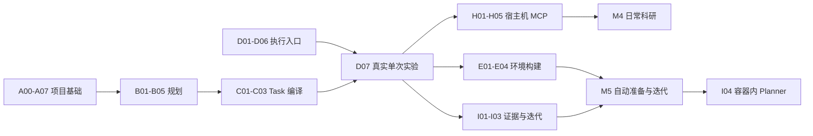

# 科研工作流开发计划：从项目初始化到实验迭代

状态：部分实施的任务分解，2026-09-18。依据 [0917 设计微调](../architecture/0917设计微调.md)。
规划基线：代码来自 `f8f47f3`，设计提案来自 `29d4565`；后续实施与集成状态见下列记录和 Git 历史。
实施更新：A00–A07 已在 `feat/project-init` 实现，交付状态与验证见
[任务记录](../changes/20260918-project-init-72a94b.md)，实际用法见 [Project 命令](../reference/projects.md)。
B01–B04 在 `feat/research-planning` 实现，B05 已通过限定范围的真实 Codex 验收，证据见
[研究规划记录](../changes/20260918-research-planning-b6f2a1.md)，使用见[命令参考](../reference/research-planning.md)。
C01–C03 在 `feat/experiment-compilation` 实现，证据见[编译记录](../changes/20260918-experiment-compilation-c42d8e.md)，
使用见[编译命令](../reference/experiment-compilation.md)。D01–D07 在 `feat/local-run-controller` 实现，
验收见[Controller 记录](../changes/20260918-local-run-controller-d73a91.md)，
使用见[本机执行命令](../reference/local-run-controller.md)。H01–H05 在 `feat/host-research-mcp` 实现，
CPU 范围验收见[H 记录](../changes/20260920-host-research-mcp-a81f2c.md)，使用见[宿主机 MCP](../reference/host-research-mcp.md)。
下文保留原任务拆分；实际集成以 Git 为准。

## 1. 从哪里开始

**A/B 批提供初始化和规划，C 批编译冻结 Task，D 批形成小型 CPU 容器科研闭环；H 批补齐宿主机 MCP 与长期 Job 的 CPU 路径；后续推进实际科研试用、环境准备和结果分析。**

第一个可验收结果是：用户提供一句研究目标和目标目录，系统创建项目框架，完整保存原始目标，
退出后重新打开仍能找到同一个项目；重复初始化不会覆盖文件。此时不需要模型、Docker、GPU 或 MCP。

第二个结果才是：宿主机 Codex 读取这个项目，与用户澄清目标，生成可保存、可修订的 Brief 和实验方案。
它先调用本地 CLI，不需要等待 MCP、Web 对话或后台规划 Agent 全部完成。

整体开发顺序：

1. 项目目录、状态和 CLI。
2. 与 Agent 协作形成 Brief 和实验方案。
3. 把一个实验编译成现有 Task。
4. 用已有镜像打通真实容器 Agent 执行与结果关联。
5. 优先完成宿主机 Agent 通过 MCP 控制训练作业的科研模式。
6. 增加自动构建环境和证据驱动的多轮迭代。
7. 扩展容器内 Planner、其他 Agent 和更完整的 Web。

与 0917 提案相比，实施时先用已有镜像验收执行，再开发自动构建；先由用户显式选择下一轮，
再实现预算内自动迭代。这样每个阶段都能独立使用，也能定位失败来自规划、执行还是环境。

## 2. 已有代码如何复用

| 已有代码 | 本轮后续工作应如何使用 |
| --- | --- |
| `records/catalog.py`、`runs/console.py` | 已有轻量 Project 及 Web 关联；保留旧数据，逐步改成新 Project 服务的兼容入口 |
| `tasks/service.py`、`tasks/authoring.py` | 复用草稿、可见视图、proposal、校验和冻结；不再建第二套 Task schema |
| `tasks/manifest.py`、`contracts/files.py` | 使用真实路径、材料可见性和摘要约束，不能仅凭示例 YAML 推断能加载 |
| `agents/registry.py` 及各 adapter | 复用 provider 发现、启动计划、认证 staging、轨迹解码 |
| `runs/service.py` | 复用 `LocalRunService` 的单 Attempt、评测与清理逻辑；外层 Controller 管调度 |
| `environments/api.py`、`environments/docker.py` | 复用一次性环境；长期科研 Job 在明确的新契约下扩展 |
| `resources/local.py`、`monitor.py` | 复用监控和 Lease；补充共享服务生命周期和重启后的核对 |
| `records/local.py`、`trajectory.py` | 原始流、事件、Artifact 和轨迹继续写入现有 Records |
| `gateways/cli/main.py`、`bootstrap/cli.py` | CLI 参数转换与对象组装各留在现有位置 |
| `gateways/http/`、`bootstrap/web.py` | 沿用现有查询服务和访问边界，逐步增加控制接口 |

规划基线没有 `projects/`；A 批现已新增该模块和工作区初始化器。MCP runtime 和自动镜像构建器仍未实现。
当前容器内 Agent 内核不等于完整研究循环；真实模型、长训练和恢复都需要分别验收。

## 3. 怎样控制 Codex 每次任务的大小

- 一次交给 Codex 一个任务编号，默认交付一个可独立评审的提交或 PR。
- 每项只完成一个外部可观察结果；通常涉及一个业务模块及必要的入口、消费者和测试。
- 一个任务同时需要新存储、新服务、新协议和前端时，应继续拆分；不要靠限制文件数漏改消费者。
- 先读依赖项实际实现，再落地本文的概念接口。本文的建议文件名不要求提前创建空文件。
- fixture 验证与真实 Agent/Docker 验证分别记录；缺少真实证据不能替代为“全部通过”。
- 每完成一批就运行该批验收，再开启下一批。不要把本文全部任务一次性交给 Codex。
- 这里的任务编号只用于计划定位；真正开工时按仓库规范创建独立 `docs/changes/<task-id>.md`。
- 每次只创建正在做的分支。集成后可按团队约定清理已合并分支，不为所有计划任务预建分支。

## 4. 里程碑与依赖

这些 M 编号是本计划的交付检查点，不替代项目原有 S0–S4 阶段。

| 检查点 | 必须完成 | 用户获得什么 |
| --- | --- | --- |
| M1：项目骨架 | A00–A07 | 一句话目标创建项目，重开可恢复，重复请求不覆盖 |
| M2：交互规划 | B01–B05 | Agent 与用户形成 Brief、Plan，换会话继续规划 |
| M3：真实单次实验 | C01–C03、D01–D07 | 使用已有镜像运行真实 Codex，归档并关联实验结果 |
| M4：宿主机科研 | H01–H05 | 宿主机 Agent 启动容器训练，查询、断连重接、停止和归档 |
| M5：自动准备与迭代 | E01–E04、I01–I03 | 从模板准备环境，依据真实结果产生并执行下一轮 |
| M6：容器内研究规划 | I04 | Planner 在容器内，通过相同服务控制多轮实验 |
| Web 配套 | W01、W02 | 在页面查看新 Project 内容并使用已有运行入口 |



D01–D06 可以在 A00 明确关联契约后使用现有 Task 样例开发。M3 的真实项目验收仍依赖 C03。
自动构建 E 不是运行已有镜像的前提；迭代 I01–I03 也可先固定镜像验证。

## 5. A 批：项目初始化（最先实施）

### A00 — 用一份短 ADR 固定最小实施约定

- **依赖/范围**：读取新提案和当前 Project catalog；只写 `docs/adr/` 决策及必要设计引用。
- **交付**：明确权威存储、工作区所有权、模块依赖、旧 Web catalog 兼容方式，以及第一版支持范围。
- **建议默认**：本机单管理员；只创建新工作区；平台 Project store 保存 revision 和事务状态；
  `project.yaml` 与 Markdown 是可导出、可审查的投影。外部修改通过显式导入校验进入新 revision，
  不做后台双向同步；`runs/index.jsonl` 仅为可重建视图，不成为第二套执行日志。
  控制面 store 与运行凭据不挂入求解容器；宿主机同用户 Agent 的文件权限不能凭目录约定隔离，
  ADR 需明确可信本机用户假设及受控 API 的保护范围。
- **验收**：明确回答“移动目录是否改变 ID”“手改文件如何处理”“数据库成功而文件写入失败如何恢复”
  “旧项目没有目录怎么办”。列出一份可实现的恢复流程，不能只写“保持一致”。
- **暂不做**：通用工作流引擎、长期 Planner、多人分布式编辑、自动 Git 初始化和已有仓库改造。

建议将研究进度与执行状态分开：Project 保持 draft/active/paused/completed 等粗粒度状态；
Brief/Plan 的草拟或确认，以及 Run/Job 状态各自维护。0917 的单线状态图可作为流程图，
不能要求一个 Project 同时运行两个实验时只有一个 `running/analyzing` 状态。

### A01 — 最小 Project 类型与校验

- **依赖/范围**：A00；新增 `projects/api.py` 和必要内部模型，相关 unit tests。
  在 `pyproject.toml` 增加 Projects 所需依赖层，保持现有导入检查的强度。
- **交付**：稳定 `project_id`、schema version、revision、原始目标、标题、状态、时间和工作区引用；
  原始目标不可被 refined goal 覆盖。定义清晰的参数无效、版本冲突、项目不存在错误。
- **验收**：结构化序列化往返；未知 schema version、空目标、非法 revision 拒绝；
  项目 ID 不由绝对路径推导；导入模块不连接数据库或启动服务。
- **暂不做**：Plan、Experiment、Docker、CLI、工作区写入。不要一开始实现所有未来模型。

### A02 — Project store 与 revision 冲突

- **依赖/范围**：A01；Projects store 契约、本地实现及存储测试。
- **交付**：create/get/list/update、`expected_revision`、初始化操作 ID 和完成阶段；
  明确区分可变 Project 元数据与不可变运行证据。
- **验收**：关闭后重新打开可读；两个写入者基于同一 revision 更新只能一个成功；
  相同操作 ID/相同参数返回同一结果，相同 ID/不同参数明确冲突；事务失败不留下半条记录。
- **暂不做**：改写旧 catalog、全文搜索、多数据库适配。旧数据适配在 W01。

### A03 — 模板渲染和初始化预览

- **依赖/范围**：A01；`projects/templates/`、纯渲染函数和少量结构校验。
- **交付**：给定目标、项目 ID 和目录得到文件清单及内容，不写磁盘；输出 `docs/`、`code/`、
  `configs/`、`data/`、`runs/`、`artifacts/` 及忽略规则。README 提供新会话阅读顺序。
- **验收**：相同输入得到相同预览；用户原话保留；runtime 数据和凭据目录进入忽略规则；
  模板通过包资源读取，安装 wheel 后仍能预览。
- **暂不做**：背景研究、随机填入方法和结果、创建空实验类、自动 Git 仓库操作。

### A04 — 安全物化项目目录

- **依赖/范围**：A02、A03；`projects/initializer.py` 及文件系统测试。
- **交付**：确认允许的父目录，使用任务自有临时目录生成并发布工作区；创建过程记录操作状态。
  对目标已存在、权限错误、符号链接和创建竞争给出稳定错误，保留用户已有文件。
- **验收**：两次创建同一个目标不会覆盖；通过链接逃逸允许目录被拒绝；中途异常不把半成品声明为 ready；
  清理只处理当前操作拥有的临时目录；并发目标竞争最多一个成功。
- **暂不做**：`--force`、自动合并非空目录、把整个宿主机 home 加入项目、Docker 启动。

### A05 — 初始化恢复与投影一致性

- **依赖/范围**：A04；Projects 恢复用例、投影修复和故障注入测试。
- **交付**：覆盖“store 已登记但目录未发布”“目录已发布但 store 未完成”等窗口；
  以操作 ID、project ID 和摘要判断是否能继续。检测用户修改过的生成文件，不能静默覆盖。
- **验收**：在各持久化边界故障后重试得到同一项目；原始目标不变；用户编辑导致明确冲突；
  不能证明归属时停止自动修复并给出恢复信息。
- **暂不做**：云同步、数据库万能修复、自动迁移任意旧项目目录。

### A06 — Project CLI 和 bootstrap

- **依赖/范围**：A05；现有 CLI gateway、bootstrap、参数测试和新参考说明。
- **交付**：规划中的 `project preview/init/show/list`，输出稳定 JSON，合理退出码；
  `init` 调用 Projects 用例，支持 state root、目标目录及操作 ID。
- **验收**：preview 没有写入；init/show 跨进程读取同一项目；非法请求有明确错误；
  现有 agent/resource/task/records/web 命令仍可使用。
- **暂不做**：HTTP、MCP、模型调用；CLI 内不复制目录和数据库规则。

### A07 — M1 验收与上手示例

- **依赖/范围**：A06；一份可复制操作说明和 CLI 集成验收。
- **交付**：在临时目录用一句目标创建项目，重开读取，重复执行，模拟失败后恢复；记录版本和证据。
- **验收**：实际目录、store、manifest 一致；第二次操作不覆盖用户文件；离开仓库安装 wheel 后模板仍可用。
- **暂不做**：以目录创建成功宣布“自动科研已实现”。M1 只验收初始化与恢复。

## 6. B 批：Agent 与用户共同形成研究方案

### B01 — Research Brief 修订与来源

- **依赖/范围**：A07；Projects Brief 契约、store、CLI。
- **交付**：背景、问题、约束、成功标准、未知项；保存 user/sourced/inference/assumption 来源和证据引用。
  创建 proposal 与确认 proposal 分开，确认绑定精确 revision/digest；已有授权范围可复用。
- **验收**：Agent 补全不改写原始目标；旧 Brief 可读取；过期 proposal 不能覆盖新内容；
  缺少来源标记的推断不能被写成 sourced，确认不会凭空补出未知数据。
- **暂不做**：自动检索系统、长期聊天服务、真实性自动判定器。

### B02 — 最小 Plan 与 Experiment

- **依赖/范围**：B01；Projects Plan/Experiment 模型、修订与 CLI。
- **交付**：研究假设、方法、控制变量、变更变量、数据引用、指标、输出、资源建议和停止条件；
  一份 Plan 可含多个 Experiment，不要求每个实验都带隐藏 evaluator。
- **验收**：新增 revision 保留旧方案；缺失字段明确；指标比较方向和数据版本可表达；
  用户修改 CPU 数量更新提案，不会直接分配 CPU；不提前引入无人值守循环。
- **暂不做**：Task 编译、费用自动估计、多阶段任意 DAG。

### B03 — 可恢复上下文与 Markdown 投影

- **依赖/范围**：B02；Projects context 查询、文档渲染和 CLI。
- **交付**：一次查询得到原始目标、当前 Brief/Plan、未决问题、下一步和已关联运行引用；
  生成 background/research-goal/research-plan 的可读内容，并标注来源 revision。
- **验收**：关闭旧会话后仅用持久文件和 API 可继续；失败的渲染可重试；
  用户编辑过的文件不被静默覆盖；摘要包含有限引用而不是全部原始日志。
- **暂不做**：聊天记录成为唯一状态、自动向量记忆、私有评测内容注入。

### B04 — 首个研究规划 Skill

- **依赖/范围**：B03；产品内 provider 无关研究说明、Codex 包装、安装/使用说明。
- **交付**：读取 project context → 提出必要问题 → 草拟 Brief → 草拟 Plan → 保存 → 返回下一步。
  Skill 调用已经实现的 CLI；固定 schema、revision 和权限由代码检查。
- **验收**：打包后说明文件可找到；不写虚构引用、数据和结果；没有 MCP 也能完成规划；
  停顿后重新进入 Skill 能识别未决问题，不重建同名项目。
- **暂不做**：修改用户全部全局 Agent 配置、自动注册不存在的 MCP 工具、泛化多 Agent 插件系统。

### B05 — M2 真实交互验收

- **依赖/范围**：B04；一个小型研究目标、用户答复和真实 Codex 交互记录。
- **交付**：在明确模型和时间预算下验证从一句话到 Brief/Plan，包含一次用户纠正和一次新会话恢复。
- **验收**：实际调用工具写入 revision；推断仍有标签；用户选择被保留；Plan 至少包含一个可理解实验；
  不是依靠测试脚本代写模型输出来宣称交互成功。
- **暂不做**：训练、Docker、任意领域科研质量评分。模型条件不可用则保留未验收状态。

## 7. C 批：把方案变成现有 Task

### C01 — 稳定的 Project/Experiment/Task 关联

- **依赖/范围**：B02；Projects 关联对象、Tasks 公共引用及必要消费者。
- **交付**：使用 task ID、revision、digest 关联实验；绝对路径只作本机解析位置。
  保存冻结的代码、配置和数据版本引用，避免同一 Task 实际读取变化中的项目文件。
- **验收**：工作区移动可重新绑定路径且身份不变；找不到材料明确失败；旧关联不被新的 Plan 改写。
- **暂不做**：全局 Task 搜索服务；Web 旧路径哈希迁移由 W01 处理。

### C02 — 材料准备与 Experiment 编译

- **依赖/范围**：C01；Projects compiler、Tasks 公开入口、小型样例和契约测试。
- **交付**：选定 Experiment 生成 manifest 和 Agent 可见说明；明确材料源根、复制/引用规则和输出根。
  当前 Tasks 要求源文件在受控根内；不得直接写 `../../data` 或用符号链接绕开校验。
- **验收**：真实 loader、view、review、freeze 可以消费生成物；未选中的项目文件不自动暴露；
  数据未提供时报告缺失；科研模式允许 `evaluation=none`，不发明 benchmark 字段。
- **暂不做**：把整个 Project 打包给 Agent、私有评测材料搬进求解工作区、改写原 benchmark 协议。

### C03 — M2 到 Task 的集成验收

- **依赖/范围**：C02、B05；增加规划中的 `project compile` 薄 CLI 和参考示例。
- **交付**：从用户确认的 Plan 选择实验，输出 Task revision 和缺失项；相同冻结输入得到相同摘要。
- **验收**：修改 Plan 后生成新 Task，不改旧 Task；来源关系能追溯；缺数据或未解决执行要求时不提交 Run。
- **暂不做**：compiler 内启动 Docker、调用模型或分配资源。

## 8. D 批：使用已有镜像完成真实单次实验

这批补上既有模块之间的执行入口。它与 Projects 通过公开契约连接，不另写一套 Docker runner。

### D01 — 请求预检与运行关联

- **依赖/范围**：A00；Runs 公共请求、Tasks/Resources/Agent 的 bootstrap 组装。
- **交付**：Run 接收冻结任务引用、可选 Project/Experiment 引用、provider、已有镜像、资源、超时；
  预检材料、Agent 能力、已批准的配置和镜像要求，返回可操作缺口。
- **验收**：预检无容器和 Lease 副作用；required tools 未绑定继续明确拒绝；
  旧 Python 调用保持兼容或有显式迁移说明；不导入 Projects 内部实现。
- **暂不做**：后台队列、镜像生成、GPU 自动扩容。

### D02 — 持久提交状态与请求幂等

- **依赖/范围**：D01；Runs 控制服务存储和 Records 关联。
- **交付**：submit/status/cancel intent、操作 ID、运行 ID 预分配或预登记契约；
  区分待执行命令、执行证据和 cleanup/release。以现有 Records Run 身份为准，避免两个 Run ID。
- **验收**：网络重试不会启动两次；同键不同参数冲突；重启仍能查询请求；
  cancel intent 不直接把实际容器标为已停止。
- **暂不做**：多次 Attempt、自动重试、按天调度。

### D03 — 单控制进程后台执行

- **依赖/范围**：D02；Runs 执行器、bootstrap、Resources 共享实例。
- **交付**：单节点先只允许一个活跃 Run；一个 controller 拥有共享 Monitor/Lease manager；
  主机级受管理资源命名空间有互斥机制，两个 state dir 不能意外管理同一批 GPU。
  使用现有 `LocalRunService` 执行，取消信号传到现有清理链路。
- **验收**：提交返回后工作继续；轮询可观察结果；重复 controller 被拒绝；
  资源不足明确返回原因，不假装已经排队；线程/进程异常留下可查询失败状态。
- **暂不做**：Ray、多个调度器、复杂公平队列、研究状态机。

### D04 — 重启对账与清理证明

- **依赖/范围**：D03；Runs 恢复、Environment 持久归属信息、Resources 占用恢复。
- **交付**：重启扫描任务自有运行和容器；首版可明确采用“中断并清理”，不承诺恢复模型对话。
  对账完成前阻止同一资源再次分配；处理 container 已退出但记录未收尾的窗口。
- **验收**：真实 Docker 下强制终止 controller 后重启；不重复求解、不误删其他容器；
  清理失败持续占用或隔离资源，不能先释放 Lease；结果标记 interrupted 而非成功。
- **暂不做**：恢复 GPU 内存里的训练进度、接管无归属容器、跨节点恢复。

### D05 — HTTP 控制入口与 CLI 客户端

- **依赖/范围**：D04；现有 HTTP/CLI gateways 和 bootstrap。
- **交付**：最小 submit/status/cancel，沿用本地鉴权；CLI 连接同一后台服务。
  同时提供受控 Artifact 读取/导出，客户端不能指定任意宿主机文件路径；必要时再独立拆一个 PR。
- **验收**：CLI 退出不终止后台运行；重复提交沿用 D02；无权限不能控制 Run；
  Records 数据在容器删除后仍可读，私有 evaluator 与凭据数据不返回求解 Agent。
- **暂不做**：Web 对话、SSE、公开网络部署、多用户权限体系。

### D06 — 已有镜像与真实 Codex 接入

- **依赖/范围**：D05；bootstrap Agent registry、认证 staging、一个固定 CPU 任务镜像及运行样例。
- **交付**：运行时选择 Codex adapter；任务依赖与 Codex 预装在测试镜像中，镜像 digest 可追溯；
  仅复制必需认证文件，结束后清理副本。安装和模型调用前明确预算及实际可用配置。
- **验收**：成功/失败路径均不把凭据写入普通 Records；配置缺失提供明确错误；
  改用 fixture 必须显式声明，不能作为真实 Agent 失败后的自动替代。
- **暂不做**：自动 Dockerfile 生成、全 provider 容器认证一次性泛化。

### D07 — M3 项目到真实执行的验收

- **依赖/范围**：C03、D06；一个小型 CPU 科研项目及真实 E2E。
- **交付**：一句目标 → Plan → Task → 容器内真实 Codex → 结果文件与指标 → Records → Project 关联。
- **验收**：包含正常执行、取消和 D04 已验证的重启行为；模型轨迹与工具结果可查询；
  清理及 Lease 释放可证明；同一实验重跑保留独立 Run；科研任务无需隐藏 evaluator。
- **暂不做**：大规模训练；本关不能用 fixture 输出替代真实模型和真实指标证据。

## 9. H 批：优先打通宿主机科研 MCP

这条路径是用户日常科研的直接入口。在固定镜像上先实现，不等待自动环境构建。

### H01 — 长期环境和 Job 契约

- **依赖/范围**：D04；Environment 公共 API、Runs 科研运行用例。
- **交付**：研究 Run 绑定环境；定义 Job 的 start/status/logs/stop、工作目录和文件范围；
  保留已有一次性 solver 契约。区分一个研究 Run 内的命令 Job 与新的独立实验 Run。
- **验收**：两个项目不能借环境 ID 互相执行；同一环境里每个 Job 有独立状态和日志游标；
  关闭 Agent 会话不自动释放仍有作业的资源；环境终止才清理并释放。
- **暂不做**：MCP、SSH、PTY、任意 Docker 管理。

### H02 — Docker 后台 Job、文件与日志

- **依赖/范围**：H01；Environment 本地实现和真实 Docker E2E。
- **交付**：同一受控容器中启动后台 Job，执行命令、限范围读写文件、读取增量日志、停止完整进程组；
  输出归档到 Records。请求生命周期与作业生命周期分离。
- **验收**：客户端断连后 Job 继续；日志从游标续读；停止能处理子进程；
  controller 重启按 D04 策略对账；文件访问拒绝越界和符号链接绕过；现有 solver 测试仍通过。
- **暂不做**：终端模拟器、无限日志缓存、容器内 SSH 服务。

### H03 — 最小 MCP Gateway

- **依赖/范围**：H02、B03、D05；`gateways/mcp/` 和 bootstrap。
- **交付**：先使用 stdio，连接独立控制服务；暴露 project context、申请/绑定环境、执行/启动 Job、
  状态/日志/停止/产物等最小工具。安装固定 SDK 时同步依赖锁与对应接口文档。
- **验收**：工具 schema 能被客户端发现；每次执行检查绑定权限；没有任意主机 Shell 或 Docker socket；
  MCP 退出不终止 Job；正常/错误响应与公共 API 对齐。
- **暂不做**：MCP 同时充当后台调度器、全局修改所有 Agent 配置、多节点传输。

### H04 — 平台操作轨迹与宿主机 Agent 来源关联

- **依赖/范围**：H03；Records 公共事件、Agent 适配和平台工具调用关联。
- **交付**：项目、外部会话、研究 Run、Job、tool call/result 使用稳定关联 ID；
  可获得的宿主机原始轨迹通过显式导入/采集接入已有归一化，标注捕获范围及缺口。
- **验收**：一条工具调用可追到命令、日志和产物；重复采集不重复计数；
  无法获得宿主机原生轨迹时写明 partial，而非声称记录了平台外全部命令。
- **暂不做**：用 Docker logs 推断所有 Agent 行为、读取无关个人会话。

### H05 — M4 真实宿主机科研验收

- **依赖/范围**：H04、D07；真实宿主机 Codex 和固定训练镜像。
- **交付**：用户描述目标，Agent 通过 MCP 启动作业，读取指标、修改参数、再运行并归档。
- **验收**：真实关闭 MCP 后作业仍运行，新连接能查日志和停止；先 CPU 小实验，
  有 GPU 资源授权后再验证指定设备和实际小训练。未测 GPU 时仅接受 CPU 能力。
- **暂不做**：以 CLI adapter 单测代替 MCP 工具真实调用证据。

## 10. E 批：自动环境准备

实施状态：E01–E04 在 `feat/environment-preparation` 落地 Python CPU 范围；
基于 H 分支，不代表已合并 main。支持公开 wheel 的受限构建、独立 smoke、版本锁、预算内 MCP 修复和 H/D 引用。
E04 已用真实 gpt-5.6-sol 完成缺依赖修复及锁定环境执行；具体检查与限制见
[E 记录](../changes/20260920-environment-preparation-e92b6a.md)、[使用指南](../reference/environment-preparation.md)。

### E01 — 环境方案与锁定结果

- **依赖/范围**：C02、D06；Environment 构建提案契约及 Project 引用。
- **交付**：intent/proposal/lock 分开；记录模板、依赖、构建上下文、基础镜像、网络和 Agent 层；
  选择已有镜像时直接解析并固定实际 digest，不误报“自动构建”。
- **验收**：运行输入绑定精确锁定方案；修改依赖会使旧验证失效；秘密内容不进入 lock。
- **暂不做**：运行任意模型生成 Dockerfile。

### E02 — 一个模板的构建器

- **依赖/范围**：E01、D04；Environment 构建实现、CPU 模板和构建记录。
- **交付**：先一个 Python CPU 模板，最小上下文白名单、资源/时间上限、构建日志和 image digest；
  构建由可信执行器负责，缓存以输入 digest 和工具版本为依据。
- **验收**：真实构建可启动；超时/取消不遗留任务自有构建进程；上下文不带整个项目 data/credentials；
  相同输入缓存命中可解释，变更输入不能复用旧结果。
- **暂不做**：GPU 模板矩阵、任意 Dockerfile、自动修复。

### E03 — 环境 smoke 与就绪判断

- **依赖/范围**：E02；独立验证步骤及 Environment 结果契约。
- **交付**：在新容器检查依赖、Agent 可执行文件、工作区和输出；GPU 检查只在指定 GPU 范围内执行。
- **验收**：build 成功但 import 失败必须判为未就绪；失败日志可查；验证容器清理；
  Run 只接收验证通过且未过期的锁定结果。
- **暂不做**：认为 smoke 通过即可证明科学方法正确或全部 GPU 兼容。

### E04 — Agent 提案与有限修复

- **依赖/范围**：E03、B04；规划工作流、构建提案接口和有界修复过程。
- **交付**：Agent 根据依赖推荐模板，读取构建/smoke 错误后提出修订；
  在已授权预算和范围内自动重试，超限才请求新决策，保留每一版来源。
- **验收**：一个可修复缺依赖例子完成闭环；永久失败达到上限停止；
  不会通过关闭校验、扩大挂载或泄露凭据来让构建“成功”。
- **暂不做**：保证任意自然语言目标都能可靠构建任意环境。

## 11. I 批：分析、决策和后续迭代

### I01 — 实验结果与 Analysis 证据引用

- **依赖/范围**：D07；Projects analysis 用例、Records 公开查询、结果 schema。
- **交付**：可追溯的指标/单位/比较方向、数据/代码版本、Run 与 Artifact 引用；
  Agent 根据真实结果写观察、解释、不确定性和下一轮建议。
- **验收**：不存在的 Run/Artifact 引用拒绝；不同数据版本不能默认排序为优劣；
  失败运行保留，手工修改研究结论不改变原始执行证据。
- **暂不做**：通用时间序列数据库、自动科学真实性裁判。

### I02 — 用户决策生成下一版计划

- **依赖/范围**：I01、B02、C03；Projects decision 与 Plan 修订。
- **交付**：接受/修改/拒绝建议、原因及授权来源；创建 Plan N+1 和新 Experiment；
  初期用户显式触发，随后复用同一个 compile/submit 入口。
- **验收**：拒绝不启动运行；确认旧 revision 报冲突；新实验可追溯到前次证据；旧 Task 和 Run 不变。
- **暂不做**：自动替用户改变原始目标、后台无限试错。

### I03 — 预算内自动迭代

- **依赖/范围**：I02、D04；Projects 工作流状态、controller 动作和授权策略。
- **交付**：限制实验次数、并发、时长、资源及可观测费用；每步持久化动作 ID，
  依据已有授权继续，只有超范围或关键未知才暂停。代码检查预算，Skill 提供下一步建议。
- **验收**：重启不重复提交已启动实验；两次并发决策不突破预算；
  达到停止条件不再创建 Run；费用不可观测时明确限制，不能声称提供精确费用硬上限。
- **暂不做**：通用 DAG 引擎、自动通过失败的验收标准。

### I04 — 容器内 Planner

- **依赖/范围**：I03、H03、E03；Agent 托管组装、Project context 和运行内工具接入。
- **交付**：Planner 可重启，状态存储在容器外；通过已实现的窄 API 请求 Run，
  实验由独立容器执行，不把 Docker socket 或私有 scorer 材料交给 Planner。
- **验收**：固定小项目做两轮实验；替换 Planner 容器后恢复；调用相同 Projects/Runs 接口；
  benchmark 使用原协议时，不额外引入未经允许的人工反馈、预算或重试。
- **暂不做**：要求所有用户必须使用长期 Planner；单次容器任务仍可独立运行。

## 12. W 批：Web 随业务增量接入

### W01 — 统一 Project 入口与旧数据兼容

- **依赖/范围**：A07、B03、C01；现有 Project catalog、console、HTTP 和前端 Project 页面。
- **交付**：已存在 Project 保留 ID、目标、里程碑和关联；无工作区项目标记为未绑定；
  新 Project 与 CLI 共用同一服务，路径哈希关联显式映射，无法解析的记录保留待处理。
- **验收**：迁移前后数量和关联一致；不因浏览旧项目自动创建目录；重复迁移幂等；
  可查看 Brief/Plan/未知项/工作区绑定状态。
- **暂不做**：破坏性删除旧 catalog、Web 自动聊天；迁移和页面较大时拆为两个顺序 PR。

### W02 — 实验提交、取消、结果与分析展示

- **依赖/范围**：W01、D05、I01；现有前后端接口及页面测试。
- **交付**：选择已确认实验并提交，查询状态、取消、查看证据及分析；
  capabilities 依据真实后端能力，未接入功能不给可点击的假按钮。
- **验收**：刷新页面恢复 Run；取消传到后台；项目/Run/Job 状态分别显示；
  Artifact 访问沿 D05，私有内容过滤仍有效。
- **暂不做**：先新建一套漂亮页面再临时拼接执行逻辑、移动端完整重构。

## 13. 最近两轮应该直接交给 Codex 什么

**第一轮只做 A00。** 产出短 ADR，决定状态权威、目录所有权、恢复步骤和旧 catalog 兼容方式。
这份 ADR 应提供具体推荐和可审查决定，不只是把问题重新列给用户。

**第二轮只做 A01。** 实现最小 Project 类型、校验和依赖边界。不要同时写 Skill、改 Web 或启动 Docker。

之后按 A02 → A03 → A04 → A05 → A06 → A07 顺序推进。
可选并行仅限 A02/A03（A01 接口确定后），其他依赖需要真实落地才能继续。

每轮无需给 Codex 整份聊天历史，提供以下模板即可：

```text
实现 docs/development/research-workflow-implementation-plan.md 中的 A01，仅此任务。

先读 AGENTS.md、project-status.md、相关任务记录和 A00 ADR。
核对 A00 已落地的决策；本文建议名与代码冲突时以已确认契约为准。

任务目标：最小 Project 类型、序列化和校验。
范围：projects 公共契约、必要内部类型、对应测试、导入边界和文档。
不包括：store、目录创建、CLI、Skill、Web、Docker、计划中的后续任务。

逐条满足 A01 的验收标准，复用仓库现有工具和依赖。
在独立任务分支完成实现、针对性测试和必需检查，更新任务记录并提交。
交付时列出接口、实际测试结果、未验证范围、分支和提交。
依赖未满足时报告具体缺口，不用假实现把任务标为完成。
不要自动实施 A02；不要自动合并或发布。
```

实现记录应足够让下一个 Agent 找到公开契约、真实入口和验证命令；不要只写“已完成基础能力”。

## 14. 多人协作与集成责任

如果后续安排四人，可按相关性分工；本轮没有实际启动并行实现。

| 角色 | 主要任务 | 交接内容 |
| --- | --- | --- |
| A：项目与规划 | A、B、C、I 的研究内容 | Project/Brief/Plan/Experiment/Task 关联、context、分析与决策 |
| B：环境与资源 | D03/D04 的执行后端、H01/H02、E | 环境、Job、资源、构建结果和清理证明 |
| C：控制与 Agent 接入 | D01–D07 的集成、B04、H03/H04、I03/I04 的控制 | 提交/取消、provider 组装、MCP、预算和恢复 |
| D：记录与界面 | W、Records 查询/证据导出，支持 I01 | 轨迹关联、稳定查询、旧 catalog 适配、页面 |

交叉任务指定一个主提交者：A 定研究语义，C 集成控制；B 提供执行契约，D 提供证据查询。
`bootstrap`、公共 DTO、依赖声明和文档导航不由多人同时改。并行开发使用独立 worktree、端口和状态目录。

当前计划分支基于未合入的设计分支。正式实现前先核实提案和本计划已进入团队约定基线；
不要从缺少这些契约的旧 main 各自推导不同实现，也不要预先创建几十个分支。

## 15. 验证与计划维护

- 文档任务：本地链接、差异和依赖顺序核对。
- 每个代码任务：相应 unit/contract/integration，加仓库要求的静态、导入与构建检查；
  当前统一入口为 `make verify`，新增测试命令在实现后写入真实参考文档。
- 涉及包内模板/Skill：验证 wheel 安装后的资源读取，避免只在源码目录有效。
- D04、D07、H02、H05、E02/E03 和 I04：按任务的实际接受范围执行 Docker/模型/GPU 验收；
  先记录节点、资源、时间和费用范围，清理仅限任务自有对象。
- 外部条件不具备时保留 `not_run` 和未验收范围；契约替身测试与实机验收各自有价值，不能互相冒充。
- 记录具体失败、取消、重试和恢复证据；不根据 Agent 的口头完成声明推定状态。
- 本文记录计划和依赖，不维护第二套全局日志。具体完成事实进入各任务记录与 Git；
  一个里程碑验收并集成后再更新 `docs/project-status.md`。

暂缓：Ray/跨节点、多租户、任意自动 Dockerfile、全 Agent 功能对齐、训练框架专用 RL 导出、
通用 workflow engine。先让一个用户、一个项目、一个 Agent、一个节点完成可恢复的真实科研过程。
