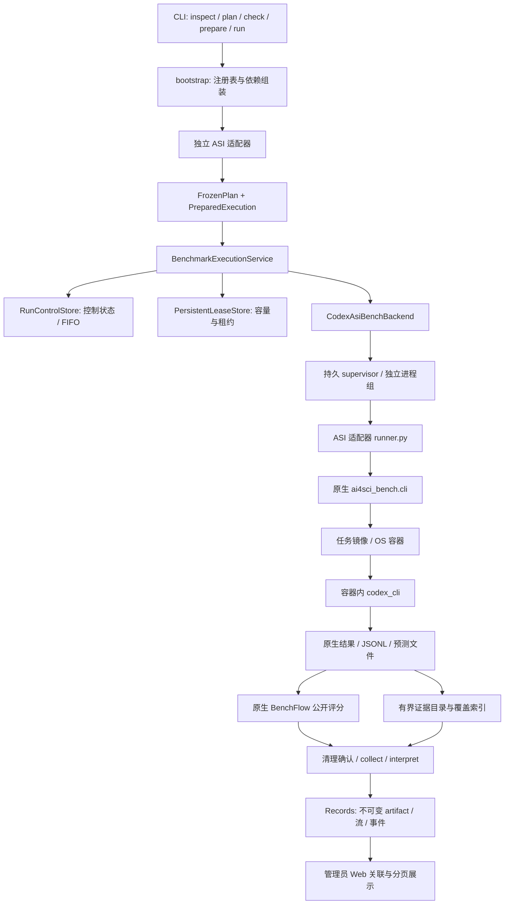

# 0926 框架详细说明：模块边界与 Benchmark 调度全链路

日期：2026-09-26。依据：`a494197` 上的实际实现及本轮维护分支；重构只整理内部职责，不改变已有 CLI、冻结计划、状态库和原生评分协议。本文描述已实现行为，未来能力单独标注。

本文的核心例子是 ASI-Bench 的 `math.sigma_linear_diophantine__seed31415`、`b1`、`codex_cli`、`gpt-5.6-sol`、Docker `--sandbox os`。它已有公开单实例真实验收，不等于完整榜单验收。操作命令见 [ASI 试运行手册](../operations/asi-bench-native-trial.md)，原始验收摘要见 [Codex OS 任务记录](../changes/20260925-asi-codex-os-traces-7e4b2a.md)。

## 1. 当前框架究竟负责什么

框架管理「一次工作如何被允许执行、在哪里执行、执行到什么状态、产生了什么证据」。Benchmark 自身仍然决定题目、提示级别、允许材料、求解协议、评分和官方提交要求。

因此，接入 ASI 后不需要把它的评分器重写成 Infra 的 Tasks evaluator，也不需要把 ASI 原生 Codex 适配器替换为 Infra 的 Agent adapter。外层管理一次原生运行，内层遵循 ASI 原协议。这样才能复用其他 bench 已成熟的 runner。

框架现有两条业务入口：

| 路径 | 输入与主要责任 | 执行方式 |
| --- | --- | --- |
| 科研 | Project、Brief、Plan、Experiment、冻结 Task；记录实验与人工决定 | Controller/长期科研环境/Planner 经 Environment、Agent 等契约执行 |
| Benchmark | 独立适配包、原生来源、候选配置、FrozenPlan、PreparedExecution | BenchmarkExecutionService 经适配器提供的原生 backend 执行 |

两条路径共享 Records、资源相关能力和底层执行设施，但状态目录和业务协调器并不完全相同。不能因为它们都能启动任务就删除其中一条；未来统一内核需要先对齐生命周期、恢复及权限契约。

## 2. 仓库结构与职责

```text
src/agent_infra/
  contracts/      基础共享类型、文件操作等，保持依赖独立
  agents/         Codex、Claude Code、DSH 等平台 Agent 接入
  tasks/          任务材料、可见性、执行与评测要求
  environments/  Docker/进程执行、工作区、后台 job、清理与恢复
  resources/     主机观测、本地资源处理、Benchmark 持久租约账本
  records/       Run/Attempt、事件、原始流、内容寻址产物与查询
  projects/      科研项目、规划、分析；Benchmark Campaign 候选与预算策略
  benchmarks/    适配器 SDK、包注册、冻结计划、能力校验及提交契约
  runs/          执行生命周期与跨模块业务协调
  bootstrap/     选择实现、组装依赖、处理应用入口动作
  gateways/      CLI、HTTP、MCP 等协议转换
src/web/         管理员控制台
adapters/        独立安装的原生 benchmark 适配包
```

`bootstrap/benchmark_execution.py` 与 `runs/benchmark_execution.py` 名称相近，但职责不同：前者选择适配器、存储和 backend，并分发 CLI 动作；后者管理队列、启动、轮询、取消、收集和释放。HTTP 不直接调用 Docker，通用 Run 协调器不写 ASI 的 task ID、评分规则或镜像构建逻辑。

`adapters/asi-bench/` 内部结构：

| 文件 | 职责 |
| --- | --- |
| `__init__.py` | 发现固定版本原生实例、构造计划、校验材料、构造调用与解释公开评分；提供 fixture 基线及可覆盖的扩展点 |
| `codex.py` | Codex OS profile：候选、模型、网络参数、资源请求、证据解释、后端选择 |
| `request.py` | 原生请求的有界、不可变字段及固定上游版本 |
| `runner.py` | 原生 CLI 调用、结果身份核对、证据归档入口、BenchFlow 评分与摘要 |
| `backend.py` | fixture 受管进程后端；Codex 子类增加专属 Docker 清理与能力声明 |
| `docker_proxy.py` | 包装本次原生 Docker 命令，添加 owner label、构建网络配置、身份及 stats 采样 |
| `evidence.py` | 根据原生结果引用复制 sidecar、记录覆盖状态、派生规范轨迹与有界视图 |
| `fixture_agent.py` | 无模型工程测试用模拟 Agent，不能代表真实 Agent 能力 |
| `bundle.py` | 调用上游逻辑生成 seed42 本地提交包，不负责上传 |

## 3. 本轮整理做了什么

1. 将 Docker 扩展能力与清理实现归入 `CodexAsiBenchBackend`。fixture 后端只声明其真正拥有的进程能力，避免无 Docker 的模式也带上容器职责。
2. 将“主摘要缺失时仍解释已有证据”的分支统一放入适配器基类已有扩展点，删除 Codex 子类重复的 `interpret()` 包装。
3. 将 Benchmark 轨迹详情拆为 `benchmark-trajectory.tsx`，由详情组件持有分页和请求；页面只负责选择 Run。用 Run ID 作为 React key，切换 Run 时重建分页状态。
4. 保留原生 runner、归档器、Docker 观测器的独立文件，避免把运行、证据解释和界面逻辑合进一个模块。

本轮没有发现可以安全删除的整个业务模块。`runs/service.py` 较大，科研和 Benchmark 的部分流程也仍有相似之处，但其输入、授权及评测边界不同；仅依据文件长度或名称相似就合并会增加风险。后续应按具体用例提取共享步骤，并用两条路径的恢复测试证明等价。

## 4. 调用链总图



这条链的调度主体是本机持久队列和租约账本；当前不经过 Ray、远程 Worker 或集群节点选择。

## 5. 从请求到冻结计划

### 5.1 显式启用适配包

`AdapterRegistry` 按 `adapters.toml` 的 alias、distribution、version、entry point、SDK version 加载已安装包。安装一个包并不自动授予其执行权限。适配包是可信本地 Python 代码，allowlist 是加载边界，不是把恶意 Python 代码隔离的沙箱。

ASI 有两个入口：`asi-bench`（fixture）和 `asi-bench-codex-os`（真实 Codex OS）。两者仍使用同一固定上游 revision，不能只修改 fixture 的 agent 字符串就获得完整真实运行链。

### 5.2 inspect：发现实例

`discover()` 要求来源是固定 ASI checkout 内一个公开 `__seed31415` 目录，并核对选定材料未修改、公开 reference 存在、已安装 runner 版本符合要求。它生成 Catalog：suite、source revision/digest、runner digest、WorkUnit。

本例一个 instance 对应一个 WorkUnit。它不是一整个 suite，也不把内部每次工具调用拆为平台 Task。

### 5.3 plan：固定协议与请求

PlanRequest 包含 selection、CandidateRef 和参数。CandidateRef 记录候选标识、agent/version、模型和配置摘要；参数包括 tasks_dir、prompt_level、timeout_seconds，以及 Codex 的 effort/proxy/network。

适配器构造 ExecutionPlan，固定一个原生阶段 `native-produce-and-public-score`：

- owner 为 `native`，backend 为 `asibench-native-v1`。
- 请求 4 CPU、8 GiB、GPU 0；当前 Codex profile 对应上游固定默认值。
- 原生超时 300 秒时，外层墙钟预算为 420 秒（额外 120 秒供外层准备/处理；不保证首次镜像构建一定能完成）。
- 内层使用原生单次尝试设置，平台不自动重试该原子单位。
- 固定 instance、task/scorer、公开 scorer policy 的路径与内容摘要及读者范围。

FrozenPlan 再封装适配器身份、来源快照、catalog 摘要和总 digest。它是可审核且不可静默改变的执行依据，不是数据库中的运行状态。

### 5.4 check：校验声明

检查会重新发现来源、重新生成计划并核对 digest，以及精确的 adapter/version、suite/runner digest、profile、agent/version、model、backend 组合。后端 required features 也必须被声明。

`compatible=true` 仅表示这些声明匹配；不是 Docker daemon、认证、网络或模型可用性的探测。`runtime_ready=false` 在此阶段是正常结果。

### 5.5 prepare：冻结实际命令

调用适配器的 invocation，生成 PreparedExecution，包含固定 Request JSON、实际 Python module 命令、timeout、取消宽限期、日志与归档边界、允许收集的输出路径。输出放在不可变源目录之外，避免规划文件自己污染来源摘要。

执行时再次核对 prepared 内容和适配器生成结果，避免同一版本的适配包被修改后仍悄悄执行旧计划。

## 6. 提交、排队与资源准入

`benchmark run` 先核对执行范围确认参数和能力声明。对 ASI 原生后端关键开关是 `--allow-native-runtime`；它不会因为还传了 `--allow-host-process` 就变成普通进程 profile。

`BenchmarkExecutionService.submit()` 以 operation_id 查重。同一个 operation_id 和相同请求返回既有 Run；相同 ID 搭配不同请求会拒绝。每次 Run 有独立 run_id、attempt_id、工作区、记录上下文。

控制库把新请求写为 `queued` 且记录 `launch_authorized=true`。在控制锁内依次检查：

1. 是否已经请求取消；未启动的取消可直接终结。
2. 预算组是否还有足够的预留墙钟预算。
3. 是否处于 FIFO 队首；后面的请求等待前面的准入。
4. `PersistentLeaseStore.acquire()` 是否可以授予持久资源租约。

| 判断 | 行为 |
| --- | --- |
| 请求本身超过管理员配置总容量 | `UNSATISFIABLE`，终结失败，不启动 |
| 总容量够，但被既有租约占用 | `WAITING`，保持 queued，并列出 shortages |
| 可以准入 | `GRANTED`，保存 lease_id/owner_epoch，进入 accepted |

默认容量只约束一个活动租约。CPU、内存、GPU 数值容量只有管理员配置后才参与相应总量准入；它不会根据实时宿主机空闲率自动推导安全并发，也无法感知所有框架外任务的占用。

FIFO 可能出现队首大任务阻塞后面小任务的情况；目前没有回填调度、优先级或抢占。并发容量可以配置，但原生 ASI 一次 invocation 的 `--parallel 1` 与外层并发 Run 数是两件事。

## 7. 四种资源信息必须分开读

| 信息 | 来源 | 含义 |
| --- | --- | --- |
| requested | 冻结阶段的 ResourceRequirements | 这次任务声明需要什么 |
| authorized | 获准的持久租约 | 本状态目录账本允许占用什么 |
| actual allocation | 后端分配证明；ASI 另存 Docker inspect | 执行环境实际获得的设备或限额 |
| usage | 进程观测；ASI Docker stats 单独保存 | 实际运行时采样的使用情况 |

ASI 的外层 Linux 进程统计不能表示容器中所有 CPU/内存/I/O。它的容器 ID、image ID、NanoCpus、memory limit 和 stats 位于 `native_result.evidence.docker` 与观测 JSONL；通用 `resource_accounting.actual_allocation` 仍可能为 null。这并不与 Docker inspect 的单独证明冲突。

Docker stats 是采样，可能错过峰值；`usage_status=sampled` 不代表连续完整测量。采用 host network 时网络统计也不能当作独立容器网络归因。

## 8. 谁真正启动进程，如何避免重复启动

准入后协调器先调用 `backend.reconcile(attempt_id)`：

- `not_submitted`：只有不存在原生启动意图且具备已保存授权/租约时才允许提交。
- `known`：复用已保存的 native identity，继续观察。
- `unknown`：身份不确定，进入 quarantined，保留占用，不盲目重启。

ManagedProcessBackend 先持久保存 spec 和 launch intent，再启动独立 supervisor。后者在独立进程组运行命令，保存 boot ID、PID、启动时间等身份。组合身份比只存 PID 更能防止 PID 重用误操作。

如果“已经启动，但响应丢失”，上层只对账，不自动再起一个容器。若“只写了启动意图，实际进程没起”，也可能保持不确定，需诊断；这是偏保守的恢复策略，不保证所有崩溃窗口自动恢复。

`benchmark status` 会推进状态，并非纯读取；`events`、`artifacts` CLI 也先经 status 路径。`benchmark worker` 循环推进未完成请求，`reconcile` 做一轮。没有持续 worker 或周期调用，排队任务不会自己后台自动准入，终态产物也可能尚未收集。Web 的读模型不会替代 worker。

## 9. ASI 内部如何运行 Codex

外层 supervisor 启动 `agent_infra_asi_bench.runner`。runner 再核对 instance、task 和 scorer policy 的内容摘要，然后调用原生：

```text
python -m ai4sci_bench.cli run
  --tasks math.sigma_linear_diophantine
  --prompt-levels b1
  --instances-dir <实例父目录>
  --tasks-dir <固定 checkout>/tasks
  --agent codex_cli
  --agent-config <model/effort JSON>
  --sandbox os --parallel 1 --retries 1 --timeout 300
  --output-dir <本 Run 工作区>/native
```

ASI 负责组装 prompt、公开数据和任务 Python 环境、构建镜像、只读挂载当前用户的 Codex 认证文件、在容器内启动原生 Codex。此处不使用 Infra `agents/codex.py` 管理内层决策循环，也不挂载整个宿主机 Codex 目录。

Infra 的任务私有 Docker CLI 包装器通过 PATH 被原生 runner 使用，仅对匹配的 ASI Agent 容器加入 `agent-infra.asi-run=<run_id>` label，并轮询 inspect/stats。其他 Docker 子命令通常透传；显式选择 host network 时，镜像 build 也用 host network，以便构建过程访问宿主机环回代理。

ASI 上游镜像安装的 Codex CLI、基础镜像缓存和网络条件仍影响可重复性；固定 ASI runner revision 不等于同时固定最新 npm Codex 包版本。Records 保存 image identity，但后续还应完善 CLI 版本与镜像供应链固定。

## 10. 求解、公开评分与正式榜单

Codex 在任务工作区产生 `analysis.py`、CSV 等原生要求的文件。ASI 输出包含 task_id、instance_id、prompt_level、Agent 状态、sandbox provenance、persisted_outputs 和原始流引用。

适配器只接受本次计划对应的身份，要求预测目录为本地安全路径。Codex profile 要求原生 OS Docker provenance，随后调用原生 `score_manifest_file()`，生成 BenchFlow manifest、score 和 native-result 摘要。

当前适配器在宿主机 runner 进程中调用 BenchFlow 公开评分函数，未通过 Infra 通用 Environment 另建可信评测容器。评分器是否执行预测代码及采用什么隔离由原生实现决定；不能把求解阶段的 Docker 隔离推断为整个评分阶段也隔离。私有答案的隔离评测契约与这条公开原生路径需分别审查。

`seed31415` 使用公开本地评分，解释器只有在 `official=false` 等条件明确时才暴露 `local_public_score`。进程成功退出、原生 attempt 完成、评分有效、官方提交成功分别是独立事实。

当前 seed42 bundle 入口只生成本地提交包；没有在这个 profile 中自动运行完整 seed42、认证上传或读取官方评分。也没有修改原生 benchmark 规则来人为补齐未开放的字段。

## 11. Records 具体保存什么

外层记录包含 Run/Attempt manifests、幂等生命周期事件、受大小约束的 combined log、native-submission artifact、解释结果和资源账目。产物本体通过内容摘要引用，不把运行数据写进 Git。

ASI 证据归档还包括：

| 内容 | 保存与读取方式 |
| --- | --- |
| 原生结果 JSON、预测文件、评分文件 | 原生输出允许列表内归档 |
| Codex stdout JSONL、stderr | 按原生 result 指定的同目录文件名复制；拒绝越界和符号链接 |
| 原生规范 trajectory | 原生文件存在时保存；否则从完整 JSONL 经固定上游 extractor 派生 |
| 调用证据 | 保存可用 model_calls sidecar；当前上游常无此文件，另从 JSONL 读取 thread/turn/usage |
| Docker 身份与资源样本 | `docker-observations.jsonl`；摘要单独放 evidence.docker |
| 覆盖索引 | `evidence/index.json`，记录缺失、无引用、派生、截断、摘要和大小 |
| Web 视图 | `trajectory-view.json`，最多 2000 步、单步文本最多 4000 字符 |

sidecar 单文件最多 64 MiB、总复制预算 192 MiB，整个 Codex artifact 上限 256 MiB。达到边界时需要查看每一项 capture_status；外层 `capture=complete` 只说明声明输出收集状态，不能推出每个可选上游文件都存在。

原始 JSONL 是上游持久化的可见输出，可能已经经过上游脱敏；不是底层模型所有请求、隐藏推理或 token logprob 的完整记录。规范轨迹是派生视图，不能宣称可以无损重放或直接满足所有 RL 数据要求。

## 12. 收集、清理与恢复顺序

正常终态处理：

```text
观察到原生进程结束
→ 确认本次进程组清理
→ Codex 后端确认本次 label 的 Docker 容器清理
→ collect 固定允许输出
→ Records 提交 artifact
→ adapter.interpret 解释已固定结果
→ finish_attempt / finish_run
→ 释放租约
→ 控制库标记 finished
```

文件收集拒绝特殊文件和符号链接，执行有界复制并支持中断续传。先收集证据再释放资源是刻意设计：如果发生归档错误，保持 `collecting` 和占用，以便下次重试收集，不能重新调用 Agent。

| 故障 | 当前处理 | 维护时不能破坏的规则 |
| --- | --- | --- |
| 镜像构建/认证/网络失败 | 保存可用原生失败结果与日志；如果有 result 则尽早写证据索引 | 不能补一个 fixture 冒充成功 |
| 超时或用户取消 | supervisor 管理自己的进程组；Codex 后端处理自己 label 的容器 | 不停止其他任务的容器 |
| Docker daemon 不可用，清理无法确认 | 保留不确定状态和租约 | 不把发出 rm 命令等同于成功释放 |
| 归档失败 | collecting，保留源目录，重试收集 | 不重跑求解 |
| Records 已终结而控制库未更新 | 从已保存 attempt result 完成控制状态与租约释放 | 不生成第二份执行 |
| 原生身份不明 | quarantined 并要求继续对账 | 不以缺响应为理由重复启动 |

资源账本、控制库和 Records 是不同存储，没有跨三个数据库的单个事务；恢复逻辑正是为了处理这些提交顺序之间的崩溃窗口。

## 13. 状态目录与关联标识

```text
<state-dir>/benchmarks/
  control.sqlite3          请求、队列、取消、handle、终态摘要
  control.lock             本地跨进程控制锁
  leases/leases.sqlite3    容量、资源 claim、native ID、租约历史
  native/<operation hash>/
    spec.json / launch.json / owner.json
    combined.log / result.json
    collecting/ / collected/
  workspaces/<run_id>/     原生 runner 的可写运行区
  records/                元数据、流与内容寻址 artifact
  campaigns/              可选候选与优化策略状态
  compatibility.json      可选兼容性证据矩阵
```

`operation_id` 是调用方幂等键；`run_id` 是一次平台运行；`attempt_id` 是本次执行尝试且作为后端 operation；`native_id` 在 ASI 后端是外层 supervisor 身份；Docker container ID 是子执行身份；Codex thread/session ID 是 Agent 对话身份；instance_id/prompt_level 是原生任务维度。它们不可相互替代。

Web 用 run_id 定位该 Run 的 result 和 attempt，再按 artifact_id 核对 Records 中所属 artifact，读取固定 trajectory-view 成员分页。它不是按任意宿主机路径读文件。当前页面每 5 秒读取持久化数据；ASI 的轨迹详情在完成归档后可用，不是容器内实时 token 流。

## 14. 自动迭代与其他 benchmark 的接入边界

Campaign 已有候选 lineage、授权变更范围、累计预算、提交去重、停止和选优基础。但原生适配器需要明确哪些反馈可公开、哪些参数可修改；当前四个原生参考适配器没有全部开放 optimizer 反馈。因此“可运行 ASI 单任务”不能推出“已自动迭代刷榜”。

接入新 bench，优先写独立适配包的 discover/plan/validate/invocation/interpret；有特殊容器或 scheduler 生命周期时实现原生 backend 扩展。保持原生 atomic unit：ASI 当前为 instance，PAST 为完整 family 对照序列，PostTrainBench 为原生训练 job。复用持久队列、Records 和 Web 概览，避免复制一个通用调度器。

适配包可以覆盖很多差异，但不能保证任意新协议零核心修改。例如跨节点执行、交互式实时桥接或全新恢复语义可能需要新增通用契约。目前 Ray/Worker、多节点认证调度未落地。

## 15. 后续维护优先级

1. 在不改变已验收结果的基础上固定 ASI 镜像和 Codex 版本，补取消/构建失败的真实环境回归；当前样本只验证公开单实例。
2. 原生完整任务集选择、聚合及 seed42 正式运行/提交分阶段建设，分别声明验收范围。
3. 将原生 Docker 分配证明与通用 resource_accounting 对接，并在跨节点之前明确资源发现与账本容量的关系。
4. 轨迹接口当前只针对 ASI，有新 adapter 的轨迹需求时再提炼通用投影契约；不要提前建立多个重复的轨迹管理器。
5. 科研和 Benchmark 共享底层能力应以具体恢复测试为依据，逐步抽取；保留各自的任务和授权语义。

## 16. 建议阅读顺序

先读 `gateways/cli/benchmarks.py` 看命令，再读 `bootstrap/benchmark_execution.py` 看组装，随后读 `runs/benchmark_execution.py` 的 `submit → _advance → _collect → _finish`。资源判断在 `resources/persistent.py`，预算在 `runs/benchmark_budget.py`；原生启动/恢复在 `environments/managed_process.py` 与 `_process_supervisor.py`。最后沿 ASI `codex.py → runner.py → evidence.py` 阅读，并对照 `bootstrap/benchmark_console.py` 和 Web `benchmark-trajectory.tsx` 理解数据如何展示。

相关文档：[总体代码能力审阅](current-code-and-capability-review.md)、[Benchmark 执行实现](benchmark-execution.md)、[ASI 实现路径](benchmark-asi-bench.md)、[队列操作说明](../operations/benchmark-queue.md)、[本轮维护记录](../changes/20260926-framework-maintenance-c82e61.md)。
