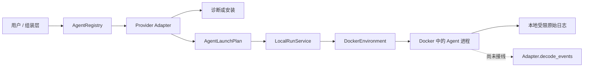

# Agent 模块实现解读

状态：解读当前 `main` 已实现的 Agent 代码及其与首版 Run/Environment 的连接；真实模型
Agent、事件解码接线和持久 Records 仍未验证或实现。

## 1. 这部分代码解决什么问题

Agent 模块的目标，是把 Codex、Claude Code、DeepSeek Harness（DSH）等不同产品包装成一套稳定接口。上层只选择 provider 并提交统一请求，不需要知道某个 CLI 的参数、配置目录或事件格式；下层 Environment 只消费一份进程启动计划，不需要理解是哪一种 Agent。

Agent 模块完成的是“发现 Agent、准备凭据副本、生成命令、解释输出”，自身不直接启动
Agent。`LocalRunService` 已能把容器启动计划翻译给 `DockerEnvironment` 执行：



确定性命令夹具已经跑通 Tasks、Resources、Run 和 Docker Environment 的单节点链路；它不
等于真实 Codex、Claude Code 或 DSH 已调用模型，也不证明 provider 原生事件已经进入 Records。

## 2. 代码放在哪里

| 文件 | 作用 |
| --- | --- |
| `src/agent_infra/agents/api.py` | 对外公共契约；其他模块应主要依赖这里 |
| `src/agent_infra/agents/registry.py` | provider 注册、别名解析和选择 |
| `src/agent_infra/agents/_cli_support.py` | CLI 探测、npm 安装和私有文件复制的内部复用逻辑 |
| `src/agent_infra/agents/codex.py` | Codex 参数、凭据和事件的适配 |
| `src/agent_infra/agents/claude_code.py` | Claude Code 参数、凭据和事件的适配 |
| `src/agent_infra/agents/deepseek_harness.py` | DSH 参数、版本、配置和事件的适配 |
| `src/agent_infra/bootstrap/cli.py` | 创建三个 adapter 并注册别名，是当前 CLI 的组装根 |
| `src/agent_infra/gateways/cli/main.py` | 只解析命令和输出 JSON，不包含 provider 业务规则 |

`agents/api.py` 没有导入 Docker、Ray 或数据库对象。适配器也不持有这些客户端，这让 Agent 模块可以独立开发和测试。

## 3. 公共对象如何串起来

### 3.1 AgentDescriptor：这个 Agent 能做什么

每个 adapter 通过 `descriptor` 声明：

- `provider`：稳定机器名，例如 `codex`、`claude-code`、`dsh`；
- `display_name`：展示名称；
- `integration`：当前都是 `cli`；
- `capabilities`：是否支持非交互、恢复、事件流、宿主机和容器运行。

能力声明供后续 Run 在启动前做兼容性判断。例如请求需要恢复会话时，Run 应先判断 provider 是否声明 `RESUME`。Codex 当前没有声明这一能力，并且 adapter 会明确拒绝恢复 ID。

### 3.2 AgentProbe：机器上的 Agent 是否可用

`probe()` 返回 `AgentProbe`，其中分别表达：

- 可执行文件是否存在；
- 版本号；
- 登录状态是成功、失败还是无法无副作用检测；
- 宿主机文件凭据能否安全复制到容器；
- 当前版本是否兼容；
- 可操作的问题列表及安装命令。

这些状态没有被压缩成一个布尔值。例如，Claude Code 可以“已安装且已登录”，同时“没有可复制的文件凭据”；这时宿主机运行可用，容器运行仍需其他 secret injection 方案。

公共辅助函数 `probe_npm_cli()` 先用 `shutil.which()` 找命令，再执行版本和登录状态命令。它只保存结果状态，不返回登录命令的 stdout，因此不会把账号信息带进 CLI JSON、日志或任务记录。

### 3.3 AgentRunRequest：Run 提交的统一输入

`AgentRunRequest` 描述一次 Agent 运行所需的最小信息：

| 字段 | 含义 |
| --- | --- |
| `run_id` | 运行标识，不能为空 |
| `prompt` | 提示词，通过 stdin 传入，不拼进 shell 字符串 |
| `workspace` | Agent 可操作的任务工作区 |
| `placement` | 在宿主机还是任务容器中运行 |
| `permission_mode` | Agent 自己约束写入，或信任外层容器隔离 |
| `model` / `reasoning_effort` | provider 支持时覆盖本次模型配置 |
| `resume_session_id` | provider 支持时恢复原会话 |

它故意不包含 Docker client、镜像构建过程、CPU/GPU、Ray 节点或数据库会话。这些信息分别属于 Environment、Resources 和 Records。

### 3.4 AgentLaunchPlan：Agent 与 Environment 的交界面

adapter 的核心方法是 `create_launch_plan()`。它把统一请求翻译成不可变的 `AgentLaunchPlan`：

- `argv`：参数数组，不经过 shell；
- `cwd`：进程工作目录；
- `stdin_text`：提示词；
- `environment`：本次运行额外环境变量；
- `mounts`：容器需要的工作区和私有配置挂载；
- `container_image`：容器模式使用的 Agent 镜像。

`LocalRunService` 校验镜像与挂载，将这份计划翻译成通用 `ProcessCommand` 和
`SandboxSpec`。`DockerEnvironment` 已负责资源限制、stdin、stdout/stderr、取消、超时和
清理。Agent adapter 不应绕过计划自行调用 `subprocess` 执行任务。

### 3.5 AgentEvent：统一索引，原始内容仍保留

三种 CLI 都输出 JSONL，但原生字段并不相同。`decode_events()` 把每行映射成少量统一种类：`session`、`message`、`tool_call`、`tool_result`、`usage`、`completed`、`error` 和 `unknown`。

统一种类用于 Web 展示、统计和查询；`native_type` 与完整 `payload` 仍保留，防止抽象层丢失 provider 特有信息。空行被跳过，非法 JSON 会变成 `invalid_json` 错误事件，非对象 JSON 会变成 `unknown`，因此异常输出不会被静默吞掉。

## 4. 一次调用的完整代码路径

当前容器求解路径的调用顺序是：

1. 组装层选择 adapter；`AgentRegistry` 已支持 canonical provider 和别名解析。
2. 调用方通过 `probe()` 诊断版本、登录和容器凭据条件，并为本次运行准备凭据副本。
3. Run 加载 Task、生成 solver 可见工作区，并从 Resources 取得 lease。
4. adapter 的 `create_launch_plan()` 生成命令、环境变量、镜像和挂载要求。
5. Run 只接受 solver 工作区及本次凭据目录，将计划翻译为 Environment 契约。
6. DockerEnvironment 创建受 CPU、内存和 GPU UUID 限制的容器并执行命令。
7. Run 停止并移除容器后冻结声明产物；配置评测时再进入独立 submission/scorer 容器。
8. 所有容器清理得到确认后，Run 才释放 lease，并写入本地生命周期与结果记录。

当前 `LocalRunService` 不负责从 Registry 选 provider，也没有自动调用 `probe()`；这些仍属于
后续 CLI/HTTP 组装工作。Environment 保存受限原始 stdout/stderr，但尚未把流交给
`decode_events()` 形成统一 Agent 轨迹。

## 5. 三个 provider 如何复用逻辑，又保留差异

### 5.1 共用部分

三个 adapter 都复用 `_cli_support.py`：

- 缺少 CLI 时给出 npm 安装命令；
- 已安装时读取版本；
- 有安全检测命令时检查登录状态；
- 仅在需要时安装，DSH 还会校准指定版本；
- 复制凭据时拒绝符号链接，目标目录设为 `0700`，文件设为 `0600`；
- 目标文件已存在时拒绝覆盖，避免错误复用其他任务状态。

这部分是实现第四个 npm CLI Agent 时最可能直接复用的逻辑。

### 5.2 Codex

Codex 使用 `codex exec --json`，提示词从 stdin 读取。宿主机模式使用真实工作区和用户现有 `CODEX_HOME`；容器模式把工作区挂载到 `/workspace`，把只含 `auth.json` 的任务私有目录挂载到 `/home/agent/.codex`。

容器计划加入 `--ignore-user-config` 和 `--ignore-rules`，减少个人配置对榜单任务的影响。普通模式使用 `workspace-write`；只有明确选择 `OUTER_SANDBOX` 且放在容器中时，才生成关闭内部审批与 sandbox 的参数。宿主机禁止该模式。当前 adapter 支持每次指定 model 和 reasoning effort，不支持恢复会话。

### 5.3 Claude Code

Claude Code 使用 print mode 和 stream JSON。它支持 model、effort 和 `--resume`。宿主机使用 `acceptEdits`；容器普通模式同样使用 `acceptEdits`，外层隔离模式才使用 `bypassPermissions`，并增加 safe mode 和严格 MCP 配置。

容器只复制 `.credentials.json`。如果登录信息只存在系统 keychain，`probe()` 会如实报告“宿主机可用、容器文件凭据不可复用”，不会复制整个 `~/.claude`。

### 5.4 DeepSeek Harness

DSH 使用 `--profile headless --json`，并可通过 `--session-id` 恢复。当前实现固定 `0.1.6-alpha.1`，其他版本会被标记为不兼容，因为所依赖的 JSON 事件和恢复协议需要该版本。

DSH 的模型和推理策略由 active profile 控制，因此统一请求中若传入单次 model 或 reasoning effort，adapter 会拒绝，而不是假装覆盖成功。容器复制一个 settings 文件与 `.credentials.yaml`；只通过环境变量提供密钥时，必须等待 Environment 的显式 secret injection，不能退化成复制整个 home。

## 6. 当前 CLI 是怎样接上的

`bootstrap/cli.py` 创建三个真实 adapter，并给 Claude Code 和 DSH 注册用户友好的别名。`gateways/cli/main.py` 只负责参数解析、调用注入函数和 JSON 输出：

```bash
agent-infra agent doctor codex
agent-infra agent doctor claude
agent-infra agent doctor dsh
agent-infra agent setup codex
```

`doctor` 是只读诊断；`setup` 可以在 CLI 缺失时执行 npm 全局安装。二者都没有创建 launch plan 或运行模型。CLI 返回码会区分“可用且兼容、认证没有明确失败”和诊断失败。

## 7. 失败会在哪里被阻止

| 情况 | 当前行为 |
| --- | --- |
| provider 未注册 | Registry 报错并列出支持项 |
| CLI 不在 PATH | Probe 返回安装命令；setup 才尝试安装 |
| 登录明确失败 | Probe 标记 `authenticated=false` 并给出 issue |
| DSH 版本不符合 | Probe 标记 `compatible=false`；setup 安装固定版本 |
| prompt 或 run ID 为空 | adapter 在生成计划前拒绝 |
| 容器运行未提供私有凭据目录 | adapter 拒绝生成计划 |
| 宿主机请求关闭内部隔离 | Codex/Claude adapter 拒绝 |
| provider 不支持请求参数 | 明确报错，例如 Codex resume、DSH 单次 model |
| 事件行不是合法 JSON | 生成错误事件并保留原文本 |

这些是“尽早失败”的输入和兼容性检查。Environment 与 Run 现已分别表达启动失败、超时、
取消、容器 OOM 和清理失败；真实 provider 的模型错误映射仍需事件接线验证。

## 8. 新增一种 Agent 时要改什么

增加一个与现有 CLI 相似的 provider，通常需要：

1. 在 `agents/` 新增 adapter，实现 descriptor、probe、安装、凭据 staging、launch plan 和事件解码。
2. 明确哪些统一参数真的受支持；不支持时显式拒绝。
3. 在 composition root 注册 canonical provider 和必要别名。
4. 如需容器运行，提供固定版本镜像参数和最小凭据白名单。
5. 添加 adapter 单元测试、Registry/CLI 路由测试，并更新兼容说明。

因此并非只添加一个 Python 文件即可完成接入。公共契约通常无需改变；如果新 Agent 是进程内 workflow 或远程服务，应新增与其执行形态匹配的端口，而不是伪装成 CLI 命令。

## 9. 阅读代码的建议顺序

1. 先读 `agents/api.py`，理解模块边界和不可变数据对象。
2. 再读 `agents/codex.py` 的 `create_launch_plan()`，看一次翻译如何发生。
3. 对照 Claude Code 和 DSH，理解公共语义与原生差异。
4. 读 `_cli_support.py`，确认安装与凭据隔离的安全约束。
5. 读 `registry.py` 和 `bootstrap/cli.py`，看实现如何在系统边界被组装。
6. 最后读 `tests/unit/agents/`，测试用例是当前行为最精确的可执行说明。

架构意图和后续路线见[Agent 模块设计](../architecture/agent-module.md)。本文件只解释已落地代码及其明确的后续连接点。
