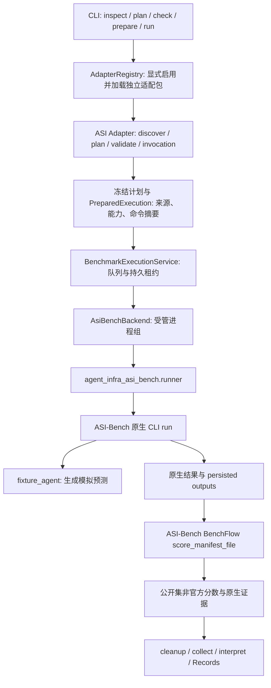

# ASI-Bench 适配与实际调用链

状态：已实现的 BM02-B 工程验收路径，基于当前 `main` 源码。本文解释代码如何运行，不把公开集 fixture 验收等同于真实 Agent 刷榜。可操作命令见[本地试运行手册](../operations/asi-bench-native-trial.md)；适配器的验收证据见[BM02-B 任务记录](../changes/20260922-benchmark-asi-bm02b-4d2c81.md)。

## 当前到底适配了什么

`adapters/asi-bench/` 是独立安装的 Python 包，通过 `adapters.toml` 显式启用。Agent Infra 核心只识别通用的 benchmark SDK、冻结计划、执行后端、资源租约和 Records 契约，没有按 `asi-bench` 名称写特殊分支。适配包负责把 ASI-Bench 的一个公开 `seed31415` instance 转为一个 WorkUnit，构造原生调用，解释原生评分，另提供 seed42 本地提交包生成入口。

目前的 profile 名为 `seed31415-single-fixture-v1`：一次只选一个公开 instance，候选 Agent 必须是 `fixture`、模型必须是 `none`，默认 prompt level 为 `b1`，不调用模型，不用 GPU；ASI-Bench 内部 `--sandbox none`，外层是宿主机受管进程，不是 Docker 隔离。它已验证“适配器 → 原生 runner → 公开评分 → 证据归档”的接线。当前既没有真实 Codex 路径，也没有完整套件、正式 seed42 运行、认证上传或官方成绩。

## 从用户命令到运行结果

以仓库自带的 `request.json` 为例：它选中 `math.sigma_linear_diophantine__seed31415`，指定 `fixture`、`none`、`b1`、`tasks_dir` 和 300 秒原生超时。`tasks_dir` 须先改为本机 ASI-Bench checkout 中的真实绝对路径。根包、适配包、锁定的 ASI-Bench 依赖及固定 Git revision 是前提；完整命令在试运行手册中。

1. **启用与发现。** `agent-infra benchmark adapters --config adapters/asi-bench/adapters.toml` 读取允许加载的 distribution、entry point、版本和 SDK 版本；`inspect --source INSTANCE_DIR asi-bench` 才加载适配包并调用 `Adapter.discover()`。它要求实例目录位于固定 revision 的 ASI-Bench checkout，选定材料没有本地修改，目录名以 `__seed31415` 结尾且含公开 `reference/`；同时核对已安装的 `asibench==0.1.5`。返回一个原生 instance 对应的 WorkUnit、suite/profile 和内容摘要。`adapters` 列表本身不运行 benchmark。
2. **规划与冻结。** `benchmark plan` 读取 `PlanRequest`，核心 `freeze_plan()` 调用 `discover()`、`Adapter.plan()` 和 `Adapter.validate()`，检查所选单元、候选、参数和 suite 未被适配器改写，然后生成 `FrozenPlan`。ASI 适配器声明一个 `native-produce-and-public-score` 阶段，后端 `asibench-native-v1`，本地 allocator、GPU 数为 0、外层墙钟预算为原生超时加 120 秒；材料分为求解可见的公开 instance，以及仅 grader/admin 使用的公开 task/scorer 与 scorer policy。它记录实例、上游 runner、task/scorer 和 policy 的摘要。规划只生成 JSON，不启动执行。
3. **离线兼容性检查。** `benchmark check --capabilities adapters/asi-bench/capabilities.json PLAN` 重新发现并冻结当前来源，比较摘要、适配器行为和精确的 `adapter × suite × runner × profile × agent × model × backend` 组合。仓库自带的能力声明只列 `fixture`。`compatible=true` 只说明声明与冻结计划匹配；CLI 明确返回 `runtime_ready=false`，不能据此声称 Docker、GPU 或真实 Agent 已可用。
4. **准备执行。** `benchmark prepare` 再次冻结计划，调用 `Adapter.invocation()` 写出 `PreparedExecution`。其中保存实际命令 `python -m agent_infra_asi_bench.runner <冻结的 Request JSON>`、工作目录、超时、取消宽限期和允许归档的输出路径。计划和执行文件都带摘要；输出须放在只读来源外，写入时不覆盖已有文件。`prepare` 仍不启动进程。
5. **提交、排队和资源准入。** `benchmark run --operation-id ... --capabilities ... --allow-native-runtime EXECUTION` 复核上述计划、命令及能力声明。CLI 入口调用 `BenchmarkExecutionService.submit()`，以 operation ID 幂等创建 run/attempt，存入持久 `RunControlStore`。它按 FIFO 检查持久租约容量，资源不足时保持 queued，超过已配置容量则结束为失败；准入后记录租约。声明中的 CPU/内存/GPU 是请求与准入记录，当前宿主机进程后端**没有 CPU/内存 cgroup 硬限额**。`--allow-native-runtime` 是明确接受此原生执行范围；对 ASI 而言再给 `--allow-host-process` 并不会让它切换到通用后端，实际选择由冻结阶段的 backend ID 决定。
6. **原生进程启动。** 核心通过适配器的 `execution_backend()` 取得 `AsiBenchBackend`。它继承受管进程后端，先持久记录启动意图，再由 supervisor 启动独立进程组；用本次 attempt ID、执行摘要和原生进程身份做重启对账。`runner.py` 启动前重新计算 instance、匹配 task/scorer 目录和公开 scorer policy 的摘要。摘要不符就拒绝继续。
7. **ASI-Bench 执行。** `runner.py` 调用真正的 `python -m ai4sci_bench.cli run`，传入原生 task ID、prompt level、实例与 tasks 路径、`--parallel 1`、`--retries 1`、原生超时、输出目录和固定 `--agent-cmd`。这个命令目前指向 `agent_infra_asi_bench.fixture_agent`，只写结构化空预测和一条模拟轨迹。ASI-Bench 自己组织 prompt、调用 agent 命令并持久化结果；Agent Infra 没有复制它的 prompt、gate 或 scorer 算法。这里的 `--sandbox none` 表示此次原生试运行没有容器沙箱。
8. **原生公开评分。** 适配器确认只找到一个原生结果，核对 task/instance/prompt 身份和预测目录。随后用原生持久化结果构造 BenchFlow schema-v2 manifest，调用 ASI-Bench 自己的 `score_manifest_file()`，写 `benchflow_manifest.json`、`benchflow_score.json` 和 `native-result.json`。这个 `seed31415` 公开分数标记为 `official=false`；原生 attempt 状态、执行状态、评分状态与官方提交状态分别保留。外层 runner 正常返回也不意味着原生 attempt 获得有效分数。
9. **清理、归档和查询。** 外层服务轮询进程输出和资源用量，写入 Records 的受限原始流。结束后必须确认本次进程组清理，才按 `NativeInvocation.outputs` 复制原生 result、persisted outputs、metadata、实例快照、BenchFlow 文件和摘要；复制时拒绝符号链接/特殊文件并受大小预算约束。临时 workspace 链接不进入归档。`Adapter.interpret()` 读取归档中的 `native-result.json`；只有 `official=false` 且 `official_score=null` 才把分数作为 `local_public_score` 暴露。Records 保存 run/attempt、事件、日志流、归档 artifact 和解释结果，最后释放租约。`benchmark status/events/artifacts` 可查询这些证据。

## 状态与恢复怎样看

一次 `benchmark run` 可能立即返回 `queued`、`running` 或 `finished`，不是同步保证有分数。`benchmark status` 或 `benchmark worker` / `reconcile` 推动未完成运行：先对账已持久化的启动意图和原生进程身份，避免丢失响应后重复启动；若身份、清理或收集无法确认，会保留占用并进入待对账/收集状态。只有清理确认且证据持久化成功才释放租约。应分别查看 `result.execution`、`result.evaluation`、`result.protocol`、`result.native_result.metrics.local_public_score`、`cleanup_complete`、`capture` 与 `missing_outputs`；“进程完成”不等于“评测有效”，更不等于“官方得分”。

运行状态写在 `--state-dir` 下的 `benchmarks/` 命名空间：控制状态、leases、native 进程日志/归档 spool、workspaces 和 Records 分开保存。`benchmark artifacts` 返回 Records 中的 `native-submission` 归档引用；`events` 提供外层执行生命周期事件。fixture 自带的 `_trajectory.jsonl` 是模拟文件，不能作为 Codex 原生轨迹或 RL 训练轨迹的验证证据。

## 正式刷榜还缺哪一段

当前配置不能把 `request.json` 中的 `agent` 改为 `codex` 就执行真实 Codex：`Adapter.validate()` 会拒绝，能力矩阵也没有该组合，`runner.py` 更是固定 fixture 命令。要形成真实刷榜 profile，需增加受审查的 Agent 命令/认证注入，按照 ASI-Bench 原生协议验证 prompt、工具、轨迹、恢复与超时；接入真实 `--sandbox os` Docker provenance 与实际资源限额/观测，并为对应版本和资源组合提供兼容性证据。完整套件需要批量选择和结果聚合，而当前执行契约只处理一个原子单元。

seed42 的[本地 bundle 入口](../../adapters/asi-bench/src/agent_infra_asi_bench/bundle.py)调用上游 `build_submission()` 校验原生结果及 OS Docker provenance，并生成本地提交目录；它不认证、不上传、不调用官方评分。后续真实运行、提交和官方反馈仍属于独立的扩展及验收工作。当前已验证的 0.0/100 是公开 fixture 的本地工程分数，不能当作排行榜成绩。

## 代码阅读入口

| 关心的问题 | 源码 |
| --- | --- |
| 包启用与 CLI 分发 | [`adapters.toml`](../../adapters/asi-bench/adapters.toml)、[`registry.py`](../../src/agent_infra/benchmarks/registry.py)、[`bootstrap/benchmarks.py`](../../src/agent_infra/bootstrap/benchmarks.py) |
| ASI 单元、材料、校验、命令、结果解释 | [`agent_infra_asi_bench/__init__.py`](../../adapters/asi-bench/src/agent_infra_asi_bench/__init__.py) |
| 冻结与兼容性 | [`planning.py`](../../src/agent_infra/benchmarks/planning.py)、[`execution.py`](../../src/agent_infra/benchmarks/execution.py)、[`capabilities.json`](../../adapters/asi-bench/capabilities.json) |
| 提交、排队、执行和 Records | [`bootstrap/benchmark_execution.py`](../../src/agent_infra/bootstrap/benchmark_execution.py)、[`runs/benchmark_execution.py`](../../src/agent_infra/runs/benchmark_execution.py) |
| 受管进程、上游 CLI 与 fixture | [`managed_process.py`](../../src/agent_infra/environments/managed_process.py)、[`runner.py`](../../adapters/asi-bench/src/agent_infra_asi_bench/runner.py)、[`fixture_agent.py`](../../adapters/asi-bench/src/agent_infra_asi_bench/fixture_agent.py) |
