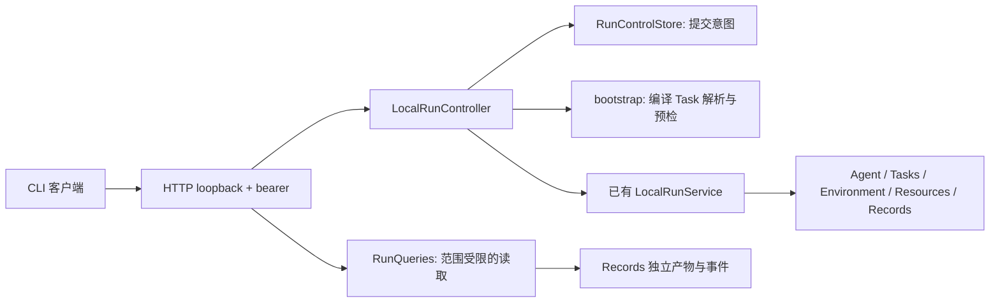

# D 批实现与维护说明

状态：本任务分支实现。适用于本机可信管理员；单进程、单活跃 Run、CPU / 内存容量控制。

## 一条请求经过哪些代码

| 文件 | 维护职责 |
| --- | --- |
| `bootstrap/controller.py` | 状态路径、资源容量、依赖组装、服务进程、私有 endpoint |
| `bootstrap/run_preflight.py` | 从 Projects 公共编译接口取得 Task；校验冻结材料、工具、资源、镜像、Agent 账号 |
| `runs/control_api.py` | 传输无关的请求和预检结果；可注入其他运行准备器 |
| `runs/control_store.py` | SQLite schema 1；操作 ID、Run/Attempt ID、请求指纹、取消意图、项目关联、终态 |
| `runs/controller.py` | 单 worker、幂等判断、动态准入、取消传播、崩溃对账；不实现推理循环 |
| `runs/host_lock.py` | 同一 OS 用户的主机级互斥与未清理状态标记，独立于 state-dir |
| `runs/service.py` | 原有求解、提交冻结、可选隔离评测、流与产物归档、清理、释放 |
| `runs/query.py` | Run 范围的事件、统一轨迹和 Artifact 成员查询；拒绝私有数据和任意路径读取 |
| `environments/recovery.py` | 本地镜像检查、根据持久归属日记验证并删除自有容器 |
| `environments/model_proxy.py` | 可关闭的模型 CONNECT 转发；随机认证、目标限制、进程内生命周期 |
| `gateways/http/control.py`、`gateways/cli/runs.py` | 协议适配、参数、认证、错误响应；不调度 Docker |

Runs 不导入 Projects。bootstrap 解析编译结果后传入 `PreparedRun`；关联信息进入命令存储和
Records 的 `RunManifest.request.lineage`。研究 context 的组装层查询命令库，不把运行状态复制进 Plan 快照。

原 `LocalRunService.run(request, agent)` 保持兼容。新增可选预分配 `run_id` / `attempt_id`，
以及 `RunRequest` 的模型、镜像 ID、冻结快照和 lineage 字段，避免产生第二套执行身份。
执行前再次核验 TaskSnapshot；容器实际使用预检固定的 image ID。

## 持久性与状态

`operation_id` 绑定规范化后的请求参数，SQLite 先提交 accepted，再启动线程。
相同请求重试不再预检或重复执行。worker 通过 accepted → running → finished / quarantined，
执行结果来自原 Run 服务；`cancel_requested` 是独立字段。
终态请求永久保留幂等关系，没有自动重试、隐式队列或新 Attempt。

资源预检调用新增 `LocalResourceManager.assess`：返回独立 `ResourceAssessment`，不制造虚假的 Lease。
开始执行时重新采样并通过原 `try_allocate` 建立真实 Lease。监控与分配由同一个 Controller 组装，
CPU 空闲率不是可承诺算力，实际 Docker cgroup 仍设置 CPU/内存硬上限。

## 重启如何处理

1. 取得 `/tmp/agent-infra-controller-<uid>/lock` 的 flock。另一状态目录也无法绕过同账户互斥。
2. 原子持久化 `owner.json`，记录状态目录及 dirty 标记。进程崩溃后 flock 自动释放，但 dirty 保留。
   若尝试用不同 state-dir 启动，明确要求先回到原目录恢复，防止丢失旧容器归属。
3. Environment 在 `docker create` 前写 ownership.json 并 fsync 文件及目录，持久区分 prepared、creating、created、removed。
4. 恢复只处理日记中的精确容器名，同时核验 owner label 和 image ID；按实际容器 ID 删除，再确认不存在。
   日记损坏、Docker 不可达或归属不匹配都会阻止接收新任务，不猜测“应该已经释放”。
   若 create 尚未得到确认且容器暂时不存在，保留隔离：Docker 请求可能仍在 daemon 中处理。
   不以一次空查询解除隔离；需要管理员核对原请求/daemon，或待对应容器出现后重新启动并完成清理。
5. 移除任务认证副本，把未收尾的 Attempt 标为 interrupted，记录 partial 轨迹及恢复清理证据。
   Records 已完成而命令库尚未完成的窗口保留已有执行结果，并单独记录恢复事实。
6. 对账成功后才允许新资源准入。不会恢复模型会话、重新执行提交或接管其他系统的容器。

同账户范围是首版本机管理员约束；不是跨 OS 用户的集群资源锁。当前 Controller 不授权任何 GPU，
后续 GPU allowlist 和多用户服务必须使用统一管理员进程或集中资源服务，不能为各账户独立启用 GPU 池。
不要手工删除 dirty 标记来绕过失败对账，也不要在旧 Controller 仍运行时删除其状态目录。

## 认证和结果的边界

镜像不包含认证。开始执行后，Codex Adapter 仅 staging `auth.json`，Run 使用独立副本；
复制文件和目录限制为当前用户可读，正常、失败、取消及恢复均清理副本。原用户配置、历史和 Skill 不被挂入。
Codex 使用外层容器隔离、忽略宿主机配置和规则；原始 stdout / stderr 与结构化事件进入 Records。
模型产生的文本不能被承诺自动识别全部秘密，使用范围仍是可信管理员和经过选择的任务输入。

本机验收发现宿主机 loopback 代理不能直接在 Docker bridge 内使用，因此增加模型连接适配。
Controller 可读取宿主机 HTTP 代理配置，按需创建认证转发，将连接变量仅传给求解进程。
不复制宿主机 Codex config.toml，不更改原代理绑定地址，TLS 仍由 Codex 与模型服务终止。
配置排查参照 [Codex 官方配置说明](https://developers.openai.com/codex/config-reference/)；
本仓库的代理行为以实现和真实连通性验收为准。

产物通过独立的内容 Blob 保存。下载只匹配同 Run 的可见 Artifact 及其 manifest 成员，
不给浏览器 Blob 任意地址或宿主机路径解析能力。私有评测与凭据分类不向这些接口返回。
控制服务首版仅执行 evaluation=none 的编译科研任务；原同步内核的隔离评测 API 保持可用。

## 如何扩展和验证

- 新 Provider：在 bootstrap 增加显式凭据/镜像兼容检查，继续使用 CommandAgentAdapter，不复制控制器。
- 新任务来源：通过 Tasks 冻结引用解析器组装 PreparedRun，保留摘要核验，不将路径读取权限直接下放 HTTP。
- 多活跃 Run / GPU：先改持久资源协调及恢复规则，不能只把 worker 数量调大。
- Web：调用既有控制 HTTP 接口；先解决新旧 Project catalog 的适配，不再写第三套 Run 状态。

自动测试见 `tests/unit/runs/test_controller.py`；真实 Docker 取消与 SIGKILL/重启见
`tests/e2e/test_controller_recovery.py`，明确使用 fixture，不调用模型。
真实 Codex 与数值结果的验收证据见[任务记录](../changes/20260918-local-run-controller-d73a91.md)。
