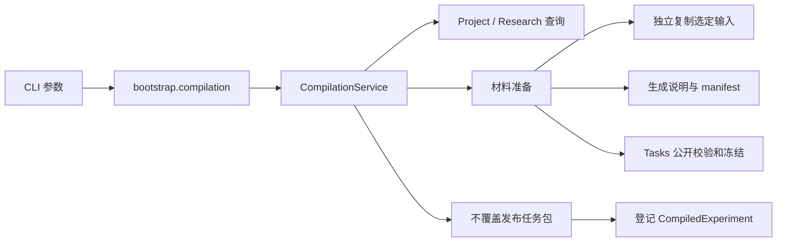

# 当前代码结构与科研工作流维护说明

状态：对应 A、B、C 批实现，C 批验证见[任务记录](../changes/20260918-experiment-compilation-c42d8e.md)。
这是实际源码导航；后续功能仍以[项目状态](../project-status.md)为准。

## 1. 一级模块边界

| 目录 | 当前职责 | 后续修改放在哪里 |
| --- | --- | --- |
| `bootstrap/` | 依赖组装、环境默认值、命令到业务调用的适配 | D 批 Controller 与执行服务的组装 |
| `gateways/` | CLI、HTTP 等协议输入输出 | 增加参数、响应、MCP 协议；业务规则留在模块内 |
| `projects/` | 项目身份、研究版本、采用决定、实验编译关联 | 科研流程与 Task/Run 的引用关系 |
| `tasks/` | 任务协议、材料可见性、检查、冻结及原生适配 | 新 benchmark、工具声明和评测协议 |
| `runs/` | 单次执行生命周期和跨模块协调 | D 批提交、取消、恢复与 Project 引用承接 |
| `agents/` | Codex、Claude Code、DSH 适配 | Provider 协议、事件和能力 |
| `environments/` | Docker 工作区、进程、提交收集与隔离 | 执行能力及后续长作业支持 |
| `resources/` | 监控、请求与本地 Lease | 持久调度、队列和节点扩展 |
| `records/` | 运行记录、原始轨迹和统一轨迹 | 执行证据及结果查询 |
| `contracts/` | 底层共享值和受控文件路径/摘要 | 只有确实被多模块共用且不含业务后端的内容 |
| `src/web/` | 展示与控制台交互 | W01 适配新 Project；目前仍使用旧 catalog |

依赖方向由 pyproject.toml/import-linter 检查。Projects 可以消费 Tasks/Resources 的公共接口，Tasks 不反向导入 Projects。
本轮没有调整一级目录、扩充依赖或批量搬迁其他模块；现有 Run、Agent、Web 实现保持原有职责。

## 2. Projects 按职责组织

```text
projects/
  api.py                   Project、初始化请求和错误
  research_api.py          不可变研究草稿及 revision
  compilation_api.py       CompiledExperiment 与跨模块 TaskReference 的组合
  service.py               初始化、查询、恢复
  research.py              保存、确认、上下文、检查、文档导出
  compiler.py              选择版本、协调准备/发布/登记、查询和验证
  relocation.py            用户移动目录后的显式重绑定
  local.py                 Project 元数据查询、兼容入口与存储组合
  _database.py             唯一连接、事务、schema 迁移和 writer 锁
  _research_store.py       研究版本、head、采用记录的 SQL
  _compilation_store.py    实验与 Task 的不可变关联 SQL
  _preparation.py          选定材料及执行配置转为可校验的任务包
  _materials.py            有界流式复制、文件类型检查与变动检测
  _task_rendering.py       研究内容到说明及 manifest 的确定性转换
  _filesystem.py           安全目录访问与不覆盖发布原语
  rendering.py             初始化模板
  research_rendering.py    研究文档投影
  skill.py + skills/       规划说明及项目内安装
```

存储重构将原 local.py 中的连接和研究 SQL 提取出来，但保留 `LocalProjectStore` 的原方法调用方式。
ResearchStore 和 CompilationStore 共用同一个 ProjectDatabase；没有第二个控制库或独立锁。
下划线文件是 Projects 内部实现，其他功能模块不应依赖其路径；bootstrap 可组合模块服务和后端。

## 3. 一次 compile 如何流动



compiler 先核对项目、已采用的研究版本和缺项，再创建私有 staging。
preparation 保留输入在求解工作区的相对路径，控制配置不会成为 solver-visible 材料。
tasks/settings.py 复用 manifest 的 YAML 和 section 校验，不在 Projects 复制解析规则。
发布成功后保存关系；查询列表只读元数据，resolve 进一步核对整个包和 TaskSnapshot。

## 4. 如何维护与验证

| 修改类型 | 主要文件 | 需要同步的验证 |
| --- | --- | --- |
| 研究字段变化 | research_api / rendering | 旧 JSON 摘要兼容、确认语义、Skill schema、编译消费者 |
| Task 转换规则 | _task_rendering / _preparation | 真实 Tasks loader/view/review/freeze，选中与未选中材料 |
| 存储字段变化 | _database + 对应 store | 旧库只读、事务升级、回滚与中断恢复 |
| 文件处理变化 | _materials / _filesystem | 链接、特殊文件、并发变动、复制预算与已有文件保护 |
| CLI 参数变化 | gateways/cli/projects + bootstrap | 跨进程 CLI、退出码、参考文档及独立 wheel 验收 |
| 运行能力变化 | runs/environments/resources | 放到 D/H 批，保留编译阶段无执行副作用 |

优先使用 `tests/unit/projects/test_compilation.py` 定位 C 批问题；存储拆分须同时跑原初始化和研究测试。
`scripts/acceptance/project_compilation.py` 使用真实 CLI 和小材料，`smoke_wheel.py` 在仓库外安装后复用相同验收。
Run 关联由 D 批 bootstrap 解析冻结引用、验证内容，再调用既有 LocalRunService。
调用链与维护入口见 [Controller 实现说明](local-run-controller.md)，没有在 Projects 内另建执行器。
编译输出的 execution_validated=false 表示尚未运行；D 批 CLI context 的 run_references 来自实际控制记录，
不能用模拟结果代替执行证据。Projects 领域服务本身不负责查询 Controller。
