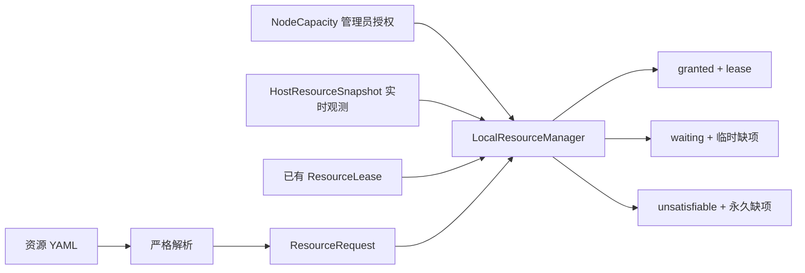

# Resources 模块实现解读

状态：解读当前 `main` 已实现的资源请求、宿主机观测、单节点进程内租约及其 Docker
落地；持久化队列、Ray backend、GPU 工作负载验证与多节点控制仍未实现。

## 1. Resources 到底负责什么

Resources 回答三个问题：任务想要多少资源、节点现在是否能安全接收任务、最终为任务保留了哪些资源。它不负责创建 Docker，也不决定任务失败后是否重试。

当前实现把资源判断拆成四类事实：

1. `ResourceRequest`：任务声明的需求；
2. `NodeCapacity`：管理员允许平台使用的资源上限；
3. `HostResourceSnapshot`：宿主机当前观测；
4. `ResourceLease`：平台已经承诺给其他任务的资源。

调度时必须同时看这四类信息。机器有 4 张 GPU，并不表示平台被允许使用全部 4 张；GPU 利用率为 0，也不表示它没有被租给一个尚未启动的 Attempt；平台没有租约，也不表示 GPU 没有被宿主机上的外部进程占用。



## 2. 代码放在哪里

| 文件 | 作用 |
| --- | --- |
| `src/agent_infra/resources/api.py` | 请求、容量、快照、租约、决策和公共协议 |
| `src/agent_infra/resources/config.py` | 把 version 1 YAML 严格转换成 `ResourceRequest` |
| `src/agent_infra/resources/monitor.py` | 只读采集 Linux CPU、内存和 NVIDIA GPU 状态 |
| `src/agent_infra/resources/local.py` | 单节点并发安全准入与进程内租约 |
| `src/agent_infra/bootstrap/cli.py` | 组装 monitor 和 YAML loader |
| `src/agent_infra/gateways/cli/main.py` | `resource inspect/validate` 的薄 CLI 入口 |
| `examples/resource-requests/single-gpu.yaml` | 当前资源请求格式的可执行样例 |

Resources 模块没有导入 Docker 或 Ray。当前 Run 把 lease 交给独立的 Environment 转成容器
限制；以后 Ray 调度后端也应返回相同的 lease 语义。

## 3. YAML 如何变成 ResourceRequest

一个当前可接受的请求如下：

```yaml
version: 1
request_id: train-001
resources:
  cpu: 3
  memory: 16GiB
  gpu:
    count: 1
    min_memory: 20GiB
    vendor: nvidia
placement:
  node_labels:
    pool: research
queue:
  wait_timeout: 30m
```

`load_resource_request()` 的处理顺序是：

1. 以 UTF-8 读取，拒绝超过 1 MiB 的配置；
2. 用 SafeLoader 解析，并额外遍历 YAML AST 拒绝重复 key；
3. 要求根节点是 mapping，版本必须是 1；
4. 在 root、resources、gpu、placement、queue 每层拒绝未知字段；
5. 把 CPU 转成正浮点数，把内存和显存转成 bytes；
6. 把等待时间转成秒，把 labels 排序成不可变 tuple；
7. 构造 `GpuRequest` 和 `ResourceRequest`，再次执行对象级不变量检查。

严格拒绝未知字段很重要。例如误写 `gpus: 1` 时，系统会报错，不会静默当成“不需要 GPU”后启动错误任务。内存要求显式单位，支持十进制 `GB` 和二进制 `GiB` 等形式；裸整数不会被猜测成 bytes。等待时间支持秒、分、时、天。

`device_ids` 用于任务必须固定到具体 GPU UUID 的场景。只写设备列表时，`count` 默认等于列表长度；两者同时存在时数量必须一致，且 UUID 不能重复。

可以用以下命令只做解析和验证：

```bash
agent-infra resource validate examples/resource-requests/single-gpu.yaml
```

该命令不分配资源，也不会启动任务。

## 4. 三种资源视图为什么不能合并

### 4.1 NodeCapacity：平台被授权使用的上限

`NodeCapacity` 是管理员配置，不是 monitor 自动发现的全部硬件。它包含 node ID、可分配 CPU、内存、GPU 清单和 labels。这样可以把一部分机器资源留给系统、其他用户或其他调度器。

`update_snapshot()` 会检查授权 CPU 和内存没有超过观测硬件，并要求 snapshot 来自同一个 node。GPU 授权则使用稳定 `device_id`，分配时再与观测数据交叉核对。

### 4.2 HostResourceSnapshot：这一刻实际看到什么

`HostResourceSnapshot` 带时区时间戳，记录逻辑 CPU 数、区间 CPU 利用率、1 分钟 load average、物理内存、`MemAvailable`、GPU 观测和采集问题。

快照必须有时间，因为旧数据不能继续用于分配。当前 `LocalResourceManager` 默认只接受 15 秒内的快照；未来节点服务需要周期更新，而不是每次使用历史 JSON。

### 4.3 ResourceLease：平台已经承诺了什么

`ResourceLease` 是一次 all-or-nothing 预留，包含 lease ID、request ID、node ID、CPU、内存、GPU UUID 和创建时间。lease 表达调度承诺，不等同于当前利用率。某个训练任务刚拿到 lease、容器还没开始占 GPU 时，其他任务也不能再次拿到同一设备。

当前 lease 只保存在 Python 进程内存中，进程重启会丢失。这足以验证单机算法，不满足生产恢复需求；后续 Run/Records 必须持久化并与实际容器状态对账。

## 5. 宿主机监控如何工作

`LinuxHostResourceMonitor.sample()` 依次读取 CPU、内存、GPU 和 load average，构造不可变 snapshot。

### 5.1 CPU

CPU 数据来自 `/proc/stat` 的累计 tick。第一次采样只能保存基线，所以 `cpu_utilization_percent` 为 `None`；第二次用总 tick 增量和 idle 增量计算区间利用率。当前 CLI 为了显示该值，会复用同一个 monitor 采样两次，中间等待 0.1 秒。

CPU 利用率用于展示和告警，不直接减少可调度 CPU。平台 CPU 可分配量按“管理员授权 CPU 减去已有 lease”计算，否则短暂的低利用率会导致超卖。

### 5.2 内存

内存来自 `/proc/meminfo` 的 `MemTotal` 和 `MemAvailable`。准入时取以下两者的较小值：

```text
授权内存 - 已租内存
当前宿主机 MemAvailable
```

因此既不会突破平台配额，也会避开宿主机外部进程正在消耗的内存。

### 5.3 GPU

monitor 执行两次只读 `nvidia-smi` 查询：第一次读取 index、UUID、名称、总/空闲显存和利用率；第二次按 GPU UUID 统计 compute process。

GPU UUID 是 lease 使用的稳定标识，index 只用于展示。`nvidia-smi` 不存在或查询失败时，snapshot 会带明确 issue。尤其当进程查询失败时，`compute_process_count` 是 `None`，不会谎报为 0；分配器要求它严格等于 0，所以这种不确定状态会停止新的 GPU 分配，即 fail closed。

```bash
agent-infra resource inspect
```

该命令只读宿主机，不创建 lease。当前实现仅覆盖 Linux 和 NVIDIA；AMD、MIG 及容器 cgroup 统计需要单独 backend 或扩展。

## 6. LocalResourceManager 如何作出决定

### 6.1 所有状态修改共用一把锁

snapshot 更新、准入、lease 写入和释放都受 `threading.Lock` 保护。一次请求从检查可用量到写入 lease 在同一临界区内完成，所以两个并发线程不能同时看到同一份剩余资源并造成超卖。

这是单进程并发安全，不是多进程或多节点锁。服务化后需要持久化事务或由单一 actor/调度服务串行化决策。

### 6.2 先判断永久不可能，再读取实时状态

`try_allocate()` 首先调用 `_capacity_shortages()`：

- node labels 不匹配；
- CPU 超过授权总量；
- 内存超过授权总量；
- 授权 GPU 中符合 vendor、总显存和指定 UUID 的数量不足。

这些情况即使一直等待也不会改变，因此返回 `UNSATISFIABLE`。上层应提示 Agent 或用户修改 YAML，或选择其他节点，而不是进入无期限队列。

### 6.3 没有新鲜快照时等待

如果永久容量允许，但快照缺失、超过默认 15 秒或时间戳来自未来，则返回 `WAITING`，短缺项为 telemetry。当前 `LocalRunService` 直接返回 waiting，不在进程内排队；后续队列服务再根据 `wait_timeout_seconds` 控制重试和最终超时。Local manager 自己不 sleep，也不隐藏内部队列。

### 6.4 计算临时剩余量

有新鲜快照后，分配器求和所有 active lease 的 CPU 和内存，并收集其 GPU UUID：

- 可用 CPU = 授权 CPU - 已租 CPU；
- 可用内存 = min(授权内存 - 已租内存, `MemAvailable`)；
- GPU 候选必须在授权清单、满足 vendor/总显存/显式 UUID、不在 lease 中、有观测、空闲显存达标，并且 compute process 数严格为 0。

GPU 候选按授权清单顺序取前 `count` 个。任意一类资源不足都返回 `WAITING`，而且不预留其中一部分。只有 CPU、内存和全部 GPU 同时满足，才生成 `ResourceLease`。

### 6.5 请求和释放的幂等性

同一个 `request_id` 以完全相同请求重试，会返回原 lease，避免网络重试重复占用。相同 ID 对应不同内容会直接报错，防止调用方意外修改已提交请求。

`release(lease_id)` 第一次成功返回 `True`，再次释放返回 `False`。这让清理流程可以安全重试。但业务上只有 Environment 已确认进程和容器停止后，Run 才应调用 release；当前 manager 无法自己证明清理已经完成。

## 7. 三种决策在上层如何处理

| 状态 | 意义 | 后续 Run 应采取的动作 |
| --- | --- | --- |
| `GRANTED` | 获得完整 lease | 把 lease 交给 Environment；启动失败也进入清理流程 |
| `WAITING` | 总容量可满足，但快照、租约或外部占用暂时不允许 | 在 YAML 的等待期限内监听或重试，超时后结束 Attempt |
| `UNSATISFIABLE` | 这个节点授权容量永远装不下 | 立即停止等待，返回结构化缺项或尝试其他节点 |

`ResourceShortage` 同时保存资源名、请求值、当前可用值和原因，避免上层只能显示笼统的“资源不足”。`AllocationDecision` 还检查只有 `GRANTED` 才能携带 lease。

## 8. lease 如何落到 Docker

`LocalRunService` 把同一份 lease 传入 `SandboxSpec`，`DockerEnvironment` 将其落实为：

- `cpu_cores` → Docker NanoCPUs 或 CFS quota；
- `memory_bytes` → hard memory limit 和明确的 swap policy；
- `gpu_device_ids` → NVIDIA DeviceRequest，仅暴露选中的 UUID；
- task workspace 与 Agent 私有配置 → 任务拥有的白名单 mounts。

容器创建后会 inspect，核对内存、NanoCPUs 和 GPU DeviceRequest 与 lease 一致。创建失败、
限制不一致、OOM、取消和清理错误保持不同状态。Run 只有确认全部任务容器移除后才释放
lease；清理结果不确定时保留租约。

Resources 不接收第二套 Docker 资源配置，Environment 也不应自行重新选择 GPU；否则 YAML 申请、调度 lease 和物理限制可能互相矛盾。

## 9. Ray 后续接在哪里

Ray 的作用是多节点的逻辑资源预留、节点选择、派发和故障通知。它不会替代本机 `/proc`/GPU 观测，也不会替代 Docker 的物理限制。

预期结构是让 `RayResourceManager` 实现 `resources/api.py` 中的 `ResourceManager` 协议，继续接收 `ResourceRequest` 并返回同样的 `AllocationDecision`。Ray 把 supervisor 派到目标节点后，节点侧仍要核对真实 GPU UUID、外部进程和快照，再由 Environment 创建容器。

当前仓库没有 Ray 依赖、Ray backend、集群启动命令或两节点验证。因此 `resource inspect` 和 `LocalResourceManager` 的存在不能被理解为多节点已经可用。多节点认证、私网、节点加入与故障恢复方案见[资源管理架构设计](../architecture/resource-management.md)。

## 10. 当前测试证明了什么

`tests/unit/resources/` 覆盖：

- 正确解析单位、labels 和等待时间；
- 拒绝未知字段、重复 YAML key 和模糊单位；
- CPU 两次采样、内存、GPU 指标及进程计数；
- `nvidia-smi` 缺失和进程查询失败时的诚实降级；
- grant/retry/release 幂等；
- 永久不足、外部 GPU 占用和过期快照；
- 并发请求不会突破授权 CPU；
- 同 request ID 配不同需求时拒绝。

Resources 单元测试本身是确定性算法与只读观测证据。另有 Run/Environment 端到端测试在
真实 Docker 中验证 CPU/内存配置和资源释放；它没有占用真实 GPU、重启持久化服务或建立
Ray 集群。

## 11. 阅读代码的建议顺序

1. 先读 `resources/api.py`，分清 request、capacity、snapshot、lease 和 decision。
2. 读 `config.py`，看不可信 YAML 如何进入强类型对象。
3. 读 `monitor.py`，理解观测值从哪里来以及失败时如何表达。
4. 读 `local.py` 的 `try_allocate()`，沿永久容量、新鲜度、临时余量到 lease 的顺序阅读。
5. 对照 `tests/unit/resources/` 验证边界条件。
6. 阅读[Run/Environment 实现说明](../reference/run-environment.md)，看 lease 如何进入 Docker。
7. 最后读[资源管理架构设计](../architecture/resource-management.md)，理解 Ray 为什么是后续
   adapter，而不是塞进当前 manager。
